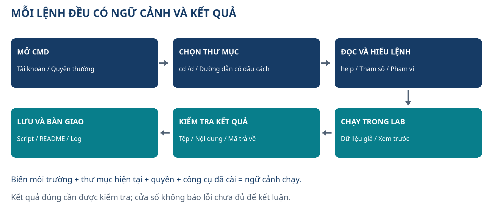

# Bắt đầu từ đây: dùng CMD tự tin trên máy Windows

Bạn có thể bắt đầu từ việc chưa nhớ cách mở cửa sổ lệnh. Cẩm nang này hướng dẫn **CMD trên Windows**, từ di chuyển trong thư mục, xem và xử lý tệp, đến đọc lỗi, viết file `.cmd`/`.bat` và tổ chức công việc có thể chạy lại. Mỗi phần trả lời ba câu hỏi: làm việc gì, vì sao cần làm, và kiểm tra bằng cách nào.

“Master” trong mục tiêu học được hiểu là tự giải quyết được những tình huống thực tế, biết tra cứu và biết giới hạn của công cụ. Một tài liệu không thể bảo đảm trình độ chỉ bằng việc đọc hết. Bạn cần tự thực hành, sửa lỗi, giải thích được script của mình và hoàn thành các dự án ở chương 25–27.

## Dùng máy nào và cần cài gì?

Lộ trình chính dùng **Windows 11 còn được hỗ trợ**. CMD có sẵn trong Windows: bạn không cần tải một ứng dụng “CMD master” từ Internet. Phần cơ bản không yêu cầu quyền quản trị, tài khoản GitHub, SQL Server, Node.js hay kết nối mạng. Một số chương mở rộng dùng các công cụ ngoài CMD; chương đó ghi riêng điều kiện cài đặt.

Windows 10 đã kết thúc hỗ trợ thông thường ngày 14/10/2025. Các chương trình Extended Security Updates và các phiên bản LTSC có điều kiện, thời hạn riêng. Nếu đang dùng Windows 10, phần lớn lệnh nền tảng vẫn áp dụng, nhưng việc còn chạy được lệnh không chứng minh hệ điều hành còn được hỗ trợ. Tham khảo trang vòng đời Microsoft và chính sách máy của công ty.

Nếu máy dùng macOS hoặc Linux, Terminal trên máy đó thường chạy một shell khác. Bạn có thể đọc để hiểu, nhưng không chạy nguyên lệnh CMD trong Bash/Zsh. CMD, PowerShell và cửa sổ Windows Terminal được phân biệt từ chương 1.

## Bộ tài liệu và bài thực hành

| Tệp | Dùng khi nào? | Điều cần biết |
|---|---|---|
| Cam-nang-CMD-Windows.docx | Đọc, ghi chú và chỉnh sửa trong Word | Có mục lục và đề mục để tra cứu |
| Cam-nang-CMD-Windows.pdf | Đọc nhanh hoặc in | Giữ bố cục cố định |
| Bo-thuc-hanh-CMD.zip | Chạy bài tập trên Windows | Giải nén rồi đọc README.md trước |
| Cam-nang-CMD-Windows.md | Đọc trực tiếp trên GitHub | Có thể tìm từ ngay trong trình duyệt |

Bộ thực hành tạo dữ liệu giả trong **`%USERPROFILE%\CMD-Lab`**. `%USERPROFILE%` là biến môi trường trỏ đến thư mục hồ sơ của tài khoản Windows hiện tại, chẳng hạn `C:\Users\Lan`. Bạn không thay tên người dùng trong từng lệnh: CMD tự mở rộng biến. Không đổi đường dẫn lab sang thư mục công việc hoặc một thư mục sao lưu đang có dữ liệu thật.

Bộ kit dùng CMD cho các bài học; một helper gọi **Windows PowerShell** có sẵn trên Windows 11 để kiểm tra marker và các liên kết thư mục trước khi thay đổi tệp. Đây là hai công cụ khác nhau phối hợp với nhau. Những phần dùng PowerShell được ghi rõ; không có nghĩa lệnh PowerShell trở thành lệnh nội bộ của CMD.

## Buổi học đầu tiên: làm theo từng bước

1. Tải file Word hoặc PDF và file ZIP về máy. Nếu trình xem trước báo không đọc được tệp, dùng nút tải trực tiếp hoặc đường dẫn GitHub ở cuối câu trả lời; không cần mở được xem trước mới tải được.
2. Trong File Explorer, mở Downloads, bấm phải ZIP và chọn **Extract All / Giải nén tất cả**. Chọn một thư mục riêng, ví dụ `C:\Users\Lan\Downloads\Bo-thuc-hanh-CMD`. Không chạy script ngay bên trong cửa sổ xem ZIP.
3. Mở `README.md` bằng Notepad hoặc ứng dụng đọc Markdown. Đọc mục “Chạy lần đầu” và xem nội dung `00-create-lab.cmd` trước khi chạy. File `.cmd` là chương trình lệnh, không phải một trang tài liệu.
4. Bấm **Win+R**, gõ `cmd`, nhấn Enter. Đây là CMD thường, không cần Run as administrator cho lab.
5. Trong Explorer, bấm vào thanh địa chỉ của thư mục vừa giải nén, sao chép đường dẫn. Ví dụ dưới đây dùng một đường dẫn minh họa: thay phần đường dẫn bằng vị trí thật của bạn.

```bat
cd /d "C:\Users\Lan\Downloads\Bo-thuc-hanh-CMD"
dir /b
```

`cd /d` đổi cả thư mục lẫn ổ đĩa. Dấu ngoặc kép giữ một đường dẫn có khoảng trắng thành một đối số. Sau `dir /b`, bạn cần nhìn thấy `00-create-lab.cmd` và các tệp đi kèm. Nếu không thấy, đang đứng sai thư mục hoặc ZIP chưa được giải nén như dự kiến.

6. Gõ lệnh khởi tạo rồi nhấn Enter:

```bat
00-create-lab.cmd
echo %ERRORLEVEL%
```

Đọc thông báo ngay sau lần chạy. Số `0` là thành công của script khởi tạo; mã khác `0` cần đọc thông báo lỗi trước khi tiếp tục. `echo %ERRORLEVEL%` ở đây được nhập trên một dòng riêng ngay sau script. Cách lấy mã lỗi trong một khối ngoặc của file batch có quy tắc khác, học ở chương 19–21.

7. Kiểm tra thư mục lab bằng lệnh đọc:

```bat
dir "%USERPROFILE%\CMD-Lab"
tree "%USERPROFILE%\CMD-Lab" /f
```

8. Quay về cửa sổ tài liệu, học chương 1–5. Chỉ chạy bộ tổng hợp `07-run-all.cmd` sau khi đã hiểu các script thành phần và đọc README. Bản sao lưu demo có bước xem trước và bước áp dụng riêng.

Nếu Windows hoặc công cụ bảo vệ máy hiển thị cảnh báo, đọc đúng tên tệp và nguồn tải. Trên máy công ty, quyền chạy script có thể bị giới hạn bởi chính sách; không tắt bảo vệ hoặc tự sửa chính sách toàn máy để làm bài. Có thể tiếp tục các lệnh đọc của chương đầu trong khi xử lý quyền theo quy trình của đơn vị.

## Cách biết đang gõ lệnh ở đâu

Một dòng như `C:\Users\Lan>` là **dấu nhắc**, thể hiện vị trí hiện tại. Phần `>` cuối dòng là giao diện, không phải ký tự phải gõ trước mọi lệnh. Các khung mã trong tài liệu chỉ chứa nội dung cần nhập.

Các khung `bat` là lệnh CMD hoặc nội dung file batch. Đọc câu ngay trước khung: “nhập trực tiếp” khác với “lưu thành file”. Trong cửa sổ CMD, vòng lặp dùng `%A`; trong file `.cmd`/`.bat`, dùng `%%A`. Khung có tên PowerShell phải chạy theo hướng dẫn PowerShell, không dán nguyên vào CMD.

Không dán một khối lệnh chưa hiểu lên máy có dữ liệu thật. Với bài đầu, nhập từng dòng và quan sát. Khi dùng file `.cmd`, đọc bằng **Edit / Notepad** trước; bấm đúp file sẽ chạy nó. Để xem phần mở rộng tệp trên Windows 11, dùng **View → Show → File name extensions** trong Explorer. Khi lưu script bằng Notepad, chọn **Save as type: All files**, để tránh tên thực tế trở thành `demo.cmd.txt`.

## Thứ tự học để không bị ngợp

| Chặng | Chương | Mốc hoàn thành |
|---|---|---|
| Từ mức 0 | 1–8 | Tự mở CMD, đi đến đúng thư mục, tạo/xem/tìm tệp giả |
| Dùng máy hằng ngày | 9–16 | Đọc tiến trình, mạng, log, PATH và chẩn đoán lỗi có căn cứ |
| Viết script | 17–24 | Đối số, điều kiện, vòng lặp, mã lỗi, log và lịch chạy |
| Làm dự án | 25–28 | Bàn giao inventory, backup demo, workflow dữ liệu có kiểm tra |
| Luyện thành thạo | 29–30 | Lộ trình 90 ngày, đề tự kiểm tra và bảng tra cứu |

Một buổi học 30–45 phút có thể gồm 10 phút đọc, 20 phút làm và 5–15 phút ghi kết quả. Đừng cố thuộc mọi tham số; hãy nhớ câu hỏi cần giải quyết và cách mở `help`, `ten-lenh /?`, hoặc tài liệu chính thức.

## Luồng làm việc với một lệnh CMD



Lệnh được thực hiện trong một ngữ cảnh: tài khoản nào, thư mục hiện tại nào, biến môi trường nào, quyền gì. Khi cùng một script chạy được bằng tay nhưng lỗi trong Task Scheduler, cần kiểm tra ngữ cảnh này trước khi sửa nội dung lệnh.

## Mức độ kiểm tra của bộ tài liệu

Cú pháp và các quy tắc quan trọng được đối chiếu với tài liệu Microsoft. Bộ thực hành đã vượt qua kiểm thử bằng CMD và Windows PowerShell trên **Windows Server 2025 qua GitHub Actions**: khởi tạo, chạy lại, tìm kiếm, backup, mã lỗi, giữ tệp đã sửa/chỉ đọc và từ chối liên kết thư mục. [Xem lần kiểm thử thành công](https://github.com/nix6242/DQY/actions/runs/38132486347).

Kiểm thử này áp dụng cho bộ kit đi kèm, không phải mọi ví dụ và thao tác giao diện trong sách. Windows Server dùng trong kiểm thử và Windows 11 trên máy bạn có khác biệt về giao diện, quyền và chính sách. Hãy thực hiện các bài trong lab, đọc mã lỗi và đối chiếu kết quả; Task Scheduler, công cụ cài riêng và quyền quản trị cần kiểm tra trên máy thực tế.

Trong Word, mở **View → Navigation Pane** để đi theo đề mục, dùng Ctrl+F để tìm lệnh. Mục lục có liên kết; nếu tự chỉnh nội dung hoặc đổi cỡ chữ, cập nhật mục lục trong Word. Trong PDF, dùng bookmarks hoặc mục lục và Ctrl+F. Các đường dẫn nguồn ở cuối sách giúp đối chiếu khi Windows cập nhật.


# Chương 1. Từ mức 0: CMD là gì và bạn đang gõ lệnh vào đâu?

## 1.1. Hiểu công cụ trước khi học lệnh

CMD, tên đầy đủ là Command Prompt, là trình thông dịch lệnh có sẵn trên Windows. Bạn viết một yêu cầu bằng chữ, nhấn Enter, Windows thực hiện yêu cầu rồi trả lại kết quả. Chẳng hạn, thay vì mở File Explorer để nhìn danh sách tệp, bạn có thể dùng `dir`. Thay vì bấm qua nhiều thư mục, bạn có thể dùng `cd`. Khi cần làm một công việc nhiều lần, bạn ghi các lệnh vào tệp `.cmd` hoặc `.bat` để chạy lại.

Học CMD giúp bạn làm việc nhanh hơn với tệp, đọc thông tin máy, tìm lỗi và tự động hóa những việc nhỏ. Với người học SQL, Power BI, Postman hoặc GitHub, CMD còn giúp kiểm tra công cụ đã cài, chạy chương trình và lưu kết quả xử lý vào tệp. Bạn không cần thuộc hàng trăm lệnh ngay. Hãy bắt đầu bằng ba câu hỏi: **tôi đang ở thư mục nào, lệnh này đọc hay thay đổi dữ liệu, kết quả đúng phải trông như thế nào?**

CMD không tự hiểu ý định của bạn. Nếu bạn chỉ nhầm tệp đích, công cụ vẫn có thể thực hiện chính xác câu lệnh sai đó. Thói quen kiểm tra đường dẫn trước khi thao tác quan trọng hơn tốc độ gõ.

## 1.2. Phân biệt bốn tên thường bị nhầm

| Công cụ | Vai trò thực tế | Ví dụ dễ nhận biết |
|---|---|---|
| CMD / Command Prompt | Đọc và chạy cú pháp lệnh truyền thống của Windows | `dir`, `cd /d`, `set` |
| PowerShell | Shell và ngôn ngữ tự động hóa khác, làm việc tốt với đối tượng và API Windows | `Get-ChildItem`, `$env:USERPROFILE` |
| Windows Terminal | Ứng dụng chứa các tab dòng lệnh; mỗi tab có thể chạy một shell khác nhau | Tab Command Prompt, tab PowerShell |
| Bash | Shell phổ biến trên Linux, WSL hoặc Git Bash | `ls`, `export`, `$HOME` |

Hãy hình dung Windows Terminal là căn phòng, còn CMD và PowerShell là những người phiên dịch khác nhau trong phòng đó. Đổi màu nền hoặc mở một tab mới không tự biến cú pháp PowerShell thành cú pháp CMD. Cùng một yêu cầu xem thư mục, hai shell có thể nhận những câu lệnh khác nhau.

Trong cuốn sách này, khối lệnh ghi `bat` được viết cho **CMD trên Windows**. Khi có ví dụ cần PowerShell, tài liệu sẽ chỉ rõ. Nếu bạn đang ở PowerShell, mở tab **Command Prompt** rồi làm bài CMD. Không cần gỡ PowerShell; cả hai công cụ đều có ích.

Các hướng dẫn chính dùng Windows 11. Với Windows 10, nhiều lệnh vẫn hoạt động, nhưng việc hệ điều hành còn được hỗ trợ và cập nhật là vấn đề riêng. Khi dùng máy công ty, hãy theo phiên bản và quyền truy cập do bộ phận IT quản lý.

## 1.3. Đọc một cửa sổ CMD

Một cửa sổ thường có dòng tương tự `C:\Users\An>`. Phần trước dấu `>` cho biết vị trí hiện tại. Bạn gõ **sau** dấu đó. Trong sách, các khối lệnh đã bỏ dấu nhắc để bạn sao chép thuận tiện:

```bat
ver
whoami
hostname
```

Nhập từng dòng, nhấn Enter sau mỗi dòng:

1. `ver` cho biết thông tin phiên bản Windows mà CMD báo cáo.
2. `whoami` cho biết tài khoản đang chạy cửa sổ này.
3. `hostname` cho biết tên máy.

Bạn không cần gửi các kết quả này lên mạng để hoàn thành bài. Tên máy và tên tài khoản có thể khác các ảnh minh họa. Sự khác nhau đó bình thường; điều cần kiểm tra là lệnh chạy được và có đầu ra phù hợp.

Nếu CMD hiển thị `'...' is not recognized as an internal or external command`, hãy đọc chính xác tên bị báo lỗi. Bạn có thể gõ sai, dùng cú pháp của shell khác, hoặc chưa cài chương trình đó. Thông báo này không có nghĩa rằng mọi thứ trên máy đã hỏng.

## 1.4. Một câu lệnh thường có những phần nào?

Ví dụ:

```bat
dir /b "%USERPROFILE%\CMD-Lab"
```

`dir` là tên lệnh. `/b` là tùy chọn yêu cầu kết quả ngắn. Phần trong dấu ngoặc kép là đường dẫn. `%USERPROFILE%` là biến môi trường trỏ tới thư mục hồ sơ của tài khoản hiện tại; CMD thay nó bằng đường dẫn thật trước khi xử lý.

Bạn có thể gọi một lệnh tích hợp trong CMD như `dir`, hoặc gọi một chương trình như `git.exe`. Lệnh tích hợp không nhất thiết có một tệp `.exe` riêng. Chương trình bên ngoài phải có trên máy và được tìm thấy qua đường dẫn phù hợp. Vì vậy, cài CMD không đồng nghĩa đã cài Git, Python, Node.js hoặc SQL Server.

Trong phần trợ giúp, chữ như `filename` hay `path` thường là tên chỗ cần thay bằng giá trị của bạn. Không gõ nguyên `filename` nếu bạn muốn đọc `notes.txt`. Dấu ngoặc vuông trong cú pháp thường biểu thị phần tùy chọn; dấu này không phải lúc nào cũng được gõ vào lệnh thật.

## 1.5. Cách học tạo ra kỹ năng sử dụng được

Mỗi bài nên đi qua bốn bước: đọc mục đích, đoán kết quả, chạy trong thư mục thực hành, rồi kiểm tra. Ghi một câu ngắn giải thích kết quả bằng lời của bạn. Sau vài ngày, hãy làm lại bài mà không nhìn đáp án.

Bạn sẽ dùng thư mục riêng `%USERPROFILE%\CMD-Lab`. Bộ thực hành đi kèm có tệp `00-create-lab.cmd` để chuẩn bị lab. Giữ bộ script đã tải ở một thư mục khác; script sẽ tạo thư mục lab trong hồ sơ người dùng. Không cần quyền quản trị. Nếu đã có một thư mục cùng tên chứa dữ liệu riêng, đọc README của bộ thực hành trước khi chạy; đừng tự xóa nó để “bắt đầu lại”.

Ở những chương đầu, các tệp mẫu chứa chữ không dấu như `Status: Ready`. Điều này giúp bạn tập trung vào cú pháp. Việc tiếng Việt, bảng mã và ký tự đặc biệt được giải thích riêng ở phần sau.

**Bài tập:** viết bằng lời của bạn sự khác nhau giữa CMD và Windows Terminal; mở đúng CMD; chạy ba lệnh thông tin ở trên; xác định tên tài khoản và tên máy trên đầu ra.

**Tiêu chí đạt:** bạn biết Terminal là ứng dụng chứa shell, biết mình đang dùng CMD, và không sao chép phần dấu nhắc `C:\...>` vào câu lệnh. Bạn cũng hiểu rằng một câu lệnh thành công chưa chứng minh máy đã được cấu hình đầy đủ cho mọi công việc.

# Chương 2. Mở CMD đúng cách, đọc trợ giúp và dùng quyền phù hợp

## 2.1. Cách mở đơn giản nhất

Nhấn **Windows + R**, nhập `cmd`, nhấn Enter. Cửa sổ mở ra thường chạy bằng quyền của tài khoản hiện tại. Đây là cách phù hợp cho các bài học đọc thông tin, tạo tệp trong hồ sơ cá nhân và viết script lab.

Bạn cũng có thể mở Start, tìm **Command Prompt** hoặc `cmd`, rồi chọn kết quả tương ứng. Nếu Windows Terminal là ứng dụng dòng lệnh mặc định, cửa sổ có thể mang giao diện Terminal. Điều quan trọng là shell bên trong phải là Command Prompt.

Trong Windows Terminal, bấm mũi tên cạnh nút mở tab, chọn **Command Prompt**. Nếu tab hiện tại là PowerShell, đừng chỉ dựa vào nền màu đen để nhận diện. Nhìn tên tab và cú pháp đang dùng. Dấu nhắc PowerShell mặc định thường có tiền tố `PS`, nhưng dấu nhắc có thể được tùy chỉnh nên đây chỉ là dấu hiệu hỗ trợ.

Một cách tiện khi làm việc với tệp là mở thư mục trong File Explorer, bấm thanh địa chỉ, nhập `cmd`, nhấn Enter. CMD thường mở tại thư mục đó. Chỉ thực hiện trong thư mục bạn đã chọn rõ ràng, chẳng hạn lab, để không nhầm vị trí thao tác.

## 2.2. Khi nào mới dùng Run as administrator?

Chuột phải vào Command Prompt trong Start và chọn **Run as administrator** sẽ yêu cầu nâng quyền qua UAC. Đây là cửa sổ có nhiều khả năng sửa cấu hình hệ thống hơn. Một số lệnh quản trị cần quyền này; nhiều lệnh thông thường không cần.

Tạo thư mục trong `%USERPROFILE%\CMD-Lab`, đọc tệp và chạy những ví dụ trong tám chương đầu không yêu cầu nâng quyền. Hãy làm các bài bằng CMD thường. Khi một chương sau yêu cầu quyền quản trị, tài liệu sẽ giải thích lệnh đó tác động tới đâu và cách kiểm tra trước.

Nếu thấy `Access is denied`, đừng lập tức mở lại mọi thứ bằng quyền quản trị. Kiểm tra bạn có đang thao tác đúng thư mục, tệp có đang mở trong ứng dụng khác, và tài khoản có được phép truy cập vị trí đó không. Quyền quản trị không giải quyết mọi lỗi đường dẫn hay tệp đang bị khóa.

Trong máy công ty, thông tin tài khoản quản trị có thể do IT quản lý. Không tự đổi quyền, tắt chính sách hoặc dùng tài khoản khác để vượt giới hạn. Đối với việc học cơ bản, thư mục lab cá nhân là đủ.

## 2.3. Đọc trợ giúp tại chính máy của bạn

Nhập lần lượt:

```bat
help
help dir
dir /?
copy /?
```

`help` liệt kê một số lệnh tích hợp. `help dir` hoặc `dir /?` giải thích lệnh `dir`. Với nhiều công cụ Windows, `/?` mở trợ giúp, nhưng không phải mọi chương trình bên ngoài đều dùng ký hiệu này. Chương trình khác có thể dùng `--help`; hãy xem tài liệu của chương trình đó.

Đừng cố đọc hết trợ giúp trong một lần. Tìm phần cú pháp và đúng tùy chọn bạn cần. Ví dụ, muốn danh sách chỉ có tên tệp, tìm `/B` trong `dir /?`, sau đó thử trên lab. CMD thường không phân biệt chữ hoa và chữ thường trong tên các lệnh này, nên `/B` và `/b` có cùng mục đích.

Một cú pháp tổng quát như `DIR [drive:][path][filename] [...]` diễn tả những phần có thể cung cấp. Ví dụ thực tế của bạn có thể chỉ là `dir`, hoặc `dir /b "C:\Users\An\CMD-Lab"`. Dấu `[...]` không phải một tệp tên như vậy để bạn tìm.

Khi phần trợ giúp dài, cuộn cửa sổ để đọc. Có thể dùng:

```bat
dir /? | more
```

`more` chia đầu ra thành từng màn hình. Nhấn Space để xem tiếp. Nếu cần dừng, dùng Ctrl + C. Ở đây Ctrl + C chỉ dừng việc hiển thị; với lệnh đang thay đổi dữ liệu, dừng giữa chừng không tự hoàn tác những gì đã làm.

## 2.4. Những thao tác nhỏ giúp bạn dùng cửa sổ thuận tiện

Phím mũi tên lên gọi lại lệnh đã nhập. Mũi tên xuống di chuyển trong lịch sử. Các phím này giúp sửa một đường dẫn mà không gõ lại toàn bộ. Đọc lại dòng hiện tại trước khi nhấn Enter, nhất là khi lệnh có tệp đích.

`cls` dọn phần hiển thị trong cửa sổ; nó không xóa tệp hay lịch sử của máy. `exit` đóng phiên CMD hiện tại. Nếu bạn đã mở CMD con bên trong CMD khác, `exit` kết thúc phiên con trước. Trong script, `exit /b` có ý nghĩa khác và được học ở phần batch.

```bat
cls
ver
```

Để sao chép kết quả, thao tác chọn và sao chép có thể khác giữa cửa sổ Command Prompt cổ điển và Windows Terminal. Terminal thường hỗ trợ tổ hợp Ctrl + Shift + C/V. Nếu Ctrl + C đang dừng một chương trình, đừng nhầm với thao tác sao chép. Khi chưa chắc, dùng menu của ứng dụng.

Dán một khối nhiều dòng có thể khiến nhiều lệnh chạy liên tiếp. Trong bài đầu tiên, nhập từng dòng sẽ dễ thấy dòng nào tạo ra kết quả nào. Các câu lệnh có thay đổi tệp luôn nên được đọc trước khi dán.

## 2.5. Chuẩn bị phiên học đầu tiên

Tải bộ thực hành, giải nén, mở README, rồi chạy `00-create-lab.cmd` theo hướng dẫn của bộ. Đọc thông báo hoàn thành. Mở CMD thường và kiểm tra:

```bat
dir "%USERPROFILE%\CMD-Lab"
```

Kết quả mong đợi là một danh sách thư mục hoặc tệp trong lab. Tên tài khoản của bạn không cần giống ví dụ. Nếu báo không tìm thấy đường dẫn, kiểm tra script khởi tạo đã hoàn tất chưa và `%USERPROFILE%` hiện đang trỏ tới đâu:

```bat
echo "%USERPROFILE%"
```

**Bài tập:** mở CMD bằng Windows + R; mở một tab Command Prompt trong Terminal nếu Terminal có sẵn; tìm trong `dir /?` ý nghĩa của `/b` và `/p`; chạy `ver` rồi đóng cửa sổ bằng `exit`.

**Tiêu chí đạt:** bạn làm được bài với quyền thường, biết đọc trợ giúp và phân biệt việc dọn màn hình với việc xóa dữ liệu. Bạn không chọn nâng quyền chỉ vì một ví dụ hiển thị thông báo lỗi.

# Chương 3. Hiểu đường dẫn, ổ đĩa và dấu ngoặc kép

## 3.1. Vì sao vị trí hiện tại quan trọng?

Lệnh `dir` không có đường dẫn sẽ đọc thư mục hiện tại. `copy "notes.txt" "backup.txt"` cũng tìm các tệp theo vị trí hiện tại. Nếu cửa sổ đang ở thư mục khác bạn nghĩ, cùng một câu lệnh có thể đọc tệp khác hoặc không tìm thấy tệp.

Kiểm tra vị trí bằng:

```bat
cd
```

`cd` không kèm đối số in ra thư mục hiện tại. Để chuyển tới lab từ bất kỳ ổ đĩa hiện tại nào, dùng:

```bat
cd /d "%USERPROFILE%\CMD-Lab"
```

`/d` cho phép đổi cả thư mục và ổ đĩa. Sau đó chạy `cd` một lần nữa để kiểm tra. Đây là thói quen nên có trước các bài tập đổi tên, di chuyển hoặc tạo tệp.

## 3.2. Đường dẫn tuyệt đối và tương đối

Đường dẫn tuyệt đối chỉ vị trí đầy đủ, chẳng hạn `C:\Users\An\CMD-Lab\lesson-03`. Đường dẫn tương đối được tính từ thư mục hiện tại, chẳng hạn `lesson-03` hoặc `..\lesson-05`.

| Cách viết | Cách hiểu | Điểm cần nhớ |
|---|---|---|
| `C:\Reports\today.txt` | Vị trí đầy đủ trên ổ C | Có dấu `\` sau dấu `:` |
| `today.txt` | Tệp ở thư mục hiện tại | Phụ thuộc vị trí của cửa sổ |
| `.\today.txt` | Tệp ở ngay thư mục hiện tại | Dấu `.` là thư mục hiện tại |
| `..\today.txt` | Tệp ở thư mục cha | Dấu `..` đi lên một cấp |
| `\Reports\today.txt` | Tính từ gốc ổ đĩa hiện tại | Không tự có nghĩa là ổ C |
| `C:today.txt` | Tính từ thư mục hiện hành được CMD ghi nhớ trên ổ C | Khác `C:\today.txt`; tránh dùng khi mới học |

Đường dẫn tương đối rất tiện khi bạn làm việc trong một dự án đã rõ vị trí. Đường dẫn tuyệt đối phù hợp khi muốn lệnh hoạt động từ nhiều vị trí khác nhau. Trong script, cách xác định vị trí script còn có `%~dp0`, được giải thích ở phần batch.

## 3.3. Tạo một khu thực hành có tên chứa dấu cách

Sau khi bộ lab đã khởi tạo, nhập từng dòng:

```bat
mkdir "%USERPROFILE%\CMD-Lab\lesson-03\Monthly Report"
cd /d "%USERPROFILE%\CMD-Lab\lesson-03\Monthly Report"
cd
```

CMD thường tạo luôn các thư mục trung gian khi chức năng mở rộng lệnh mặc định được bật. Kết quả cuối phải kết thúc bằng `CMD-Lab\lesson-03\Monthly Report`. Nếu `mkdir` báo thư mục đã tồn tại vì bạn chạy bài lần thứ hai, thư mục cũ vẫn ở đó; không cần xóa nó.

Tiếp theo:

```bat
cd ..
cd
dir
```

Bạn đã đi từ `Monthly Report` về `lesson-03`. `dir` tại vị trí này phải thấy thư mục `Monthly Report`. Đi thêm một lần `cd ..` sẽ trở về `CMD-Lab`.

Không nhập `cd...` thay cho `cd ..`. Dấu cách giữa tên lệnh và đối số giúp cách viết rõ ràng, dễ kiểm tra. Một số cách gõ tắt có thể hoạt động trong CMD nhưng không phải nền tảng tốt để viết tài liệu hoặc script cho người khác.

## 3.4. Chuyển ổ đĩa mà không bị nhầm

Giả sử máy có ổ D. Nhập `D:` sẽ chuyển sang ổ D và vị trí mà phiên CMD ghi nhớ trên ổ đó. `cd "D:\Some Folder"` có thể thay đổi vị trí ghi nhớ của D mà vẫn để dấu nhắc ở ổ C. Đó là lý do nhiều người thấy “đã cd nhưng sao không đổi chỗ”.

Khi biết chắc thư mục cần đến, dùng dạng `cd /d "D:\Some Folder"`. Đây là ví dụ minh họa; không tạo ổ D và không yêu cầu máy của bạn phải có ổ này. Bài thực hành chính vẫn dùng đường dẫn trong `%USERPROFILE%`.

Đường dẫn mạng có thể có dạng `\\server\share\folder`. CMD có giới hạn khi dùng đường dẫn UNC làm thư mục hiện tại qua `cd`; phần làm việc với mạng sẽ giải thích `pushd` và `popd`. Đừng sửa một đường dẫn mạng thành `C:\...` chỉ để hết lỗi, vì bạn đã đổi hoàn toàn vị trí dữ liệu.

## 3.5. Dấu ngoặc kép bảo vệ một đối số có dấu cách

Với lệnh gọi chương trình, tên đường dẫn có dấu cách có thể bị tách thành nhiều đối số nếu thiếu ngoặc kép. Thói quen tốt là bao đường dẫn trong `"..."`, kể cả những đường dẫn hiện chưa có dấu cách.

```bat
dir "%USERPROFILE%\CMD-Lab\lesson-03\Monthly Report"
```

Không đặt toàn bộ câu lệnh vào một cặp ngoặc kép khi câu lệnh có nhiều thành phần. Ví dụ, mục tiêu là trích dẫn **đường dẫn**, còn tên lệnh `dir` và tùy chọn đứng ngoài. Khi gọi một `.exe` trong `Program Files`, phần đường dẫn tới `.exe` được trích dẫn riêng; các đối số tiếp theo vẫn là các phần riêng.

Windows không cho phép các ký tự như `\ / : * ? " < > |` trong một tên tệp thông thường. Có thêm các tên thiết bị dành riêng như `CON` và `NUL`; đừng dùng chúng làm tên tệp bài tập. Tên ngắn, rõ mục đích như `notes.txt` giúp bạn học dễ hơn. Với tệp thực tế có dấu tiếng Việt hoặc ký tự `!`, hãy đọc phần bảng mã và delayed expansion trước khi viết batch xử lý hàng loạt.

**Bài tập:** tạo `lesson-03\Project Notes`, vào thư mục đó, đi về thư mục cha, rồi trở lại thư mục lab bằng một lệnh dùng đường dẫn tuyệt đối.

**Đáp án tham khảo:** `mkdir "%USERPROFILE%\CMD-Lab\lesson-03\Project Notes"`; `cd /d "%USERPROFILE%\CMD-Lab\lesson-03\Project Notes"`; `cd ..`; `cd /d "%USERPROFILE%\CMD-Lab"`. Dùng `cd` sau mỗi lần chuyển để chứng minh vị trí đúng. Không chỉ nhìn việc lệnh không báo lỗi.

# Chương 4. Đọc thư mục và tệp mà chưa thay đổi dữ liệu

## 4.1. Xem danh sách bằng dir

Trước tiên chuyển về lab:

```bat
cd /d "%USERPROFILE%\CMD-Lab"
dir
```

Đầu ra mặc định có thể gồm tên, ngày giờ, dung lượng và dấu `<DIR>` cho thư mục. Tên cột, định dạng ngày và dấu phân cách số có thể phụ thuộc ngôn ngữ Windows. Đừng viết script dựa trên việc mọi máy đều có ngày tháng giống máy bạn.

Các tùy chọn sau dùng thường xuyên:

| Lệnh hoặc tùy chọn | Mục đích | Khi dùng |
|---|---|---|
| `dir /b` | Chỉ liệt kê tên | Muốn danh sách gọn |
| `dir /a:d` | Chỉ liệt kê thư mục | Tìm các thư mục con |
| `dir /a:-d` | Liệt kê mục không phải thư mục | Muốn nhìn các tệp |
| `dir /a` | Hiện cả các mục ẩn và hệ thống | Kiểm tra vì sao Explorer và CMD có danh sách khác |
| `dir /s` | Xem thêm các thư mục con | Tìm trong cây thư mục đã xác định |
| `dir /p` | Tạm dừng sau mỗi màn hình | Danh sách dài |
| `dir /o:n` | Sắp xếp theo tên | So sánh tên dễ hơn |

`dir /s` trên lab thường ngắn. Chạy nó tại gốc một ổ lớn có thể tạo rất nhiều đầu ra và mất thời gian. Luôn cung cấp phạm vi bạn thực sự cần. `dir` chỉ xem danh sách; tùy chọn `/a` không tự thay đổi thuộc tính ẩn.

## 4.2. Ký tự đại diện dùng để lọc tên

`*` biểu thị một nhóm ký tự trong mẫu tên. `?` dùng trong nhiều mẫu để đại diện một ký tự, nhưng quy tắc khớp tên của Windows có các chi tiết riêng; hãy kiểm tra danh sách thực tế trước khi dùng một mẫu trong lệnh thay đổi dữ liệu.

```bat
dir /b "%USERPROFILE%\CMD-Lab\lesson-04\*.txt"
```

Lệnh này chỉ có kết quả nếu thư mục `lesson-04` và các tệp `.txt` đã được tạo. Thông báo không tìm thấy không làm mất dữ liệu. Chúng ta sẽ tạo tệp mẫu ngay dưới đây. Đừng thay một mẫu trong lệnh đọc thành một lệnh xóa chỉ vì nghĩ chúng sẽ khớp giống nhau.

Trên nhiều máy, File Explorer có thể ẩn phần mở rộng. Tệp bạn tưởng tên `notes.txt` có thể thực tế là `notes.txt.txt` nếu đã thêm `.txt` vào tên một tệp văn bản mà Explorer đang giấu phần mở rộng. Bật hiển thị phần mở rộng trong Explorer hoặc dùng `dir /b` để nhìn tên thật.

## 4.3. Tạo đúng hai tệp giả để luyện cách đọc

Những dòng có `>` sau đây **ghi dữ liệu vào tệp**, được dùng có chủ đích trong thư mục bài học. Chỉ chạy chúng với đường dẫn mẫu này; `>` có thể thay thế nội dung cũ của tệp đích nếu bạn chạy lại.

```bat
mkdir "%USERPROFILE%\CMD-Lab\lesson-04"
echo Lesson 04 - text viewing>"%USERPROFILE%\CMD-Lab\lesson-04\notes-view.txt"
echo Status: Ready>>"%USERPROFILE%\CMD-Lab\lesson-04\notes-view.txt"
echo This is a second sample.>"%USERPROFILE%\CMD-Lab\lesson-04\second-view.txt"
```

Ở đây, lệnh echo đầu tiên ghi tệp đầu tiên; dòng tiếp theo dùng `>>` để thêm một dòng. Viết sát `>` sau chữ cuối giúp tránh vô tình thêm một khoảng trắng ở cuối nội dung. Cơ chế chuyển hướng sẽ được học kỹ trong chương 8.

Kiểm tra bằng:

```bat
dir /b "%USERPROFILE%\CMD-Lab\lesson-04\*.txt"
type "%USERPROFILE%\CMD-Lab\lesson-04\notes-view.txt"
```

Danh sách phải có `notes-view.txt` và `second-view.txt`. Nội dung tệp đầu tiên gồm hai dòng: `Lesson 04 - text viewing` và `Status: Ready`. Nếu bạn đổi chữ mẫu, kết quả có thể khác nhưng cần đúng với chữ đã ghi.

## 4.4. Type, more và tree giải quyết ba nhu cầu khác nhau

`type` in nội dung tệp văn bản. Nó không mở Word để đọc `.docx`; tài liệu Word là một gói dữ liệu nhị phân có cấu trúc, nên in bằng `type` không phải cách đọc nội dung tài liệu.

```bat
type "%USERPROFILE%\CMD-Lab\lesson-04\notes-view.txt"
more < "%USERPROFILE%\CMD-Lab\lesson-04\notes-view.txt"
tree "%USERPROFILE%\CMD-Lab\lesson-04" /f /a
```

`more` phù hợp với tệp văn bản dài. Dấu `<` đưa nội dung tệp vào đầu vào của chương trình. Với tệp chỉ có hai dòng, bạn có thể không thấy khác biệt lớn; mục đích là hiểu cách dùng trước khi gặp log dài.

`tree` vẽ cấu trúc thư mục. `/f` thêm tên tệp; `/a` dùng ký tự ASCII để các nhánh cây dễ hiển thị trong nhiều môi trường. `tree` không đọc nội dung của từng tệp, và một cây thư mục lớn cũng có thể tạo đầu ra dài.

Nếu tệp tiếng Việt hiện sai chữ, chưa thể kết luận dữ liệu đã hỏng. Vấn đề có thể nằm ở bảng mã của tệp, code page hoặc cách chương trình hiển thị. Không lưu đè một tệp đang hiện sai chữ chỉ để “sửa nhanh”. Đọc phần bảng mã ở chương sau và thử trên bản sao.

## 4.5. Kiểm tra kết quả đọc một cách có hệ thống

Khi không tìm thấy tệp, kiểm tra lần lượt: thư mục hiện tại qua `cd`, thư mục cha qua `dir`, tên và phần mở rộng thật qua `dir /b`, rồi đường dẫn đầy đủ trong câu lệnh. Một lỗi gõ tên không cần cài lại Windows hay CMD.

**Bài tập:** liệt kê chỉ các tệp trong `lesson-04`, đọc tệp thứ hai, rồi hiển thị cây thư mục có tên tệp. Giải thích sự khác nhau giữa `dir` và `type`.

**Đáp án tham khảo:** `dir /b /a:-d "%USERPROFILE%\CMD-Lab\lesson-04"`; `type "%USERPROFILE%\CMD-Lab\lesson-04\second-view.txt"`; `tree "%USERPROFILE%\CMD-Lab\lesson-04" /f /a`. Bạn đạt bài nếu nhìn đúng hai tên tệp và hiểu danh sách tệp không phải nội dung của chúng.

# Chương 5. Tạo, sao chép, di chuyển và đổi tên trong thư mục giả

## 5.1. Đọc trước khi thay đổi

Từ chương này, một số lệnh sẽ thay đổi tên hoặc vị trí tệp. Toàn bộ ví dụ chỉ dùng dữ liệu giả trong `CMD-Lab`. Trước mỗi thao tác, đọc cả đường dẫn nguồn lẫn đường dẫn đích, rồi kiểm tra bằng `dir`. Khi học, bạn không cần chuyển tài liệu cá nhân sang lab để thử.

Ba động từ cần phân biệt rõ: **copy** tạo một bản sao, **move** chuyển tệp tới vị trí khác, **ren** đổi tên mà không tự chuyển nó sang thư mục khác. Một bản sao trong thư mục cùng ổ đĩa giúp bạn luyện thao tác, nhưng không bảo vệ dữ liệu nếu ổ đó hỏng. Phần sao lưu thực tế của sách sẽ giải thích đích lưu khác và cách kiểm tra bản sao.

## 5.2. Chuẩn bị bài có nguồn, đích và thư mục lưu cũ

Nhập từng dòng sau:

```bat
mkdir "%USERPROFILE%\CMD-Lab\lesson-05\Source"
mkdir "%USERPROFILE%\CMD-Lab\lesson-05\Copies"
mkdir "%USERPROFILE%\CMD-Lab\lesson-05\Archive"
>"%USERPROFILE%\CMD-Lab\lesson-05\Source\report-original.txt" echo Sample business report.
>>"%USERPROFILE%\CMD-Lab\lesson-05\Source\report-original.txt" echo Status: Draft
tree "%USERPROFILE%\CMD-Lab\lesson-05" /f /a
```

`mkdir` và `md` là hai tên thường dùng cho cùng chức năng tạo thư mục trong CMD. Bạn có thể dùng tên đầy đủ `mkdir` cho dễ nhớ. Ví dụ đặt phần chuyển hướng ra tệp ở đầu dòng `echo`; cách này vẫn có cùng mục đích ghi hoặc thêm nội dung.

Kết quả mong đợi: có ba thư mục `Source`, `Copies`, `Archive`, và tệp `report-original.txt` nằm trong `Source`. Tệp chứa hai dòng đã nêu. Lệnh bắt đầu bằng `>` sẽ viết lại tệp giả này nếu bạn chạy lại bài khởi tạo; không đổi đường dẫn sang tệp riêng của bạn.

## 5.3. Copy: giữ nguồn và tạo thêm bản sao

```bat
copy /-Y "%USERPROFILE%\CMD-Lab\lesson-05\Source\report-original.txt" ^
  "%USERPROFILE%\CMD-Lab\lesson-05\Copies\report-copy.txt"
```

Dấu `^` ở cuối dòng nối dòng tiếp theo thành cùng một lệnh. Không thêm khoảng trắng sau `^`; nếu CMD hiện `More?`, chỉ gõ nội dung dòng tiếp theo, không gõ chữ `More?`.

Nguồn là tệp trong `Source`, đích là tệp tên `report-copy.txt` trong `Copies`. `/-Y` yêu cầu hỏi trước khi ghi đè tệp đích đã có. Khi lần đầu chưa có tệp đích, lệnh thường hoàn tất ngay. Thông báo đếm tệp sao chép có thể khác ngôn ngữ, nhưng cần cho thấy một tệp đã được sao chép.

Kiểm tra:

```bat
dir /b "%USERPROFILE%\CMD-Lab\lesson-05\Source"
dir /b "%USERPROFILE%\CMD-Lab\lesson-05\Copies"
type "%USERPROFILE%\CMD-Lab\lesson-05\Copies\report-copy.txt"
```

Tệp gốc phải còn trong `Source`. Bản sao phải có hai dòng giống tệp gốc. Nếu chạy lệnh copy lần nữa và gặp câu hỏi ghi đè, đọc đích trước khi trả lời. Trong bài này, có thể chọn không ghi đè để giữ bản đã tạo. Không tập thói quen nhấn “Yes to all” khi chưa biết các tệp bị tác động.

`copy` phù hợp với tệp. Đừng mong nó tự sao chép toàn bộ cây thư mục như File Explorer. Công cụ `robocopy` ở chương sau xử lý nhu cầu sao chép thư mục tốt hơn và có quy tắc mã thoát riêng.

## 5.4. Move: vị trí cũ không còn bản đã chuyển

Chuyển bản sao vào `Archive`:

```bat
move /-Y "%USERPROFILE%\CMD-Lab\lesson-05\Copies\report-copy.txt" ^
  "%USERPROFILE%\CMD-Lab\lesson-05\Archive\report-copy.txt"
```

`/-Y` cũng yêu cầu hỏi trước khi ghi đè đích đã có. Sau khi thành công, `report-copy.txt` sẽ có trong `Archive`, còn `Copies` không còn tệp đó. Tệp gốc trong `Source` vẫn còn vì chúng ta chuyển bản sao, không chuyển nguồn gốc.

```bat
dir /b "%USERPROFILE%\CMD-Lab\lesson-05\Copies"
dir /b "%USERPROFILE%\CMD-Lab\lesson-05\Archive"
```

Khi thư mục không còn tệp để liệt kê, một số dạng lệnh `dir` có thể báo không tìm thấy tệp khớp. Điều này cần được hiểu theo yêu cầu hiện tại; trong bài này nó có thể là dấu hiệu bản sao đã chuyển đi đúng.

Nếu đường dẫn đích được dự định là một thư mục, hãy tạo thư mục đó trước và kiểm tra. Một đường dẫn đích chưa tồn tại đôi khi được công cụ hiểu là tên tệp mới, khiến bạn tưởng dữ liệu đã vào một thư mục mà thực ra đã được đổi tên. Viết đầy đủ tệp đích như ví dụ giúp giảm sự mơ hồ.

## 5.5. Ren: tên mới là tên, không phải đường dẫn mới

```bat
ren "%USERPROFILE%\CMD-Lab\lesson-05\Archive\report-copy.txt" "report-final.txt"
```

Đối số đầu chỉ tệp hiện tại. Đối số sau là **tên mới** trong cùng thư mục. Không viết một đường dẫn đầy đủ cho tên mới với hy vọng `ren` sẽ chuyển tệp sang ổ khác. Muốn đổi thư mục, dùng `move` với nguồn và đích rõ ràng.

Kiểm tra:

```bat
dir /b "%USERPROFILE%\CMD-Lab\lesson-05\Archive"
type "%USERPROFILE%\CMD-Lab\lesson-05\Archive\report-final.txt"
```

Bạn phải nhìn thấy tên mới và nội dung vẫn đúng. Nếu tên mới đã tồn tại, không tự xóa tệp đó để ép bài chạy. Đọc danh sách, xác định tệp nào do lần học trước tạo ra, rồi chọn một tên khác cho bài tiếp theo.

Bạn có thể luyện hoàn tác đổi tên bằng `ren ... "report-copy.txt"`, rồi dùng `move` đưa bản sao từ `Archive` về `Copies`. Đây là thao tác ngược do bạn chủ động thực hiện. CMD không có nút Undo chung cho tất cả lệnh đã chạy.

## 5.6. Chỉ xóa một thư mục rỗng trong bài học

Để hiểu giới hạn của thao tác đơn giản, tạo một thư mục rỗng rồi bỏ chính thư mục đó:

```bat
mkdir "%USERPROFILE%\CMD-Lab\lesson-05\Empty Demo"
rmdir "%USERPROFILE%\CMD-Lab\lesson-05\Empty Demo"
```

Đây là thư mục giả mới tạo. `rmdir` không kèm `/s` yêu cầu thư mục rỗng. Nếu nó có nội dung, đọc thông báo rồi kiểm tra; không thêm `/s /q` để cho lệnh “chạy được”. Các lệnh xóa cây thư mục có thể mất dữ liệu rất nhanh, nên chỉ được học với phạm vi và kiểm tra cụ thể ở phần sau.

Nếu tệp đang được Word, Excel hoặc chương trình khác giữ mở, thao tác di chuyển hay đổi tên có thể thất bại. Đóng đúng tài liệu đang dùng, kiểm tra lại và thử trong lab. Việc một chương trình giữ tệp mở không đồng nghĩa bạn cần dừng mọi tiến trình trên máy.

**Bài tập:** sau khi đưa bản sao về `Copies`, tạo một bản sao thứ hai tên `report-review.txt`, chuyển nó vào `Archive`, đổi tên thành `report-approved.txt`.

**Tiêu chí đạt:** `Source` vẫn có `report-original.txt`; `Copies` có bản sao thứ nhất nếu bạn đã đưa về; `Archive` có `report-approved.txt` với nội dung đúng. Bạn giải thích được thao tác nào giữ nguồn, thao tác nào chuyển vị trí và thao tác nào chỉ đổi tên. Nếu bạn chạy lại ví dụ sau khi đã đổi tên, hiểu rằng tên nguồn cũ không còn là nguyên nhân hợp lý của lỗi “không tìm thấy”.

# Chương 6. Tìm tệp, tìm công cụ và tìm chữ trong nội dung

## 6.1. Ba loại tìm kiếm có ba câu hỏi khác nhau

“Tệp báo cáo nằm ở đâu?”, “CMD đang gọi chương trình Python nào?” và “Dòng nào trong log có chữ error?” là ba câu hỏi khác nhau. Dùng đúng công cụ giúp bạn hiểu kết quả thay vì thử ngẫu nhiên.

| Câu hỏi | Công cụ khởi đầu | Dữ liệu được xem |
|---|---|---|
| Có tên tệp nào khớp mẫu trong thư mục này? | `dir /b /s` | Tên và đường dẫn |
| Chương trình bên ngoài được tìm thấy ở đâu? | `where` | Vị trí tệp thực thi tìm được |
| Dòng nào chứa một chuỗi chữ? | `find` | Nội dung văn bản |
| Dòng nào khớp nhiều mẫu hoặc mẫu đơn giản? | `findstr` | Nội dung văn bản |

Tên tệp có chữ `error` không chứng minh nội dung có lỗi. Ngược lại, tệp tên `app.log` vẫn có thể chứa hàng trăm lỗi. Luôn xác định bạn muốn tìm tên hay đọc nội dung.

## 6.2. Tạo dữ liệu văn bản giả dễ kiểm tra

```bat
mkdir "%USERPROFILE%\CMD-Lab\lesson-06\Logs"
>"%USERPROFILE%\CMD-Lab\lesson-06\sales.txt" echo id,status,amount
>>"%USERPROFILE%\CMD-Lab\lesson-06\sales.txt" echo 101,Paid,120000
>>"%USERPROFILE%\CMD-Lab\lesson-06\sales.txt" echo 102,Pending,80000
>>"%USERPROFILE%\CMD-Lab\lesson-06\sales.txt" echo 103,Paid,200000
>"%USERPROFILE%\CMD-Lab\lesson-06\Logs\app.log" echo INFO Application started
>>"%USERPROFILE%\CMD-Lab\lesson-06\Logs\app.log" echo WARNING Sample configuration missing
>>"%USERPROFILE%\CMD-Lab\lesson-06\Logs\app.log" echo ERROR Sample connection failed
```

Các số tiền là dữ liệu giả. Chúng được đưa vào tệp bằng chuyển hướng ở đầu dòng để chữ số cuối câu không bị nhầm với số hiệu luồng chuyển hướng. Bài này không kết nối hệ thống thật hay tạo đơn hàng thật.

Chạy `type` đọc cả hai tệp để biết trước dữ liệu. Việc biết đáp án bằng mắt giúp bạn kiểm tra câu lệnh tìm kiếm sau đó.

## 6.3. Tìm tên tệp trong một phạm vi rõ ràng

```bat
dir /b /s "%USERPROFILE%\CMD-Lab\lesson-06\*.txt"
where /r "%USERPROFILE%\CMD-Lab\lesson-06" *.log
```

Lệnh thứ nhất liệt kê đường dẫn những tệp `.txt` khớp trong cây thư mục của bài. Lệnh thứ hai dùng `/r` của `where` để tìm tệp `.log` đệ quy trong phạm vi đã nêu. Bạn phải thấy `sales.txt` ở câu đầu và `Logs\app.log` ở câu sau.

Tránh tìm toàn bộ ổ C ngay từ đầu. Nếu bạn biết dự án nằm trong thư mục nào, tìm tại đó trước. Bạn sẽ có ít kết quả hơn, tránh đọc các thư mục không liên quan và dễ thấy lý do không tìm được.

## 6.4. Tìm đúng chương trình đang được gọi

```bat
where cmd.exe
where notepad.exe
```

`where` thường tìm trong thư mục hiện tại và các vị trí của `PATH`, với ảnh hưởng của quy tắc tìm chương trình và cấu hình hiện tại. Nó có thể trả lại nhiều đường dẫn. Thứ tự và vị trí có ý nghĩa khi hai phiên bản cùng tên cùng có trên máy.

Với lệnh tích hợp như `dir`, `where dir` có thể không tìm được tệp nào dù `dir` vẫn chạy. Lý do là `dir` không cần một `dir.exe` riêng. Dùng `help dir` để xem trợ giúp của lệnh tích hợp.

Khi đã cài một công cụ ngoài như Git, có thể dùng `where git` rồi `git --version`. `where` chỉ cho biết tệp tìm được; lệnh phiên bản giúp bạn xác nhận công cụ chạy và phiên bản hiện tại. Nếu chưa cài Git, việc `where git` không tìm được là kết quả phù hợp. Với Python trên Windows, đường dẫn trong `WindowsApps` có thể là alias của hệ thống; đừng kết luận đã có môi trường Python đầy đủ chỉ từ một dòng đường dẫn.

## 6.5. Find: tìm một chuỗi chữ đơn giản

```bat
find /i /n "paid" "%USERPROFILE%\CMD-Lab\lesson-06\sales.txt"
find /i /c "paid" "%USERPROFILE%\CMD-Lab\lesson-06\sales.txt"
```

`/i` bỏ qua khác biệt hoa/thường; `/n` thêm số dòng; `/c` đếm số dòng khớp. Với tệp mẫu, dòng 2 và 4 chứa `Paid`, tổng cộng hai dòng. Đếm ở đây là **đếm dòng**, không phải đếm mọi lần một chữ xuất hiện và không phải tính tổng tiền.

Tìm chuỗi con `paid` cũng có thể khớp `Unpaid` nếu tệp khác có chữ đó. Công cụ tìm chữ không hiểu nghiệp vụ đơn hàng đã thanh toán. Khi cần điều kiện dữ liệu chính xác, dùng công cụ xử lý bảng hoặc truy vấn phù hợp.

Ngay sau một lệnh `find`, có thể xem mã kết quả:

```bat
find /i "paid" "%USERPROFILE%\CMD-Lab\lesson-06\sales.txt"
echo %ERRORLEVEL%
```

Với dữ liệu mẫu, mã thường là `0` vì đã tìm thấy chuỗi. `find` dùng `1` cho không tìm thấy chuỗi và `2` cho lỗi xử lý. Phải đọc mã theo quy tắc của đúng công cụ; không áp quy tắc này cho mọi chương trình. Lệnh khác chạy xen vào có thể thay đổi mã bạn đang muốn kiểm tra.

## 6.6. Findstr: chuỗi nguyên văn và nhiều mẫu

```bat
findstr /l /n /c:",Paid," "%USERPROFILE%\CMD-Lab\lesson-06\sales.txt"
findstr /i /l /n /c:"warning" /c:"error" "%USERPROFILE%\CMD-Lab\lesson-06\Logs\app.log"
```

`/l` chọn tìm chuỗi nguyên văn. `/c:"..."` giữ cả chuỗi thành một mẫu. Câu đầu phải trả dòng 2 và 4. Câu thứ hai trả dòng 2 và 3 trong `app.log`, vì một dòng chứa warning và một dòng chứa error.

Mẫu `,Paid,` giúp phân biệt chuỗi ở giữa hai dấu phẩy trong **tệp mẫu rất đơn giản này**. Nó không biến `findstr` thành bộ đọc CSV. CSV thật có thể chứa dấu phẩy trong trường được trích dẫn, xuống dòng trong một ô hoặc ký tự Unicode; cần công cụ đọc CSV đúng cấu trúc khi xử lý báo cáo thực tế.

`findstr` có chế độ biểu thức chính quy đơn giản, nhưng không hỗ trợ đầy đủ mọi cú pháp regex bạn thấy trong Python, JavaScript hoặc công cụ khác. Hãy xem `findstr /?` và thử với dữ liệu nhỏ. Việc tiếng Việt hoặc mã hóa khác nhau làm kết quả tìm kiếm sai còn phụ thuộc hạn chế của công cụ; với log Unicode và dữ liệu quan trọng, cân nhắc PowerShell hoặc trình soạn thảo có hỗ trợ rõ ràng.

**Bài tập:** tìm dòng có `Pending`, đếm số dòng chứa `Paid`, tìm mọi dòng cảnh báo hoặc lỗi trong log. Sau đó giải thích vì sao hai dòng `Paid` không tương đương một phép cộng tiền.

**Đáp án tham khảo:** `find /i /n "Pending" "...\sales.txt"` trả dòng 3; `find /i /c "Paid" "...\sales.txt"` đếm 2; lệnh `findstr` với hai mẫu ở trên trả dòng 2 và 3 của log. Thay `...` bằng đường dẫn đầy đủ của bài, không sao chép nguyên ký hiệu viết tắt này.

# Chương 7. Biến môi trường, PATH và phạm vi của một phiên CMD

## 7.1. Biến môi trường là những giá trị có tên

Một biến môi trường giống ô ghi nhớ có tên. `%USERPROFILE%` lưu đường dẫn hồ sơ người dùng. `PATH` lưu danh sách nơi Windows và chương trình dùng để tìm một số tệp thực thi. Bạn cũng có thể tạo biến riêng cho phiên làm việc.

```bat
echo "%USERPROFILE%"
set "CMD_GUIDE_DEMO=Hello CMD"
echo %CMD_GUIDE_DEMO%
```

Dòng cuối phải in `Hello CMD`. Cú pháp `set "TEN=gia tri"` đặt tên và giá trị bên trong ngoặc kép; dấu ngoặc dùng cho cú pháp này không trở thành một phần của giá trị. Nó giúp tránh khoảng trắng vô tình ở cuối dòng và giữ các ký tự trong giá trị dễ kiểm soát hơn.

Không có dấu cách quanh dấu `=`. `set NAME =value` có thể tạo một tên biến có khoảng trắng cuối, khiến `%NAME%` không lấy ra điều bạn nghĩ. Dùng tên riêng dễ hiểu như `CMD_GUIDE_DEMO`, tránh tự ý ghi đè các biến hệ thống chỉ để thử.

## 7.2. Dùng một biến cho đường dẫn lab

```bat
set "CMD_GUIDE_LAB=%USERPROFILE%\CMD-Lab"
echo %CMD_GUIDE_LAB%
dir "%CMD_GUIDE_LAB%"
```

Biến giúp bạn không gõ lại một đường dẫn dài. CMD mở rộng `%CMD_GUIDE_LAB%` thành giá trị khi xử lý dòng lệnh. Bạn vẫn đặt ngoặc kép quanh phần mở rộng khi dùng nó làm đường dẫn, vì giá trị có thể chứa dấu cách.

Đây chỉ là tạo biến; nó không tự tạo thư mục. Nếu `dir` báo không tìm thấy, kiểm tra lab đã được khởi tạo chưa. Một đường dẫn được in đúng chữ không chứng minh vị trí đó thực sự tồn tại.

Xem riêng những biến có tiền tố của bài:

```bat
set CMD_GUIDE
```

`set` không có đối số sẽ in nhiều biến môi trường. Một số phần mềm có thể đặt thông tin kết nối hoặc token trong biến. Khi nhờ người khác hỗ trợ, chỉ gửi những dòng cần thiết và kiểm tra nội dung trước; không chụp hoặc đăng toàn bộ danh sách một cách máy móc.

Để bỏ biến thử nghiệm khỏi phiên hiện tại:

```bat
set "CMD_GUIDE_DEMO="
```

Gán giá trị rỗng bằng cách này xóa biến đó khỏi môi trường của phiên. Lệnh không xóa thư mục hay tệp cùng tên.

## 7.3. Một cửa sổ khác có tự thấy biến mới không?

`set` chỉ thay đổi môi trường của tiến trình CMD hiện tại và những tiến trình con được mở từ nó sau đó. Một cửa sổ CMD đã mở trước không tự nhận biến vừa đặt ở cửa sổ khác. Một cửa sổ mới mở từ Start cũng không có biến chỉ đặt tạm trong cửa sổ lab.

Thử ngay trong cửa sổ đã có biến lab:

```bat
cmd /d
echo %CMD_GUIDE_LAB%
exit
```

Dòng đầu mở một phiên CMD con. `/d` bỏ qua lệnh AutoRun được cấu hình cho CMD trong lần mở này; nó khác `/d` của `cd`. Cửa sổ con được tạo từ phiên hiện tại nên thường nhận biến lab. `exit` kết thúc phiên con, đưa bạn trở về CMD cha.

Giữ cửa sổ cha mở, dùng Windows + R mở một CMD độc lập và nhập `set CMD_GUIDE_LAB`. Nếu biến chỉ được đặt trong phiên lab, cửa sổ độc lập không có nó. Kết quả này chứng minh sự khác nhau giữa thiết lập tạm theo tiến trình và thiết lập lâu dài cho tài khoản.

## 7.4. PATH giải quyết việc tìm chương trình

Khi nhập tên một chương trình mà không ghi đường dẫn đầy đủ, cơ chế tìm kiếm sẽ xét các vị trí phù hợp, thường gồm thư mục hiện tại và những thư mục trong `PATH`. Có chi tiết khác nhau giữa lệnh tích hợp, chương trình ngoài và các cấu hình Windows; vì thế cần kiểm tra thực tế bằng `where` và lệnh phiên bản của công cụ.

```bat
set PATH
echo %PATHEXT%
where cmd.exe
```

`PATH` thường là một danh sách đường dẫn cách nhau bằng dấu chấm phẩy `;`. `PATHEXT` liệt kê những phần mở rộng có thể được xét khi gọi tên không ghi phần mở rộng, chẳng hạn `.EXE`, `.CMD` và `.BAT`. Danh sách trên máy bạn có thể khác.

Thêm một tên vào `PATHEXT` không cài một chương trình. Thêm thư mục vào `PATH` cũng không tải chương trình về. Hai thao tác này chỉ ảnh hưởng việc tìm thứ đã tồn tại.

Để hiểu thay đổi tạm thời, trước hết tạo một thư mục công cụ giả và lưu PATH hiện tại vào biến riêng:

```bat
mkdir "%USERPROFILE%\CMD-Lab\tools"
set "CMD_GUIDE_OLD_PATH=%PATH%"
set "PATH=%USERPROFILE%\CMD-Lab\tools;%PATH%"
```

Thư mục mới đứng ở đầu danh sách trong **phiên này**. Vì chưa có công cụ nào trong đó, bạn chỉ đang học cấu trúc. Không đặt tệp `.exe` không rõ nguồn gốc vào thư mục đứng đầu PATH rồi thử chạy tên quen thuộc.

Khôi phục khi kết thúc bài:

```bat
set "PATH=%CMD_GUIDE_OLD_PATH%"
set "CMD_GUIDE_OLD_PATH="
```

Thực hiện ngay trong cùng phiên đã lưu giá trị cũ. Nếu bạn đã đóng phiên đó, môi trường tạm đã kết thúc; không chạy câu khôi phục với một biến không còn tồn tại.

## 7.5. Thiết lập lâu dài nên làm qua giao diện rõ ràng

Khi cài Git, Python hoặc công cụ khác, trình cài đặt thường có tùy chọn cấu hình PATH. Sau cài đặt, đóng rồi mở lại cửa sổ dòng lệnh để nhận môi trường mới. Với một công cụ cụ thể, đọc hướng dẫn cài đặt của nó trước khi tự sửa PATH.

Nếu cần sửa thủ công, tìm **Edit environment variables for your account** trong Start, mở biến `Path` của tài khoản, ghi lại các mục hiện tại, thêm **một thư mục cần thiết** bằng nút New, rồi mở CMD mới để kiểm tra. Không thay toàn bộ danh sách bằng một đường dẫn mới và không sửa biến của mọi người dùng nếu bạn chỉ cần cho tài khoản mình.

Không dùng công thức `setx PATH "%PATH%;..."` như một cách sửa mặc định. `setx` ghi giá trị lâu dài nhưng không cập nhật ngay cửa sổ hiện tại; cách lấy rồi ghi lại PATH có thể trộn các phạm vi, mở rộng biến và gặp giới hạn của công cụ hoặc phiên bản. Một bài thêm công cụ không cần biến thành bài khôi phục cả cấu hình tìm chương trình.

**Bài tập:** tạo `CMD_GUIDE_TOPIC=Windows CMD`, kiểm tra giá trị, chứng minh một CMD con có thể nhận biến nhưng CMD độc lập không nhận biến tạm, rồi xóa biến thử.

**Tiêu chí đạt:** bạn giải thích được `set` tạm thời, không xem PATH như danh sách chương trình đã cài, và biết mở CMD mới sau khi thay đổi cấu hình lâu dài. Bạn khôi phục phần thử PATH trước khi tiếp tục học trong cùng phiên.

# Chương 8. Chuyển hướng, pipe và nối lệnh mà hiểu đúng luồng dữ liệu

## 8.1. Mỗi lệnh có đầu vào và đầu ra

Thông thường, chương trình nhận đầu vào từ bàn phím và in kết quả ra màn hình. Chuyển hướng cho phép lấy dữ liệu từ tệp hoặc ghi kết quả vào tệp. Pipe đưa đầu ra của một lệnh tới đầu vào của lệnh tiếp theo.

Có ba luồng thường gặp: đầu vào chuẩn là số `0`, đầu ra chuẩn là số `1`, và lỗi chuẩn là số `2`. Không phải chương trình nào cũng phân chia thông báo giống nhau, nhưng hiểu ba luồng này giúp bạn lưu log đúng hơn.

| Ký hiệu | Mục đích | Điều cần nhớ |
|---|---|---|
| `>` | Ghi đầu ra chuẩn vào tệp | Tạo mới hoặc thay thế nội dung cũ |
| `>>` | Thêm đầu ra chuẩn vào cuối tệp | Chạy lại sẽ thêm tiếp |
| `<` | Đọc đầu vào từ tệp | Không tự sửa tệp nguồn |
| `2>` | Ghi lỗi chuẩn vào tệp | Không nhất thiết giữ đầu ra chuẩn |
| `2>&1` | Cho luồng lỗi đi tới đích hiện tại của luồng đầu ra chuẩn | Thứ tự đặt có ý nghĩa |
| `|` | Truyền đầu ra chuẩn sang lệnh tiếp theo | Không mặc định bao gồm lỗi chuẩn |

Hãy học `>` và `>>` bằng dữ liệu giả trước. Ghi đè nhầm một tài liệu bằng `>` không có nút Undo chung để lấy lại nội dung đã mất.

## 8.2. Tạo và thêm dòng theo cách dễ kiểm tra

```bat
mkdir "%USERPROFILE%\CMD-Lab\lesson-08"
>"%USERPROFILE%\CMD-Lab\lesson-08\tasks.txt" echo DONE Read CMD basics
>>"%USERPROFILE%\CMD-Lab\lesson-08\tasks.txt" echo TODO Practice file copy
>>"%USERPROFILE%\CMD-Lab\lesson-08\tasks.txt" echo DONE Check current folder
type "%USERPROFILE%\CMD-Lab\lesson-08\tasks.txt"
```

Đầu ra phải có ba dòng theo thứ tự. Nếu chạy lại toàn bộ khối, dòng `>` đầu tiên viết lại tệp và hai dòng tiếp theo thêm vào. Nếu chỉ chạy lại hai dòng `>>`, tệp sẽ có các dòng lặp. Đó là hành vi thêm dữ liệu, không phải lỗi của CMD.

Ví dụ đặt `>` ở đầu dòng còn tránh một bẫy: chữ số sát trước dấu `>` có thể được hiểu là số hiệu luồng. Khi ghi nội dung kết thúc bằng một số, cách `>"file" echo Amount: 100` rõ ràng hơn việc gắn dấu chuyển hướng sát ngay chữ số.

Lưu một danh sách tên thư mục:

```bat
dir /b "%USERPROFILE%\CMD-Lab\lesson-05" >"%USERPROFILE%\CMD-Lab\lesson-08\folder-list.txt"
type "%USERPROFILE%\CMD-Lab\lesson-08\folder-list.txt"
```

Đích log nằm ngoài thư mục đang liệt kê để tránh chính tệp kết quả xuất hiện trong tập dữ liệu của một bài liệt kê rộng hơn. Trên công việc thật, cũng nên tách nguồn dữ liệu và nơi lưu kết quả.

## 8.3. Pipe nối hai việc nhỏ thành một quy trình

```bat
type "%USERPROFILE%\CMD-Lab\lesson-08\tasks.txt" | find /i "DONE"
type "%USERPROFILE%\CMD-Lab\lesson-08\tasks.txt" | find /i /c "DONE"
```

Câu đầu đọc tệp rồi giữ những dòng có `DONE`. Câu thứ hai đếm số dòng khớp, kết quả mong đợi là `2`. Đây là dòng văn bản, không phải một danh sách đối tượng có thuộc tính như trong nhiều lệnh PowerShell.

Bạn có thể viết ngắn hơn bằng `find /i "DONE" "...\tasks.txt"` khi công cụ đã nhận tệp trực tiếp. Dùng pipe khi nó giúp nối các bước thực sự cần thiết; thêm nhiều dấu pipe không tự làm quy trình chính xác hơn.

Pipe thường dùng cho **đầu ra chuẩn**. Nếu lệnh đầu báo lỗi ở luồng lỗi chuẩn, thông báo đó có thể vẫn xuất hiện trên màn hình thay vì đi qua bộ lọc. Muốn gộp lỗi vào dữ liệu phải làm rõ bằng `2>&1`, và cần hiểu rằng khi đó bộ lọc cũng đọc cả thông báo lỗi.

## 8.4. Lưu lỗi riêng và lưu một log chung

Tạo một tên thư mục chắc chắn chưa được bài học tạo ra, rồi dùng nó để thử lỗi đọc:

```bat
dir "%USERPROFILE%\CMD-Lab\lesson-08\missing-demo-folder" ^
  >"%USERPROFILE%\CMD-Lab\lesson-08\standard-output.log" ^
  2>"%USERPROFILE%\CMD-Lab\lesson-08\standard-error.log"
type "%USERPROFILE%\CMD-Lab\lesson-08\standard-error.log"
```

Nếu bạn đã tự tạo thư mục đó trước, chọn một tên giả chưa tồn tại khác. Bài này chỉ yêu cầu `dir` đọc; nó không tạo hay xóa thư mục bị tìm. Tệp lỗi sẽ chứa thông báo của máy bạn, có thể bằng tiếng Anh hoặc tiếng Việt.

Để gộp hai luồng vào một tệp:

```bat
dir "%USERPROFILE%\CMD-Lab\lesson-08\missing-demo-folder" ^
  >"%USERPROFILE%\CMD-Lab\lesson-08\combined.log" 2>&1
type "%USERPROFILE%\CMD-Lab\lesson-08\combined.log"
```

Thứ tự ở đây là: cho đầu ra chuẩn đi vào `combined.log`, rồi cho lỗi đi cùng đích hiện tại của đầu ra chuẩn. Nếu viết `2>&1` **trước** phần `>file`, lỗi có thể vẫn đi tới đích cũ của đầu ra chuẩn, chẳng hạn màn hình. “Có đủ ký hiệu” chưa đủ; thứ tự mới quyết định việc gộp.

`nul` là tên thiết bị đặc biệt để bỏ đầu ra. `>nul` không phải lưu lại một bản log để đọc sau. Đừng bỏ mọi thông báo ngay trong lần thử đầu tiên, vì bạn sẽ mất dữ liệu cần chẩn đoán.

## 8.5. &, && và || có ba ý nghĩa khác nhau

```bat
echo First step & echo Second step
where cmd.exe >nul && echo CMD executable found
dir "%USERPROFILE%\CMD-Lab\lesson-08\missing-demo-folder" >nul 2>&1 ^
  || echo Demo folder was not found
```

`&` chạy lệnh tiếp theo bất kể lệnh trước báo thành công hay thất bại. `&&` chỉ chạy tiếp khi lệnh trước trả mã thành công theo cơ chế shell. `||` chạy tiếp khi lệnh trước trả mã thất bại theo cơ chế đó.

Không xem `command && actionA || actionB` là một câu if/else hoàn hảo: nếu `command` thành công nhưng `actionA` thất bại, `actionB` vẫn có thể chạy. Khi cần logic nhiều nhánh rõ ràng, hãy học `if` và xử lý mã thoát ở phần batch.

Một số công cụ có quy tắc mã thoát riêng. Ví dụ, `robocopy` có nhiều mã khác 0 vẫn không phải lỗi sao chép nghiêm trọng. Khi tự động hóa, bạn cần quy đổi đúng mã của công cụ, không mặc định áp dụng `&&` cho mọi kết quả hợp lệ.

Bạn có thể tạo một mã thử trong CMD con:

```bat
cmd /d /c exit 7
echo %ERRORLEVEL%
```

`/c` mở CMD con để thực hiện lệnh rồi kết thúc. Kết quả mong đợi là mã `7`; cửa sổ CMD đang học vẫn mở. Không bỏ phần `cmd /d /c` rồi nhập `exit 7` trực tiếp, vì bạn sẽ kết thúc chính phiên hiện tại.

## 8.6. Khi muốn in ký tự vốn là toán tử

Dấu `&`, `|`, `<` và `>` có vai trò cú pháp. Để in chúng trong một ví dụ đơn giản tại dấu nhắc CMD, dùng ký tự escape `^`:

```bat
echo Research ^& Development
echo A ^> B
echo First ^| Second
```

Kết quả là các dòng chữ có ký tự thật. Viết `echo A > B` lại mang nghĩa ghi chữ vào tệp tên `B`. Một ký tự khác có thể biến câu lệnh đọc thành câu lệnh ghi, nên cần kiểm tra trước khi Enter.

Với `%`, cú pháp còn phụ thuộc bạn nhập trực tiếp hay đặt trong batch. Chẳng hạn biến vòng lặp dùng `%A` tại dấu nhắc nhưng dùng `%%A` trong tệp `.cmd`/`.bat`. Không sửa tất cả dấu `%` thành `%%` khi chuyển ví dụ vào script: `%USERPROFILE%` vẫn là một biến môi trường với một dấu `%` ở mỗi đầu. Phần vòng lặp sẽ giải thích quy tắc cụ thể.

**Bài tập:** tạo tệp `done-only.txt` chỉ chứa hai dòng DONE từ tệp mẫu; đọc tệp mới; lưu một lần tìm thư mục không có vào log chung; in `Sales & Reports` mà không tách thành hai lệnh.

**Đáp án tham khảo:** `type "...\tasks.txt" | find /i "DONE" >"...\done-only.txt"`; đọc bằng `type`; dùng dạng `dir "...\missing-demo-folder" >"...\combined.log" 2>&1`; in bằng `echo Sales ^& Reports`. Thay phần `...` bằng đường dẫn thật của `lesson-08`. Bạn đạt bài khi tệp kết quả có đúng hai dòng và giải thích được vì sao `>` khác `>>`, vì sao lỗi và kết quả thường cần hai luồng riêng.


# Chương 9. Xem tiến trình và xử lý một chương trình bị treo

## 9.1. Cửa sổ, chương trình và tiến trình khác nhau thế nào?

Bạn nhìn thấy một cửa sổ Word, nhưng Windows quản lý công việc bằng **tiến trình**. Một ứng dụng có thể tạo nhiều tiến trình; một tiến trình có thể không có cửa sổ. Ví dụ, trình duyệt dùng nhiều tiến trình cho các trang, tiện ích và phần đồ họa. Vì vậy, thấy mười dòng tên trình duyệt trong danh sách không có nghĩa máy bị lỗi.

Mỗi tiến trình đang chạy có một **PID**, tức số nhận diện. PID chỉ có ý nghĩa ở thời điểm quan sát: chương trình đóng rồi mở lại sẽ có PID khác; Windows cũng có thể dùng lại số cũ. Khi định dừng một tiến trình, hãy kiểm tra lại PID, tên và công việc của nó ngay trước khi thực hiện.

`tasklist` giúp quan sát; `taskkill` yêu cầu dừng. Hai lệnh phục vụ hai mức tác động rất khác nhau. Thói quen tốt là xem trước, hiểu mục tiêu rồi mới thay đổi. Với tài liệu chưa lưu, ưu tiên đóng ứng dụng bằng giao diện để ứng dụng có cơ hội hỏi lưu.

## 9.2. Đọc danh sách bằng tasklist

Mở CMD thông thường, không cần quyền quản trị cho bài này:

```bat
tasklist
tasklist /?
tasklist /FI "IMAGENAME eq cmd.exe"
tasklist /FI "IMAGENAME eq notepad.exe"
tasklist /FO CSV > "%USERPROFILE%\CMD-Lab\tasklist.csv"
```

Lệnh cuối ghi danh sách vào CSV trong thư mục thực hành đã tạo bằng `00-create-lab.cmd`. Nếu CMD báo không tìm thấy đường dẫn, chạy bước khởi tạo trước. Dùng CSV vì phần mềm bảng tính đọc các cột dễ hơn dạng bảng căn bằng khoảng trắng. Tên cột và một số thông báo có thể thay đổi theo ngôn ngữ Windows.

Các cột thường gặp gồm tên ảnh thực thi, PID, phiên và lượng bộ nhớ. Bộ nhớ ở một thời điểm không đủ để kết luận có rò rỉ bộ nhớ. Quan sát xu hướng và tình huống sử dụng, rồi đối chiếu Task Manager nếu cần CPU, đĩa hoặc lịch sử hoạt động.

`/FI` là bộ lọc. Ví dụ `IMAGENAME eq cmd.exe` chỉ lấy tiến trình có tên đó. `/V` thêm thông tin chi tiết, có thể chậm hơn và có trường tiêu đề cửa sổ. Trường tiêu đề không phải lúc nào cũng hữu ích: ứng dụng nền, Windows Terminal và cửa sổ thay đổi tên có thể làm kết quả khác điều bạn thấy.

```bat
tasklist /V /FI "IMAGENAME eq cmd.exe"
```

Không dùng tên cửa sổ làm bằng chứng duy nhất để dừng chương trình. Khi chia sẻ tệp chẩn đoán với người khác, đọc lại vì danh sách chi tiết có thể chứa tên người dùng hoặc tên tài liệu đang mở.

## 9.3. Bài thực hành chỉ với cửa sổ do mình tạo

Từ CMD hiện tại, tạo một cửa sổ CMD thứ hai:

```bat
start "CMD-Lab-Demo" cmd.exe /d /k
```

Với `start`, chuỗi đầu tiên trong dấu nháy kép là **tiêu đề**, không phải đường dẫn chương trình. `/d` của `cmd.exe` ở đây tắt việc chạy các lệnh AutoRun của CMD; `/k` giữ cửa sổ sau khi thực hiện lệnh. `/d` trong `cd /d` ở chương trước có nghĩa khác: chuyển cả ổ đĩa. Ý nghĩa tùy lệnh, nên cần đọc đúng trang trợ giúp.

Trong cửa sổ mới, gõ `title CMD-Lab-Demo`. Bạn có thể đóng bình thường bằng:

```bat
exit
```

Đây là cách kết thúc phù hợp khi CMD vẫn đáp ứng. Mở lại cửa sổ demo nếu muốn thử nhận diện PID. CMD không có biến tích hợp đáng tin cậy để trả về PID của chính nó. Có thể xem PID trong Task Manager; hoặc, trong **cửa sổ demo**, dùng cầu nối PowerShell sau:

```bat
powershell.exe -NoProfile -Command ^
  "(Get-CimInstance Win32_Process -Filter ('ProcessId='+$PID)).ParentProcessId"
```

Đây là lệnh PowerShell được CMD gọi qua `powershell.exe`, không phải cú pháp CMD. Dấu `^` ở cuối dòng, bên ngoài dấu nháy, nối lệnh sang dòng tiếp theo; không thêm khoảng trắng sau `^`. Nếu CMD hiện lời nhắc `More?`, đó là lời nhắc của chương trình, không phải chữ bạn cần gõ. Lệnh tìm tiến trình PowerShell vừa được mở, rồi lấy PID của tiến trình cha, tức cửa sổ CMD đã gọi nó. Kết quả là một số. Nếu máy bị chính sách chặn PowerShell hoặc CIM, dùng Task Manager; không đổi chính sách của cơ quan để hoàn thành bài.

Quay lại cửa sổ ban đầu, kiểm tra PID vừa nhận bằng `tasklist /FI "PID eq số-vừa-nhận"`. Thay phần mô tả bằng số thật; không gõ nguyên chữ `số-vừa-nhận`. Chỉ khi kết quả đúng là cửa sổ demo do mình tạo, dùng `taskkill /PID số-vừa-nhận`. Nếu nó đã đóng, việc báo không tìm thấy tiến trình là bình thường.

## 9.4. Vì sao không nên kết thúc theo tên hàng loạt?

`taskkill /IM tên.exe` có thể tác động đến nhiều tiến trình cùng tên. Với `cmd.exe`, điều đó có thể đóng cả cửa sổ đang chạy công việc khác. `/T` còn dừng các tiến trình con; `/F` ép kết thúc, khiến ứng dụng mất cơ hội lưu và dọn dẹp. Bạn cần hiểu cả ba trước khi dùng.

Trong bài này chỉ dừng PID của cửa sổ demo. Nếu nhận “Access is denied”, kiểm tra xem mục tiêu có thuộc phiên của bạn hay đang chạy quyền cao hơn. Không mở CMD quản trị rồi thử dừng một dịch vụ hệ thống mà chưa biết chức năng. Máy thuộc công ty cần tuân thủ quyền được cấp.

## 9.5. Bài tập và đáp án

**Bài 1:** Lưu danh sách tiến trình vào CSV, rồi mở bằng trình soạn thảo. Tại sao CSV phù hợp hơn chụp ảnh danh sách? **Đáp án:** có thể tìm kiếm và nhập vào công cụ khác; ảnh không giữ được cấu trúc dữ liệu.

**Bài 2:** Mở cửa sổ demo, ghi PID, đóng bằng `exit`, mở lại và so sánh. **Đáp án:** PID thường thay đổi; không được giữ PID cũ để áp dụng cho lần sau.

**Bài 3:** Đồng nghiệp bảo “chạy taskkill theo tên để hết treo”. Bạn cần biết gì trước? **Đáp án:** ứng dụng nào bị treo, có dữ liệu chưa lưu không, tiến trình nào thuộc ứng dụng đó, và việc dừng có ảnh hưởng phiên hoặc công việc khác không. Tiêu chí hoàn thành chương là nhận diện đúng mục tiêu, không phải thuộc lòng nhiều tùy chọn.

# Chương 10. Hiểu và chẩn đoán mạng bằng CMD

## 10.1. Chia vấn đề thành các lớp

“Không vào được website” có thể do máy chưa kết nối, Wi-Fi mất mạng, tên miền không phân giải, tuyến mạng có vấn đề, máy chủ ngừng hoạt động hoặc ứng dụng trả lỗi. Một lệnh không kiểm tra được tất cả. Hãy đi từ dữ kiện đơn giản đến cụ thể: máy có địa chỉ mạng chưa, tên miền có phân giải không, kết nối có đến nơi không, rồi ứng dụng trả điều gì.

Một lượt `ping` thành công chỉ cho biết có phản hồi ICMP trong điều kiện đó. Nó không khẳng định HTTPS, tài khoản đăng nhập hay API hoạt động. Ngược lại, nhiều máy chủ chặn ICMP nhưng website vẫn hoạt động. Vì vậy, không lấy “ping thất bại” làm lý do tắt tường lửa hoặc kết luận máy chủ đã chết.

Các bài ở đây đọc thông tin hoặc gửi yêu cầu kiểm tra đơn giản. Không chạy reset mạng, đổi DNS, sửa cấu hình VPN hoặc tắt bảo vệ trên máy thật như một bước mặc định. Nếu đang sử dụng mạng công ty, ghi lại triệu chứng để người quản trị xử lý đúng phạm vi.

## 10.2. ipconfig: biết máy đang dùng kết nối nào

```bat
ipconfig
ipconfig /all
```

`ipconfig` cho thông tin gọn; `/all` có thêm DNS, DHCP và các chi tiết bộ điều hợp. Đừng cố diễn giải mọi dòng ngay. Tìm bộ điều hợp đang sử dụng: Ethernet khi cắm dây hoặc Wi-Fi khi kết nối không dây. Máy có VPN, Hyper-V hay Docker có thể có nhiều bộ điều hợp ảo; “Media disconnected” trên một bộ điều hợp không dùng không phải lỗi của toàn máy.

| Thông tin | Ý nghĩa thực tế | Cách sử dụng |
|---|---|---|
| IPv4 hoặc IPv6 | Địa chỉ của kết nối hiện tại | Đối chiếu với kết nối đang dùng |
| Default Gateway | Điểm đi ra ngoài mạng cục bộ | Kiểm tra tuyến đầu khi mất mạng |
| DNS Servers | Nơi máy hỏi địa chỉ theo tên miền | So sánh với cấu hình được cấp |
| DHCP Enabled | Có nhận cấu hình tự động hay không | Tránh tự gán IP khi chưa biết yêu cầu |

Địa chỉ `127.0.0.1` là loopback của chính máy. Một dịch vụ trên loopback không tự động truy cập được từ máy khác. Dải IPv4 `169.254.x.x` thường xuất hiện khi giao diện tự gán địa chỉ vì không nhận được cấu hình DHCP, nhưng cần đọc đúng giao diện và bối cảnh trước khi kết luận. Một địa chỉ IP hợp lệ cũng không bảo đảm có Internet.

Không đăng toàn bộ `ipconfig /all` lên diễn đàn khi chưa xem lại: nó có thể lộ tên máy, địa chỉ MAC, tên miền nội bộ và thông tin VPN.

## 10.3. ping: kiểm tra phản hồi và thời gian

```bat
ping -n 4 127.0.0.1
ping -n 4 example.com
```

Bài đầu kiểm tra loopback; bài sau còn phụ thuộc phân giải tên miền và việc máy đích cho phép ICMP. Kết quả có thời gian phản hồi và tỷ lệ mất gói trong **mẫu thử nhỏ**. Bốn gói không chứng minh kết nối ổn định cả ngày. Khi kiểm tra mất mạng chập chờn, cần biết thời điểm xảy ra, loại kết nối và các ứng dụng bị ảnh hưởng.

`ping -t` tiếp tục đến khi bạn dừng bằng `Ctrl+C`; dùng có mục đích, không để chạy rồi quên. Khi cần kiểm tra gateway, lấy địa chỉ từ `ipconfig` rồi dùng địa chỉ thật trong lệnh; không đoán rằng mọi router đều là `192.168.1.1`.

Nếu tên miền báo không tìm thấy nhưng một dịch vụ khác vẫn truy cập được, chuyển sang kiểm tra DNS. Nếu loopback cũng không phản hồi bình thường, vấn đề cần xem lại sâu hơn ở máy hoặc chính sách; đừng vội thay cấu hình của router.

## 10.4. nslookup: tách lỗi tên miền khỏi lỗi ứng dụng

```bat
nslookup example.com
```

Lệnh cho biết máy chủ DNS được hỏi và câu trả lời. “Non-authoritative answer” thường là câu trả lời từ DNS đệ quy hoặc bộ nhớ đệm, không tự nó là lỗi. Có thể nhận nhiều địa chỉ do hệ thống phân phối tải; kết quả khác nhau giữa hai máy không nhất thiết bất thường.

Một số môi trường VPN dùng DNS nội bộ để phân giải tên của công ty. Tự thay sang DNS công cộng có thể làm hỏng truy cập nội bộ. Chỉ truy vấn một máy chủ DNS khác khi mục tiêu chẩn đoán và chính sách cho phép; ghi lại máy chủ nào được hỏi thay vì nói chung chung “DNS lỗi”.

## 10.5. tracert và netstat: nhìn đường đi và kết nối

```bat
tracert -d example.com
netstat -ano
netstat -ano | findstr ":4010"
```

`tracert` mô tả các chặng phản hồi trên đường đi. `/d` bỏ bước tra tên cho từng địa chỉ, thường giảm thời gian chờ. Dấu `*` nghĩa không nhận phản hồi trong thời hạn cho chặng đó; router có thể hạn chế trả lời. Nếu các chặng sau vẫn trả lời, dấu sao trước đó không chứng minh đường đi đã đứt.

`netstat -ano` hiển thị địa chỉ, cổng, trạng thái và PID. Cột local là phía máy bạn; foreign là phía bên kia. `LISTENING` ở TCP cho biết có tiến trình chờ kết nối trên địa chỉ và cổng đó, chưa khẳng định API đáp ứng đúng. `TIME_WAIT` là trạng thái TCP bình thường trong nhiều tình huống, không tự nó là dấu hiệu phần mềm độc hại.

Lọc chuỗi `:4010` chỉ là tìm văn bản: có thể khớp cổng phía bên kia hoặc một cổng dài hơn. Đọc cả dòng và kết hợp PID với `tasklist`. Nếu không có dòng nào, chưa có dịch vụ nghe ở cổng bạn đang tìm, hoặc bạn đang kiểm tra sai địa chỉ/tiến trình. UDP có cách hiển thị khác TCP, nên không áp dụng máy móc trạng thái TCP cho mọi dòng.

## 10.6. Bài tập và đáp án

**Tình huống A:** `ping example.com` không trả lời nhưng trình duyệt mở website. **Đáp án:** HTTP có thể hoạt động trong khi ICMP bị chặn; dùng kiểm tra HTTP ở chương 11 để đánh giá ứng dụng.

**Tình huống B:** API báo connection refused ở `localhost:4010`. **Đáp án:** kiểm tra server đã chạy chưa, địa chỉ và cổng đúng không; xem `netstat` và cửa sổ log server. Không cần đổi DNS cho lỗi loopback này.

**Tình huống C:** `tracert` có một chặng dấu sao rồi tiếp tục đến đích. **Đáp án:** một chặng có thể không phản hồi; không kết luận mất Internet ở chặng đó.

Tạo ghi chú chẩn đoán gồm thời gian, ứng dụng gặp lỗi, kết nối đang dùng, lệnh đã chạy và kết quả rút gọn. Không lưu mật khẩu hoặc token vào ghi chú. Bạn hoàn thành chương khi biết mỗi lệnh trả lời câu hỏi nào và câu hỏi nào nó chưa trả lời.

# Chương 11. Kiểm tra HTTP, API và tải tệp bằng curl.exe

## 11.1. Vì sao người dùng CMD cần biết HTTP?

Khi học Postman, xây website hoặc dùng Power BI gọi API, bạn sẽ gặp một địa chỉ URL, một phương thức và một mã phản hồi. `curl.exe` giúp gửi yêu cầu HTTP từ dòng lệnh, hữu ích để xác định vấn đề nằm ở kết nối hay ở ứng dụng. Bạn không cần viết chương trình mới để kiểm tra một URL.

`curl.exe` là chương trình riêng, không phải lệnh tích hợp của CMD. Windows hiện đại thường có bản đi kèm; máy được tổ chức tùy chỉnh có thể khác. Kiểm tra công cụ thực tế:

```bat
where curl.exe
curl.exe --version
```

Dùng rõ tên `curl.exe` để tránh nhầm với alias `curl` trong một số phiên bản PowerShell. Khi nhiều bản được tìm thấy, bản xuất hiện đầu trong cơ chế tìm chương trình thường là bản được gọi. Đừng lấy tùy chọn của một bản curl rất mới để khẳng định mọi máy Windows đều hỗ trợ.

## 11.2. Đọc header và nội dung bằng yêu cầu GET

```bat
curl.exe --connect-timeout 10 --max-time 30 --include "https://example.com/"
```

Ví dụ dùng GET, có giới hạn thời gian kết nối và tổng thời gian. `--include` thêm header vào đầu nội dung. Bạn sẽ thấy một mã HTTP rồi phần HTML; chi tiết có thể đổi tùy mạng, proxy và máy chủ. Đây là dữ liệu của website mẫu, không phải chứng nhận Internet của máy luôn tốt.

`--head` chỉ yêu cầu header bằng phương thức HEAD. Một số máy chủ xử lý HEAD và GET khác nhau hoặc không hỗ trợ HEAD; vì thế HEAD thành công không chứng minh có thể tải toàn bộ tệp. Khi mục tiêu là tải tệp, kiểm tra bằng GET và kiểm tra tệp nhận được.

```bat
set "LAB=%USERPROFILE%\CMD-Lab"
curl.exe --connect-timeout 10 --max-time 30 ^
  --location --fail --output "%LAB%\example.html" ^
  "https://example.com/"
type "%USERPROFILE%\CMD-Lab\example.html"
```

`LAB` ở đây là biến đường dẫn chỉ trong phiên CMD, giúp lệnh ngắn hơn; nó không tạo thư mục hay thay cấu hình lâu dài. Dấu `^` nối dòng ngoài dấu nháy như ở chương 9, không có khoảng trắng theo sau. `--location` cho phép theo chuyển hướng. `--fail` làm curl trả lỗi với các phản hồi HTTP lỗi thông thường thay vì coi tải trang báo lỗi là thành công. Nó không bảo đảm nội dung đúng loại: máy chủ có thể trả HTML đăng nhập với mã 200. Luôn kiểm tra loại tệp, kích thước và khả năng mở sau khi tải.

Lệnh ghi vào đúng tên `example.html`; nếu tệp đã có thì nội dung có thể bị ghi đè. Trong bài thực hành đó là tệp giả; khi tải tài liệu thật, chọn tên mới nếu cần giữ bản cũ. Không dùng `--insecure` để né lỗi chứng chỉ. Kiểm tra ngày giờ máy, URL, chuỗi chứng chỉ, proxy của tổ chức và thông báo lỗi cụ thể.

## 11.3. Phân biệt mã HTTP với mã thoát

HTTP 200, 401 hay 500 do máy chủ trả về. Mã thoát của curl do chương trình curl trả về cho CMD. Nếu không bật tùy chọn xử lý lỗi HTTP, curl có thể tải đầy đủ trang báo lỗi 404 rồi kết thúc với mã thoát 0. “Chương trình chạy xong” và “nghiệp vụ API thành công” là hai điều cần kiểm tra riêng.

| Dấu hiệu | Câu hỏi cần hỏi | Bước phù hợp |
|---|---|---|
| Không phân giải được tên | URL đúng chưa, DNS/VPN ra sao? | Dùng nslookup, kiểm tra cấu hình |
| Không kết nối hoặc timeout | Có server ở địa chỉ/cổng đó không? | Xem server, tuyến mạng, proxy |
| HTTP 401 hoặc 403 | Thiếu xác thực hay thiếu quyền? | Đọc tài liệu API, không gửi token bừa |
| HTTP 404 | Đường dẫn hoặc phương thức đúng chưa? | Đối chiếu endpoint và phiên bản |
| HTTP 429 | Có vượt giới hạn yêu cầu không? | Đọc Retry-After và chính sách API |
| HTTP 500 trở lên | Server lỗi gì tại thời điểm đó? | Thu thập request ID và log liên quan |

Mã 403 không phải lý do thử vòng qua kiểm soát truy cập. Với API công ty, chỉ gọi endpoint bạn được phép dùng. Bài GET ít tác động nhưng một số API thiết kế không chuẩn vẫn có tác dụng phụ; hãy đọc tài liệu trước khi gọi địa chỉ lạ.

## 11.4. Liên hệ với bộ Postman đã học

Nếu đã tải bộ thực hành Postman DQY và mở server của bộ đó theo README, bạn có thể thử URL mà README chỉ định. Ví dụ, khi một server đang nghe tại loopback cổng 4010:

```bat
curl.exe --connect-timeout 5 --max-time 15 --include "http://127.0.0.1:4010/health"
```

Đây là ví dụ có điều kiện: cần server thực sự đang chạy và có endpoint `/health`. Chỉ khởi tạo thư mục CMD-Lab không tạo server HTTP. Nếu README của bộ bạn đang dùng chỉ định đường dẫn khác, dùng đường dẫn đó. Không tự thêm một endpoint rồi kỳ vọng mọi dự án đều có.

Khi cần gửi JSON, nên lưu JSON vào một tệp thử rồi dùng `--data-binary "@đường-dẫn-tệp"`. CMD và JSON đều dùng dấu nháy; gõ JSON dài trực tiếp làm tăng khả năng sai escape. Với POST, PUT, PATCH hoặc DELETE, hiểu tác động lên dữ liệu trước và chỉ thử trên API lab. Token thật không được dán vào tài liệu, ảnh chụp hoặc kho GitHub.

Trong Postman, thao tác “Generate code” có thể tạo lệnh curl theo một shell khác. Không mặc định đoạn có `\` cuối dòng là cú pháp CMD; CMD dùng `^` để nối dòng trong ngữ cảnh phù hợp. Bạn có thể giữ một dòng hoặc chọn đúng dạng dành cho Windows rồi kiểm tra cẩn thận.

## 11.5. Dấu phần trăm trong curl khi đưa vào batch

Tùy chọn `--write-out` của curl có các mẫu như `%{http_code}`. Tại dấu nhắc CMD có thể dùng một dấu `%`; khi lưu trong `.cmd` hoặc `.bat`, cần viết `%%{http_code}` để CMD chuyển dấu phần trăm nguyên vẹn cho curl. Đây là lỗi phổ biến khi lệnh chạy tay tốt nhưng đưa vào script cho kết quả lạ.

Không ghép dữ liệu URL không tin cậy trực tiếp thành lệnh CMD. Các ký tự `&`, `|`, `>` có ý nghĩa với shell. Dấu nháy đúng giúp xử lý nhiều URL thông thường, nhưng batch không phải bộ phân tích dữ liệu tùy ý an toàn. Khi tự động hóa API phức tạp, dùng một công cụ có cấu trúc dữ liệu và khả năng xử lý lỗi phù hợp.

## 11.6. Bài tập và đáp án

Tải `example.html` vào lab, ghi lại mã HTTP nhìn thấy và mở tệp. Giải thích tại sao một tệp tên `.pdf` chưa chắc là PDF. **Đáp án:** phần mở rộng chỉ là tên; dữ liệu bên trong có thể là trang báo lỗi hoặc trang đăng nhập. Muốn xác nhận tải đúng tài liệu, kiểm tra nội dung/khả năng mở và, nếu bên phát hành cung cấp, đối chiếu hash.

Nếu curl báo lỗi chứng chỉ, bài đạt yêu cầu khi bạn giữ nguyên kiểm tra TLS, ghi lỗi và tìm nguyên nhân đúng. Mục tiêu là hiểu kết quả để xử lý, không phải ép mọi lệnh trả về thành công.

# Chương 12. Quan sát Windows, quyền và bảo trì đúng phạm vi

## 12.1. Thu thập thông tin trước khi sửa

Một người hỗ trợ tốt bắt đầu bằng phiên bản Windows, tài khoản, thông báo lỗi và thay đổi gần nhất. Bạn không cần quyền quản trị chỉ để đọc phần lớn thông tin cơ bản:

```bat
ver
hostname
whoami
whoami /groups
systeminfo
```

`ver` cho phiên bản hệ điều hành ở dạng gọn; `hostname` cho tên máy; `whoami` cho danh tính hiện tại. `systeminfo` trả nhiều chi tiết hơn, có thể mất thời gian. Không hiểu một trường thì tra đúng tài liệu hoặc so sánh với trang About của Windows, thay vì suy luận từ một con số lẻ.

Trong năm 2026, Windows 11 đang là hướng học phổ biến cho máy cá nhân có hỗ trợ. Windows 10 phiên bản thông thường đã kết thúc hỗ trợ ngày 14/10/2025; thiết bị tham gia ESU hoặc các bản LTSC có điều kiện/vòng đời riêng. Nhiều lệnh CMD vẫn giống nhau, nhưng việc học được lệnh không làm hệ điều hành hết hỗ trợ trở thành lựa chọn an toàn mặc định. Kiểm tra bản Windows và tình trạng hỗ trợ thực tế của máy.

WMIC là công cụ đã bị loại dần; không xây quy trình mới dựa vào giả định mọi máy Windows 11 còn có `wmic`. Với thông tin hệ thống nâng cao, có thể dùng PowerShell/CIM theo hướng dẫn của tổ chức, ghi rõ đó là công cụ khác.

## 12.2. Tài khoản quản trị và cửa sổ nâng quyền

Một tài khoản thuộc nhóm Administrators không đồng nghĩa mọi cửa sổ của nó đang có đầy đủ quyền quản trị. UAC tạo sự khác biệt giữa cửa sổ thông thường và cửa sổ được nâng quyền. Khi lệnh đọc/ghi báo từ chối, cần xác định đường dẫn và quyền cần thiết, không coi “Run as administrator” là đáp án cho mọi lỗi.

Không nhận diện quyền hiện tại chỉ bằng tên người dùng hoặc tiêu đề cửa sổ tùy chỉnh. `whoami /groups` có thể giúp hiểu token của phiên, nhưng cần đọc đúng trạng thái nhóm. Với bài cơ bản trong `%USERPROFILE%\CMD-Lab`, bạn thường không cần nâng quyền. Nếu không thể ghi vào thư mục lab, trước hết kiểm tra bạn dùng đúng đường dẫn và không bị chính sách/quyền thư mục chặn.

Khi hướng dẫn yêu cầu CMD quản trị, hãy nêu tác vụ nào cần nó và phạm vi thay đổi. Đóng cửa sổ nâng quyền sau khi xong giúp tránh vô tình chạy một lệnh tác động rộng trong những bài tiếp theo.

## 12.3. attrib và icacls: quan sát tệp và quyền

```bat
attrib "%USERPROFILE%\CMD-Lab\*"
icacls "%USERPROFILE%\CMD-Lab"
```

`attrib` hiển thị thuộc tính như read-only, hidden, system và archive. Chúng không phải toàn bộ mô hình quyền. Xóa thuộc tính read-only không cấp quyền NTFS; thuộc tính archive cũng không chứng minh tệp đã được sao lưu thành công.

`icacls` khi chỉ có đường dẫn sẽ hiển thị danh sách kiểm soát truy cập. Các ký hiệu gồm quyền đọc, sửa, toàn quyền và thông tin kế thừa. Hãy đọc để hiểu ai có quyền với lab, không chạy thao tác `/grant`, `/reset` hoặc `/inheritance` trên thư mục thật chỉ vì một bài trên mạng đề nghị. Thay quyền cả cây thư mục có thể làm dữ liệu của ứng dụng không truy cập được hoặc bị truy cập quá rộng.

Có hai lý do khác nhau khiến tệp không sửa được: quyền và việc ứng dụng khác đang giữ tệp. Một bản sao trong lab giúp phân biệt lỗi mà không thay cấu hình thư mục công ty. Nếu tệp nằm trên OneDrive hoặc ổ mạng, còn phải xem trạng thái đồng bộ và quyền của dịch vụ/đường chia sẻ.

## 12.4. Kiểm tra dung lượng và tính toàn vẹn tệp

`dir` hiển thị dung lượng trống của ổ chứa thư mục đang xem và kích thước các tệp được liệt kê. Đó không phải báo cáo sức khỏe phần cứng. Khi ổ gần đầy, xác định nguồn dữ liệu trước khi xóa; tệp hệ thống và thư mục ứng dụng không phải nơi để luyện `del`.

Với một tệp lab đã có, bạn có thể tính hash:

```bat
certutil -hashfile "%USERPROFILE%\CMD-Lab\example.html" SHA256
```

Nếu chưa tạo `example.html` ở chương 11, chọn một tệp khác thực sự tồn tại trong lab. SHA-256 biểu diễn nội dung tệp; thay đổi một byte thường tạo giá trị khác. Đối chiếu hai bản sao giúp kiểm tra chúng có cùng nội dung. Hash không mã hóa tệp, không khôi phục dữ liệu và không tự chứng minh nguồn phát hành đáng tin. Giá trị đối chiếu phải đến từ nguồn bạn tin cậy.

Tệp HTML tải từ website động có thể khác giữa hai lần tải hợp lệ. Đối chiếu hash phù hợp cho bản sao của **cùng một tệp** hoặc gói phát hành có hash cố định, không phải để yêu cầu mọi phản hồi web luôn giống nhau.

## 12.5. SFC và DISM: biết chức năng trước khi dùng

SFC kiểm tra các tệp hệ thống Windows được bảo vệ. DISM có nhiều chức năng liên quan ảnh Windows và kho thành phần. Chúng không sửa mọi lỗi ứng dụng, không khôi phục tài liệu cá nhân và không thay thế sao lưu.

Trong chương này, bạn chỉ học mục đích, không được yêu cầu sửa máy thật. Những lựa chọn kiểm tra thường gặp là `sfc /verifyonly`, `DISM /Online /Cleanup-Image /CheckHealth` và `/ScanHealth`; cần CMD nâng quyền theo yêu cầu của công cụ. Kiểm tra có thể tốn thời gian và vẫn tạo log/thao tác nội bộ. `/CheckHealth` kiểm tra trạng thái đã ghi nhận; `/ScanHealth` thực hiện lượt quét sâu hơn. Đừng xem một kiểm tra nhanh là bằng chứng đã quét mọi thứ.

`sfc /scannow` và DISM `/RestoreHealth` có thể thực hiện sửa chữa. Chỉ cân nhắc khi có triệu chứng phù hợp, đã đọc hướng dẫn hiện hành, biết nguồn sửa chữa cần dùng và có phương án cho dữ liệu/công việc đang chạy. Máy thuộc tổ chức nên chuyển thông tin cho bộ phận hỗ trợ. Không chạy một chuỗi lệnh sửa hệ thống chỉ để “máy nhanh hơn”.

## 12.6. Bài tập và đáp án

Ghi vào một tệp ghi chú: phiên bản Windows, tên tài khoản hiện tại, đường dẫn lab và một kết quả `icacls` đã diễn giải. Không công bố toàn bộ thông tin hệ thống lên GitHub. **Đáp án mẫu về quyền:** “Tài khoản của tôi có thể tạo tệp trong lab; đó là nơi phù hợp để thử lệnh, chưa cho phép tôi thay quyền thư mục Windows.”

Tính hash một tệp, sao chép sang tên khác và tính lại. **Kết quả mong đợi:** hai bản có cùng nội dung cho cùng hash; khi sửa nội dung một bản, hash thay đổi. Bạn hoàn thành chương khi biết đâu là quan sát, đâu là sửa chữa và khi nào cần nâng quyền.

# Chương 13. Sao chép và sao lưu bằng robocopy

## 13.1. Sao chép khác với sao lưu có thể phục hồi

Một lệnh copy thành công chỉ cho biết công việc sao chép đã diễn ra theo điều kiện của lệnh. Một kế hoạch sao lưu còn cần biết dữ liệu nào được bảo vệ, lịch chạy, thời gian lưu các phiên bản, nơi giữ bản sao và cách phục hồi. Đồng bộ theo gương có thể xóa ở nơi đến khi nguồn bị xóa; nó không tự tạo lịch sử giúp bạn lấy lại bản cũ.

`copy` phù hợp cho một vài tệp. `robocopy` phù hợp hơn cho cây thư mục với nhiều tệp, log và điều khiển thử lại. Bài này chỉ dùng dữ liệu tự tạo trong lab. Sau khi nắm cách đọc kết quả, bạn mới thiết kế sao lưu dữ liệu thật theo yêu cầu của mình hoặc công ty.

## 13.2. Tạo nguồn và đích hoàn toàn riêng

```bat
mkdir "%USERPROFILE%\CMD-Lab\Backup Source"
mkdir "%USERPROFILE%\CMD-Lab\Backup Copy"
mkdir "%USERPROFILE%\CMD-Lab\Backup Source\Subfolder"
echo Demo backup file> "%USERPROFILE%\CMD-Lab\Backup Source\demo.txt"
echo Demo child file> "%USERPROFILE%\CMD-Lab\Backup Source\Subfolder\child.txt"
```

Thông báo thư mục đã tồn tại là bình thường nếu chạy lại bước tạo. Lệnh `echo ...>` sẽ ghi đè các tệp demo cùng tên; chúng chỉ chứa dữ liệu giả. Nguồn và đích nằm cạnh nhau, không lồng vào nhau. Đặt đích bên trong nguồn rồi quét toàn cây có thể dẫn đến sao chép đệ quy ngoài ý muốn.

Hai thư mục ở cùng một ổ phục vụ **học lệnh**, chưa bảo vệ được bạn khi ổ đó hỏng. Với dữ liệu thật, cần bản sao độc lập và kiểm tra phục hồi. Đừng gọi hai thư mục trên cùng ổ là một hệ thống sao lưu đã hoàn thiện.

## 13.3. Chạy thử bằng /L trước khi sao chép

```bat
set "LAB=%USERPROFILE%\CMD-Lab"
robocopy "%LAB%\Backup Source" "%LAB%\Backup Copy" /E /L /R:1 /W:1
```

Biến `LAB` giữ đường dẫn của bài, không tạo hoặc xóa thư mục. `/E` bao gồm thư mục con, kể cả thư mục rỗng. `/L` liệt kê những thao tác dự kiến mà không thực hiện sao chép/xóa/đổi thời gian của tệp. Đọc lại hai đường dẫn xuất hiện trong phần đầu kết quả. Đây là bước phát hiện gõ nhầm đích trước khi dữ liệu thay đổi.

`/R:1` giới hạn số lần thử lại; `/W:1` là thời gian chờ giữa các lượt thử, tính bằng giây. Robocopy có mặc định thử lại rất nhiều, không phù hợp cho mọi bài học hoặc job cần kết thúc nhanh. Giới hạn ở đây giúp bạn nhìn thấy lỗi sớm, không khiến ổ mạng lỗi kéo dài công việc vô hạn. Với hệ thống thật, chọn giá trị theo yêu cầu phục hồi, không sao chép mặc định của lab một cách máy móc.

Chạy thật khi nguồn/đích đúng:

```bat
robocopy "%LAB%\Backup Source" "%LAB%\Backup Copy" /E /R:1 /W:1
echo %ERRORLEVEL%
```

Hai dòng được gõ riêng, dòng xem mã chạy ngay sau robocopy. Trong batch có khối ngoặc, quy tắc mở rộng biến khác; xem chương viết script. Đừng chèn một lệnh khác giữa robocopy và việc ghi nhận mã rồi kỳ vọng vẫn giữ được mã của robocopy.

## 13.4. Mã thoát robocopy không giống mọi công cụ

| Mã | Cách hiểu chính |
|---|---|
| 0 | Không cần sao chép, không có tình trạng lỗi được ghi nhận |
| 1 | Có tệp được sao chép thành công |
| 2 đến 7 | Các tổ hợp trạng thái như tệp thừa, khác biệt và tệp được sao chép; chưa thuộc nhóm thất bại sao chép |
| Từ 8 | Có ít nhất một lỗi sao chép; cần đọc log và xử lý |

Robocopy dùng các giá trị trạng thái kết hợp. Nhóm 0–7 được xem là không có lỗi sao chép nghiêm trọng theo quy ước trả về, nhưng một mã cho biết tệp thừa hoặc khác biệt vẫn cần đối chiếu với mục tiêu công việc. Không bỏ qua ý nghĩa chỉ vì số nhỏ hơn 8.

Đây là lý do không viết chung “mọi mã khác 0 đều thất bại” cho mọi chương trình. Một lượt sao chép thành công có thể trả 1; lượt tiếp theo không có gì đổi có thể trả 0. Trong batch cần phân nhánh theo quy ước riêng, thường kiểm tra `if errorlevel 8` ngay sau robocopy để nhận nhóm lỗi. Với báo cáo chi tiết, lưu mã vào biến trước rồi dùng biến đã lưu.

## 13.5. Giữ log và kiểm tra bản sao

```bat
robocopy "%LAB%\Backup Source" "%LAB%\Backup Copy" ^
  /E /R:1 /W:1 /TEE /LOG:"%LAB%\backup-demo.log"
```

`/LOG` ghi log và có thể ghi đè tệp log cùng tên; `/LOG+` nối vào tệp có sẵn. `/TEE` đồng thời hiển thị trên màn hình. Với tên và nội dung Unicode, cân nhắc tùy chọn log Unicode của robocopy và công cụ dùng để mở; chương 14 giải thích lý do encoding cần thống nhất.

Sau đó mở `Backup Copy\demo.txt`, kiểm tra có thư mục con và đối chiếu hash một tệp ở nguồn/đích. Một bài sao lưu đạt yêu cầu khi bạn đọc được bản sao, không phải chỉ thấy chữ “Finished”. Khi nguồn đang bị ứng dụng thay đổi, một lượt copy thông thường không bảo đảm toàn bộ dữ liệu là một ảnh nhất quán. Cơ sở dữ liệu cần cơ chế backup của hệ quản trị; không copy bừa tệp SQL Server đang hoạt động rồi coi đó là bản backup hợp lệ.

## 13.6. Những tùy chọn không dùng làm mặc định

`/MIR` tạo gương bằng cách sao chép toàn cây và loại bỏ mục ở đích không còn tại nguồn. Tệp bạn chỉ lưu ở đích có thể bị xóa. `/PURGE` cũng liên quan loại bỏ mục thừa. Không dùng hai tùy chọn này cho bài đầu tiên hoặc bản sao mà bạn muốn giữ lịch sử.

Không chạy `/MOVE` chỉ để có cảm giác “backup xong thì gọn”: tùy chọn chuyển dữ liệu có thể xóa dữ liệu ở nguồn sau khi sao chép. `/COPYALL`, quyền NTFS, chủ sở hữu và thông tin kiểm toán có yêu cầu quyền và ý nghĩa riêng; không thêm chúng vào mọi lệnh cho “đầy đủ”. Junction/reparse point và ổ đích khác hệ thống tệp cũng ảnh hưởng cây sao chép và metadata; người vận hành phải xác định cách xử lý trước khi sao lưu dữ liệu thật.

## 13.7. Bài tập và đáp án

Thêm một tệp mới ở nguồn, chạy `/L`, xác nhận nó được liệt kê rồi chạy thật. Chạy lại khi không sửa gì. **Kết quả:** lượt có thay đổi thường sao chép tệp mới; lượt sau có thể không cần sao chép. Mã cụ thể còn phụ thuộc trạng thái đích, nên đọc bảng tổng kết.

Tạo `only-at-destination.txt` ở đích và chạy lại lệnh `/E` trong bài. **Kết quả mong đợi:** tệp chỉ ở đích không bị xóa bởi lệnh này. Giải thích nếu dùng gương thì chuyện gì có thể xảy ra. **Đáp án:** tệp thừa ở đích có thể bị loại bỏ, nên gương không thay thế bản sao có lịch sử. Không cần thực hiện xóa để chứng minh mình hiểu.

# Chương 14. Làm việc với văn bản, log và tiếng Việt

## 14.1. Nhìn thấy đúng chưa chắc lưu đúng

Văn bản là các byte được diễn giải theo một quy tắc mã hóa. Font quyết định cách vẽ ký tự; code page của console ảnh hưởng một số thao tác nhập/xuất. Ba thứ có liên hệ nhưng không phải một. Đổi font không sửa được tệp đã bị giải mã sai; đổi code page cũng không tự chuyển encoding của mọi tệp đang có.

```bat
chcp
type "%USERPROFILE%\CMD-Lab\backup-demo.log"
```

`chcp` cho code page đang dùng. Một tệp UTF-8 có thể hiển thị sai khi công cụ đọc theo code page khác; một tệp Unicode định dạng khác cũng không được sửa chỉ bằng chuyển sang UTF-8. Trước khi thử thay đổi, xác định tệp được tạo bằng công cụ nào và công cụ đọc mong đợi encoding nào.

Windows Terminal hỗ trợ trải nghiệm hiển thị hiện đại, nhưng Terminal là nơi chứa shell. Một CMD bên trong vẫn có quy tắc mở rộng biến, byte và công cụ truyền thống của CMD. Chọn Terminal không biến batch thành PowerShell.

## 14.2. Dùng chcp 65001 có chủ đích

```bat
chcp 65001
```

65001 là code page UTF-8. Trên Windows hiện đại, nhiều tác vụ làm việc tốt hơn với UTF-8; vẫn có công cụ cũ, đầu vào đặc biệt hoặc cách đọc tệp không theo console. Thử trên tệp giả, kiểm tra cả màn hình lẫn tệp kết quả, không tuyên bố đây là cách chữa mọi lỗi tiếng Việt.

Lệnh thay code page của phiên console; chương trình con có thể nhận bối cảnh liên quan nhưng hành vi cụ thể tùy chương trình. Nó không phải cách đổi encoding hàng loạt mọi tệp và không phải lý do bật một thiết lập hệ thống toàn máy chỉ để thử bài. Ghi lại code page ban đầu từ `chcp` để có thể quay lại hoặc mở một phiên mới.

Trong bộ bài thực hành này, script `.cmd` được thiết kế với phần lệnh và thông báo đơn giản nhằm giảm phụ thuộc encoding; phần giải thích tiếng Việt nằm trong README/tài liệu. Khi tự viết script tiếng Việt, chọn encoding có chủ đích và thử trên phiên bản Windows mục tiêu. UTF-8 có BOM không phải lựa chọn mặc định luôn an toàn cho batch: BOM ở đầu tệp có thể làm CMD hiểu sai lệnh đầu tiên.

## 14.3. Đọc và tìm nội dung

```bat
type "%USERPROFILE%\CMD-Lab\backup-demo.log"
more "%USERPROFILE%\CMD-Lab\backup-demo.log"
find /I "ERROR" "%USERPROFILE%\CMD-Lab\backup-demo.log"
findstr /N /I /C:"ERROR" "%USERPROFILE%\CMD-Lab\backup-demo.log"
```

`type` in toàn bộ; `more` phân trang khi kết quả dài. `find` tìm chuỗi văn bản; `findstr` thêm lựa chọn như số dòng và biểu thức tìm kiếm đơn giản. `/I` bỏ phân biệt hoa/thường. `/C:"ERROR"` giữ mẫu là một cụm; `/N` thêm số dòng trong kết quả.

Không thấy chữ ERROR không chứng minh job thành công: chương trình có thể dùng ngôn ngữ khác, ghi lỗi vào stderr, dùng từ khác hoặc chỉ trả mã thoát. Đọc mã kết thúc và quy ước log của công cụ. Ngược lại, một dòng tài liệu ghi “0 errors” có chứa chữ error nhưng không phải lỗi.

`findstr` có cú pháp biểu thức giới hạn, khác regex của các công cụ hiện đại. Nó cũng có các giới hạn đối với encoding, ký tự và dòng dài. Với JSON, CSV có dấu nháy hoặc log Unicode phức tạp, dùng trình phân tích phù hợp; đừng dùng một mẫu tìm chữ rồi khẳng định đã đọc đúng cấu trúc.

## 14.4. stdout, stderr và thứ tự chuyển hướng

stdout thường là kết quả; stderr thường là thông báo lỗi. Không phải mọi công cụ tuân thủ hoàn hảo, nhưng phân biệt hai kênh giúp bạn ghi nhận cả hai:

```bat
set "LAB=%USERPROFILE%\CMD-Lab"
dir "%LAB%" > "%LAB%\dir-result.txt" 2> "%LAB%\dir-errors.txt"
dir "%LAB%" > "%LAB%\dir-combined.txt" 2>&1
```

`>` ghi đè tệp; `>>` nối thêm. `2>&1` chuyển stderr đến nơi stdout đang trỏ ở **thời điểm xử lý**. Do vậy `> log.txt 2>&1` thường gom cả hai kênh vào log; đảo thành `2>&1 > log.txt` có thể khiến stderr vẫn ở màn hình. Thứ tự là một phần của ý nghĩa, không chỉ là cách viết cho đẹp.

Nếu tệp log đã tồn tại với encoding khác, nối bằng công cụ xuất encoding mới có thể tạo tệp trộn mã hóa. Đừng nối tùy ý rồi ngạc nhiên vì nửa đầu đọc được, nửa sau lỗi. Thiết kế tên log theo phiên hoặc thống nhất công cụ tạo log và encoding.

## 14.5. cmd /u làm gì và không làm gì?

`cmd.exe /u` làm đầu ra của **một số lệnh nội bộ CMD** khi chuyển hướng sang pipe/tệp dùng Unicode. Nó không buộc mọi chương trình ngoài, như git hay curl, đổi đầu ra. Một pipeline trộn chương trình có thể vẫn không đồng nhất.

Nếu tạo tệp bằng chế độ này, đầu ra của lệnh nội bộ theo Unicode thường là UTF-16LE, không phải UTF-8. Công cụ sau cần đọc đúng encoding. Thay vì thêm `/u` vào mọi script, chọn một định dạng log mà toàn chuỗi công cụ hỗ trợ. Khi cần xử lý văn bản đa ngôn ngữ với quy tắc rõ ràng, PowerShell hoặc Python thường phù hợp hơn; nêu rõ công cụ và phiên bản thay vì gọi tất cả là CMD.

## 14.6. Khi tệp đã bị lỗi chữ

Giữ một bản gốc trước khi thử chuyển encoding. Nếu byte vẫn đúng nhưng trình soạn thảo đang giải mã sai, “Reopen with Encoding” có thể giúp. Nếu bạn đã lưu lại nội dung sai, thông tin có thể bị mất; đổi encoding tiếp không chắc phục hồi được. Lưu một bản sao để thử, đừng ghi đè bản duy nhất.

Khi gửi log nhờ hỗ trợ, nêu công cụ tạo, encoding nếu biết, code page, shell và một đoạn mẫu không có bí mật. Điều này hữu ích hơn câu “tiếng Việt lỗi hết”. Với đường dẫn có dấu, kiểm tra riêng việc truyền đường dẫn và việc hiển thị nội dung; hai lỗi có thể độc lập.

## 14.7. Bài tập và đáp án

Tạo một tệp UTF-8 có câu “Báo cáo thử nghiệm” bằng trình soạn thảo, lưu trong lab. Xem bằng trình soạn thảo và `type`, ghi lại code page. **Kết quả:** có thể giống hoặc khác tùy môi trường; bài đạt khi bạn nhận diện được các lớp encoding/font/công cụ, không phải ép mọi máy cho cùng ảnh.

Tạo một lệnh `dir` đến đường dẫn không tồn tại và lưu stderr riêng. **Đáp án:** thông báo lỗi xuất hiện ở tệp lỗi; tệp stdout không phải bằng chứng thành công. Đọc mã thoát ngay sau lệnh để kết luận đúng.

# Chương 15. Dùng CMD với Git, Node.js, SQL và dự án DQY

## 15.1. CMD là nơi gọi công cụ

CMD không tích hợp sẵn Git, Node.js, npm, Postman CLI hay sqlcmd. Bạn dùng shell để khởi chạy các chương trình đã cài. Hiểu sự khác biệt này giúp xử lý “not recognized” đúng cách: kiểm tra chương trình có trên máy và đường tìm kiếm có đúng, chứ không sửa mã dự án ngay.

Các lệnh dưới đây chỉ kiểm tra công cụ. Nếu công cụ chưa có, lệnh tương ứng có thể báo lỗi; đó là dữ kiện, không phải máy hỏng:

```bat
where git
git --version
where node
node --version
where npm
npm --version
where sqlcmd
```

Với nhiều kết quả của `where`, chú ý thứ tự và đường dẫn. Windows có PATH và PATHEXT để xác định nơi/các phần mở rộng được tìm. Thư mục hiện tại và cấu hình tìm chương trình cũng có thể ảnh hưởng; tránh đặt một tệp trùng tên công cụ trong thư mục dự án rồi chạy mà không biết nguồn.

## 15.2. Cài công cụ từ nguồn phù hợp, mở phiên mới

Cài Git từ nguồn Git for Windows, Node.js từ nguồn Node.js và công cụ SQL theo hướng dẫn của Microsoft. Nếu máy thuộc công ty, dùng kênh phần mềm được cấp. Với Node, chọn dòng LTS đang được hỗ trợ phù hợp dự án; “mới nhất” không luôn là phiên bản repo yêu cầu. Đọc README, `package.json` và các tệp khóa trước khi quyết định.

Sau khi trình cài thêm PATH, mở CMD mới để nhận môi trường mới. Cửa sổ đã mở trước thường giữ bản môi trường cũ. Khởi động lại toàn máy không phải bước đầu tiên cần làm cho mọi lỗi PATH. Nếu CMD mới vẫn không tìm thấy, kiểm tra đường dẫn cài, lựa chọn của trình cài và quyền/chính sách.

Không dùng `setx PATH "%PATH%;..."` như mẹo mặc định. Thao tác này ghi môi trường lâu dài, có thể nhân bản/mất nội dung hoặc gặp giới hạn của công cụ; nó cũng không cập nhật ngay biến của cửa sổ hiện tại. Muốn kiểm tra tạm thời, có thể thay PATH của phiên bằng `set` với đường dẫn đã hiểu; muốn cấu hình lâu dài, dùng giao diện Environment Variables, giữ lại giá trị cũ và chỉ thêm mục cần thiết. Phần biến môi trường ở các chương batch sẽ đi sâu hơn.

## 15.3. Lấy repo DQY về một thư mục riêng

Kho DQY của bạn là `nix6242/DQY`. Chọn một thư mục học không chứa dữ liệu thật. Ví dụ:

```bat
mkdir "%USERPROFILE%\Code"
cd /d "%USERPROFILE%\Code"
git clone "https://github.com/nix6242/DQY.git" "DQY-Learning"
cd /d "%USERPROFILE%\Code\DQY-Learning"
git status
git branch --show-current
```

Chỉ chạy clone nếu `DQY-Learning` chưa chứa một repo cần giữ. Nếu thư mục đã có, kiểm tra nó rồi làm việc trên repo hiện có hoặc chọn tên khác; không xóa để giải quyết lỗi một cách vội vàng. `git clone` tải nội dung và lịch sử repo theo quyền của tài khoản. Kho riêng tư yêu cầu đăng nhập được hỗ trợ; không đặt token trực tiếp vào URL trong tài liệu.

`git status` cho biết nhánh và thay đổi. Đọc trạng thái trước khi chạy những lệnh thay đổi cây làm việc. Với các tài liệu từng được xuất lên nhánh riêng, clone nhánh mặc định có thể chưa thấy chúng. Dùng các đường dẫn tải hoặc chọn nhánh tài liệu tương ứng, không kết luận tài liệu bị mất chỉ vì nhánh `main` chưa chứa.

## 15.4. Làm một thay đổi có thể xem lại

```bat
git switch -c "practice/cmd-notes"
```

Trong thư mục repo, tạo một tệp ghi chú bằng trình soạn thảo. Ví dụ `CMD-NOTES.md` chứa điều bạn đã học. Sau đó:

```bat
git status
git diff
git add "CMD-NOTES.md"
git diff --cached
git commit -m "Add CMD learning notes"
```

Với tệp mới chưa được theo dõi, `git diff` thông thường chưa hiện nội dung của tệp đó; hãy mở tệp và xem `git diff --cached` sau khi thêm. Thêm chính xác tệp cần thiết dễ kiểm soát hơn dùng `git add .` khi thư mục còn log, tệp tải xuống hoặc cấu hình cá nhân.

Git có thể yêu cầu cấu hình tên và email của người tạo commit. Đó là metadata hiển thị trong lịch sử, không phải mật khẩu GitHub. Cấu hình ở repo nếu không muốn ảnh hưởng các repo khác; cân nhắc email noreply được GitHub cấp khi cần giữ email cá nhân riêng tư. Việc push là gửi commit lên máy chủ: chỉ thực hiện khi bạn muốn chia sẻ nội dung đó và đã xem phần được commit.

CMD chạy lệnh Git; nó không thay thế hiểu biết về nhánh, commit và Pull Request. Dùng cẩm nang GitHub đã tạo để học quy trình nhóm và xử lý xung đột.

## 15.5. Node/npm: chạy đúng thư mục, đúng script

Trong một dự án Node thật, mở README và `package.json` trước. `npm run` không kèm tên sẽ liệt kê script có sẵn; không mặc định mọi repo có `dev`, `start` hay `test`.

```bat
cd /d "DUONG_DAN_THAT_CUA_DU_AN_NODE"
npm run
```

Đường dẫn viết hoa ở ví dụ là vị trí phải thay bằng thư mục dự án thật, không phải thư mục kit CMD. `npm ci` phù hợp khi dự án có lockfile tương thích và cần cài theo khóa; nó có thể xóa `node_modules` hiện có. `npm install` có hành vi khác và có thể thay lockfile. Đọc quy định repo để dùng đúng lệnh, không tự chạy cả hai “cho chắc”.

Gói npm có thể chạy script trong lúc cài. Chỉ cài dự án/gói bạn tin và có quyền sử dụng; đọc cảnh báo và nguồn. Bài CMD không yêu cầu chạy một script tải từ Internet với quyền quản trị. Khi server phát triển đang chạy và chiếm cửa sổ, mở cửa sổ CMD khác để gửi curl; dừng server bằng `Ctrl+C` theo hướng dẫn của nó.

Khi `.cmd` cha gọi npm, cần lưu ý npm trên Windows thường được cung cấp qua wrapper `.cmd`. Dùng `call npm ...` trong batch để bảo đảm luồng quay về script cha; tại dấu nhắc gõ tay không cần thêm `call` chỉ vì cùng một lệnh. Các chương về batch sẽ giải thích cơ chế này.

## 15.6. sqlcmd và Power BI: tránh nhầm công cụ

SQL Server là hệ quản trị, SSMS là giao diện quản lý, `sqlcmd` là công cụ dòng lệnh, còn Power BI là nền tảng báo cáo. Cài một công cụ không đồng nghĩa đã cài tất cả. Các bản sqlcmd có triển khai/tùy chọn khác nhau; kiểm tra đúng bản và hướng dẫn kết nối của nó.

Không ghi mật khẩu SQL vào file `.cmd`, README hay commit. Dùng cơ chế xác thực phù hợp được cấp, một lab riêng và script có mục tiêu rõ ràng. Trước khi chạy tệp SQL, xác nhận tên server, database và xem nội dung. Một lệnh hợp lệ về cú pháp vẫn có thể tác động sai cơ sở dữ liệu nếu tham số kết nối nhầm.

Cẩm nang SQL Server/Power BI trước đó đã có bộ lab riêng. Dùng README của bộ đó cho các bước cài, tạo database và dữ liệu giả; thư mục CMD-Lab không tự cài SQL Server. Power BI Desktop có nhiều thao tác giao diện không thể thay bằng một lệnh CMD tương đương. Kỹ năng CMD hỗ trợ kiểm tra tệp, gọi script và ghi log; nó là một phần của quy trình dữ liệu.

## 15.7. Bài tập và đáp án

Lập bảng công cụ của máy gồm tên, kết quả `where`, phiên bản và dự án cần nó. **Đáp án:** công cụ không tìm thấy được ghi là chưa có/chưa có trên PATH, không tự đoán phiên bản.

Tạo một commit chỉ chứa ghi chú trong nhánh thực hành. **Tiêu chí đạt:** trạng thái rõ ràng, đã xem nội dung staged, không có mật khẩu, log chứa thông tin riêng hoặc file cài đặt. Nếu chưa muốn push thì commit cục bộ vẫn là kết quả học tập hợp lệ; commit và upload lên GitHub là hai bước khác nhau.

# Chương 16. Một quy trình xử lý lỗi có thể dùng ở công việc

## 16.1. Không bắt đầu bằng một lệnh sửa ngẫu nhiên

Khi gặp lỗi, giữ thông báo chính xác, lệnh đã chạy, thư mục hiện tại và bối cảnh. Chỉ một ký tự nháy hoặc một đường dẫn khác đã có thể thay đổi kết quả. Tự hỏi: tôi mong đợi điều gì, đã nhận gì, bước nào vừa thay đổi và lỗi có lặp lại với dữ liệu giả không?

Quy trình thực tế gồm: xác nhận shell, xác nhận thư mục/tệp, xác nhận công cụ/phiên bản, thử ví dụ nhỏ, ghi kết quả và mã thoát, rồi mới chọn sửa. Mỗi bước làm giảm phạm vi nguyên nhân. Bạn có thể làm nhanh khi quen, nhưng cần giữ thứ tự tư duy.

```bat
echo %CD%
ver
where cmd.exe
```

Nếu bạn đang trong PowerShell thì cách mở rộng `%CD%` không giống CMD. Nhìn prompt hoặc kiểm tra tab shell trong Windows Terminal trước; không dùng kết quả một lệnh sai shell để kết luận biến bị hỏng.

## 16.2. Ma trận lỗi thường gặp

| Dấu hiệu | Nguyên nhân cần kiểm tra | Bước tiếp theo |
|---|---|---|
| Not recognized | Gõ sai tên, chưa cài hoặc PATH chưa nhận | Dùng where, phiên CMD mới, đường dẫn cài |
| Cannot find the path | Sai ổ/thư mục, chưa tạo thư mục cha | Xem CD, dir, dùng cd /d và nháy kép |
| Access is denied | Quyền, tệp khóa, chính sách hoặc đường dẫn hạn chế | Thử tệp giả trong lab, đọc quyền |
| File exists | Tên đích đã có hoặc công cụ không ghi đè | Đọc dữ liệu cũ rồi chọn tên mới |
| Lệnh tay chạy, batch sai | Phần trăm, block expansion, call hoặc thư mục | Thu nhỏ script, xem từng biến/luồng |
| Output tiếng Việt lỗi | Encoding, code page, font hoặc công cụ | Giữ bản gốc, kiểm tra chuỗi tạo/đọc |

Đây là ma trận gợi ý, không phải kết luận tự động. “Access is denied” cũng có thể do phần mềm bảo vệ ngăn một thao tác; tự tắt bảo vệ chưa phải giải pháp thích hợp. “Cannot find” trên ổ mạng có thể xuất phát từ khác biệt phiên đăng nhập/quyền của job.

## 16.3. Đường dẫn và thư mục hiện tại

Một script dùng `config.json` tương đối sẽ tìm theo thư mục làm việc, không luôn theo nơi chứa script. Bạn nhấp đúp, mở từ CMD và chạy trong Task Scheduler có thể có ba thư mục hiện tại khác nhau. Khi viết script, thiết kế rõ đường dẫn dựa trên `%~dp0` hoặc tham số đường dẫn; các chương tiếp theo hướng dẫn chi tiết.

Đường dẫn có khoảng trắng phải đặt trong nháy. Với `start`, còn phải nhớ đối số nháy đầu là tiêu đề. Với chuyển ổ, dùng `cd /d`. Với thư mục trên UNC, `cd` có giới hạn; `pushd` có thể xử lý bằng cách ánh xạ tạm khi môi trường cho phép, rồi cần `popd` để khôi phục. Đừng tự gán một ký tự ổ cố định đã được công ty sử dụng.

`echo %CD%` cho biết đang ở đâu. `dir "đường-dẫn"` giúp xác nhận mục tồn tại. Không tạo hàng loạt thư mục theo suy đoán chỉ để lệnh ngừng báo lỗi; bạn có thể đang tạo cấu trúc sai chỗ.

## 16.4. Ghi mã thoát ở thời điểm đúng

Gõ lệnh cần kiểm tra, rồi gõ `echo %ERRORLEVEL%` ở dòng kế tiếp ngay. Không dùng ví dụ `lệnh & echo %ERRORLEVEL%` để khẳng định đã ghi mã mới: CMD có thể mở rộng biến trước khi thực hiện chuỗi lệnh, khiến bạn nhìn mã cũ. Trong script, hiểu thời điểm mở rộng biến và dùng cách lưu/kiểm tra phù hợp.

Mã thoát phụ thuộc từng công cụ. Robocopy có quy ước ở chương 13; `find`/`findstr` có trạng thái tìm thấy, không tìm thấy và lỗi. Bạn không tìm thấy một chuỗi chưa chắc là lỗi chương trình. Đọc tài liệu để phân biệt “không có kết quả” với “không đọc được tệp”.

Không tự tạo biến môi trường có tên `ERRORLEVEL`; nó có thể làm việc đọc `%ERRORLEVEL%` gây nhầm lẫn. Dùng tên rõ như `COPY_RESULT` hoặc `HTTP_RESULT` khi lưu trạng thái, rồi không ghi đè trước lúc kiểm tra.

## 16.5. Thu nhỏ lỗi và thay từng yếu tố

Nếu script có hai mươi bước, tách một bước lỗi ra chạy với hai tệp giả. Khi nó chạy đúng, ghép lại và kiểm tra tham số, thư mục và môi trường. Đừng đổi cùng lúc PATH, quyền quản trị, code page và vị trí dự án: nếu hết lỗi, bạn không biết thay đổi nào có tác dụng; nếu sinh lỗi mới, khó quay lại.

Khi có dữ liệu đặc biệt như dấu cách, dấu `!`, dấu `&` hoặc tên có dấu, tạo mẫu thử đại diện trong lab. Một script chạy tốt với `a.txt` chưa chắc chạy với tên thật. Không dùng tên dữ liệu từ nguồn không tin cậy làm câu lệnh; batch có các giới hạn cần nhận biết khi bạn tiến đến mức nâng cao.

Khi lệnh chờ lâu, xem có đang yêu cầu nhập ở một cửa sổ khác, retry liên tục hoặc chờ mạng không. `pause` hữu ích trong một buổi học tương tác nhưng làm job chạy lịch chờ vô thời hạn. Dừng bằng `Ctrl+C` có thể ngắt giữa thao tác; kiểm tra trạng thái dữ liệu trước khi chạy lại.

## 16.6. Mẫu ghi chú hỗ trợ

Bạn có thể tạo tệp Markdown với các mục: thời gian và múi giờ; mục tiêu; hệ điều hành và shell; thư mục làm việc; phiên bản công cụ; lệnh đã chạy; thông báo nguyên văn; mã thoát; bước đã thử; kết quả. Che mật khẩu, token, thông tin khách hàng và đường dẫn nội bộ khi gửi ra ngoài.

Một ghi chú tốt là: “Trong CMD, tại thư mục lab, curl phiên bản X gọi GET loopback cổng 4010, bị connection refused; netstat không thấy tiến trình nghe cổng; cửa sổ server chưa chạy.” Nó dẫn thẳng tới bước kiểm tra server. Một ghi chú như “CMD lỗi, Internet yếu” không đủ để đồng nghiệp giúp bạn.

## 16.7. Bài tổng hợp và đáp án

**Bài A:** Bạn clone repo rồi chạy một công cụ, nhưng CMD báo not recognized. **Đáp án:** clone tải mã, không tự cài mọi công cụ. Đọc README, kiểm tra cài đặt/PATH và phiên bản. Không sửa nguồn dự án trước khi công cụ chạy được.

**Bài B:** Robocopy trả 1 và script báo thất bại. **Đáp án:** kiểm tra logic đánh giá mã; 1 có thể là sao chép thành công. Script cần áp dụng quy ước robocopy, xem log và bảo toàn mã ngay sau lệnh.

**Bài C:** Script chạy bằng nhấp đúp nhưng thất bại khi chạy lịch. **Đáp án:** so sánh thư mục làm việc, tài khoản, quyền, PATH, ổ mạng và yêu cầu nhập tương tác. Không thêm quyền cao nhất trước khi hiểu nguyên nhân.

**Bài D:** Tệp tải tên đúng nhưng không mở được. **Đáp án:** kiểm tra mã HTTP, nội dung, loại tệp và hash nếu có; có thể bạn đã tải trang HTML báo lỗi dưới tên tài liệu.

Bạn hoàn thành nhóm chương này khi đưa ra được một kết luận có chứng cứ, biết giới hạn của chứng cứ và chọn bước tiếp theo ít tác động nhưng giải quyết đúng câu hỏi. Đây là kỹ năng được dùng hằng ngày trong hỗ trợ máy tính, phát triển phần mềm và làm dữ liệu.


# Chương 17. Biến nhiều lệnh thành một file `.cmd`

## 17.1. Khi nào nên viết batch?

Nếu mỗi ngày bạn mở CMD, chuyển đến một thư mục, liệt kê vài file rồi tạo báo cáo, bạn đang làm một quy trình có thể lưu lại. File batch là file văn bản chứa các lệnh để `cmd.exe` đọc và thực hiện lần lượt. Lợi ích chính là làm đúng cùng một việc, giảm thao tác lặp, ghi lại kết quả và chia sẻ cách chạy với đồng nghiệp.

Batch phù hợp với việc gọi chương trình khác, chuẩn bị thư mục, sao chép dữ liệu mẫu, thu thập thông tin và điều phối một số bước đơn giản. Khi dữ liệu là JSON, CSV phức tạp, tên file có ký tự đặc biệt hoặc cần nhiều cấu trúc dữ liệu, PowerShell hay Python thường giúp kiểm soát tốt hơn. Thành thạo CMD bao gồm biết chọn công cụ phù hợp.

CMD hiện đại chạy cả `.bat` và `.cmd`; tài liệu dùng `.cmd`. File `demo.cmd.txt` vẫn là văn bản: bật **View → Show → File name extensions** trong File Explorer để thấy đuôi thật.

## 17.2. Tạo chương trình đầu tiên bằng trình soạn thảo

Sau khi tạo bộ lab, mở CMD và chạy:

```bat
mkdir "%USERPROFILE%\CMD-Lab\scripts" 2>nul
notepad "%USERPROFILE%\CMD-Lab\scripts\hello.cmd"
```

Lệnh `mkdir` ở đây chỉ tạo thư mục bài học. `2>nul` giấu thông báo lỗi của lệnh đó, gồm cả trường hợp thư mục đã tồn tại; vì vậy vẫn cần kiểm tra đường dẫn trong File Explorer nếu việc lưu file thất bại. Không dùng cách giấu lỗi này cho toàn bộ chương trình quan trọng.

Nhập nội dung sau vào Notepad, lưu đúng tên `hello.cmd`:

```bat
@echo off
setlocal
echo Hello from CMD-Lab.
echo Current directory:
cd
echo Script directory:
echo "%~dp0"
endlocal
exit /b 0
```

Ví dụ chỉ có ký tự ASCII, tránh vướng mã hóa lúc mới học. Khi chọn mã hóa, dùng UTF-8 **không BOM** nếu trình soạn thảo hỗ trợ, hoặc một lựa chọn ANSI phù hợp cho file chỉ có ASCII. Một số cách lưu thêm BOM khiến CMD nhìn thấy ký tự lạ ở đầu lệnh đầu tiên. Dấu xuống dòng CRLF là lựa chọn thông thường của Windows. Nếu nội dung có tiếng Việt, đọc phần về code page và mã hóa; đổi `chcp` không tự chuyển mã mọi file hay mọi chương trình.

Chạy từ CMD đang mở:

```bat
"%USERPROFILE%\CMD-Lab\scripts\hello.cmd"
echo Exit code: %ERRORLEVEL%
```

Lệnh thứ hai phải nhập sau khi lệnh đầu hoàn tất. Kết quả là câu chào, thư mục hiện hành, thư mục chứa script và mã kết thúc `0`. Khi nhấp đúp file, cửa sổ có thể đóng rất nhanh. Trong giai đoạn học, chạy từ cửa sổ CMD có sẵn để đọc được kết quả và lỗi.

## 17.3. Hiểu từng dòng để tự sửa được

| Thành phần | Ý nghĩa | Lý do sử dụng |
|---|---|---|
| `@echo off` | Không in lại từng lệnh sắp chạy; `@` ẩn chính dòng này | Báo cáo dễ đọc; không phải chức năng bảo vệ mật khẩu |
| `setlocal` | Bắt đầu phạm vi thay đổi biến và một số tùy chọn CMD | Tránh để biến bài học ảnh hưởng phiên gọi |
| `echo` | In thông báo | Cho người chạy biết chương trình đang làm gì |
| `cd` không tham số | In thư mục hiện hành | Phân biệt nơi gọi và nơi chứa script |
| `%~dp0` | Ổ đĩa và đường dẫn của chính file batch, thường có dấu `\` cuối | Tìm file đi cùng script |
| `endlocal` | Kết thúc phạm vi cục bộ | Khôi phục môi trường của phía gọi |
| `exit /b 0` | Kết thúc batch và trả mã `0` | Trả kết quả cho người gọi, giữ cửa sổ CMD của họ |

Trong lab, thường mở đầu bằng:

```bat
@echo off
setlocal EnableExtensions DisableDelayedExpansion
```

`EnableExtensions` bật các khả năng mở rộng CMD. `DisableDelayedExpansion` tránh một số vấn đề với dấu `!`; chương 21 sẽ bật tùy chọn này đúng chỗ.

`exit` không có `/b` có thể đóng cửa sổ CMD của người gọi; ưu tiên `exit /b`. `pause` đợi người bấm phím, nên không dùng trong tác vụ tự động.

## 17.4. Thư mục của script khác thư mục đang đứng

Nếu đang ở `C:\Users\An`, rồi gọi một script nằm trong thư mục lab, CMD không mặc nhiên chuyển thư mục hiện hành đến thư mục của script. Vì vậy đường dẫn tương đối `data\report.txt` phụ thuộc nơi gọi. Có hai cách rõ ràng:

```bat
type "%~dp0sample.txt"
```

Hoặc chuyển đến nơi chứa script và khôi phục khi xong:

```bat
@echo off
setlocal
pushd "%~dp0" || exit /b 1
echo Working inside the script folder.
cd
popd
exit /b 0
```

`pushd` ghi nhớ thư mục trước đó; `popd` quay lại. `cd /d` đổi cả ổ đĩa và thư mục, nhưng không tự nhớ đường về. Trong chương trình nhiều nhánh, bảo đảm mọi nhánh sau `pushd` đều có `popd`, hoặc dùng đường dẫn tuyệt đối để giảm việc đổi thư mục.

## 17.5. Gọi một batch khác phải dùng `call`

Tạo `child.cmd` cùng thư mục:

```bat
@echo off
echo Child finished.
exit /b 0
```

Tạo `parent.cmd`:

```bat
@echo off
setlocal
echo Parent started.
call "%~dp0child.cmd"
set "RC=%ERRORLEVEL%"
if not "%RC%"=="0" exit /b %RC%
echo Parent continued.
exit /b 0
```

`call` cho phép quay lại chương trình cha sau khi batch con xong. Nếu viết trực tiếp tên một batch khác trong batch hiện tại mà không có `call`, luồng điều khiển có thể chuyển sang batch đó và không chạy phần còn lại như bạn mong đợi. Khi gọi file `.exe`, không mặc nhiên cần `call`; khi gọi `npm` trên Windows, lưu ý bản được tìm thấy thường là `npm.cmd`.

**Bài tập.** Chạy `parent.cmd`, rồi gọi nó từ một thư mục khác. Bạn phải thấy đủ ba thông báo, cửa sổ vẫn mở và mã kết thúc bằng `0`. Đổi mã trả của `child.cmd` thành `3`: chương trình cha phải dừng trước thông báo cuối và trả `3`. Đổi lại `0` khi đã hiểu. Đây là bài kiểm tra đầu tiên cho khả năng điều phối một quy trình thực tế.

# Chương 18. Nhận tham số và nhập dữ liệu có kiểm soát

## 18.1. Tham số giúp dùng lại một chương trình

Thay vì sửa nội dung script mỗi lần muốn đổi chế độ, truyền lựa chọn khi gọi. Chẳng hạn:

```bat
"%USERPROFILE%\CMD-Lab\scripts\arguments.cmd" demo
```

Trong batch, `%1` là tham số thứ nhất, `%2` là tham số thứ hai, đến `%9`. `%0` là cách chương trình được gọi. `%*` biểu diễn chuỗi tham số truyền vào; nó không phải mảng đã được kiểm tra. Với tham số được bọc trong dấu nháy kép, `%~1` bỏ cặp nháy bao ngoài để bạn chủ động bọc nháy tại chỗ dùng.

```bat
@echo off
setlocal EnableExtensions DisableDelayedExpansion
if "%~1"=="" goto :usage
if /i "%~1"=="demo" goto :demo
if /i "%~1"=="report" goto :report
echo Unsupported mode.
exit /b 2

:demo
echo Demo mode selected.
exit /b 0

:report
echo Report mode selected.
exit /b 0

:usage
echo Usage: arguments.cmd demo
echo Usage: arguments.cmd report
exit /b 2
```

Ví dụ nhận các lựa chọn do bạn nhập trong bài học, không phải thiết kế để xử lý dữ liệu do người không đáng tin cung cấp. Cú pháp batch có nhiều lớp phân tích; chuỗi chứa dấu nháy lồng, toán tử shell hoặc cấu trúc bất thường cần cách xử lý chặt hơn. Không biến một batch học tập thành dịch vụ công khai nhận chuỗi tùy ý.

`if /i` so sánh không phân biệt hoa thường. Mã `2` là quy ước sai cách gọi của **script này**, không phải chuẩn cho mọi chương trình; cần ghi rõ trong hướng dẫn.

## 18.2. Đường dẫn có khoảng trắng phải được xem là một tham số

Giả sử cần xem file trong thư mục `My Notes`. Khi gọi:

```bat
show-file.cmd "%USERPROFILE%\CMD-Lab\My Notes\note.txt"
```

Trong script minh họa với đường dẫn do bạn kiểm soát:

```bat
@echo off
setlocal EnableExtensions DisableDelayedExpansion
if "%~1"=="" goto :usage
if not exist "%~1" (
    echo File was not found.
    exit /b 3
)
type "%~1"
set "RC=%ERRORLEVEL%"
exit /b %RC%

:usage
echo Usage: show-file.cmd "full-path-to-a-text-file"
exit /b 2
```

Ví dụ nhằm đọc file văn bản; `if exist` cũng có thể đúng với thư mục, nên riêng điều kiện này chưa chứng minh đó là file văn bản hợp lệ. Khi cần phân biệt file, thư mục, liên kết hoặc kiểm tra định dạng nội dung, phải thêm kiểm tra tương ứng hoặc chuyển sang công cụ phù hợp. Đường dẫn được bọc nháy giúp khoảng trắng không tách thành nhiều tham số, nhưng **nháy kép không thay thế việc kiểm tra đầu vào**.

Các biến thể hữu ích:

| Cú pháp trong batch | Kết quả với tham số đường dẫn | Lúc cần |
|---|---|---|
| `%~f1` | Đường dẫn đầy đủ theo cách CMD phân giải | Hiển thị nơi sắp đọc; vẫn cần kiểm tra tồn tại |
| `%~dp1` | Phần ổ đĩa và thư mục | Tìm thư mục chứa file |
| `%~nx1` | Tên file và phần mở rộng | In tên gọn trong báo cáo |
| `%~x1` | Phần mở rộng | Phân loại sơ bộ, không xác thực nội dung |
| `%~dp0` | Thư mục của script | Tìm cấu hình hoặc dữ liệu mẫu đi cùng |

Không ghép một tên do người dùng nhập vào đường dẫn rồi cho rằng nó luôn ở trong lab. `..`, đường dẫn tuyệt đối, junction và liên kết thư mục có thể làm phạm vi thực khác dự đoán. Bài học thay đổi file dùng đường dẫn lab cố định và các tên đã biết; nếu xây công cụ nhận đường dẫn linh hoạt, cần kiểm tra đầy đủ trước khi sửa hoặc xóa.

## 18.3. `set /p`: nhập từ bàn phím

Khi học tương tác, có thể hỏi tên hiển thị. Phải xóa giá trị cũ trước khi đọc, vì nhấn Enter mà không nhập gì có thể để lại giá trị trước đó:

```bat
@echo off
setlocal EnableExtensions EnableDelayedExpansion
set "DISPLAY_NAME="
set /p "DISPLAY_NAME=Enter a display name: "
if not defined DISPLAY_NAME (
    echo No name was entered.
    exit /b 2
)
echo Hello, !DISPLAY_NAME!
exit /b 0
```

Trong ví dụ này, tên chỉ được in ra bằng delayed expansion; không ghép nó thành câu lệnh, đường dẫn xóa hay biểu thức số. Việc mở rộng `!DISPLAY_NAME!` xảy ra sau bước CMD nhận diện nhiều toán tử của dòng, nên phù hợp hơn việc chèn trực tiếp `%DISPLAY_NAME%` vào một dòng lệnh. Điều đó không làm toàn bộ script tự nhiên an toàn với mọi đầu vào: đưa dữ liệu vào `call`, `cmd /c`, biểu thức `set /a`, ứng dụng con hoặc đường dẫn nhạy cảm vẫn tạo rủi ro khác.

Không dùng `set /p` để nhập mật khẩu nếu bạn mong muốn ký tự được che; lệnh này không cung cấp giao diện mật khẩu. Không ghi token, mật khẩu hoặc chuỗi kết nối thật vào log hay ví dụ chia sẻ trên GitHub. Với tác vụ theo lịch, không dùng `set /p` vì thường không có người ngồi trước cửa sổ để trả lời.

## 18.4. Thêm lời hướng dẫn và giới hạn phạm vi

Hướng dẫn script cần ghi lựa chọn đầu vào, phạm vi thay đổi, nơi lưu kết quả và ý nghĩa mã thoát. Khi gọi sai, in ví dụ đúng và trả mã khác `0`.

Với thao tác có khả năng xóa hoặc ghi đè, thiết kế mặc định nên là xem trước hoặc chỉ thao tác dữ liệu giả. Nếu yêu cầu người dùng nhập `YES`, vẫn phải có kiểm tra đúng thư mục và marker lab; câu xác nhận không sửa được một đường dẫn ghép sai. Đừng xây chế độ nguy hiểm chỉ bằng cách kiểm tra ký tự đầu tiên của câu trả lời.

**Bài tập.** Tạo `arguments.cmd` như trên, chạy với bốn trường hợp: không tham số, `demo`, `REPORT`, `unknown`. Ghi lại mã kết thúc ngay sau mỗi lần. Đáp án lần lượt: `2`, `0`, `0`, `2`. Tạo thêm một file văn bản trong thư mục có khoảng trắng, rồi dùng `show-file.cmd` đọc nó. Cuối cùng thử đường dẫn không tồn tại; script phải báo lỗi rõ ràng, không tự tạo hay sửa file đó.

Trong bộ thực hành, chạy `04-arguments.cmd` theo README để đối chiếu. Khi sửa code của người khác, đọc hợp đồng đầu vào trước khi thêm tính năng.

# Chương 19. Điều kiện và mã kết thúc: biết khi nào phải dừng

## 19.1. Thành công phải dựa trên kết quả lệnh

Thông báo “Done” không chứng minh việc đã xong. Chỉ báo thành công sau khi kiểm tra kết quả; nếu sao chép thất bại, phải báo lỗi thay vì tạo cảm giác đã có bản sao.

CMD lưu một trạng thái kết thúc mà bạn thường đọc bằng `%ERRORLEVEL%`. Mỗi ứng dụng định nghĩa mã của nó; nhiều chương trình dùng `0` là thành công và số khác `0` là lỗi, nhưng có ngoại lệ quan trọng như Robocopy. Đọc hướng dẫn của lệnh trước khi viết quy tắc chung.

Ghi nhận mã ngay sau lệnh cần theo dõi:

```bat
where definitely_missing_cmd_lab_tool.exe >nul 2>&1
set "RC=%ERRORLEVEL%"
echo Lookup returned %RC%.
```

Tên ở đây được cố ý đặt là một công cụ không tồn tại trong bài học. Nếu bạn đặt tên đó cho một chương trình thật, kết quả sẽ khác. Không chạy thêm một loạt lệnh rồi mới đọc trạng thái: một lệnh trung gian có thể thay đổi nó. Đặc biệt, `%ERRORLEVEL%` bên trong khối ngoặc có vấn đề thời điểm mở rộng, được giải thích ở chương 21.

## 19.2. `if errorlevel N` nghĩa là lớn hơn hoặc bằng

Đây là điểm rất dễ hiểu sai:

```bat
if errorlevel 1 echo A nonzero positive status was reported.
```

Điều kiện đúng khi trạng thái **ít nhất bằng `1`**, không chỉ bằng `1`. Nếu phân loại các mức `3`, `2`, `1`, hãy kiểm tra từ lớn xuống nhỏ hoặc lưu mã và so sánh chính xác. Với mã âm hoặc quy ước khác, đọc đặc tả chương trình và dùng cách so sánh thích hợp.

Tạo `return-code.cmd`:

```bat
@echo off
exit /b 3
```

Rồi tạo chương trình kiểm tra:

```bat
@echo off
setlocal
call "%~dp0return-code.cmd"
if errorlevel 3 goto :level3
if errorlevel 2 goto :level2
if errorlevel 1 goto :level1
echo Level 0.
exit /b 0

:level3
echo Status is at least 3.
exit /b 3

:level2
echo Status is 2 in this demonstration.
exit /b 2

:level1
echo Status is 1 in this demonstration.
exit /b 1
```

Đáp án là nhánh `level3`. Nhánh này cũng nhận mã `4` trở lên, đúng với chữ “at least”. Nếu muốn đúng `3`, lưu mã rồi dùng `if "%RC%"=="3" ...`. Không tạo biến môi trường tên `ERRORLEVEL` bằng `set "ERRORLEVEL=..."`; biến thật cùng tên có thể che giá trị trạng thái động bạn muốn đọc.

## 19.3. Các điều kiện thường dùng

```bat
if exist "%USERPROFILE%\CMD-Lab" echo Lab path exists.
if not exist "%USERPROFILE%\CMD-Lab" echo Create the lab first.
if defined USERPROFILE echo A user profile variable is present.
if /i "demo"=="DEMO" echo These text values match.
```

`if defined NAME` kiểm tra biến có được định nghĩa; không viết `%NAME%` sau `defined`. `if exist` kiểm tra đường dẫn khớp tồn tại, có thể gồm thư mục hoặc ký tự đại diện. Nó không chứng minh nội dung đúng, dữ liệu không hỏng hay bạn có quyền ghi.

Với số nguyên đã biết trong bài học, dùng `EQU`, `NEQ`, `LSS`, `LEQ`, `GTR`, `GEQ`:

```bat
set "COUNT=5"
if %COUNT% GEQ 3 echo At least three items.
```

Nếu `COUNT` trống hoặc chứa nội dung tùy ý, dòng so sánh có thể lỗi hoặc bị diễn giải thành cú pháp khác. Kiểm tra dữ liệu trước khi dùng trong biểu thức; không dùng ví dụ trên làm bộ kiểm tra số cho mọi đầu vào. `set /a` còn diễn giải tên biến, toán tử và một số tiền tố số; `08` hoặc `09` có thể vướng cách hiểu số có số `0` đầu trong phép tính.

## 19.4. Dùng `&&` và `||` đúng mức

```bat
dir "%USERPROFILE%\CMD-Lab" >nul 2>&1 && echo Lab was found.
dir "%USERPROFILE%\CMD-Lab" >nul 2>&1 || echo Lab was not accessible.
```

`&&` thực hiện phần tiếp theo khi lệnh trước trả `0`; `||` thực hiện khi lệnh trước trả khác `0`. Chúng giúp viết một bước ngắn gọn. Khi cần nhiều nhánh, báo cáo chi tiết hoặc ngoại lệ mã thành công, `if` và nhãn thường dễ đọc hơn.

Một chuỗi `command && second || fallback` kiểm tra kết quả của cả bước chạy sau đó, nên `fallback` cũng có thể chạy khi `command` thành công nhưng `second` thất bại. Đừng đọc nó như một biểu thức `if/else` đơn giản với chỉ một điều kiện. Cũng không dùng `robocopy ... && echo Backup OK` làm quy tắc đầy đủ: Robocopy có nhiều mã không phải lỗi nhưng khác `0`.

## 19.5. Dừng sớm và thông báo có ích

Mẫu sau chỉ tạo báo cáo danh sách thư mục lab:

```bat
@echo off
setlocal EnableExtensions DisableDelayedExpansion
set "LAB=%USERPROFILE%\CMD-Lab"
if not exist "%LAB%" (
    echo ERROR: CMD-Lab does not exist. Run the lab initializer.
    exit /b 2
)
dir /b "%LAB%" >"%LAB%\listing-demo.txt" 2>"%LAB%\listing-demo-error.txt"
set "RC=%ERRORLEVEL%"
if not "%RC%"=="0" (
    echo ERROR: Could not create the listing. Check the error file.
    exit /b %RC%
)
echo Report created inside CMD-Lab.
exit /b 0
```

Việc mở chuyển hướng `>` có thể tạo hoặc cắt ngắn file đích trước khi lệnh thực sự chạy; vì vậy bài học dùng tên báo cáo giả riêng. Không dùng file công việc thật để thử nghiệm. Đừng suy ra mọi chương trình đều có thể xác nhận nội dung bằng mã thoát; nhiều quy trình còn phải kiểm tra file đầu ra, kích thước, số dòng hoặc điều kiện nghiệp vụ.

**Bài tập.** Thử script với lab đã tồn tại, rồi đổi biến `LAB` sang một thư mục giả không tồn tại trong bài học. Trường hợp sau phải dừng với mã `2`. Chạy `06-errorlevels.cmd` của kit và đọc từng kỳ vọng trong README. Bạn đạt yêu cầu khi giải thích được tại sao phải lưu trạng thái ngay và tại sao `if errorlevel 2` cũng đúng với `3`.

# Chương 20. Vòng lặp: làm nhiều việc mà vẫn hiểu đầu vào

## 20.1. Một dấu `%` ở cửa sổ, hai dấu trong batch

Trong cửa sổ CMD, viết:

```bat
for %A in (red green blue) do @echo %A
```

Trong file `.cmd`, cùng ý tưởng phải viết:

```bat
for %%A in (red green blue) do echo %%A
```

`A` là biến vòng lặp, tên của nó có phân biệt hoa thường. `%A` và `%a` không nhất thiết chỉ cùng một biến. Dùng một quy ước nhất quán. Nếu chép nguyên dòng từ sách vào sai ngữ cảnh, bạn có thể gặp lỗi dù ý tưởng đúng; trước khi sửa nội dung, kiểm tra đang gõ trực tiếp hay đang lưu batch.

## 20.2. Lặp qua các tên file đã biết

Tạo thư mục bài học `loop-demo` và hai file giả trong đó:

```bat
mkdir "%USERPROFILE%\CMD-Lab\loop-demo"
echo alpha>"%USERPROFILE%\CMD-Lab\loop-demo\one.txt"
echo beta>"%USERPROFILE%\CMD-Lab\loop-demo\two notes.txt"
```

Các lệnh `echo ... >` ghi đè file cùng tên; chỉ chạy với dữ liệu giả vừa tạo. Batch báo cáo:

```bat
@echo off
setlocal EnableExtensions DisableDelayedExpansion
set "SOURCE=%USERPROFILE%\CMD-Lab\loop-demo"
if not exist "%SOURCE%\*.txt" (
    echo No text files were found.
    exit /b 2
)
for %%F in ("%SOURCE%\*.txt") do (
    echo Name: "%%~nxF"
    echo Bytes: %%~zF
)
exit /b 0
```

`%%~nxF` lấy tên và đuôi; `%%~zF` lấy kích thước file. Nháy bảo vệ khoảng trắng và nhiều toán tử trong tên. `DisableDelayedExpansion` tránh một số lỗi khi tên có dấu `!`; nếu chuyển tên qua `call` hay lệnh lồng, phải xét thêm lớp phân tích.

Nếu mẫu không khớp file nào, một số cách dùng `for` vẫn đưa mẫu chưa khớp vào thân vòng lặp. Điều kiện tồn tại trước vòng lặp giúp bài học không báo một “file” giả là chuỗi `*.txt`. Đây là ví dụ cho nguyên tắc: hiểu tập đầu vào trước khi xử lý.

## 20.3. Lặp số với `for /l`

```bat
@echo off
for /l %%N in (1,1,5) do echo Round %%N
exit /b 0
```

Ba số là **bắt đầu, bước nhảy, kết thúc**. Ví dụ `(10,-2,2)` tạo `10, 8, 6, 4, 2`. Bước nhảy phải hợp lý; đừng thử một vòng lặp rất dài trước khi hiểu điểm dừng. Nếu cần dừng thao tác đang chạy ở cửa sổ, `Ctrl+C` thường yêu cầu ngắt; riêng ứng dụng con có thể xử lý tín hiệu khác.

Để đếm số file, có thể dùng biến và `set /a`:

```bat
@echo off
setlocal EnableExtensions DisableDelayedExpansion
set "COUNT=0"
for %%F in ("%USERPROFILE%\CMD-Lab\loop-demo\*.txt") do (
    if exist "%%~fF" set /a COUNT+=1 >nul
)
echo Count: %COUNT%
exit /b 0
```

Kết quả được in **sau** khối, nên `%COUNT%` được mở rộng sau khi vòng lặp đã chạy. Nếu in nó ngay trong khối bằng `%COUNT%`, bạn có thể thấy giá trị cũ; chương tiếp theo giải thích lý do.

## 20.4. `for /d` và `for /r`

`for /d` duyệt các thư mục khớp mẫu trong phạm vi trực tiếp. `for /r` duyệt xuống cây thư mục. Bắt đầu với thao tác chỉ đọc:

```bat
for /d %%D in ("%USERPROFILE%\CMD-Lab\*") do echo Folder: "%%~nxD"
for /r "%USERPROFILE%\CMD-Lab\loop-demo" %%F in (*.txt) do echo File: "%%~nxF"
```

Hai dòng trên dành cho **file batch**. Khi gõ tại prompt, đổi `%%D` thành `%D`, `%%F` thành `%F`. Không đổi mọi dấu `%` trong `%USERPROFILE%`; đó là biến môi trường, không phải biến vòng lặp.

Không ghép ngay vòng lặp đệ quy với `del`, `rmdir` hay lệnh ghi đè khi chưa biết chính xác cây thư mục. Thư mục liên kết, quyền truy cập, file đang mở và phạm vi dữ liệu có thể làm kết quả khác dự đoán. Nếu cần công cụ đồng bộ file lớn hoặc xử lý reparse point, đọc tùy chọn tương ứng của Robocopy thay vì tự viết một vòng lặp xóa toàn cây.

## 20.5. `for /f`: đọc văn bản theo luật tách dòng

Tạo file giả `people-demo.txt`, mỗi dòng chỉ chứa hai trường đơn giản:

```text
An,Sales
Binh,Support
Chi,IT
```

Lưu file tại `%USERPROFILE%\CMD-Lab\people-demo.txt`. Batch đọc:

```bat
@echo off
setlocal EnableExtensions DisableDelayedExpansion
for /f "usebackq tokens=1,2 delims=," %%A in ("%USERPROFILE%\CMD-Lab\people-demo.txt") do (
    echo Name: %%A - Team: %%B
)
exit /b 0
```

`tokens=1,2` lấy hai phần; biến thứ hai tự là `%%B`. `delims=,` dùng dấu phẩy để tách. `usebackq` cho phép đặt tên file có khoảng trắng trong nháy kép; các hình thức chuỗi và chạy lệnh bên trong cũng đổi cách dùng nháy theo tùy chọn này.

Mặc định, `for /f` bỏ dòng trống, tách theo khoảng trắng/tab và bỏ dòng bắt đầu bằng ký tự chú thích mặc định `;`. Khi đặt `delims=,`, bạn thay bộ ký tự tách, nhưng cơ chế vẫn không trở thành bộ đọc CSV chuẩn. Dấu phân cách liên tiếp, trường trống, dấu nháy trong dữ liệu và nội dung nhiều dòng không được xử lý giống một thư viện CSV.

Ví dụ `"Nguyen, An",Sales` là một trường tên có dấu phẩy trong CSV thực. Dòng minh họa trên sẽ tách sai. Đừng dùng nó để nhập danh sách khách hàng rồi khẳng định dữ liệu đã được xử lý đúng. Dùng PowerShell `Import-Csv`, Python hoặc công cụ dữ liệu phù hợp và ghi rõ đó là công cụ khác CMD. JSON cũng không nên xử lý bằng việc cắt chuỗi dựa vào vị trí dấu ngoặc.

## 20.6. Đọc kết quả một lệnh và hiểu giới hạn

```bat
for /f "delims=" %%L in ('where cmd.exe') do echo Found: %%L
```

Đây là cú pháp trong batch; CMD chạy lệnh nằm trong nháy đơn rồi đọc từng dòng đầu ra. Vì vậy thông báo lỗi, ngôn ngữ hiển thị, định dạng cột và hành vi của ứng dụng có thể ảnh hưởng kết quả. Tránh phân tích các cột `dir` hoặc `tasklist` bằng vị trí ký tự cố định nếu cần dùng qua nhiều ngôn ngữ Windows.

Không coi cách đọc này là cách tự động lấy mã kết thúc của chương trình con. Nó chủ yếu lấy văn bản đầu ra; nếu quy trình cần mã thoát đáng tin, gọi chương trình trực tiếp, lưu mã ngay và xử lý đầu ra bằng một bước riêng. Dữ liệu đọc được không nên bị đưa vào một `call` hay `cmd /c` để thực thi lại.

**Bài tập.** Chạy `05-loops.cmd`, sau đó tự tạo ba file `.txt` và một file `.log` trong một thư mục bài học mới. Viết script đếm `.txt`, chỉ in tổng sau vòng lặp. Đáp án mong đợi là `3`. Thêm một dòng CSV có tên chứa dấu phẩy rồi giải thích vì sao ví dụ `for /f` đơn giản không còn phù hợp. Bạn đạt mức thực dụng khi biết cả khả năng và giới hạn của vòng lặp.

# Chương 21. Hiểu thời điểm mở rộng biến để tránh lỗi khó tìm

## 21.1. Vì sao biến không đổi dù bạn vừa `set`?

CMD không xử lý mọi dấu `%VAR%` đúng ở thời điểm bạn tưởng dòng đó “đang chạy”. Với một khối ngoặc, phần mở rộng phần trăm thường xảy ra khi CMD đọc cả khối, trước khi từng lệnh bên trong thực thi. Xem ví dụ:

```bat
@echo off
setlocal
set "VALUE=old"
(
    set "VALUE=new"
    echo Value inside block: %VALUE%
)
echo Value after block: %VALUE%
exit /b 0
```

Dòng trong khối in `old`; dòng sau khối in `new`. Biến đã đổi, nhưng văn bản lệnh in trong khối đã được thay `%VALUE%` bằng giá trị cũ trước đó. Lỗi này thường xuất hiện ở bộ đếm vòng lặp, điều kiện có nhiều dòng và kiểm tra mã thoát sau lệnh bên trong khối.

Nếu cấu trúc đơn giản, cách sửa dễ hiểu nhất có thể là đưa bước đọc biến ra ngoài khối. Đừng bật delayed expansion cho mọi script ngay lập tức nếu chưa cần; tùy chọn này cũng thay cách xử lý dấu `!`.

## 21.2. Delayed expansion đọc giá trị khi lệnh được thực hiện

```bat
@echo off
setlocal EnableExtensions EnableDelayedExpansion
set "COUNT=0"
for /l %%N in (1,1,3) do (
    set /a COUNT+=1 >nul
    echo Current count: !COUNT!
)
echo Final count: %COUNT%
exit /b 0
```

`!COUNT!` đọc giá trị ở giai đoạn trễ hơn, nên in `1`, `2`, `3`. Sau vòng lặp, `%COUNT%` cũng in `3`, vì đó là dòng được đọc sau khi khối xong. Cách đánh dấu là một quyết định về **thời điểm**, không phải hai loại biến khác nhau.

Tương tự, trong một khối đã bật delayed expansion:

```bat
(
    where definitely_missing_cmd_lab_tool.exe >nul 2>&1
    set "RC=!ERRORLEVEL!"
    echo Result: !RC!
)
```

Ở đây dùng `!ERRORLEVEL!` giúp đọc trạng thái sau lệnh `where`. Chương trình vẫn cần biết ý nghĩa mã của công cụ. Tách bước thành các nhãn hoặc subroutine thường dễ hiểu hơn việc dùng khối rất dài.

## 21.3. Dấu `!` trong tên file là một tình huống khác

Nếu bật delayed expansion, CMD xem dấu chấm than như dấu mở rộng biến ở các giai đoạn liên quan. Một tên file như `budget!final!.txt` có thể bị biến đổi trong một số cách đưa vào dòng lệnh, khiến script không tìm được file hoặc báo tên sai. Cách bảo vệ đơn giản khi chỉ duyệt và dùng tên file là giữ `DisableDelayedExpansion`.

Khi vừa cần tên file nguyên vẹn vừa cần đọc biến mới trong vòng lặp, có thể thay thiết kế để xử lý tên trong một subroutine hoặc bật delayed expansion trong phạm vi rất ngắn. Không chuyển dữ liệu tùy ý qua `call` để né vấn đề, vì `call` có thêm một vòng mở rộng. Với nhiều ký tự đặc biệt hoặc đầu vào không do bạn kiểm soát, PowerShell phù hợp hơn để xử lý đối tượng đường dẫn.

Mẫu phạm vi cục bộ cho biến số, không xử lý tên file:

```bat
@echo off
setlocal EnableExtensions DisableDelayedExpansion
set "COUNT=10"
setlocal EnableDelayedExpansion
for /l %%N in (1,1,2) do (
    set /a COUNT+=1 >nul
    echo Inner count: !COUNT!
)
endlocal
echo Outer count: %COUNT%
exit /b 0
```

Kết quả bên trong là `11`, `12`; sau `endlocal`, `COUNT` quay về `10`. Bật chế độ trễ bằng `setlocal` mới cũng tạo một phạm vi biến mới. Nếu cần mang một kết quả ra ngoài phạm vi, dùng mẫu ở chương 22 và giới hạn kiểu dữ liệu được truyền.

## 21.4. Ngoặc, toán tử và dấu escape

Các ký tự `&`, `|`, `<`, `>`, `(`, `)` có vai trò cú pháp trong nhiều ngữ cảnh CMD. Dấu `^` có thể escape ký tự ở một lớp phân tích thích hợp:

```bat
echo A ^& B
echo 2 ^> 1
echo Left ^| Right
```

Không suy ra rằng cứ thêm một dấu `^` là chuỗi bất kỳ sẽ an toàn qua mọi lớp. Một lệnh nằm trong `for /f`, `call`, `cmd /c` hoặc pipe có thể bị đọc thêm lần nữa; dấu escape cho lớp đầu có thể bị tiêu thụ trước lớp sau.

Trong batch, muốn có dấu `%` literal thường cần `%%` trong ngữ cảnh thích hợp, ví dụ:

```bat
echo Progress: 100%%
```

Ở prompt trực tiếp, `echo Progress: 100%` là cách thường dùng. Đừng đổi những dấu phần trăm thực sự dùng để mở rộng `%USERPROFILE%` thành đôi. Với phép dư của `set /a` trong batch, toán tử phần trăm cũng cần lưu ý cú pháp `%%`:

```bat
set /a "REMAINDER=7%%3" >nul
echo Remainder: %REMAINDER%
```

Kết quả là `1`. Các số ở đây cố định và tin cậy; không chèn chuỗi chưa kiểm tra vào biểu thức.

## 21.5. Không dùng `call` như một chiếc đũa sửa biến

Mẹo `call echo %%VAR%%` thêm một lượt mở rộng, khiến dấu `%`, nháy và toán tử trong dữ liệu khó kiểm soát. Ưu tiên delayed expansion có phạm vi, thay bố cục khối hoặc subroutine dễ bảo trì.

Hai phía của pipe như `producer | consumer` không nên được xem là một phạm vi batch chung luôn chia sẻ thay đổi biến. CMD có thể thực thi các phía trong các ngữ cảnh tiến trình riêng; việc `set` ở một phía không đảm bảo thay đổi môi trường của phía kia hay của chương trình cha. Nếu cần kết quả qua nhiều bước, dùng file tạm trong lab với tên được kiểm soát hoặc chọn công cụ có mô hình truyền dữ liệu phù hợp.

Ví dụ `echo text | set /p "VALUE="` không phải cách đáng tin để gán `VALUE` rồi dùng trong batch cha. Đầu ra của pipe là dữ liệu; môi trường tiến trình con không tự chảy ngược lên tiến trình cha.

**Bài tập có đáp án.** Dự đoán kết quả ba mẫu trong chương trước khi chạy: khối `VALUE` in `old/new`; bộ đếm delayed in `1/2/3` rồi `3`; phạm vi lồng in `11/12` rồi `10`. Sau đó tạo file giả có dấu `!` trong tên bằng File Explorer, thử script chỉ đọc với delayed expansion tắt. Đừng dùng kết quả một ví dụ duy nhất để khẳng định mọi tên đặc biệt đã được xử lý; mục tiêu là nhận biết tại sao chế độ mở rộng phải được lựa chọn có chủ đích.

# Chương 22. Subroutine, luồng điều khiển và hợp đồng trả kết quả

## 22.1. Tách việc lặp lại thành một khối có tên

Nếu chương trình cần in cùng một tiêu đề ở ba nơi, có thể dùng subroutine. Nhãn bắt đầu bằng `:`; gọi bằng `call :label`. `exit /b` trong subroutine quay về điểm sau `call`:

```bat
@echo off
setlocal EnableExtensions DisableDelayedExpansion
call :print_header
echo First task.
call :print_header
echo Second task.
exit /b 0

:print_header
echo ------------------------------
echo CMD-Lab demonstration
echo ------------------------------
exit /b 0
```

Dòng `exit /b 0` trước khu vực nhãn rất quan trọng: nếu không kết thúc phần chính, thực thi có thể rơi tiếp xuống subroutine dù không được gọi. Nhãn không tự tạo “hàm” theo mô hình của Python hoặc JavaScript; nó là điểm trong một file batch mà bạn phải quản lý luồng đi tới.

`goto :eof` là cách thường dùng để đi đến cuối batch hoặc kết thúc subroutine khi command extensions bật. Nếu cần hợp đồng mã trả rõ ràng, `exit /b N` thể hiện mã tốt hơn. Một `goto :label` chỉ nhảy tới nhãn; nó không ghi nhớ nơi quay về như `call :label`.

## 22.2. Tham số của subroutine

```bat
@echo off
setlocal
call :show_pair "alpha" "beta"
exit /b 0

:show_pair
echo First: %~1
echo Second: %~2
exit /b 0
```

Trong subroutine, `%1`, `%2` là tham số của lần gọi đó. Ví dụ dùng các từ cố định. Chuyển tên file tùy ý qua `call` cần xét lần mở rộng bổ sung, dấu `%` và nháy; ví dụ đơn giản chưa xử lý mọi đường dẫn.

Tách hợp đồng thành ba phần: dữ liệu vào, công việc thực hiện và kết quả trả. Ví dụ một subroutine kiểm tra thư mục có thể không sửa file nào, trả `0` khi có và `2` khi thiếu. Người gọi tự quyết định báo lỗi hay dừng.

```bat
@echo off
setlocal
call :check_lab
set "RC=%ERRORLEVEL%"
if not "%RC%"=="0" (
    echo Create CMD-Lab before continuing.
    exit /b %RC%
)
echo Ready for the next task.
exit /b 0

:check_lab
if exist "%USERPROFILE%\CMD-Lab" exit /b 0
exit /b 2
```

Việc kiểm tra này chỉ xác nhận đường dẫn tồn tại, không xác minh quyền ghi hay marker. Nếu bước sau thay đổi dữ liệu, bổ sung điều kiện của chính bước đó trước khi làm.

## 22.3. Phân biệt trả trạng thái và trả dữ liệu

Mã thoát dùng để báo trạng thái. Dữ liệu như tổng số file hoặc vị trí báo cáo có thể trả bằng một biến được quy ước. Một mẫu phổ biến là mở phạm vi cục bộ, tính kết quả, rồi mang một giá trị đơn giản ra ngoài:

```bat
@echo off
setlocal EnableExtensions DisableDelayedExpansion
set "TOTAL="
call :add_demo 12 8
set "RC=%ERRORLEVEL%"
if not "%RC%"=="0" exit /b %RC%
echo Total: %TOTAL%
exit /b 0

:add_demo
setlocal
set /a "SUM=%~1+%~2" >nul
if errorlevel 1 (
    endlocal
    exit /b 2
)
endlocal & set "TOTAL=%SUM%" & exit /b 0
```

Kết quả là `20`. Trên dòng cuối, `%SUM%` được mở rộng trước khi `endlocal` bỏ phạm vi chứa `SUM`; sau đó `set` ghi giá trị ấy vào biến `TOTAL` ở phạm vi người gọi. Đây là mẫu cho **các số nguyên đơn giản do bạn kiểm soát**. Nó không phải cách truyền chuỗi tùy ý an toàn qua mọi ký tự shell. Không dùng `set /a` như bộ lọc đầu vào: nó là bộ tính biểu thức, có thể đọc tên biến và toán tử.

Nếu cần trả bảng dữ liệu hay danh sách đường dẫn phức tạp, dùng file theo định dạng phù hợp và công cụ có thư viện đọc chuẩn.

## 22.4. `setlocal` lồng nhau và dọn trạng thái

`endlocal` hoặc kết thúc batch khôi phục các phạm vi biến tương ứng. `setlocal` không tự `popd`, xóa file tạm hay đóng ứng dụng con; phải quản lý các tài nguyên đó riêng.

Với một chương trình có nhiều đường thoát, dùng nhãn xử lý lỗi hoặc nhãn dọn chung có thể giảm bỏ sót. Tuy nhiên đừng làm chương trình nhảy vòng khó hiểu. Một quy trình ngắn nên có các bước rõ: kiểm tra điều kiện → chạy việc → lưu trạng thái → dọn tài nguyên đã tạo → trả mã.

Không đặt `exit /b 0` ở một nhãn dọn cuối cho mọi tình huống nếu trước đó đã có lỗi; bạn sẽ che mất mã lỗi. Lưu trạng thái cần trả trong một biến rồi trả đúng mã sau phần dọn.

## 22.5. Cách đọc chương trình batch của người khác

Đọc phần chính, tìm `call`, nhãn, `goto`, `exit /b` và nơi script có thể ghi. Đánh dấu nơi ghép đầu vào, bật delayed expansion hoặc phân tích lại dữ liệu qua `call`.

Trước khi sửa script công ty, tạo bản sao và thử trên dữ liệu giả. Đọc kỹ các bước xóa, đồng bộ, triển khai hoặc gọi hệ thống thật trước khi chạy.

**Bài tập.** Viết subroutine `:check_lab`, gọi trước một thông báo “Ready”. Thử tình huống đường dẫn giả không tồn tại và xác nhận mã `2` đi đến người gọi. Thêm subroutine in tiêu đề, bảo đảm chương trình không rơi xuống chạy nó thêm lần thứ ba. Cuối cùng sửa mẫu tính tổng thành `7` và `5`: kết quả `12`, trạng thái `0`. Giải thích được dòng `endlocal & set ...` là tiêu chí hoàn thành chương, còn xử lý đầu vào không tin cậy là bài toán cần thiết kế riêng.

# Chương 23. Ghi log, sao chép và thiết kế quy trình đáng tin

## 23.1. Một log hữu ích phải giúp trả lời “đã xảy ra gì?”

Log nên ghi thời điểm, bước thực hiện, vị trí dữ liệu, đầu ra cần thiết và mã thoát để tìm nguyên nhân lỗi. Tránh mật khẩu và thông tin riêng không phục vụ chẩn đoán.

`>` ghi mới và có thể cắt ngắn file; `>>` nối vào cuối. `2>` điều hướng stderr. Để gom cả stdout và stderr vào một file:

```bat
dir "%USERPROFILE%\CMD-Lab" >"%USERPROFILE%\CMD-Lab\log-demo.txt" 2>&1
```

Thứ tự quan trọng. `2>&1` làm stderr trỏ tới nơi stdout đang trỏ **ở thời điểm đó**. Nếu đảo thành `2>&1 >file`, stderr có thể vẫn đi ra màn hình còn stdout vào file. `2>&1` là hợp nhất các dòng đầu ra, không tự phân loại lỗi hoặc bảo đảm thứ tự thông điệp của mọi chương trình con.

Không giấu toàn bộ stderr vào `nul` khi cần tìm nguyên nhân. Với bước kiểm tra cố ý không muốn in ra, giấu có chủ đích rồi dùng trạng thái để quyết định; với bước làm công việc thật, lưu hoặc hiển thị lỗi đủ cho người dùng xử lý.

## 23.2. Ghi log bằng phạm vi đơn giản

```bat
@echo off
setlocal EnableExtensions DisableDelayedExpansion
set "LAB=%USERPROFILE%\CMD-Lab"
if not exist "%LAB%" exit /b 2
echo START: listing demonstration>"%LAB%\workflow-demo.log"
dir /b "%LAB%" >>"%LAB%\workflow-demo.log" 2>&1
set "RC=%ERRORLEVEL%"
>>"%LAB%\workflow-demo.log" echo DIR_EXIT_CODE=%RC%
if not "%RC%"=="0" (
    echo ERROR: See workflow-demo.log inside CMD-Lab.
    exit /b %RC%
)
echo FINISHED>>"%LAB%\workflow-demo.log"
echo Listing completed.
exit /b 0
```

Ví dụ ghi log cố định của bài học, vì chưa xử lý đồng thời nhiều lần chạy. Nếu hai tiến trình cùng ghi một file, thông tin có thể xen kẽ hoặc file bị cắt ngắn. Trong công việc, dùng tên log riêng cho mỗi lần chạy, giới hạn chạy đồng thời và quy định thời gian giữ log.

## 23.3. Tạo timestamp không phụ thuộc định dạng ngày của máy

Các mẹo cắt `%DATE%` bằng vị trí ký tự có thể hoạt động ở một máy và sai ở máy khác do định dạng ngày, tên thứ hoặc thiết lập vùng. `%TIME%` còn có khoảng trắng ở một số trường hợp và dấu `:` không phù hợp với tên file. Đừng coi `%DATE:~...%` là công thức dùng chung.

Nếu máy có Windows PowerShell, CMD có thể **gọi PowerShell** để lấy một chuỗi định dạng rõ ràng:

```bat
@echo off
setlocal EnableExtensions DisableDelayedExpansion
set "STAMP="
set "FMT=Get-Date -Format yyyyMMdd-HHmmss"
for /f "delims=" %%T in ('powershell.exe -NoProfile -Command "%FMT%"') do (
    set "STAMP=%%T"
)
if not defined STAMP (
    echo ERROR: Could not obtain a timestamp.
    exit /b 2
)
echo Timestamp: %STAMP%
exit /b 0
```

`Get-Date` là lệnh PowerShell, không phải lệnh nội bộ CMD. `-NoProfile` giảm phụ thuộc cấu hình cá nhân; không cần thêm `-ExecutionPolicy Bypass` cho lệnh này. Nếu tổ chức chặn PowerShell hoặc máy không có công cụ đó, dùng tên phiên được nhập theo một quy ước kiểm tra được, hoặc dùng công cụ được tổ chức cho phép. Chuỗi theo giây có thể trùng khi chạy hai lần trong cùng giây; nó không phải khóa duy nhất tuyệt đối.

## 23.4. Robocopy trả mã khác nhiều lệnh khác

Robocopy phù hợp sao chép cây thư mục và có cơ chế thử lại, log, kiểm tra khác biệt. Mã `0–7` thường biểu diễn các trạng thái hoàn tất không có lỗi sao chép, có thể gồm file đã sao chép, file thừa hoặc khác biệt. Mã **từ `8` trở lên** báo ít nhất một lỗi sao chép. Một công ty có thể quy định rằng file thừa là điều cần xử lý, nhưng đó là quy tắc nghiệp vụ thêm trên mã của Robocopy.

Với hai thư mục dữ liệu giả do bạn chuẩn bị, xem trước trước khi sao chép:

```bat
set "SOURCE=%USERPROFILE%\CMD-Lab\backup-source-demo"
set "TARGET=%USERPROFILE%\CMD-Lab\backup-target-demo"
robocopy "%SOURCE%" "%TARGET%" /E /L /R:1 /W:1
```

`/L` chỉ liệt kê việc dự định làm. `/E` gồm các thư mục con kể cả rỗng. `/R:1 /W:1` giới hạn thử lại và thời gian chờ để bài học không kéo dài bất ngờ. Sau khi kiểm tra nguồn và đích, mới chạy cùng lệnh nhưng bỏ `/L` trên dữ liệu giả.

Mẫu bắt trạng thái dành cho chương trình batch:

```bat
robocopy "%SOURCE%" "%TARGET%" /E /R:1 /W:1
set "RC=%ERRORLEVEL%"
if %RC% GEQ 8 (
    echo ERROR: Robocopy reported a copy failure.
    exit /b %RC%
)
echo Copy completed with Robocopy status %RC%.
exit /b 0
```

`SOURCE` và `TARGET` ở đây phải là các đường dẫn lab đã được kiểm tra và đặt từ trước. Bài học không thêm `/MIR`: tùy chọn này có thể xóa ở đích những gì không có ở nguồn. `/L` hữu ích để xem trước, nhưng việc xem trước không bảo đảm lần chạy thật giống hệt nếu dữ liệu hoặc quyền thay đổi giữa hai lần.

## 23.5. Từ “copy xong” đến “có bản sao dùng được”

Trước khi sao chép, kiểm tra nguồn tồn tại, đích đúng phạm vi, hai thư mục khác nhau và đích không nằm trong nguồn. Trong kit, `03-backup-demo.cmd` mặc định chỉ xem trước (`/L`); truyền `/apply` mới sao chép từ `data` sang `backups\demo` trong lab. Đọc README và script trước khi đổi đường dẫn.

Sau khi sao chép, kiểm tra số file, nội dung mẫu và khả năng đọc lại. Với một file thử nghiệm, có thể tính SHA-256:

```bat
certutil -hashfile "%USERPROFILE%\CMD-Lab\backup-source-demo\sample.txt" SHA256
certutil -hashfile "%USERPROFILE%\CMD-Lab\backup-target-demo\sample.txt" SHA256
```

Hai hash giống nhau cho thấy nội dung hai file giống theo phép kiểm tra này; nó không chứng minh toàn bộ thư mục đã có bản sao, không chứng minh nguồn đáng tin và không thay cho thử khôi phục. Tên file là ví dụ do bạn tạo; đọc README để dùng đúng fixture trong kit. Không phân tích đầu ra `certutil` theo số dòng cứng mà không xem ngôn ngữ và định dạng của máy.

Chương trình điều phối phải giữ mã của bước lỗi. Kit có `07-run-all.cmd`, chạy backup ở chế độ xem trước; `09-verify-lab.cmd` đối chiếu fixture và báo cáo bằng hash. `08-cleanup-demo.cmd /confirm` chỉ xóa báo cáo mẫu có hash khớp, giữ file đã sửa cùng lab, dữ liệu và backup.

**Bài tập.** Tạo hai thư mục sao chép giả, mỗi bên tách biệt trong lab. Thực hiện `/L`, đọc những file dự định sao chép, chạy thật với `/E`, rồi chạy lần nữa để thấy trạng thái có thể thay đổi dù vẫn không có lỗi. Thêm một file chỉ có ở đích: với `/E` thông thường nó không tự bị xóa. Giải thích được tại sao đó là điều cần kiểm tra trước khi nghĩ đến `/MIR`. Cuối cùng mở log bằng Notepad và chỉ ra nơi ghi trạng thái thất bại; một bản sao đáng tin bắt đầu từ khả năng kiểm chứng quy trình.

# Chương 24. Task Scheduler: tự động hóa mà không phụ thuộc người ngồi trước máy

## 24.1. Chạy thủ công thành công chưa đủ để chạy theo lịch

Task Scheduler chạy tác vụ theo thời gian hoặc sự kiện. Tác vụ có tài khoản, thư mục làm việc, môi trường và điều kiện riêng; không tự kế thừa mọi thứ trong cửa sổ CMD của bạn. Nó không đọc biểu thức cron Linux; cấu hình lịch bằng **Triggers** và các điều kiện của Windows.

Script dùng theo lịch nên không hỏi `set /p`, không chờ `pause`, dùng đường dẫn rõ ràng, tạo log và trả mã có ý nghĩa. Nếu nó cần truy cập mạng hoặc dữ liệu của người dùng, quyền của tài khoản thực thi phải phù hợp. Chọn quyền cao nhất chỉ khi công việc thực sự cần; bài tạo báo cáo trong lab cá nhân thường không cần quyền quản trị.

Các bước sau là hướng dẫn để bạn thực hiện trên Windows, không phải một lịch đã được tạo từ môi trường đám mây. Hãy dùng script báo cáo dữ liệu giả, thử chạy thủ công trước và đọc log.

## 24.2. Chuẩn bị script chạy không tương tác

Lưu `scheduled-demo.cmd` trong thư mục `scripts` của lab. Ví dụ tối giản:

```bat
@echo off
setlocal EnableExtensions DisableDelayedExpansion
set "LAB=%USERPROFILE%\CMD-Lab"
if not exist "%LAB%" exit /b 2
echo Scheduled CMD-Lab report>"%LAB%\scheduled-demo.log"
whoami >>"%LAB%\scheduled-demo.log" 2>&1
dir /b "%LAB%" >>"%LAB%\scheduled-demo.log" 2>&1
set "RC=%ERRORLEVEL%"
>>"%LAB%\scheduled-demo.log" echo DIR_EXIT_CODE=%RC%
exit /b %RC%
```

Script chỉ báo cáo lab theo tài khoản đang chạy; `%USERPROFILE%` thuộc tài khoản đó. Nếu sau này chuyển lịch sang một tài khoản khác, nó sẽ tìm một thư mục lab khác. Để công việc thật dùng một đường dẫn cố định, ghi rõ đường dẫn và phân quyền phù hợp; đừng dựa vào một biến người dùng rồi ngạc nhiên khi chạy ở tài khoản dịch vụ.

Ví dụ bắt mã của bước `dir`; nếu cần coi thất bại của `whoami` hoặc ghi log là lỗi, kiểm tra riêng từng bước. File log cố định bị ghi mới mỗi lần; với công việc thực tế, chọn chính sách lưu lịch sử và đồng thời ở chương trước.

## 24.3. Tạo tác vụ bằng giao diện để nhìn rõ cấu hình

Mở Start, tìm **Task Scheduler**, chọn **Create Task** để thấy đủ các tùy chọn. Đặt tên `CMD-Lab-Report-Demo`, ghi mô tả đây là bài học chỉ đọc dữ liệu giả. Trong **General**, chọn đúng tài khoản của bạn. Ban đầu chọn chạy khi bạn đang đăng nhập để dễ kiểm tra; sau khi hiểu mới thử chế độ chạy khi không đăng nhập và các yêu cầu tài khoản tương ứng.

Trong **Actions**, tạo action **Start a program**. Ví dụ với tên người dùng Windows là `An`, điền:

| Ô cấu hình | Giá trị minh họa |
|---|---|
| Program/script | `C:\Windows\System32\cmd.exe` |
| Add arguments | `/d /c ""C:\Users\An\CMD-Lab\scripts\scheduled-demo.cmd""` |
| Start in | `C:\Users\An\CMD-Lab\scripts` |

Thay đường dẫn bằng đường dẫn thật trên máy bạn; không chép tên `An` nếu tài khoản khác. `cmd.exe /d` tắt xử lý các thiết lập AutoRun khi khởi động CMD, giúp tác vụ ít phụ thuộc tùy biến ngoài script. `/c` chạy lệnh rồi kết thúc; `/k` giữ CMD mở và thường không phù hợp với tác vụ nền. Cặp nháy ngoài và cặp nháy quanh đường dẫn trong **Add arguments** là mẫu cho `cmd /c` với file batch có thể có khoảng trắng.

Ô **Start in** nhận thư mục, không phải tên file; trong giao diện này nhập đường dẫn thư mục không kèm dấu nháy bao ngoài. Nếu Windows của bạn không nằm trên `C:`, chọn đúng đường dẫn `cmd.exe` của hệ thống. Dùng nút **Browse** hoặc kiểm tra `%ComSpec%` trong CMD để biết ứng dụng đang sử dụng; không giả định mọi máy đều bố trí giống ví dụ.

## 24.4. Kiểm tra trước khi thêm trigger

Lưu tác vụ, chọn **Run** trong Task Scheduler. Mở file `scheduled-demo.log` và kiểm tra tài khoản được ghi bởi `whoami`, danh sách lab, mã của bước `dir`. Trạng thái **Last Run Result** bằng `0x0` thường biểu thị tiến trình trả `0`, nhưng vẫn nên đối chiếu log và đầu ra; một script viết sai luôn `exit /b 0` có thể tạo cảm giác thành công.

Sau khi lần chạy thủ công từ Scheduler đúng, thêm một trigger đơn giản trong tương lai gần hoặc theo ngày. Đọc **Conditions** và **Settings**: máy dùng pin, ngủ, mất kết nối, lần chạy bị bỏ lỡ hoặc một phiên trước chưa xong có thể ảnh hưởng. Chọn cách xử lý khi tác vụ đã chạy, tránh nhiều lần cùng ghi một file log hay sao chép cùng đích.

Nếu chương trình không chạy, kiểm tra đường dẫn và nháy, tài khoản, quyền đọc/ghi, **Start in**, môi trường `PATH`, công cụ đã cài và các điều kiện. Ổ mạng được ánh xạ trong phiên đăng nhập không chắc có mặt trong phiên của tác vụ; với hệ thống công ty, dùng đường dẫn và quyền được bộ phận phụ trách cho phép. Đừng sửa lỗi bằng cách tắt firewall, đổi quyền cả ổ đĩa hoặc cấp quản trị cho mọi tác vụ.

## 24.5. Xem lịch bằng lệnh và kết thúc bài thực hành

Bạn có thể chỉ đọc cấu hình từ CMD:

```bat
schtasks /query /tn "CMD-Lab-Report-Demo" /v /fo list
```

Đầu ra phụ thuộc ngôn ngữ Windows; nó thích hợp cho người đọc, chưa chắc phù hợp để cắt chuỗi theo một mẫu cố định. `schtasks /?` và hướng dẫn từng lệnh con giúp tìm tùy chọn. Không cần học lệnh tạo hay xóa hàng loạt khi mới muốn kiểm chứng một lịch cá nhân.

Sau bài học, mở Task Scheduler và **Disable** tác vụ mẫu để nó không tiếp tục chạy. Nếu xóa, chỉ xóa tác vụ có đúng tên bạn vừa tạo, không xóa các tác vụ hệ thống. Ghi lại cấu hình hoặc xuất tác vụ trước khi chỉnh tác vụ có giá trị trong công việc.

**Bài tập cuối phần batch.** Tạo báo cáo lab không tương tác, chạy từ thư mục khác rồi từ Task Scheduler. Kiểm tra log, mã thoát và tài khoản. Nếu thất bại, log phải chỉ ra bước lỗi. Giải thích được sự khác biệt giữa hai cách chạy trước khi đổi quyền hoặc cấu hình hệ thống.


# Chương 25. Dự án tổ chức tệp và lập báo cáo thư mục

## 25.1. Bạn cần tạo ra sản phẩm gì?

Bạn sẽ tổ chức đầu vào, chọn nhóm tệp, lập báo cáo và viết hướng dẫn để người khác làm lại. Đây là công việc thường gặp khi nhận báo cáo bán hàng hoặc tệp xuất từ phần mềm.

Bài này dùng dữ liệu giả trong `%USERPROFILE%\CMD-Lab`. Không lấy thư mục khách hàng thật để tập. CMD lập danh sách tệp tốt; tính tổng doanh thu từ một bảng CSV cần công cụ đọc dữ liệu phù hợp. Một tệp mang đuôi `.csv` cũng chưa chắc có nội dung CSV đúng.

Trước khi bắt đầu, giải nén bộ thực hành, mở CMD tại thư mục vừa giải nén và chạy:

```bat
00-create-lab.cmd
01-file-tour.cmd
02-search-report.cmd
```

Nhập từng tên script ở CMD. Nếu gọi từ một script khác, dùng `call` để quay về script gọi. Kit có năm tệp giả trong `data`; `02` tạo `outputs\report.txt` chứa kết quả tìm hai dòng ERROR. Đọc README trước khi làm bài riêng dưới đây.

## 25.2. Tạo một khu vực làm việc riêng

Bài mở rộng sử dụng `exercises\inventory`. Thư mục này tách dữ liệu bạn tự tạo khỏi dữ liệu mẫu của bộ thực hành. Trước hết, kiểm tra đường dẫn gốc:

```bat
echo %USERPROFILE%
dir "%USERPROFILE%\CMD-Lab"
```

Nếu thư mục chưa tồn tại, quay lại `00-create-lab.cmd`. Không thay đường dẫn bằng một thư mục hệ thống để cố cho lệnh chạy. Sau đó tạo cấu trúc:

```bat
mkdir "%USERPROFILE%\CMD-Lab\exercises\inventory\input"
mkdir "%USERPROFILE%\CMD-Lab\exercises\inventory\reports"
cd /d "%USERPROFILE%\CMD-Lab\exercises\inventory"
```

`mkdir` tạo thư mục; `cd /d` đổi cả ổ đĩa và thư mục. Dấu ngoặc kép giúp đường dẫn vẫn hoạt động nếu tên tài khoản hoặc một thư mục chứa dấu cách. CMD không phân biệt `input` với `INPUT` theo cách thông thường trên Windows, nhưng dùng một cách viết nhất quán giúp người khác đọc bài dễ hơn.

Tạo ba tệp giả. Các lệnh `>` dưới đây ghi lại nội dung của đúng những tệp bài tập này; chạy lần nữa sẽ thay nội dung cũ của chúng:

```bat
> "input\sales-2026-01.csv" echo month,revenue_vnd
>> "input\sales-2026-01.csv" echo 2026-01,1200000
> "input\sales-2026-02.csv" echo month,revenue_vnd
>> "input\sales-2026-02.csv" echo 2026-02,1800000
> "input\project note.txt" echo Demo files for CMD practice.
```

Kết quả dự kiến: hai tệp CSV, mỗi tệp có dòng tên cột và một dòng dữ liệu; một tệp ghi chú có dấu cách trong tên. Mở bằng Notepad hoặc dùng `type` để xem. Chưa cần Excel hay tài khoản dịch vụ nào.

```bat
type "input\sales-2026-01.csv"
type "input\project note.txt"
```

## 25.3. Tạo báo cáo có mục đích rõ ràng

Trước khi xuất danh sách, xác định câu hỏi. “Trong thư mục đầu vào có những tệp CSV nào?” khác với “Trong toàn bộ cây thư mục có những tệp nào?”. `/b` cho danh sách gọn; `/a-d` loại thư mục; `/s` mở rộng xuống các thư mục con.

```bat
dir /b /a-d "input\*.csv" > "reports\csv-files.txt"
set "InventoryExit=%ERRORLEVEL%"
echo Inventory command exit code: %InventoryExit%
type "reports\csv-files.txt"
```

Dòng lưu mã trả về đặt ngay sau `dir`. Không chen thêm một lệnh khác rồi mới đọc `%ERRORLEVEL%`, vì mã đó có thể đã bị thay. Báo cáo dự kiến chứa `sales-2026-01.csv` và `sales-2026-02.csv`. Dấu `>` tạo mới hoặc ghi đè báo cáo; `>>` nối thêm, nên dùng `>>` trong bài này có thể tạo các dòng trùng khi chạy nhiều lần.

Tạo thêm hai góc nhìn:

```bat
dir /s /b /a-d "input" > "reports\all-file-paths.txt"
tree "input" /f /a > "reports\folder-tree.txt"
findstr /n /c:"month" "input\sales-2026-01.csv"
```

`all-file-paths.txt` phù hợp khi muốn nhìn đường dẫn đầy đủ. `folder-tree.txt` dễ đọc cấu trúc thư mục; `/a` dùng ký tự ASCII cho đường nối. `findstr` tìm văn bản và `/n` thêm số dòng. Nó không kiểm tra kiểu dữ liệu, dấu phân cách hay quy tắc dấu ngoặc kép của CSV. Trong tệp mẫu đơn giản này, chuỗi `month` ở dòng 1 là điều bạn cần thấy.

Đừng lấy dòng tiêu đề, dòng tổng số của `dir` thông thường rồi coi đó là dữ liệu chuẩn. Định dạng ngày, cách hiển thị số và ngôn ngữ Windows có thể khác giữa hai máy. Với báo cáo cần trao đổi giữa hệ thống, chọn định dạng và công cụ xuất dữ liệu rõ ràng.

## 25.4. Kiểm tra kết quả thay vì chỉ nhìn chữ “thành công”

Kiểm tra đúng nguồn, số tệp, nơi lưu báo cáo và kết quả chạy lại. Dùng File Explorer xem song song; khác biệt thường đến từ đường dẫn hoặc bộ lọc.

Bài mẫu ban đầu có ba tệp. Thêm một tệp `.txt` trong `input`, chạy lại báo cáo CSV: danh sách CSV phải giữ hai tệp. Thêm một tệp `.csv` giả thứ ba: danh sách phải tăng lên ba. Xóa tệp mới bằng File Explorer sau khi kiểm tra nó đúng là tệp bài tập rồi chạy lại: danh sách trở lại hai. Các bước này chứng minh bộ lọc hoạt động, thay vì chỉ chụp một kết quả thuận mắt.

Nếu không có tệp khớp, `dir` có thể báo không tìm thấy tệp và trả mã lỗi. Đừng mặc định báo cáo rỗng đồng nghĩa “máy bị hỏng”. Hãy xác nhận đây là tình huống không có dữ liệu hay bạn gõ sai đường dẫn. Một quy trình doanh nghiệp phải quy định tình huống rỗng được phép hay cần cảnh báo.

## 25.5. Viết hướng dẫn bàn giao

Tạo `README-inventory.txt` bằng Notepad. Ghi mục đích, vị trí nguồn, vị trí đầu ra, lệnh cần chạy, kết quả dự kiến và cách xử lý khi không có tệp. Thêm một ngày theo dạng `2026-10-11` do bạn nhập; đừng dùng một đoạn cắt từ `%DATE%` rồi cho rằng máy nào cũng có định dạng giống nhau.

Ghi giới hạn: “Báo cáo liệt kê tên tệp CSV; chưa xác thực CSV hoặc tính doanh thu”.

**Bài tự làm:** tạo hai thư mục con `north` và `south`, mỗi nơi có một tệp giả; so sánh `dir /b /a-d "input\*.csv"` với `dir /s /b /a-d "input\*.csv"`. Đáp án: lệnh đầu chỉ xét mức thư mục hiện tại; lệnh có `/s` xét cả thư mục con. Nộp README và hai báo cáo, đồng thời giải thích vì sao số dòng khác nhau.

# Chương 26. Dự án sao lưu và chứng minh có thể phục hồi

## 26.1. Sao chép xong chưa có nghĩa là đã có bản sao lưu tốt

Bản sao lưu cần rõ nguồn, đích, thời điểm, kết quả và cách phục hồi. Kiểm tra danh sách tệp và nội dung phục hồi; thông báo hoàn thành chưa đủ.

Chạy `03-backup-demo.cmd` trước: mặc định chạy thử và hiển thị console, không tự tạo log. Sau khi xem kết quả, dùng `03-backup-demo.cmd /apply` để sao chép dữ liệu giả từ `data` sang `backups\demo`. Bài mở rộng dưới đây dùng dữ liệu chương 25 trong `exercises\inventory`.

Mục tiêu cụ thể là sao chép ba tệp mẫu sang một nơi khác, kiểm tra một tệp bằng SHA-256 rồi phục hồi vào thư mục mới. Bạn không cần quyền quản trị cho các thư mục bài tập của mình.

## 26.2. Chọn nguồn và đích trước khi chọn tùy chọn

Đặt thư mục bản sao ngoài thư mục nguồn. Nếu đích nằm bên trong nguồn, một lần sao chép đệ quy có thể kéo cả các bản sao cũ vào lần mới. Trong bài này, `input` là nguồn; `backup-run-01` là đích và chúng là thư mục cùng cấp.

```bat
cd /d "%USERPROFILE%\CMD-Lab\exercises\inventory"
mkdir "backup-run-01"
```

Nếu `backup-run-01` đã chứa kết quả lần trước, kiểm tra nó bằng `dir` rồi dùng tên mới như `backup-run-02` cho một lần thực hành mới. Cách đặt tên có chủ ý dễ hiểu hơn tên thời gian tạo bằng việc cắt chuỗi ngày theo ngôn ngữ máy.

Đọc thử nguồn và đích:

```bat
dir /s /b /a-d "input"
dir "backup-run-01"
```

Nguồn dự kiến là ba tệp mẫu. Đích mới chưa có tệp. Nếu thấy tài liệu cá nhân hoặc cây thư mục quá lớn, dừng lại và sửa đường dẫn trước khi chạy lệnh sao chép.

## 26.3. Chạy thử rồi sao chép thật

`robocopy` có nhiều tùy chọn nên bắt đầu bằng chế độ `/L`: liệt kê việc dự kiến làm, không thực hiện sao chép. Các dòng trong khối này là hai lệnh độc lập; chạy và xem log lệnh đầu trước khi chạy lệnh thứ hai.

```bat
robocopy "input" "backup-run-01" /E /COPY:DAT /DCOPY:DAT /XJ /R:1 /W:1 /L /LOG:"reports\backup-plan.txt"
```

`/E` bao gồm thư mục con, kể cả thư mục rỗng. `/COPY:DAT` chọn dữ liệu, thuộc tính và thời gian của tệp; nó không phải yêu cầu sao chép toàn bộ quyền truy cập. `/DCOPY:DAT` áp dụng các thành phần tương ứng cho thư mục. `/XJ` loại junction; bài này chỉ tạo thư mục và tệp bình thường, không dùng liên kết phức tạp. `/R:1 /W:1` giới hạn thử lại để lỗi không khiến bài chờ quá lâu. `/LOG` lưu kết quả vào tệp.

Xem `reports\backup-plan.txt`. Khi nguồn và đích đều đúng, chạy:

```bat
robocopy "input" "backup-run-01" /E /COPY:DAT /DCOPY:DAT /XJ /R:1 /W:1 /LOG:"reports\backup-copy.txt"
set "BackupExit=%ERRORLEVEL%"
echo Robocopy exit code: %BackupExit%
```

Mã từ 0 đến 7 của Robocopy không được phân loại là lỗi sao chép nghiêm trọng; mã từ 8 trở lên báo có thất bại. Một số mã trong khoảng 0–7 phản ánh tệp được sao chép, tệp thừa hoặc khác biệt, nên vẫn đọc bảng tổng kết. Dùng quy tắc “mọi mã khác 0 đều thất bại” cho Robocopy sẽ báo lỗi nhầm.

Bài không sử dụng `/MIR`. Tùy chọn đó đồng bộ cây thư mục và có thể xóa tệp ở đích không còn ở nguồn. Một thư mục chứa dữ liệu riêng không phải đích thử nghiệm cho `/MIR`. Khi công việc thật cần đồng bộ, phải có quy định rõ về xóa, phạm vi và phục hồi trước khi triển khai.

## 26.4. Kiểm tra số lượng, nội dung và phục hồi

Liệt kê tệp ở nguồn và đích để kiểm tra số lượng và đường dẫn tương đối. Bạn dự kiến thấy ba tệp ở mỗi phía khi chưa làm bài mở rộng tạo thêm tệp.

```bat
dir /s /b /a-d "input"
dir /s /b /a-d "backup-run-01"
fc /b "input\sales-2026-01.csv" "backup-run-01\sales-2026-01.csv"
```

`fc /b` so sánh byte; đọc thông báo của lệnh. Khi cần so sánh hai bản sao độc lập, tính hash của từng tệp:

```bat
certutil -hashfile "input\sales-2026-01.csv" SHA256
certutil -hashfile "backup-run-01\sales-2026-01.csv" SHA256
```

Hai chuỗi SHA-256 dự kiến giống nhau. Bỏ qua dòng mô tả bằng ngôn ngữ Windows và so sánh chuỗi hash thực tế. Hash giống nhau hỗ trợ kết luận hai nội dung byte trùng nhau; nó không chứng minh tệp an toàn hoặc người tạo tệp đáng tin. Bạn có thể lưu hai kết quả vào log nhưng không đặt log đó trong một báo cáo công khai chứa đường dẫn nhạy cảm.

Phục hồi vào một thư mục mới để không ghi đè nguồn:

```bat
mkdir "restore-check-01"
robocopy "backup-run-01" "restore-check-01" /E /R:1 /W:1 /LOG:"reports\restore-check.txt"
set "RestoreExit=%ERRORLEVEL%"
echo Restore exit code: %RestoreExit%
type "restore-check-01\sales-2026-01.csv"
fc /b "input\sales-2026-01.csv" "restore-check-01\sales-2026-01.csv"
```

Đọc log phục hồi và so sánh tệp. Đừng coi một bản sao có cùng tên là đã đúng nội dung. Nếu bạn chỉnh nguồn sau khi sao lưu, khác biệt với bản sao cũ có thể là điều hợp lý. Ghi thời điểm và mô tả thay đổi để không nhầm bản sao cũ với bản sao bị hỏng.

## 26.5. Từ bài tập đến kế hoạch công việc

Tạo một bản ghi gồm tên lần chạy, đường dẫn nguồn/đích, danh sách tệp, mã Robocopy, vị trí log và kết quả phục hồi. Danh sách này là manifest đơn giản. Nếu cần manifest hash máy đọc được cho hàng nghìn tệp, dùng PowerShell hoặc Python có cấu trúc dữ liệu rõ ràng; không tách chuỗi output Certutil dựa vào một dòng cố định trên mọi ngôn ngữ Windows.

Bản sao cùng ổ không bảo vệ khi ổ hỏng. Công việc thật cần bản sao độc lập, thời hạn giữ, quyền truy cập và lịch thử phục hồi. Đồng bộ đám mây có thể đồng bộ cả thao tác xóa; hiểu chính sách khôi phục của dịch vụ và quy định nơi làm việc.

**Bài tự làm:** sửa một dòng trong nguồn sau khi sao lưu, so sánh với bản sao, rồi phục hồi vào thư mục mới. Giải thích vì sao “khác nội dung” lần này là đúng. Chỉ hoàn thành bài khi bạn mở được tệp phục hồi và chứng minh đó là phiên bản trước khi sửa. Dùng `08-cleanup-demo.cmd /confirm` theo README để dọn `report.txt` và `report.sha256` khi các kiểm tra khớp; script giữ dữ liệu, backup và `exercises`. Kiểm tra bài mở rộng riêng trước khi dọn.

# Chương 27. CMD trong công việc GitHub, API, SQL và Power BI

## 27.1. CMD điều phối công việc, mỗi công cụ xử lý một phần

CMD giúp mở công cụ, truyền đường dẫn, lưu log và đọc mã trả về trong quy trình dữ liệu. Hiểu từng bước giúp xác định đúng nơi phát sinh lỗi.

`git`, `node`, `npm`, Postman CLI, `sqlcmd` và Power BI không phải các lệnh nội bộ của CMD. Chúng chỉ hoạt động khi phần mềm tương ứng đã cài và Windows tìm được nó. Trước khi chạy một quy trình, kiểm tra những gì thực sự có trên máy:

```bat
where git
git --version
where node
node --version
where npm
npm --version
where sqlcmd
where curl.exe
curl.exe --version
```

Nếu một công cụ chưa có, ghi lại điều đó và cài theo tài liệu chính thức hoặc yêu cầu của công ty. Không tải một chương trình ngẫu nhiên chỉ vì một video có đường dẫn. `where` cũng giúp phát hiện nhiều bản cùng tên trong PATH. Kiểm tra bản nào được chạy trước khi sửa script.

Trong một file `.cmd`, `npm` thường đi qua `npm.cmd`, nên cần `call npm ...` nếu bạn muốn script tiếp tục các dòng sau. Nhập ở cửa sổ CMD tương tác thì không có vấn đề quay về một script gọi đang chạy.

## 27.2. Quản lý một bài tập bằng Git

Trước khi dùng lệnh Git, chọn đúng thư mục repository bằng `cd /d`. Chỉ làm bài trong repository luyện tập chứa dữ liệu giả. Các lệnh dưới đây kiểm tra trạng thái, chưa gửi thay đổi lên GitHub:

```bat
git status
git diff
git log -5 --oneline
```

`git status` cho biết nhánh và tệp thay đổi; `git diff` hiển thị nội dung đổi; `git log` xem commit. Nếu chưa ở repository, kiểm tra `cd`; đừng tùy tiện chạy `git init` để hết thông báo.

Khi chuẩn bị một commit cho báo cáo thực hành, chọn đúng từng tệp bằng `git add "duong-dan-tep"`, đọc `git diff --cached`, rồi mới commit. Không đưa dữ liệu khách hàng, token, mật khẩu hay tệp log có thông tin nội bộ lên kho công khai. `.gitignore` ngăn đưa các tệp chưa được theo dõi vào commit thông thường; nó không xóa bí mật đã nằm trong lịch sử.

Dùng cẩm nang GitHub cho quy trình quyền truy cập và pull request. Bài CMD cần phân biệt bước local với bước gửi dữ liệu lên dịch vụ.

## 27.3. Kiểm tra API với dữ liệu giả

Nếu đã có bộ thực hành Postman của cẩm nang trước và đã cài Node.js, mở một cửa sổ CMD tại thư mục bộ đó rồi chạy:

```bat
node demo-server.mjs
```

Giữ cửa sổ này mở. Server mẫu lắng nghe trên máy của bạn tại `127.0.0.1:4010`. Mở CMD thứ hai để kiểm tra:

```bat
curl.exe --fail --max-time 10 http://127.0.0.1:4010/health
set "ApiExit=%ERRORLEVEL%"
echo Curl exit code: %ApiExit%
```

Kết quả dự kiến là JSON có `status` bằng `ok` và tên dịch vụ `postman-practice`. Mã trả về và nội dung phản hồi cùng giúp đánh giá kết quả. `--max-time 10` giới hạn thời gian chờ; `--fail` làm Curl báo lỗi với các phản hồi HTTP lỗi phù hợp. Endpoint ở đây dùng HTTP trên loopback cho bài tập local, không phải hướng dẫn hạ bảo mật kết nối Internet.

Nếu không kết nối được, kiểm tra cửa sổ server còn chạy, cổng có đúng và bạn có gõ đúng `127.0.0.1` không. Ping thành công đến một máy không chứng minh API trên cổng 4010 đang hoạt động. Khi xong, dùng Ctrl+C trong cửa sổ server của chính bạn.

Postman cung cấp giao diện xây request, môi trường và kiểm tra phản hồi; CLI hoặc Newman có thể chạy collection theo tài liệu riêng. Đừng đưa token thật vào dòng lệnh được chụp ảnh hoặc log. Phân biệt lỗi tìm chương trình, lỗi kết nối và lỗi phản hồi HTTP trước khi sửa cấu hình.

## 27.4. Chạy truy vấn SQL khi có công cụ và quyền phù hợp

`sqlcmd` có các biến thể và phiên bản khác nhau. Bản ODBC truyền thống hỗ trợ trợ giúp `sqlcmd -?`; bản dựa trên Go có tài liệu và lệnh trợ giúp tương ứng. Xem phiên bản và tài liệu của bản bạn đã cài trước khi sao chép một bộ tham số từ Internet.

Ví dụ sau áp dụng cho cú pháp kết nối thông dụng của sqlcmd, trên máy đã có SQL Server local cho bài tập và tài khoản Windows được cấp quyền:

```bat
sqlcmd -S localhost -E -Q "SET NOCOUNT ON; SELECT 1 AS ConnectionCheck;"
```

`-S` chọn máy/instance; `localhost` trong ví dụ không tự tìm một named instance bất kỳ. `-E` dùng xác thực tích hợp theo môi trường hỗ trợ; `-Q` thực thi truy vấn rồi thoát. Truy vấn chỉ trả số 1, không sửa dữ liệu. Nếu bạn cài named instance, dùng tên đã xác định trong tài liệu thực hành SQL Server. Nếu không có SQL Server, bỏ qua bước chạy và tiếp tục học khái niệm kết nối.

Lỗi chứng chỉ hoặc mã hóa cần giải quyết theo cấu hình máy chủ và tài liệu hiện hành. Đừng biến việc bỏ xác minh chứng chỉ thành thiết lập mặc định của mọi kết nối. Với tài khoản SQL, chọn cách quản lý mật khẩu phù hợp; mật khẩu viết thẳng vào file `.cmd` có thể bị đọc bởi người có quyền xem file.

Khi làm báo cáo, kiểm tra truy vấn trong SSMS, xác nhận số dòng và tổng kiểm soát trước khi tự động hóa. Kết quả dạng bảng của CLI không tự trở thành CSV chuẩn chỉ nhờ đổi dấu phân cách. Dữ liệu có dấu phẩy, xuống dòng, Unicode và NULL cần một công cụ xuất theo định dạng được xác định.

## 27.5. Kết nối với quy trình Power BI

Power BI Desktop là phần mềm riêng để nhập dữ liệu, tạo quan hệ, viết DAX và kiểm tra báo cáo. CMD không tự xác minh số liệu hay bộ lọc.

Với dự án học phân tích dữ liệu, dùng CMD để chuẩn bị thư mục `input`, `reports`, `logs`, kiểm tra tệp đầu vào và ghi nhận phiên bản công cụ. Dùng SQL cho truy vấn có cấu trúc, Power Query cho biến đổi dữ liệu, DAX cho phép đo trong mô hình và Git cho các tệp dự án phù hợp. Việc refresh, chia sẻ và lịch chạy trên dịch vụ còn phụ thuộc tài khoản, gateway và quyền của tổ chức; học đúng quy trình thay vì đoán từ một lệnh local.

**Bài tự làm:** viết sơ đồ năm bước “nguồn dữ liệu → kiểm tra đầu vào → xử lý → kiểm tra số liệu → báo cáo”, ghi công cụ ở từng bước. Thêm hai tình huống lỗi: thiếu chương trình trong PATH và kết nối cơ sở dữ liệu thất bại. Bài đạt khi bạn mô tả được cách kiểm tra từng lỗi mà không tùy tiện tắt cơ chế bảo vệ của Windows hoặc máy chủ.

# Chương 28. Đọc một script trước khi chạy và biết lúc nên đổi công cụ

## 28.1. Quy trình đọc một file `.cmd`

File `.cmd` chạy với quyền của người mở. Tên “cleanup” hoặc “fix” không cho biết tác động. Mở bằng trình soạn thảo để đọc trước khi chạy.

Đọc theo sáu câu hỏi. File nhận đầu vào gì? Dùng thư mục nào? Gọi những chương trình nào? Có ghi đè, di chuyển hoặc xóa gì? Khi lỗi, nó dừng hay tiếp tục? Kết quả và log được lưu ở đâu? Với file dài, đánh dấu từng đoạn “kiểm tra”, “xử lý”, “kiểm tra kết quả” thay vì cố học từng dòng một lượt.

Bộ thực hành là ví dụ để tập đọc. `00-create-lab.cmd` chuẩn bị lab; `02-search-report.cmd` tạo báo cáo; `03-backup-demo.cmd` mặc định chạy thử. Lệnh `03-backup-demo.cmd /apply` mới thực hiện sao chép theo phạm vi đã kiểm tra. `08-cleanup-demo.cmd /confirm` chỉ dọn báo cáo do kit tạo khi các kiểm tra cần thiết khớp. Nó không phải lệnh xóa toàn bộ `CMD-Lab`.

Marker gốc `.cmd-lab-marker` chứa `DQY_CMD_LAB_V1`. Marker giúp nhận dạng lab nhưng chỉ nhìn tên file marker chưa đủ. Cần kiểm tra nội dung, đường dẫn và các liên kết thư mục có thể chuyển hướng thao tác ra khỏi khu vực dự kiến. Kit còn có những kiểm tra như vậy; đừng bỏ chúng chỉ để một dòng lỗi biến mất.

## 28.2. Đường dẫn và quyền thực thi

Phân biệt `%CD%` với `%~dp0`. `%CD%` là thư mục làm việc hiện tại; `%~dp0` là ổ và thư mục chứa chính script. Nếu một script lấy dữ liệu theo đường dẫn tương đối, chạy từ nơi khác có thể làm nó đọc hoặc ghi sai nơi. Đây là nguyên nhân phổ biến khi script chạy tay được nhưng chạy theo lịch thất bại.

`set "name=value"` là cách gán biến tránh đưa dấu cách cuối dòng ngoài ý muốn vào giá trị. Quoting đường dẫn vẫn cần thiết khi dùng biến. Tuy nhiên, bao một chuỗi trong dấu ngoặc kép không biến batch thành một hệ thống xử lý mọi đầu vào không đáng tin. Các ký tự đặc biệt, dấu mở rộng biến và cách CMD phân tích lệnh có thể tạo hành vi khác mong đợi. Một script chỉ dành cho đường dẫn và dữ liệu giả đã kiểm soát không nên được quảng bá là trình xử lý mọi tên tệp từ Internet.

Chạy với quyền quản trị chỉ khi thao tác cụ thể cần quyền đó và bạn hiểu tác động. Bài đọc tệp, tạo thư mục cá nhân và backup dữ liệu demo không cần mở CMD bằng Administrator. Nâng quyền có thể làm một đường dẫn sai gây tác động lớn hơn. Các thao tác sửa quyền truy cập, dịch vụ, Registry, cấu hình mạng hoặc ổ đĩa cần được đánh giá theo công việc thực tế, không được thêm vào một script “dọn máy” cho người mới.

## 28.3. Kiểm tra phụ thuộc và luồng lỗi

Đọc mọi dòng gọi chương trình ngoài. `powershell.exe` trong kit được dùng cho những kiểm tra hệ thống tệp mà CMD thuần khó thực hiện đúng; đó là một tiến trình PowerShell được gọi từ CMD. Cú pháp nằm trong `-Command` thuộc PowerShell. Việc gọi nó không biến các câu lệnh PowerShell thành lệnh CMD nội bộ.

Kiểm tra xem script có cần `curl.exe`, `git.exe` hoặc một công cụ chưa cài hay không. Tìm chỗ lưu mã trả về. Với lệnh có thể thất bại, mã cần được xử lý trước bước phụ thuộc vào kết quả của nó. Một script vừa copy thất bại vừa in “Done” ở cuối không có nghĩa là đã hoàn thành.

Đọc các nhánh `if`, `goto`, `call` và `exit /b`. Một script gọi script khác cần xác định có quay về hay không. Với công việc theo lịch, `pause` hoặc câu hỏi nhập tay có thể khiến tiến trình chờ mãi. Với sao lưu bằng Robocopy, dùng ngưỡng lỗi từ 8 thay vì quy tắc chung “khác 0 là lỗi”.

## 28.4. Khi CMD còn phù hợp, khi nên chuyển

CMD phù hợp với lệnh ngắn, điều phối chương trình, thao tác file đơn giản và bảo trì script Windows cũ. Giữ script nhỏ, đầu vào rõ và kết quả kiểm tra được.

Chọn PowerShell khi cần đối tượng hệ thống, truy vấn thuộc tính tệp, xử lý Unicode, JSON, CSV đúng quy tắc, quyền truy cập hoặc tự động hóa Windows có cấu trúc. Chọn Python khi cần biến đổi dữ liệu, thư viện phân tích, kiểm tra dữ liệu phức tạp hoặc chương trình chạy trên nhiều hệ điều hành. Chọn SQL khi xử lý dữ liệu trong cơ sở dữ liệu và cần joins, tổng hợp, điều kiện và giao dịch.

Lọc tên file bằng `dir` phù hợp với CMD. Đọc CSV có dấu phẩy trong ô và tính doanh thu cần parser dữ liệu. `for /f` chia delimiter không thực hiện đầy đủ quy tắc CSV; kết quả có thể âm thầm sai.

## 28.5. Bài đánh giá script

Mở `03-backup-demo.cmd`. Ghi nguồn, đích, cách chạy thử/chạy thật và ngưỡng lỗi; script này chỉ xuất console. Đọc `08-cleanup-demo.cmd` và chỉ ra điều kiện từ chối xóa. Không sửa script.

**Nộp một trang diễn giải:** tệp có thể thay đổi, tệp được giữ và cách xử lý lỗi. Với đoạn chưa hiểu, tra trợ giúp hoặc hỏi người hướng dẫn trước khi dùng thật.

# Chương 29. Lộ trình 90 ngày và portfolio thực tế

## 29.1. Đặt mục tiêu có thể chứng minh

Mục tiêu 90 ngày: xử lý việc CMD phổ biến, viết script nhỏ có kiểm tra lỗi và biết đổi công cụ. Năng lực đến từ tình huống đã hiểu và kiểm tra, không chỉ số lệnh thuộc lòng.

Dành 45–60 phút mỗi buổi; để thời gian ôn và sửa lỗi. Ghi việc đã làm, điều chưa hiểu và bằng chứng. Luôn dùng dữ liệu giả trong lab.

## 29.2. Bảy giai đoạn học

| Ngày | Nội dung chính | Sản phẩm kiểm tra |
|---|---|---|
| 1–14 | Mở CMD, xác định thư mục, đọc trợ giúp, quotes, tạo và xem tệp | Sơ đồ lab; 10 lệnh tự giải thích; báo cáo danh sách tệp |
| 15–28 | Tìm kiếm, chuyển hướng, PATH, tiến trình và chẩn đoán mạng cơ bản | Log một tình huống lỗi đường dẫn; báo cáo tìm chuỗi ERROR |
| 29–42 | Batch, biến, tham số, điều kiện, vòng lặp và mã trả về | Chạy `04`, `05`, `06`; giải thích một tình huống đầu vào sai |
| 43–56 | Backup, log, chạy thử và phục hồi | Bản sao dữ liệu giả; log; kiểm tra hash và tệp phục hồi |
| 57–70 | Điều phối công cụ ngoài; Git và workflow dữ liệu | Một repository bài tập có README; quy trình kiểm tra công cụ |
| 71–84 | Đọc script, xử lý lỗi và học một nhánh PowerShell hoặc Python | Rà soát script của chính mình; thay một phép xử lý dữ liệu bằng công cụ phù hợp |
| 85–90 | Hoàn thiện dự án và tự đánh giá | Ba dự án portfolio, hướng dẫn chạy và biên bản kiểm tra |

Điều chỉnh mốc theo thời gian của bạn. Hiểu đường dẫn và ghi đè tệp trước khi thêm tự động hóa; tự làm bài thay vì chỉ xem video.

## 29.3. Ba dự án nên đưa vào portfolio

**Dự án 1 — Báo cáo thư mục.** Dùng dữ liệu giả có tên chứa dấu cách, xuất danh sách CSV và tìm ERROR từ log. Giải thích giới hạn tìm văn bản và trường hợp không có tệp khớp.

**Dự án 2 — Sao lưu có phục hồi.** Tách nguồn/đích, chạy thử, giới hạn retry, ghi mã Robocopy và phục hồi vào thư mục mới. Chứng minh nội dung phục hồi đúng bằng so sánh.

**Dự án 3 — Điều phối một quy trình dữ liệu nhỏ.** Chọn một hướng phù hợp: kiểm tra API local của bộ Postman, kiểm tra truy vấn SQL lab hoặc chuẩn bị tệp giả cho Power BI. Liệt kê phụ thuộc, kiểm tra đầu vào, lưu log không chứa bí mật và mô tả điểm kiểm tra kết quả. Nếu chưa cài một công cụ, ghi rõ bước chưa chạy; đừng ghi toàn bộ dự án “đã kiểm thử” chỉ vì script có đủ dòng lệnh.

Trong mỗi repository, nên có README, script, dữ liệu giả, ví dụ đầu ra và báo cáo kiểm tra. Ghi Windows và phiên bản công cụ đã dùng, cách chạy từ CMD, đường dẫn đầu ra và cách làm lại bài. Loại dữ liệu thật, token, tên tài khoản nội bộ và đường dẫn nhạy cảm khỏi ảnh chụp và log trước khi công khai.

## 29.4. Tự chấm bằng tiêu chí cụ thể

Chấm năm tiêu chí từ 0 đến 4: hiểu đường dẫn và phạm vi; giải thích lệnh; xử lý lỗi; kiểm tra kết quả; bàn giao để người khác chạy được. Mức 0 là chưa có bằng chứng; mức 1 là làm theo nhưng chưa giải thích; mức 2 là chạy được một trường hợp; mức 3 là xử lý thêm trường hợp lỗi; mức 4 là người khác làm lại được với tài liệu rõ ràng.

Mục tiêu tham khảo là ít nhất 16/20, đồng thời không có tiêu chí phạm vi thao tác nào ở mức 0. Nếu dự án chỉ chạy trên máy của bạn với một đường dẫn tự viết sẵn, tiếp tục sửa tính tái sử dụng và tài liệu. Nếu mã lỗi bị bỏ qua, chưa tăng độ phức tạp của lịch chạy.

Nhờ người khác thử README trên dữ liệu giả rồi sửa chỗ vướng. Tự chạy lại từ CMD mới để phát hiện phụ thuộc vào biến tạm hoặc thư mục hiện tại.

## 29.5. Gắn việc học với hướng nghề nghiệp

Với phân tích dữ liệu, ưu tiên kiểm tra tệp, Git, log và điều phối công cụ; tiếp tục SQL, mô hình dữ liệu, Power Query, DAX và kiểm tra số liệu.

Với hỗ trợ IT hoặc vận hành Windows, học sâu hơn về quyền, dịch vụ, sự kiện, mạng và PowerShell theo môi trường công ty. Các thay đổi trên máy thật cần theo quy trình và quyền được giao. Trong hồ sơ, mô tả kết quả cụ thể như “viết quy trình backup dữ liệu demo có kiểm tra phục hồi” thay vì tự gắn mức chuyên gia không có bằng chứng.

**Bài cuối lộ trình:** chạy lại dự án từ một CMD mới, cố tình cho một đường dẫn không tồn tại, quan sát lỗi, sửa lại và chứng minh kết quả đúng. Trình bày trong năm phút: vấn đề, phạm vi, công cụ, kết quả kiểm tra và một giới hạn còn tồn tại.

# Chương 30. Bảng tra cứu, thuật ngữ và 35 câu tự kiểm tra

## 30.1. Bảng tra cứu thao tác thường dùng

Các mẫu dưới đây chạy trong CMD. Thay đường dẫn bằng đường dẫn lab đã kiểm tra, giữ dấu ngoặc kép. Với thao tác làm thay đổi tệp, xem nguồn và đích trước khi thực hiện.

| Mục đích | Mẫu lệnh | Điều cần nhớ |
|---|---|---|
| Xem thư mục hiện tại | `cd` | Chưa đổi thư mục |
| Đổi ổ và thư mục | `cd /d "D:\CMD Lab"` | Thư mục phải tồn tại |
| Xem tệp | `dir /b /a-d "data"` | `/a-d` loại thư mục |
| Xem cây | `tree "data" /f /a` | Bao gồm tên tệp |
| Tạo thư mục | `mkdir "work files"` | Kiểm tra nơi đang đứng |
| Đọc văn bản nhỏ | `type "note.txt"` | Output không chứng minh encoding đúng |
| Đọc theo trang | `more "report.txt"` | Tiện với output dài |
| Tìm chuỗi | `findstr /n /i /c:"error" "app.log"` | Không phải CSV/JSON parser |
| Tìm chương trình | `where git` | Có thể có nhiều kết quả |
| Trợ giúp | `dir /?` hoặc `help dir` | Tool ngoài có cách trợ giúp riêng |
| Ghi output | `dir /b > "list.txt"` | `>` ghi đè; `>>` nối thêm |
| Xem tiến trình | `tasklist` | Xem tên/PID trước mọi thao tác dừng |
| Thông tin IP | `ipconfig` | Không chứng minh một API đang chạy |
| Tính hash | `certutil -hashfile "file.txt" SHA256` | So sánh nội dung byte |
| Sao chép cây thử | `robocopy "src" "dst" /E /L /R:1 /W:1` | `/L` chạy thử; xem log và mã |

Đừng lấy bảng tra cứu làm quy trình đủ cho một thao tác quản trị. Quyền, đường dẫn, dữ liệu và tình huống lỗi vẫn quyết định cách dùng lệnh.

## 30.2. CMD và PowerShell: đừng trộn cú pháp

| Việc | CMD | PowerShell | Lưu ý |
|---|---|---|---|
| Biến môi trường | `%USERPROFILE%` | `$env:USERPROFILE` | Hai cách mở rộng khác nhau |
| Biến trong script | `set "x=hello"` | `$x = 'hello'` | Kiểu dữ liệu khác nhau |
| Xem tệp | `dir` | `Get-ChildItem` | PowerShell trả đối tượng |
| Đọc nội dung | `type` | `Get-Content` | Chọn encoding theo nhu cầu |
| Tìm văn bản | `findstr` | `Select-String` | Tùy chọn không hoán đổi trực tiếp |
| Đổi thư mục | `cd /d "D:\Lab"` | `Set-Location 'D:\Lab'` | `/d` là tùy chọn của CMD |
| Mã tool ngoài | `%ERRORLEVEL%` | `$LASTEXITCODE` | Đọc ngay sau tool; PowerShell còn có `$?` |
| Nối lệnh theo kết quả | `&&` và &#124;&#124; | Có từ PowerShell 7 | Không mặc định có trong Windows PowerShell 5.1 |

Windows Terminal là ứng dụng chứa các tab phiên làm việc. Một tab có thể chạy CMD; tab khác chạy PowerShell hoặc WSL. Nhìn tên profile và phiên thực tế trước khi dùng mẫu lệnh. Dấu `>` hoặc `PS C:\...>` trong ảnh thường là prompt, không phải phần cần gõ.

## 30.3. Phím tắt và thuật ngữ

Dùng mũi tên lên/xuống để xem lịch sử lệnh, Tab để hoàn thành tên theo môi trường đang dùng và Ctrl+C để yêu cầu dừng công việc hiện tại. Một script batch có thể hỏi có muốn kết thúc không; đọc thông báo. F7 có thể mở lịch sử trong cửa sổ console truyền thống; ứng dụng host có thể xử lý phím khác. Chọn và sao chép bằng menu của Windows Terminal hoặc menu cửa sổ để tránh đoán phím tắt giữa các host.

**Prompt** là dòng nhắc nhập lệnh. **Shell** là chương trình hiểu cú pháp lệnh. **Host/terminal** là ứng dụng hiển thị phiên. **Working directory** là thư mục làm việc hiện tại. **PATH** là danh sách thư mục tìm chương trình. **Environment variable** là biến môi trường mà tiến trình nhận. **Argument** là đối số truyền cho lệnh hoặc script. **Exit code** là mã kết thúc để caller đánh giá kết quả. **Stdout** là luồng kết quả thông thường; **stderr** là luồng báo lỗi. **Redirection** chuyển luồng vào hoặc ra tệp. **Pipe** đưa output của một lệnh sang đầu vào lệnh khác. **Dry run** báo việc dự kiến mà chưa thực hiện thay đổi. **Reparse point** là cơ chế hệ thống tệp có thể chuyển hướng truy cập, trong đó có một số loại liên kết. **Idempotent** mô tả thao tác chạy lại mà không tạo thêm thay đổi ngoài kết quả mong muốn.

## 30.4. Bộ đề 35 tình huống

Trả lời trước khi xem đáp án. Với câu về đường dẫn hoặc dữ liệu, giải thích bạn sẽ kiểm tra gì trước khi chạy.

1. Windows Terminal và CMD có phải cùng một chương trình không?
2. Đang ở ổ C, muốn vào thư mục lab trên D bằng một lệnh thì dùng gì?
3. Vì sao cần quotes cho `notes with spaces.txt`?
4. Một lệnh đọc tệp tương đối thành công hôm qua, hôm nay thất bại: kiểm tra gì đầu tiên?
5. Có cần gõ `C:\Users\...>` phía trước lệnh từ ảnh hướng dẫn không?
6. `>` và `>>` khác nhau thế nào khi tạo báo cáo?
7. Pipe có tự đưa cả mọi thông báo lỗi của lệnh trước sang lệnh sau không?
8. Muốn lưu stdout và stderr vào cùng log, thứ tự chuyển hướng nào thường dùng?
9. `where git` trả hai đường dẫn: vì sao phải xem chúng?
10. `sqlcmd` không được nhận diện: có thể kết luận SQL Server đang hỏng không?
11. Tạo thư mục cá nhân có cần chạy CMD bằng Administrator không?
12. `set` trong một cửa sổ CMD có tự đổi biến ở mọi cửa sổ đang mở không?
13. `if errorlevel 8` kiểm tra bằng 8 hay từ 8 trở lên?
14. Từ một file `.cmd`, gọi file `.cmd` khác rồi muốn chạy tiếp: dùng từ khóa nào?
15. Biến vòng lặp ở prompt và trong file batch có khác số dấu `%` không?
16. Vì sao `%x%` trong một block có thể hiển thị giá trị cũ?
17. Tên tệp có `!` gặp vấn đề gì khi bật delayed expansion?
18. Robocopy trả mã 1: có luôn là thất bại không?
19. `/L` của Robocopy giúp gì trước khi sao chép?
20. Tại sao không lấy `/MIR` làm mặc định cho mọi thư mục backup?
21. Đã thấy thư mục backup tồn tại: còn cần kiểm tra gì?
22. Hai hash SHA-256 giống nhau có chứng minh tệp không chứa nội dung nguy hiểm không?
23. `for /f` tách dấu phẩy có đủ để đọc mọi CSV hợp lệ không?
24. `chcp 65001` có tự sửa mọi file văn bản đang bị lỗi encoding không?
25. Ping thành công có chứng minh endpoint API đang hoạt động không?
26. `localhost` trong ví dụ sqlcmd có tự trỏ đúng mọi named instance không?
27. Chạy `npm` từ file batch rồi script dừng ở đó: cần kiểm tra cách gọi nào?
28. Script đọc dữ liệu cạnh file script nên chú ý `%CD%` hay `%~dp0`?
29. Vì sao `%DATE%` cắt theo vị trí dễ tạo tên file sai trên máy khác?
30. `pause` có phù hợp trong một job theo lịch không có người ngồi chờ không?
31. Marker tồn tại có đủ để cho phép xóa mọi thứ bên dưới một thư mục không?
32. Thấy một junction trong lab và guard từ chối: có nên bỏ guard để chạy tiếp không?
33. `.gitignore` có tự xóa mật khẩu đã commit khỏi lịch sử không?
34. CMD khó xử lý dữ liệu JSON/CSV có cấu trúc: nên làm gì?
35. Báo cáo kiểm thử tốt cần ghi điều gì nếu chưa chạy script trên Windows thật?

## 30.5. Đáp án và lý do

1. **Không.** Terminal là ứng dụng host; CMD là shell có cú pháp riêng. Xác định profile của tab trước khi dùng lệnh.
2. **`cd /d "D:\duong-dan-lab"`.** `/d` đổi cả ổ đĩa và thư mục; chỉ dùng `cd` có thể chưa đổi ổ hiện hành như bạn nghĩ.
3. **Quotes giữ đường dẫn thành một đối số.** Không có quotes, chương trình có thể hiểu các từ trong tên thành nhiều đối số khác nhau.
4. **Kiểm tra thư mục hiện tại bằng `cd`.** Sau đó kiểm tra tệp có ở nơi dự kiến không; đường dẫn tương đối phụ thuộc nơi đang đứng.
5. **Không.** Đó thường là prompt; chỉ gõ phần lệnh phía sau. Sao chép cả prompt có thể gây lỗi không tìm thấy lệnh.
6. **`>` ghi đè, `>>` nối thêm.** Báo cáo chạy lại dùng nối thêm có thể giữ cả dữ liệu cũ và tạo dòng trùng.
7. **Không.** Pipe thông thường nối stdout; stderr cần chuyển hướng phù hợp. Mã lỗi của từng chương trình cũng không được suy ra chỉ từ dòng cuối màn hình.
8. **Ví dụ `tool > "run.log" 2>&1`.** Stdout được đưa vào log trước, rồi stderr theo đích stdout; đổi thứ tự có thể làm kết quả khác.
9. **Vì có nhiều bản công cụ.** PATH và thứ tự tìm kiếm quyết định bản được chọn; kiểm tra đúng phiên bản thay vì cài thêm ngay.
10. **Không.** Trước hết có thể là thiếu công cụ hoặc PATH sai. Lỗi tìm chương trình khác lỗi kết nối cơ sở dữ liệu.
11. **Thông thường không.** Dùng quyền đủ cho thư mục của mình; nâng quyền không phải cách sửa mọi lỗi đường dẫn.
12. **Không.** `set` đổi môi trường trong tiến trình đó; các cửa sổ đã mở khác không tự nhận thay đổi. Tiến trình con mới nhận môi trường theo lúc được tạo.
13. **Từ 8 trở lên.** Nếu kiểm tra nhiều ngưỡng, sắp xếp hợp lý hoặc lưu mã rồi so sánh cụ thể.
14. **`call`.** Nhờ đó luồng thực thi quay về script gọi sau khi script con hoàn thành.
15. **Có.** Ví dụ `%A` tại prompt, `%%A` trong batch; không đổi đúng có thể làm lệnh lỗi.
16. **Do thời điểm mở rộng biến khi CMD phân tích block.** Delayed expansion có thể đọc giá trị mới trong tình huống phù hợp, nhưng có các hạn chế cần hiểu.
17. **Dấu `!` có thể bị xử lý như cú pháp mở rộng.** Không bật delayed expansion bừa bãi khi cần giữ nguyên tên tệp hoặc dữ liệu có dấu này.
18. **Không.** Mã 0–7 là nhóm không được coi là lỗi sao chép nghiêm trọng; vẫn đọc log để hiểu số tệp sao chép và khác biệt.
19. **Liệt kê công việc dự kiến.** Nó giúp kiểm tra nguồn, đích và phạm vi trước; lần chạy thật vẫn cần kiểm tra kết quả.
20. **Vì nó có thể xóa tệp ở đích.** Một bản sao lưu chứa dữ liệu riêng hoặc các phiên bản cũ không nên bị đồng bộ xóa ngoài ý muốn.
21. **Kiểm tra tệp, nội dung, log và phục hồi.** Thư mục tồn tại không chứng minh dữ liệu đã được sao chép đủ hay có thể dùng lại.
22. **Không.** Hash hỗ trợ so sánh nội dung byte; mức an toàn và nguồn gốc cần đánh giá riêng theo mục đích sử dụng.
23. **Không.** CSV có quoted fields, dấu phẩy và xuống dòng bên trong ô; cần parser hiểu định dạng.
24. **Không.** Code page, encoding của file, font và cách mỗi chương trình xử lý output là những yếu tố khác nhau.
25. **Không.** Cần kiểm tra đúng giao thức, cổng, endpoint và phản hồi; API có thể không chạy dù máy vẫn trả lời ping.
26. **Không.** Tên máy và instance phải khớp cấu hình thật; ví dụ `localhost` không thay bước xác định instance.
27. **Kiểm tra `call npm ...`.** Trên Windows, npm thường được gọi qua một file `.cmd`; script gọi cần quay về để chạy các dòng tiếp.
28. **Chú ý `%~dp0` cho vị trí script.** `%CD%` phản ánh nơi caller đang đứng; phải chọn theo ý nghĩa đường dẫn mà chương trình cần.
29. **Vì định dạng ngày phụ thuộc môi trường.** Dùng tên lần chạy rõ ràng hoặc cách tạo thời gian có định dạng chủ động bằng công cụ phù hợp.
30. **Không.** Job có thể chờ mãi; dùng log, mã trả về và cơ chế thông báo được thiết kế cho chạy không tương tác.
31. **Không.** Còn phải kiểm tra nội dung marker, đường dẫn, phạm vi và chuyển hướng qua liên kết; marker tên đúng không phải giấy phép xóa rộng.
32. **Không.** Guard đang cảnh báo phạm vi có thể bị chuyển hướng. Kiểm tra nguyên nhân và tạo lab bình thường theo hướng dẫn.
33. **Không.** Bí mật đã công khai cần xử lý theo tình huống, bao gồm thu hồi/đổi bí mật; ignore chỉ là một phần quản lý tệp tương lai.
34. **Chuyển phần dữ liệu sang PowerShell, Python hoặc công cụ phù hợp.** CMD vẫn có thể điều phối, nhưng không nên dùng parser tự vá để âm thầm làm sai dữ liệu.
35. **Ghi rõ mức kiểm tra và phần chưa chạy.** Ví dụ đã đọc/rà soát script trên Linux, chưa xác nhận hành vi native CMD trên Windows; tách bằng chứng thực chạy khỏi suy luận.

Nếu trả lời sai, quay lại chương tương ứng và làm một thử nghiệm nhỏ trong lab. Mục tiêu là hiểu được vì sao kết quả xuất hiện và biết cách kiểm tra, không phải ghi nhớ nguyên văn đáp án.


# Nguồn đối chiếu và tài liệu học tiếp

Tài liệu đối chiếu vào ngày **11/10/2026**, ưu tiên tài liệu Microsoft. Cú pháp cơ bản của CMD khá ổn định; một số chương trình đi kèm, giao diện và tùy chọn thay đổi theo phiên bản Windows. Vì vậy, trước khi áp dụng một lựa chọn mới, hãy đọc `ten-lenh /?` ngay trên máy đang dùng. Với công cụ cài riêng như Git, Node.js hoặc SQLCMD, đọc thêm tài liệu của chính công cụ đó.

## Tra cứu trực tiếp trên máy

```cmd
ver
help
cmd /?
for /?
if /?
robocopy /?
```

`ver` cho biết phiên bản hệ thống; muốn xem edition và build trong giao diện, mở Start, gõ `winver`, nhấn Enter. `help` liệt kê nhiều lệnh, không phải toàn bộ phần mềm dòng lệnh đã cài. Dấu `/ ?` phải viết liền thành `/?` như ví dụ.

Khi đọc Help, phân biệt phần bắt buộc, lựa chọn và tham số mẫu. Những ký hiệu như `<path>`, `[option]` và `|` trong mô tả cú pháp có vai trò trình bày; bạn thay giá trị thật, không sao chép nguyên các ký hiệu vào dòng lệnh.

## Nguồn lệnh CMD và batch

- [Windows Commands: danh mục lệnh](https://learn.microsoft.com/en-us/windows-server/administration/windows-commands/windows-commands): điểm bắt đầu khi biết tên lệnh nhưng quên cách dùng.
- [CMD](https://learn.microsoft.com/en-us/windows-server/administration/windows-commands/cmd): cách mở shell, `/c`, `/k`, `/d`, delayed expansion và ký tự điều khiển.
- [SET](https://learn.microsoft.com/en-us/windows-server/administration/windows-commands/set_1) và [SETX](https://learn.microsoft.com/en-us/windows-server/administration/windows-commands/setx): biến trong phiên và biến tồn tại sau khi đóng cửa sổ. Đọc giới hạn `setx` trước khi sửa biến lâu dài.
- [IF](https://learn.microsoft.com/en-us/windows-server/administration/windows-commands/if), [FOR](https://learn.microsoft.com/en-us/windows-server/administration/windows-commands/for), [CALL](https://learn.microsoft.com/en-us/windows-server/administration/windows-commands/call) và [EXIT](https://learn.microsoft.com/en-us/windows-server/administration/windows-commands/exit): điều kiện, vòng lặp, gọi script con và mã trả về.
- [CD](https://learn.microsoft.com/en-us/windows-server/administration/windows-commands/cd), [WHERE](https://learn.microsoft.com/en-us/windows-server/administration/windows-commands/where) và [START](https://learn.microsoft.com/en-us/windows-server/administration/windows-commands/start): vị trí làm việc, tìm chương trình và mở ứng dụng. Chú ý tiêu đề rỗng khi `start` nhận đường dẫn có khoảng trắng.
- [FINDSTR](https://learn.microsoft.com/en-us/windows-server/administration/windows-commands/findstr) và [CHCP](https://learn.microsoft.com/en-us/windows-server/administration/windows-commands/chcp): tìm chuỗi và code page; chúng không tự giải quyết mọi loại tệp Unicode.

Các trang nằm trong nhóm tài liệu Windows Server nhưng nhiều lệnh cũng có trên Windows desktop. Khả năng thực tế vẫn phải kiểm tra trên máy; vị trí tài liệu không có nghĩa bạn cần cài Windows Server để học CMD.

## Nguồn sao chép, tự động hóa và quyền

- [ROBOCOPY](https://learn.microsoft.com/en-us/windows-server/administration/windows-commands/robocopy): danh sách lựa chọn và bảng mã trả về. Nhớ rằng `/MIR` có thể xóa tệp ở đích, `/L` dùng xem trước và mã từ 8 trở lên báo có lỗi sao chép.
- [CHOICE](https://learn.microsoft.com/en-us/windows-server/administration/windows-commands/choice): chỉ số lựa chọn, Ctrl+C và trạng thái lỗi. Khi xác nhận thao tác thay đổi dữ liệu, kiểm tra đúng mã được chấp nhận.
- [SCHTASKS /CREATE](https://learn.microsoft.com/en-us/windows-server/administration/windows-commands/schtasks-create): lựa chọn lịch và tài khoản chạy.
- [Task Scheduler ExecAction](https://learn.microsoft.com/en-us/windows/win32/taskschd/execaction): sự khác nhau giữa chương trình, đối số và thư mục làm việc trong một action.
- [CERTUTIL](https://learn.microsoft.com/en-us/windows-server/administration/windows-commands/certutil): tra cứu `-hashfile` khi muốn đối chiếu byte của tệp. Hai tệp có cùng SHA-256 là một phép kiểm tra nội dung; không tự chứng minh ai phát hành tệp.

## Nguồn Windows Terminal, PowerShell và phiên bản Windows

- [Windows Terminal overview](https://learn.microsoft.com/en-us/windows/terminal/): Terminal là nơi hiển thị và chứa các shell như CMD, PowerShell, Bash. Chọn đúng profile trước khi dùng ví dụ.
- [WMIC](https://learn.microsoft.com/en-us/windows/win32/wmisdk/wmic): tiện ích WMIC đã deprecated; WMI vẫn tồn tại. Khi học quản trị hiện nay, dùng công cụ PowerShell/CIM phù hợp thay vì phụ thuộc WMIC có sẵn.
- [PowerShell Learn](https://learn.microsoft.com/en-us/powershell/): bước tiếp theo cho dữ liệu có cấu trúc, đối tượng, JSON/CSV và tự động hóa khó bảo trì bằng batch.
- [Select-String, PowerShell 7.5](https://learn.microsoft.com/en-us/powershell/module/microsoft.powershell.utility/select-string?view=powershell-7.5): cách tìm chuỗi có lựa chọn mã hóa. Windows PowerShell 5.1 và PowerShell 7 là hai phiên bản khác nhau; kiểm tra phiên bản của chương trình đang gọi.
- [Vòng đời Windows 10 Home và Pro](https://learn.microsoft.com/en-us/lifecycle/products/windows-10-home-and-pro) và [Extended Security Updates](https://learn.microsoft.com/en-us/windows/whats-new/extended-security-updates): xem hỗ trợ theo edition, thời gian và điều kiện thực tế. Không áp một mốc Home/Pro cho mọi LTSC/IoT; không xem ESU như việc mọi hỗ trợ sản phẩm được khôi phục.

## Cách đọc nguồn tiếng Anh mà không bị ngợp

Mở đúng trang lệnh, đọc **Syntax** trước để biết hình dạng lệnh, rồi **Parameters** để hiểu mỗi cờ. Chỉ chọn một ví dụ tương ứng với nhu cầu của bạn, thử trên tệp giả trong `CMD-Lab` và quan sát kết quả. Khi lệnh thay đổi dữ liệu, đọc tiếp **Remarks**, mã trả về và tác động đối với nguồn/đích. Sau đó viết lại một dòng ghi chú bằng tiếng Việt: “Lệnh này làm gì, ở đâu, tôi kiểm tra bằng cách nào”.

Đừng học mọi cờ cùng lúc. Ví dụ, khi chỉ cần sao chép thư mục lab, hiểu nguồn, đích, `/E`, `/L`, `/R`, `/W`, log và mã trả về có ích hơn việc thuộc toàn bộ lựa chọn của Robocopy. Học sâu một lệnh bằng cách thay một điều kiện, dự đoán kết quả, chạy và kiểm tra.

Nếu trợ lý AI hoặc bài viết cho một lệnh mới, kiểm tra ba thứ: đúng shell hay chưa, đường dẫn thuộc dữ liệu nào và kết quả dự kiến là gì. Hãy yêu cầu giải thích cờ trước khi dùng, rồi đối chiếu Help trên máy. Với dữ liệu thật, chỉ chạy khi bạn đã nhận diện rõ phạm vi thay đổi và có cách kiểm tra/khôi phục phù hợp.

## Giới hạn đối chiếu của lần biên soạn

Môi trường biên soạn truy cập được các bản Markdown chính thức trên GitHub của Microsoft, gồm tài liệu lệnh Windows, Terminal, WMIC, Task Scheduler và PowerShell. Một số trang Microsoft Learn/Support không mở trực tiếp được từ môi trường này; các liên kết ở đây giúp bạn đọc bản hiện hành trên trình duyệt của mình. Những khác biệt theo build Windows, tài khoản, font, mã hóa và giao diện cần xác nhận trên máy người học. Thông tin kiểm thử bộ bài tập được ghi riêng trong README đi kèm.
