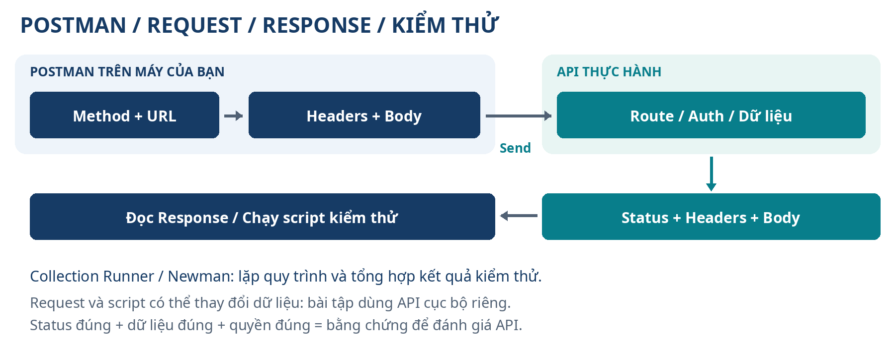

# Bắt đầu từ đây

Cẩm nang này dành cho người mới, người đã quên cách dùng Postman và người muốn làm việc với API có quy trình rõ ràng. Bạn có thể học bằng các bước nhỏ, không cần bắt đầu từ một hệ thống công ty đang hoạt động. Các tên nút tiếng Anh được giữ lại để bạn nhận ra chúng trong ứng dụng; ý nghĩa và cách sử dụng được giải thích bằng tiếng Việt.

## Sau khi học, bạn sẽ làm được gì?

Bạn sẽ đọc được một API, tạo và gửi request đúng cấu trúc, hiểu response, sử dụng đăng nhập và biến môi trường, sắp xếp collection, viết kiểm thử, chạy nhiều bộ dữ liệu và chẩn đoán lỗi. Các chương sau mở rộng sang cộng tác, tài liệu API, mocks, chạy bằng lệnh, CI, monitors, GraphQL và các giao thức khác.

Thành thạo là tự làm được việc, biết kiểm tra bằng chứng và biết giới hạn của công cụ. Một response có status 200 chưa đủ chứng minh chức năng đúng; một collection toàn màu xanh chỉ chứng minh những điều mà các kiểm thử thật sự kiểm tra.

## Các tệp đi kèm tài liệu

- **Cam-nang-Postman.docx:** bản Word để đọc và ghi chú.
- **Cam-nang-Postman.pdf:** bản PDF có mục lục để đọc và in.
- **Bo-thuc-hanh-Postman.zip:** API chạy bằng Node.js, collection JSON v2.1, environment, dữ liệu CSV, tệp gửi thử và README hướng dẫn.

Giải nén ZIP vào một thư mục riêng. Chương 4 hướng dẫn chạy API; chương 9 hướng dẫn CRUD; chương 11–13 hướng dẫn scripts và dữ liệu; chương 17–19 hướng dẫn chạy tự động. Các tệp trong ZIP là ví dụ học tập, không phải hệ thống website doanh nghiệp đã triển khai.

## Chọn đường học phù hợp

| Bạn đang cần gì? | Đọc trước | Bằng chứng hoàn thành |
|---|---|---|
| Tôi chưa hiểu API là gì | Chương 1–4 | Gửi được request health và giải thích response |
| Tôi biết bấm Send nhưng hay nhầm | Chương 5–9 | Gửi đúng URL, body, auth và hoàn thành CRUD |
| Tôi muốn kiểm thử có thể lặp lại | Chương 10–14 và 17–18 | Kiểm thử chính và dữ liệu đều đạt, có báo cáo |
| Tôi làm việc cùng nhóm | Chương 15–16 và 22 | Chia sẻ được collection phù hợp, bảo vệ dữ liệu và quyền |
| Tôi cần CI hoặc tính năng nâng cao | Chương 19–21 | Chọn đúng runner, giao thức và môi trường |
| Tôi gặp lỗi hoặc muốn ôn tập | Chương 23–24 | Chẩn đoán được tình trạng, tra lệnh và tự làm bài tổng hợp |

Bạn không cần học mọi tính năng nâng cao trong ngày đầu. Hoàn thành bài đầu tiên rồi tăng dần độ khó; dùng lộ trình 30 ngày khi muốn có lịch học cụ thể.

## Cách mở và tra cứu trong Word

Mở tệp `.docx` bằng Microsoft Word hoặc ứng dụng tương thích. Trong Word trên máy, chọn **View → Navigation Pane** để xem đề mục; bấm vào đề mục để đi tới phần cần đọc. Mục lục cũng có liên kết: bấm hoặc Ctrl + bấm tùy ứng dụng. Tìm một từ bằng Ctrl + F trên Windows hoặc Command + F trên macOS.

Nếu bạn sửa nội dung làm số trang thay đổi, chọn mục lục rồi **Update Table / Update Field**, chọn cập nhật toàn bộ khi có lựa chọn. Số trang có thể thay đổi nhẹ giữa Word, ứng dụng khác, phông chữ và máy in.

## Quy ước khi làm theo

- **Request** là yêu cầu gửi đến API; **response** là câu trả lời API gửi lại.
- Chạy từng lệnh trong terminal, đọc kết quả rồi mới sang lệnh tiếp theo. Không gõ dấu ba nháy của khung mã.
- Các chỗ như `TEN_THU_MUC`, `URL_API_CUA_BAN` và `TOKEN_CUA_BAN` là chỗ điền thông tin thật. Tài khoản giả trong bài học chỉ dùng cho API thực hành.
- `{{base_url}}`, `{{access_token}}` và `{{product_id}}` là cú pháp biến của Postman, không tự thay bằng một địa chỉ cố định ở mọi request.
- `localhost` hoặc `127.0.0.1` là máy đang thực hiện kết nối. Cloud Agent không coi máy của bạn là localhost của nó.
- Kiểm tra status, headers, body và kết quả script; chỉ thấy kết nối được chưa đủ để xác nhận nội dung đúng.

## Sơ đồ một vòng làm việc



Trong bài học, mọi thao tác tạo, sửa và xóa đều diễn ra trên API thực hành riêng ở máy của bạn. Khi áp dụng vào hệ thống thật, dùng môi trường và tài khoản được cho phép, theo quy trình của dự án. Không gửi request xóa hoặc tạo dữ liệu thử vào production chỉ để xem nút Send hoạt động.

## Những khác biệt phiên bản cần nhớ

Giao diện, tên nút và tính năng phụ thuộc phiên bản, nền tảng và tài khoản. Cẩm nang ưu tiên khái niệm và kết quả kiểm tra để bạn tìm được chức năng tương ứng khi giao diện khác.

Postman hiện có cả workflow collection JSON và workflow Git với collection dạng thư mục/YAML v3. Collection đi kèm **cố ý dùng JSON v2.1** để chạy được với Newman trong bài thực hành. Không suy ra rằng mọi collection hiện nay đều dùng v2.1, hoặc mọi định dạng mới đều chạy được bằng Newman.

Các hướng dẫn cũ thường dùng hai cột Initial/Current của biến. Giao diện mới dùng một Value và trạng thái chia sẻ; chương 8 giải thích cả cách nhận biết bản mới và cách hiểu ảnh hướng dẫn cũ. Postman CLI và Newman là hai công cụ khác nhau; hãy kiểm tra phiên bản và help trước khi lấy lệnh của công cụ này dùng cho công cụ kia.

## Phạm vi đã xác minh

Tài liệu được biên soạn ngày 11/10/2026. Nguồn đối chiếu gồm tài liệu và mã nguồn chính thức của Postman trên GitHub, cùng metadata/README gói npm chính thức. Phần nguồn cuối tài liệu phân biệt nguồn đã đọc và các liên kết để bạn tra cứu thêm.

Bộ API và collection được kiểm tra bằng lệnh trong môi trường phát triển; số request, assertion và kết quả thực tế được ghi ở phần nghiệm thu. Cẩm nang không khẳng định đã thao tác ứng dụng Postman trên máy của bạn, đã chạy monitor trên tài khoản của bạn hay đã kết nối hệ thống công ty. Giá, hạn mức và ma trận hỗ trợ mọi giao thức cần được kiểm tra theo gói và phiên bản hiện dùng.


# Chương 1. Hiểu API và HTTP từ con số không

## 1.1. Bạn đang học để làm được việc gì?

Postman là công cụ giúp bạn gửi yêu cầu đến API, đọc kết quả và kiểm tra kết quả đó. Bạn có thể dùng Postman để thử đăng nhập, tìm sản phẩm, tạo đơn hàng, kiểm tra lỗi hoặc xác nhận website đang giao tiếp đúng với máy chủ. Bạn chưa cần biết viết một ứng dụng hoàn chỉnh để bắt đầu.

Mục tiêu đầu tiên rất cụ thể: bạn biết mình gửi yêu cầu tới đâu, dữ liệu nào được gửi, máy chủ trả gì và kết quả đó có đúng mong đợi không. Các chương sau mới tiến đến chạy nhiều yêu cầu và tự động kiểm tra.

Postman không tự xây máy chủ cho mọi API, không tự cấp quyền vào hệ thống công ty và không sửa lỗi ứng dụng thay cho lập trình viên. Khi API có lỗi, Postman giúp bạn mô tả bằng chứng rõ hơn: URL, phương thức, dữ liệu gửi, mã trạng thái và phần trả về.

## 1.2. API, frontend và backend là gì?

Hình dung bạn đặt hàng trên website. Bạn bấm nút “Đặt hàng”. Phần giao diện chuyển thông tin giỏ hàng đến máy chủ. Máy chủ kiểm tra tồn kho, tính tiền và trả kết quả. API là cách hai bên thống nhất giao tiếp: gọi địa chỉ nào, gửi những trường nào, cần quyền gì và kết quả có cấu trúc ra sao.

| Khái niệm | Cách hiểu | Ví dụ |
|---|---|---|
| Frontend | Phần người dùng nhìn thấy và tương tác | Trang sản phẩm, nút đăng nhập |
| Backend | Phần xử lý nghiệp vụ phía máy chủ | Kiểm tra mật khẩu, lưu đơn hàng |
| API | Giao diện giao tiếp theo hợp đồng | Yêu cầu lấy danh sách sản phẩm |
| Database | Nơi lưu dữ liệu lâu dài | Bảng khách hàng và đơn hàng |

Khi thử API bằng Postman, bạn thường giao tiếp trực tiếp với backend. Vì vậy, một nút trên website bị hỏng nhưng API vẫn chạy là tình huống có thể xảy ra. Ngược lại, giao diện đẹp không có nghĩa API đã hoạt động đúng.

API còn xuất hiện giữa hai máy chủ, ứng dụng điện thoại và máy chủ, hoặc các phần mềm nội bộ. Trong cẩm nang này, chúng ta chủ yếu làm việc với API dùng HTTP.

## 1.3. Một yêu cầu và một phản hồi gồm những gì?

Yêu cầu, tiếng Anh là **request**, là phần bạn gửi đi. Phản hồi, tiếng Anh là **response**, là phần máy chủ gửi lại. Một cuộc trao đổi đơn giản có dạng:

```text
Postman → GET http://127.0.0.1:4010/health → máy chủ thực hành
Postman ← 200 OK và dữ liệu JSON ← máy chủ thực hành
```

Các phần thường gặp của request:

- **Method:** hành động HTTP, chẳng hạn GET hoặc POST.
- **URL:** địa chỉ đích, gồm máy chủ và đường dẫn.
- **Params:** tham số trên URL, chẳng hạn từ khóa tìm kiếm.
- **Headers:** thông tin bổ sung, chẳng hạn kiểu dữ liệu và xác thực.
- **Body:** dữ liệu trong thân yêu cầu, chẳng hạn nội dung sản phẩm mới.

Các phần thường gặp của response:

- **Status:** mã trạng thái cho biết máy chủ xử lý ra sao.
- **Headers:** thông tin bổ sung về phản hồi.
- **Body:** dữ liệu, thông báo lỗi, tệp hoặc nội dung khác.
- **Time và Size:** thời gian phản hồi và kích thước mà Postman ghi nhận.

Không phải request nào cũng có body; không phải response nào cũng chứa JSON. GET lấy dữ liệu thường dùng URL và Params. Một phản hồi 204 thường không có body.

## 1.4. HTTP và HTTPS

HTTP là giao thức giao tiếp. HTTPS là HTTP được bảo vệ bằng TLS trong quá trình truyền. Với API thực tế qua Internet, hãy dùng địa chỉ HTTPS mà nhà cung cấp công bố. Chữ “s” có vai trò bảo vệ đường truyền, nhưng không tự chứng minh dữ liệu trả về là đúng nghiệp vụ.

Bộ thực hành của tài liệu dùng `http://127.0.0.1:4010` vì máy chủ chạy ngay trên máy bạn. `127.0.0.1` và tên `localhost` đều thường chỉ về chính máy đang thực hiện kết nối. Cổng `4010` là cổng chương trình thực hành lắng nghe.

Nếu một người khác mở cùng URL trên máy của họ, họ đang gọi máy của họ. Địa chỉ này không tự chia sẻ máy chủ của bạn ra Internet.

## 1.5. Các phương thức thường gặp

| Method | Mục đích thường gặp | Ví dụ |
|---|---|---|
| GET | Đọc dữ liệu | Lấy danh sách sản phẩm |
| POST | Gửi dữ liệu để tạo hoặc xử lý | Tạo sản phẩm, đăng nhập |
| PUT | Thay thế biểu diễn của một tài nguyên | Gửi lại toàn bộ dữ liệu cần thay thế |
| PATCH | Cập nhật một phần | Chỉ sửa giá sản phẩm |
| DELETE | Yêu cầu xóa tài nguyên | Xóa sản phẩm theo ID |

Đây là ý nghĩa chuẩn và cách sử dụng phổ biến. API thực tế có thể thiết kế khác hoặc giới hạn những phương thức được hỗ trợ. Bạn phải đọc tài liệu của API; không đoán rằng đổi GET thành POST thì sẽ tạo được dữ liệu.

GET được thiết kế để đọc mà không thay đổi trạng thái nghiệp vụ. POST không mặc định có tính lặp an toàn: gửi hai lần có thể tạo hai đơn hàng. Khái niệm gửi lặp sẽ được giải thích kỹ hơn trong chương 5.

## 1.6. Đọc mã trạng thái có ý nghĩa

Mã trạng thái là số có ba chữ số. Nhóm mã giúp bạn định hướng nhanh, nhưng cần đọc thêm body và tài liệu API.

| Nhóm | Ý nghĩa chung | Ví dụ cần nhớ |
|---|---|---|
| 2xx | Yêu cầu đã được xử lý thành công theo HTTP | 200 OK; 201 Created; 204 No Content |
| 3xx | Chuyển hướng hoặc thông tin về bản lưu | 301; 302; 304 |
| 4xx | Vấn đề liên quan yêu cầu hoặc quyền truy cập | 400; 401; 403; 404; 429 |
| 5xx | Máy chủ hoặc hệ thống phía sau gặp sự cố | 500; 502; 503 |

Những mã bạn sẽ gặp thường xuyên:

- **400 Bad Request:** dữ liệu gửi không hợp lệ, chẳng hạn JSON sai cú pháp.
- **401 Unauthorized:** thiếu hoặc không chấp nhận thông tin xác thực. Tên tiếng Anh dễ gây nhầm; hãy hiểu là cần xác thực hợp lệ.
- **403 Forbidden:** máy chủ hiểu yêu cầu nhưng từ chối quyền truy cập.
- **404 Not Found:** không tìm thấy đường dẫn hoặc tài nguyên.
- **405 Method Not Allowed:** đường dẫn có thể tồn tại nhưng không cho phép phương thức vừa dùng.
- **409 Conflict:** yêu cầu xung đột với trạng thái hiện có, tùy hợp đồng API.
- **422 Unprocessable Content:** cấu trúc có thể đọc được nhưng dữ liệu không đạt yêu cầu, tùy cách API thiết kế.
- **429 Too Many Requests:** vượt giới hạn tần suất.
- **500 Internal Server Error:** máy chủ gặp lỗi nội bộ.

Đừng kết luận “đúng” chỉ vì nhận 200. Ví dụ, API trả 200 nhưng thiếu trường giá hoặc trả nhầm dữ liệu khách hàng vẫn có thể sai. Ngược lại, 400 có thể là kết quả đúng của bài kiểm tra cố tình gửi dữ liệu không hợp lệ.

## 1.7. JSON là gì?

JSON là cách biểu diễn dữ liệu văn bản phổ biến. Ví dụ:

```json
{
  "name": "Sổ tay A5",
  "price": 49000,
  "active": true,
  "description": null,
  "tags": ["van-phong", "qua-tang"]
}
```

Ở đây, `name` là chuỗi; `price` là số; `active` là giá trị đúng/sai; `description` là giá trị rỗng có chủ ý; `tags` là danh sách. Dấu ngoặc nhọn tạo object. Dấu ngoặc vuông tạo array. JSON dùng dấu nháy kép cho tên trường và chuỗi.

Bạn sẽ luyện viết JSON trong chương 6. Trước mắt hãy nhớ JSON có cấu trúc, không phải đoạn văn tùy ý. Postman hiển thị đẹp hơn nhưng không tự làm dữ liệu sai trở thành đúng.

## 1.8. REST, endpoint và hợp đồng API

**Endpoint** là điểm truy cập cụ thể, thường được xác định bằng phương thức và đường dẫn. `GET /products` và `POST /products` có cùng đường dẫn nhưng là hai thao tác khác nhau.

REST là một phong cách thiết kế hệ thống, không phải phần mềm phải cài. Nhiều API được gọi là REST dùng tài nguyên như sản phẩm và người dùng, kết hợp với các phương thức HTTP. Trong thực tế, chất lượng thiết kế khác nhau; đừng coi mọi API JSON đều đáp ứng đầy đủ REST.

**Hợp đồng API** trả lời: cần gửi gì, trường nào bắt buộc, mã thành công nào đúng, cấu trúc phản hồi thế nào, lỗi có ý nghĩa gì. Các nguồn hợp đồng có thể là tài liệu chính thức, đặc tả OpenAPI hoặc thỏa thuận của nhóm phát triển.

Tự kiểm tra cuối chương: bạn giải thích được request khác response thế nào; biết 401 khác 403; hiểu một phản hồi 200 vẫn cần kiểm tra dữ liệu. Nếu chưa, quay lại ví dụ đơn giản trước khi học script.

# Chương 2. Cài Postman và chọn đúng cách kết nối

## 2.1. Lựa chọn nên dùng khi bắt đầu

Với bộ thực hành chạy trên máy cá nhân, cách dễ nhất là **Postman Desktop**. Bạn cài ứng dụng trên Windows, macOS hoặc Linux rồi dùng nó gọi máy chủ cục bộ. Postman còn có ứng dụng web và các agent; chương này giúp bạn tránh chọn sai đường đi của request.

Giao diện, quyền dùng và yêu cầu tài khoản có thể thay đổi theo phiên bản, workspace và gói dịch vụ. Vì thế, tài liệu hướng dẫn theo chức năng thay vì bắt bạn tìm đúng một vị trí nút bất biến. Nếu phiên bản hiện tại yêu cầu đăng nhập để dùng chức năng cần thiết, dùng tài khoản của bạn hoặc tài khoản tổ chức cấp. Không dùng tài khoản chung chứa API và dữ liệu của người khác.

## 2.2. Cài trên Windows

**Làm gì:** cài ứng dụng Postman chính thức. **Vì sao:** ứng dụng desktop phù hợp để gọi API cục bộ và quan sát request thuận tiện.

1. Mở trình duyệt, truy cập `https://www.postman.com/downloads/`.
2. Chọn bản dành cho Windows phù hợp kiến trúc máy nếu trang yêu cầu lựa chọn.
3. Tải trình cài đặt từ trang chính thức. Không tải bản “bẻ khóa” hoặc gói được đăng lại ở website không rõ nguồn.
4. Mở tệp vừa tải. Thực hiện các bước của trình cài đặt.
5. Mở Postman từ Start Menu hoặc biểu tượng được tạo.
6. Đăng nhập hoặc chọn cách sử dụng mà phiên bản hiện tại cho phép. Bạn không cần mua gói trả phí chỉ để làm bài gửi HTTP cơ bản nếu tính năng đó có trong quyền sử dụng hiện tại.

**Kết quả cần thấy:** ứng dụng mở được và bạn có thể tạo hoặc mở một HTTP request. Nếu chưa thấy workspace giống hình trên Internet, kiểm tra loại ứng dụng và chế độ tài khoản; giao diện mới có thể đã đổi bố cục.

## 2.3. Cài trên macOS

1. Mở trang tải chính thức như trên.
2. Chọn đúng bản dành cho Apple Silicon hoặc Intel theo máy của bạn.
3. Tải và mở tệp theo hướng dẫn trên trang.
4. Nếu tệp tải là gói ZIP, giải nén; nếu cần, kéo ứng dụng vào thư mục Applications theo hướng dẫn.
5. Mở Postman từ Applications. Xác nhận cảnh báo mở ứng dụng tải từ Internet khi hệ điều hành hiển thị nguồn phù hợp.

Nếu macOS từ chối vì chữ ký hoặc nguồn tải không hợp lệ, kiểm tra lại trang tải và gói cài. Không vô hiệu hóa bảo vệ hệ điều hành để mở một gói chưa rõ nguồn. Cách cài cụ thể có thể đổi khi Postman cập nhật cách phân phối.

## 2.4. Cài trên Linux

Tải bản Linux phù hợp từ trang chính thức và làm theo hướng dẫn cài hiện hành tại `https://learning.postman.com/`. Postman có thể cung cấp gói tải hoặc hướng dẫn qua trình quản lý gói cho một số hệ thống. Chọn phương án phù hợp bản phân phối bạn dùng.

Với người mới, ưu tiên phương án được tài liệu chính thức mô tả cho hệ thống của mình. Không dùng lệnh yêu cầu quyền quản trị chỉ vì một bài viết cũ nói như vậy. Không chạy ứng dụng thường ngày bằng tài khoản root để giải quyết vấn đề quyền tệp.

**Kết quả kiểm tra:** ứng dụng khởi động được; không xuất hiện lỗi thiếu thư viện; có thể tạo HTTP request. Nếu máy là server không có giao diện đồ họa, Postman Desktop không phải lựa chọn tương tác phù hợp. Phần chạy collection bằng dòng lệnh sẽ được trình bày sau.

## 2.5. Ứng dụng web và Desktop Agent

Bạn có thể mở Postman trong trình duyệt tại `https://web.postman.co/`. Tuy nhiên, cần hiểu request được gửi từ đâu.

| Cách dùng | Request được thực hiện từ đâu | Phù hợp cho API trên máy bạn? |
|---|---|---|
| Postman Desktop | Ứng dụng trên máy bạn | Có, nếu API đang chạy và cổng đúng |
| Web + Desktop Agent | Agent cài trên máy bạn | Có, khi agent đang hoạt động và được chọn |
| Web + Cloud Agent | Hạ tầng đám mây của Postman | Không truy cập được localhost riêng của máy bạn |
| Web + cách gửi của trình duyệt | Trình duyệt, với các giới hạn tương ứng | Có thể chịu giới hạn CORS và mạng cục bộ |

Để dùng web với bộ thực hành:

1. Mở Postman web và đăng nhập theo yêu cầu.
2. Tải **Desktop Agent** từ nguồn chính thức nếu giao diện đề nghị.
3. Cài và khởi động agent trên cùng máy đang chạy `demo-server.mjs`.
4. Trong Postman web, tìm bộ chọn agent hoặc trạng thái kết nối, chọn Desktop Agent đang hoạt động.
5. Gửi `GET http://127.0.0.1:4010/health` sau khi đã khởi động máy chủ ở chương 4.

Desktop Agent và ứng dụng Postman Desktop là hai thành phần khác nhau. Cài một thành phần không có nghĩa mọi chế độ của thành phần kia đã được cấu hình. Với người mới, chỉ dùng Desktop trước sẽ giảm số thứ phải kiểm tra.

## 2.6. CORS là gì và xử lý đúng cách

CORS là cơ chế trình duyệt dùng để kiểm soát việc một trang web gọi tài nguyên khác nguồn. Một request chạy trong Postman Desktop có thể thành công trong khi frontend chạy trong trình duyệt bị CORS chặn. Điều đó không có nghĩa hai công cụ đang kiểm tra cùng điều kiện.

Nếu dùng Postman web và gặp lỗi liên quan cách gửi từ trình duyệt, kiểm tra agent được chọn. Nếu website của bạn thật sự bị CORS, cấu hình backend để cho phép đúng origin, phương thức và header cần thiết. Không tắt bảo vệ trình duyệt hoặc dùng extension vô hiệu hóa CORS như giải pháp triển khai thật.

Một số trình duyệt còn yêu cầu quyền truy cập mạng cục bộ. Nếu Postman web chính thức cần kết nối với Desktop Agent hoặc máy chủ trên máy bạn, đọc hộp thoại quyền và chỉ cho phép đúng website bạn đang chủ động sử dụng. Nếu trước đó đã từ chối, kiểm tra quyền của website trong cài đặt trình duyệt. Không tắt các cờ bảo mật toàn trình duyệt để né yêu cầu này.

Một điểm cần nhớ: kết quả Postman chứng minh API phản hồi trong điều kiện Postman đang dùng. Nó không tự xác nhận frontend, cookie, CORS và phiên đăng nhập trong trình duyệt đều đúng.

## 2.7. Thiết lập ban đầu tối thiểu

Tạo một workspace phục vụ học tập, ví dụ `Hoc Postman`. Workspace là vùng tổ chức công việc; collection là nhóm request nằm bên trong. Nếu chương trình có lựa chọn quyền riêng tư, chọn phạm vi phù hợp cho việc học và kiểm tra ai có thể xem nội dung trước khi thêm dữ liệu thật.

Bạn chưa cần mua gói, mời cả công ty hoặc bật mọi tính năng. Bắt đầu bằng HTTP request, collection, environment và Console. Khi học đến Runner, mock server, monitor hoặc làm việc nhóm, tài liệu sẽ chỉ ra điều kiện sử dụng riêng.

Tự kiểm tra: biết mình đang dùng desktop hay web; nếu là web, biết agent nào gửi request; mở được giao diện tạo HTTP request. Chưa cài Node và chưa chạy API thì lỗi kết nối localhost lúc này là điều có thể dự đoán.

# Chương 3. Đọc giao diện và tổ chức request

## 3.1. Workspace, collection, folder và request

Hãy tổ chức từ nhỏ đến lớn:

- **Request:** một thao tác, chẳng hạn “Đọc trạng thái máy chủ”.
- **Folder:** nhóm request liên quan, chẳng hạn “Sản phẩm”.
- **Collection:** tập hợp request, biến, cấu hình xác thực và script phục vụ một API hoặc một luồng kiểm thử.
- **Workspace:** nơi chứa và cộng tác với các tài nguyên trên.

Ví dụ, collection `Postman Practice` có folder “Kiểm tra máy chủ”, “Đăng nhập” và “Sản phẩm”. Đặt tên theo công việc giúp bạn tìm lại nhanh hơn tên `Untitled Request`.

Không cần tạo một workspace cho mỗi endpoint. Dự án thật thường chọn cách nhóm theo đội, sản phẩm và phạm vi truy cập. Với bài học, một workspace và một collection là đủ.

## 3.2. Tạo một HTTP request

1. Mở workspace học tập.
2. Tìm chức năng tạo mới, thường có tên **New**, nút dấu cộng hoặc menu tương tự.
3. Chọn **HTTP Request**. Nếu giao diện có nhiều loại request như GraphQL hoặc gRPC, chúng ta chưa dùng các loại đó ở bước này.
4. Chọn phương thức **GET** ở cạnh ô URL.
5. Nhập địa chỉ đầy đủ, chẳng hạn `http://127.0.0.1:4010/health`.
6. Lưu request vào collection với tên `01 - Kiem tra may chu`.

**Vì sao lưu?** Bạn giữ được cấu hình để dùng lại, thay vì gõ từ đầu. Nút gửi không thay thế thao tác lưu.

## 3.3. Save và Send khác nhau

**Save** lưu cấu hình request: phương thức, URL, headers, body, xác thực và các script liên quan. **Send** thực hiện một lần gọi API ngay lúc đó.

Ví dụ, bạn sửa giá trong body rồi bấm Send nhưng chưa Save. Máy chủ có thể đã nhận giá mới; collection lưu trên máy hoặc được đồng bộ vẫn có thể chứa cấu hình trước đó. Ngược lại, bấm Save không tạo sản phẩm trên máy chủ.

Một thói quen tốt:

1. Kiểm tra môi trường và URL.
2. Kiểm tra dữ liệu cần gửi.
3. Bấm Send và đọc kết quả.
4. Nếu cấu hình đó là cấu hình cần giữ, bấm Save.

Khi gửi request tạo, cập nhật hoặc xóa trên hệ thống thật, xác nhận URL đang trỏ môi trường thử nghiệm được cấp quyền. Việc thay một biến `base_url` có thể đổi hoàn toàn hệ thống nhận dữ liệu.

## 3.4. Các tab request cần đọc

| Tab hoặc khu vực | Bạn cấu hình gì | Khi nào thường dùng |
|---|---|---|
| Params | Tham số query trên URL | Tìm kiếm, lọc, phân trang |
| Authorization | Kiểu xác thực | Bearer token, Basic, API key |
| Headers | Header tùy chỉnh | Content-Type, Accept, mã theo dõi |
| Body | Dữ liệu thân request | POST, PUT, PATCH, tải tệp |

Tùy phiên bản, các mục script có thể nằm dưới **Scripts**, với **Pre-request** và **Post-response**, hoặc mang nhãn cũ trong tài liệu bạn gặp. Phần pre-request chạy trước khi gửi. Phần post-response chạy khi có phản hồi để kiểm tra hoặc lưu dữ liệu phục vụ bước tiếp theo.

Ở các chương đầu, chưa cần thêm script. Nếu nhập collection đi kèm, một số request đã có script kiểm tra. Bạn có thể đọc phần đó nhưng nên làm được thao tác thủ công trước.

## 3.5. Các khu vực response cần đọc

Sau khi Send, đọc theo thứ tự:

1. **Status:** có đúng mã mong đợi không?
2. **Body:** cấu trúc và dữ liệu có đúng không?
3. **Headers:** kiểu dữ liệu, vị trí tài nguyên mới, giới hạn API hoặc mã theo dõi nếu có.
4. **Time:** phản hồi mất bao lâu trong lần này?
5. **Kết quả test:** nếu request có script, kiểm tra phần kết quả từng test.

Postman có thể cho xem body dạng trình bày đẹp, văn bản thô hoặc xem trước. Với JSON, chọn chế độ dễ đọc và có đánh dấu cấu trúc. Nếu gặp HTML trong khi mong JSON, hãy đọc vài dòng đầu: bạn có thể gọi nhầm trang đăng nhập, trang lỗi proxy hoặc website thay vì endpoint API.

Thời gian của một lần Send không phải kết luận toàn bộ hiệu năng hệ thống. Mạng, máy cá nhân, khởi động lạnh và dung lượng dữ liệu đều ảnh hưởng. Đo hiệu năng đáng tin cậy cần bài kiểm tra được thiết kế riêng.

## 3.6. Postman Console giúp bạn nhìn request thật

Console là khu vực ghi thông tin gửi/nhận và thông điệp từ script. Mở bằng chức năng **Console** hoặc **Postman Console** của phiên bản đang dùng. Nếu không tìm thấy, dùng menu hoặc phần tìm kiếm trợ giúp.

Khi request lỗi:

1. Mở Console.
2. Gửi lại một lần sau khi kiểm tra cấu hình.
3. Mở dòng tương ứng để xem URL đã được thay biến, headers và nội dung.
4. So sánh URL thật với URL bạn định gửi.

Console hữu ích khi ô URL có `{{base_url}}` nhưng biến đang trỏ nhầm máy chủ. Nó cũng có thể hiển thị token, cookie và dữ liệu cá nhân. Trước khi chụp ảnh hoặc gửi log cho người khác, che hoặc loại bỏ các phần đó. Bộ thực hành chỉ dùng dữ liệu giả để bạn tập quan sát an toàn hơn.

## 3.7. Đặt tên và giữ request rõ ràng

Dùng tên mô tả hành động: `GET - Danh sach san pham`, `POST - Dang nhap`, `PATCH - Sua gia`. Khi collection là một luồng có thứ tự, thêm số đầu tên: `01`, `02`, `03`. Ghi một đoạn mô tả ngắn cho request quan trọng: mục đích, tiền đề và kết quả mong đợi.

Ví dụ mô tả tốt:

```text
Mục đích: đọc hồ sơ người dùng thực hành.
Tiền đề: đã đăng nhập và có access_token hợp lệ.
Kết quả: 200, email learner@example.test, role learner.
```

Đừng ghi mật khẩu thật vào mô tả hoặc tên request. Collection có thể được đồng bộ, xuất tệp hoặc chia sẻ cho đồng đội.

## 3.8. Tự kiểm tra cuối chương

Bạn đã đạt mục tiêu khi có thể tìm một request trong collection; giải thích Save khác Send; đọc status và body; mở Console để kiểm tra URL thật. Nếu chưa chạy máy chủ, hãy chuyển sang chương 4 rồi quay lại gửi request đã lưu.

# Chương 4. Khởi động bộ thực hành và gửi yêu cầu đầu tiên

## 4.1. Bộ thực hành này giải quyết điều gì?

Một API công khai có thể đổi dữ liệu, giới hạn lượt gọi hoặc ngừng hoạt động. Bộ thực hành đi kèm chạy trên máy bạn, dùng dữ liệu giả và cho phép bắt đầu lại. Bạn không cần tài khoản dịch vụ bên ngoài hoặc nhập thông tin khách hàng thật.

Tệp `Bo-thuc-hanh-Postman.zip` đi kèm cẩm nang chứa máy chủ Node.js, collection Postman, environment và các tệp mẫu. Sau khi giải nén, tìm `demo-server.mjs`. Không mở và chỉnh mã máy chủ nếu mục tiêu hiện tại chỉ là học sử dụng Postman.

Máy chủ dùng bộ nhớ để lưu dữ liệu thực hành. Khi dừng và chạy lại, dữ liệu trở về trạng thái ban đầu và các token cũ hết hiệu lực. Đây là hành vi được thiết kế cho bài học, không phải lỗi mất dữ liệu cần sửa.

## 4.2. Cài Node.js để chạy máy chủ

**Làm gì:** cài Node.js phiên bản từ 20 trở lên; ưu tiên bản LTS hiện hành được trang chính thức khuyến nghị và còn được hỗ trợ. **Vì sao:** Node.js là chương trình thực thi tệp `demo-server.mjs`; Postman chỉ gửi request, không chạy mã máy chủ này.

1. Mở `https://nodejs.org/`.
2. Chọn bản phù hợp hệ điều hành. Nếu chưa quen công cụ quản lý phiên bản, dùng cách cài chính thức được trang mô tả cho máy bạn.
3. Cài theo hướng dẫn. Sau khi cài, đóng cửa sổ terminal cũ rồi mở cửa sổ mới để nhận đường dẫn chương trình.
4. Trên Windows, mở PowerShell hoặc Terminal. Trên macOS/Linux, mở Terminal.
5. Gõ lệnh:

```sh
node --version
```

**Kết quả:** nhìn thấy dạng `v22.x.x`, `v24.x.x` hoặc phiên bản tương thích khác từ 20 trở lên. Nếu thông báo không tìm thấy `node`, kiểm tra cài đặt và mở lại terminal; đừng sửa nhiều biến hệ thống một cách ngẫu nhiên.

Bạn không phải cài các thư viện riêng cho máy chủ mẫu: nó dùng khả năng có sẵn của Node.js. Các lệnh bổ sung cho kiểm thử tự động xuất hiện ở phần sau và phục vụ mục đích khác.

## 4.3. Tải, giải nén và mở đúng thư mục

1. Tải ZIP đi kèm về máy.
2. Giải nén bằng chức năng của hệ điều hành.
3. Mở thư mục vừa giải nén. Tìm tệp `demo-server.mjs`.
4. Mở terminal trong thư mục đó. Một số hệ điều hành có menu “Open in Terminal”; nếu không, dùng lệnh `cd`.

Ví dụ trên Windows, thay đường dẫn bằng thư mục thật của bạn:

```powershell
cd "C:\Users\TEN_CUA_BAN\Downloads\Bo-thuc-hanh-Postman"
```

Ví dụ trên macOS/Linux:

```sh
cd "$HOME/Downloads/Bo-thuc-hanh-Postman"
```

Dấu nháy giúp đường dẫn có khoảng trắng được hiểu là một đường dẫn. Các ví dụ không phải đường dẫn có sẵn trên máy bạn. Nếu ZIP tạo thêm một thư mục con, đi vào thư mục thật sự chứa `demo-server.mjs`.

Kiểm tra tệp bằng `dir` trên PowerShell hoặc `ls` trên macOS/Linux. Nếu chưa thấy đúng tệp, sửa vị trí thư mục trước khi chạy lệnh tiếp theo.

## 4.4. Chạy máy chủ

Gõ:

```sh
node demo-server.mjs
```

**Kết quả cần thấy:** terminal thông báo máy chủ lắng nghe ở cổng `4010`. Giữ cửa sổ terminal đang chạy; việc chương trình không trả lại dấu nhắc là bình thường vì nó đang chờ request.

Máy chủ thực hành chỉ dùng dữ liệu giả. Tài khoản mẫu:

```text
Email: learner@example.test
Mật khẩu: postman-demo-2026
```

Đuôi `.test` được dùng cho ví dụ. Không thay bằng email và mật khẩu tài khoản thật. Các giá trị này được công khai cùng tài liệu để mọi người thực hành được.

Muốn dừng máy chủ, chọn cửa sổ terminal đó rồi nhấn **Ctrl+C**. Muốn đặt lại dữ liệu, dừng rồi chạy lại cùng lệnh. Sau khi chạy lại, bạn phải đăng nhập lại để có token mới.

## 4.5. Gửi GET /health trong Postman

1. Mở Postman Desktop, hoặc Postman web với Desktop Agent đang hoạt động.
2. Tạo HTTP request mới.
3. Chọn **GET**.
4. Nhập URL:

```text
http://127.0.0.1:4010/health
```

5. Trong Authorization, dùng **No Auth** cho request này.
6. Không thêm body.
7. Bấm **Send**.

**Kết quả đúng:** status `200 OK`, body có các giá trị sau:

```json
{
  "status": "ok",
  "service": "postman-practice"
}
```

So sánh giá trị và tên trường; khoảng trắng hoặc thứ tự trường có thể khác mà dữ liệu JSON vẫn tương đương. Lưu request với tên `01 - Kiem tra may chu`.

**Vì sao thử /health trước?** Nó tách bài toán kết nối khỏi bài toán xác thực và dữ liệu. Nếu /health chưa chạy, việc sửa token hoặc body đăng nhập chưa giải quyết được lỗi kết nối.

## 4.6. Import collection và environment đi kèm

Bạn có thể tự tạo request để hiểu thao tác, rồi nhập bộ mẫu để luyện tiếp:

1. Trong Postman, chọn chức năng **Import**.
2. Chọn `Postman-Local.postman_collection.json` trong thư mục giải nén.
3. Nhập `Postman-Local.postman_environment.json`.
4. Mở collection **Postman Local — Bài thực hành** vừa nhập. Folder **01 - Quy trình chính** chứa luồng thực hành; folder **02 - Bài tập dữ liệu** dành cho phần Runner về sau.
5. Chọn environment **Postman Local** trong bộ chọn môi trường.
6. Kiểm tra `base_url` là `http://127.0.0.1:4010`.
7. Mở request kiểm tra máy chủ và bấm Send.

Import là đọc cấu hình, không phải gửi mọi request ngay. Lúc chạy nhiều request, phải xem trước thứ tự và dữ liệu vì một số request có thể tạo, sửa hoặc xóa.

Collection mẫu dùng cấu trúc Postman Collection v2.1 để tương thích với công cụ chạy được hướng dẫn trong bài. Một số phiên bản Postman có thể dùng định dạng collection mới hơn; giữ bản JSON gốc của bộ thực hành khi chạy Newman. Nếu Import báo tệp không hợp lệ, kiểm tra bạn chọn JSON collection, không chọn ZIP hoặc tệp JavaScript máy chủ.

## 4.7. Lỗi thường gặp ngay ở bài đầu

| Dấu hiệu | Nguyên nhân cần kiểm tra | Cách xử lý |
|---|---|---|
| `node` không được nhận diện | Node chưa cài hoặc terminal chưa nhận đường dẫn | Cài đúng bản, mở lại terminal, thử `node --version` |
| Không tìm thấy `demo-server.mjs` | Terminal đang ở sai thư mục | Dùng `cd` và kiểm tra danh sách tệp |
| `EADDRINUSE` | Cổng 4010 đã được dùng | Kiểm tra một cửa sổ máy chủ khác đang chạy; dừng đúng tiến trình của bạn |
| `ECONNREFUSED` | Máy chủ chưa chạy hoặc URL/cổng sai | Kiểm tra terminal và URL; gửi lại /health |

Nếu Postman web đang dùng Cloud Agent, chuyển sang Desktop Agent hoặc dùng ứng dụng Desktop. Cloud Agent không nhìn thấy máy chủ `127.0.0.1` trên máy cá nhân của bạn.

Nếu `localhost` gặp khác biệt do cấu hình mạng, dùng đúng địa chỉ `127.0.0.1` trong bài học. Đừng thay URL thành địa chỉ máy chủ công ty chỉ để “thử cho chạy”.

## 4.8. Bài thực hành nhỏ và mốc hoàn thành

Gửi /health ba lần. Lần một đọc status, lần hai đọc body, lần ba mở Console kiểm tra URL thật. Sau đó dừng máy chủ bằng Ctrl+C và gửi lại: quan sát lỗi kết nối. Chạy máy chủ lại rồi xác nhận request thành công.

Bạn đã hoàn thành khi giải thích được: Node chạy API; Postman gọi API; terminal phải tiếp tục chạy; 200 cùng dữ liệu đúng xác nhận bài đầu; khởi động lại máy chủ đặt lại dữ liệu và token.

# Chương 5. URL, Params và phương thức HTTP trong công việc thật

## 5.1. Tách một URL ra từng phần

Xem URL:

```text
http://127.0.0.1:4010/products?q=Laptop&limit=10
```

- `http` là giao thức.
- `127.0.0.1` là địa chỉ máy chủ.
- `4010` là cổng.
- `/products` là đường dẫn.
- `?q=Laptop&limit=10` là query string, chứa các tham số.

Một API Internet có thể dùng URL như `https://api.example.com/v1/products`. Phần `/v1` có thể chỉ phiên bản API. `example.com` trong tài liệu là miền minh họa; bạn phải dùng địa chỉ thật được API cung cấp khi làm dự án.

## 5.2. Path parameter khác query parameter

**Path parameter** nằm trong đường dẫn để chỉ một tài nguyên, chẳng hạn ID sản phẩm:

```text
/products/1
```

**Query parameter** thường biểu diễn tìm kiếm, lọc, phân trang hoặc lựa chọn:

```text
/products?q=Laptop
```

Nếu tài liệu ghi `/products/{id}`, `{id}` là ký hiệu cho vị trí cần thay bằng ID thật; không gửi nguyên chuỗi `{id}`. Trong Postman, bạn cũng có thể dùng biến `{{product_id}}` nhưng biến phải có giá trị hợp lệ.

ID không luôn là số. Hệ thống thật có thể dùng chuỗi UUID hoặc mã nghiệp vụ. Không tự chuyển ID thành số nếu hợp đồng API quy định chuỗi.

## 5.3. Điền Params đúng cách

1. Tạo request GET với URL `http://127.0.0.1:4010/products`.
2. Mở tab **Params**.
3. Thêm key `q`, value `Laptop`. Đây là tên tham số tìm kiếm của máy chủ mẫu; API khác có thể dùng `search` hoặc một tên khác.
4. Quan sát Postman thêm query vào URL.
5. Muốn tạm bỏ tham số, bỏ chọn ô của dòng đó thay vì xóa cả URL.
6. Bấm Send rồi so sánh danh sách trả về với request không có bộ lọc.

**Vì sao dùng bảng Params?** Bạn dễ nhìn tên và giá trị riêng, giảm lỗi thiếu dấu `&` hoặc gõ nhầm phần URL. Một tham số không được API hỗ trợ có thể bị bỏ qua hoặc bị báo lỗi; không suy ra rằng bất kỳ key nào cũng lọc được dữ liệu.

Với các tham số như `page`, `limit`, `sort`, đọc kỹ tài liệu: trang đầu là 0 hay 1; giới hạn tối đa bao nhiêu; sắp tăng dùng `asc` hay dấu `+`; phản hồi chứa tổng số bản ghi hay không. Các quy ước này khác nhau giữa API.

## 5.4. Khoảng trắng, tiếng Việt và ký tự đặc biệt

URL có quy tắc mã hóa. Ví dụ khoảng trắng thường được biểu diễn thành `%20` ở những ngữ cảnh phù hợp. Trong một số dạng mã hóa form/query, bạn có thể gặp dấu `+`. Dấu `&` dùng để phân tách tham số; nếu nó là nội dung giá trị, cần được mã hóa đúng.

Khi dùng Params, nhập giá trị bạn muốn và kiểm tra URL thực tế trong Console. Không mã hóa toàn bộ URL một cách mù quáng và không mã hóa lặp khiến `%` trở thành `%25` ngoài ý muốn.

Ví dụ bạn tìm `bút & sổ`: `&` thuộc từ khóa, không phải một tham số mới. Nếu gõ trực tiếp URL mà không xử lý đúng, máy chủ có thể hiểu sai. Khi kết quả tìm kiếm bất ngờ, xem giá trị query đã đến máy chủ thay vì chỉ nhìn chữ trong ô nhập.

## 5.5. POST, PUT, PATCH và DELETE

Trong một hệ thống sản phẩm điển hình:

```text
POST /products       → tạo sản phẩm
PUT /products/1      → thay thế dữ liệu sản phẩm theo hợp đồng
PATCH /products/1    → sửa một phần dữ liệu
DELETE /products/1   → xóa sản phẩm
```

PUT thường yêu cầu gửi biểu diễn đầy đủ mà API cần để thay thế. PATCH thường chỉ gửi những trường cần đổi. Tuy nhiên, API phải quy định cụ thể: trường bị thiếu được giữ, xóa hay nhận mặc định; trường nào bất biến; dùng JSON thường hay định dạng patch chuyên dụng.

Ví dụ, muốn sửa giá, một API hỗ trợ PATCH có thể nhận:

```json
{
  "price": 59000
}
```

Nếu gửi body này bằng PUT vào API yêu cầu đầy đủ cả `name` và `price`, bạn có thể nhận lỗi hoặc làm mất các trường khác. Không học PUT bằng cách mặc định nó giống PATCH.

DELETE có thể xóa vĩnh viễn, đánh dấu đã xóa hoặc không cho xóa khi còn dữ liệu liên quan. Đọc hợp đồng trước khi thử trên hệ thống thật. Trong bộ mẫu, dùng dữ liệu bạn vừa tạo và theo đúng luồng hướng dẫn ở phần thực hành CRUD.

## 5.6. Idempotent: gửi lặp có cùng tác động cuối cùng

Một thao tác có tính **idempotent** khi gửi lại cùng yêu cầu tạo ra cùng tác động dự kiến lên trạng thái máy chủ như gửi một lần. Đây là ý nghĩa về tác động, không có nghĩa response của các lần phải giống từng ký tự.

Ví dụ DELETE một sản phẩm: lần đầu có thể trả 204; lần sau trả 404 vì sản phẩm đã bị xóa. Trạng thái cuối vẫn là sản phẩm không tồn tại. DELETE được định nghĩa là idempotent trong HTTP dù hai response khác nhau.

GET, HEAD, OPTIONS và TRACE được định nghĩa là safe; các phương thức safe cùng PUT và DELETE được định nghĩa là idempotent. “Safe” nói về ý định không thay đổi trạng thái mà người dùng yêu cầu; máy chủ vẫn có thể ghi log hoặc số liệu nội bộ. Trong thực tế, một API thiết kế sai có thể vi phạm ý nghĩa này.

POST và PATCH không mặc định idempotent. Một API có thể cung cấp **idempotency key** hoặc thiết kế thao tác PATCH cụ thể để hỗ trợ gửi lặp an toàn. Cách đó phải được tài liệu mô tả, không phải chỉ tự thêm một header bất kỳ.

Khi request tạo thanh toán bị timeout, bạn chưa biết máy chủ có xử lý thành công trước khi phản hồi bị mất hay không. Việc bấm Send lại có thể nguy hiểm trên dịch vụ thật. Cần quy trình tra trạng thái và cơ chế chống trùng của hệ thống.

## 5.7. Mã lỗi gắn với nguyên nhân

Nếu bạn gọi đường dẫn không tồn tại, 404 là kết quả có thể đúng. Nếu dùng phương thức không được hỗ trợ trên một đường dẫn tồn tại, 405 có thể phù hợp. Tuy nhiên, framework hoặc chính sách bảo mật có thể trả 404 để không tiết lộ endpoint; không kết luận dựa trên mã đơn lẻ.

401 và 403 cần xử lý khác nhau. 401 thường bắt đầu bằng kiểm tra token hoặc thông tin xác thực. 403 cần kiểm tra quyền, phạm vi hoặc chính sách của tài nguyên. Đăng nhập lại không tự thêm quyền quản trị cho tài khoản.

429 cần đọc giới hạn và header hướng dẫn chờ nếu API cung cấp, chẳng hạn `Retry-After`. Không liên tục gửi lại nhanh hơn. 500 cần ghi lại request và mã theo dõi nếu có, rồi chuyển bằng chứng cho bên phụ trách máy chủ.

## 5.8. Checklist trước khi gửi một request có thay đổi dữ liệu

Xác nhận đúng môi trường; đúng method; đúng tài nguyên/ID; body đáp ứng hợp đồng; quyền được cấp; hiểu tác động khi gửi lại. Với bài học, chỉ làm trên máy chủ giả cục bộ. Bạn sẽ thực hành toàn bộ chu trình tạo–đọc–sửa–xóa ở chương tiếp theo của bộ cẩm nang.

# Chương 6. Gửi Body: JSON, form và tệp

## 6.1. Khi nào cần Body?

Body là dữ liệu thân request. Nó thường xuất hiện ở POST, PUT và PATCH; một số API dùng các quy ước khác. Đừng tự gửi body GET rồi kỳ vọng mọi máy chủ đọc nó: cách xử lý body GET không thống nhất và hợp đồng API thường không dùng nó.

Trước khi nhập dữ liệu, đọc ba điều: API nhận định dạng nào; trường nào bắt buộc; mỗi trường có kiểu và giới hạn gì. Một màn hình “thêm sản phẩm” thường chuyển dữ liệu form thành JSON trước khi gửi, chứ không phải API luôn nhận đúng hình thức bạn nhìn thấy trên màn hình.

## 6.2. Viết JSON hợp lệ

Mẫu đúng:

```json
{
  "name": "Sổ tay A5",
  "price": 49000,
  "active": true,
  "note": null,
  "tags": ["hoc-tap", "van-phong"],
  "dimensions": {
    "width": 15,
    "height": 21
  }
}
```

Các lỗi cần tránh:

- Tên trường và chuỗi phải dùng dấu nháy kép, không dùng dấu nháy đơn.
- Không thêm dấu phẩy sau phần tử cuối.
- Không chèn comment `// ghi chú` hoặc `/* ghi chú */` vào JSON.
- `true`, `false`, `null` không đặt trong dấu nháy nếu muốn đúng kiểu đó.
- Số `49000` khác chuỗi `"49000"`.
- `null` khác chuỗi rỗng `""`, trường bị thiếu và danh sách rỗng `[]`.

JSON đúng cú pháp chưa chắc đúng hợp đồng. `{"price": -1}` có thể hợp lệ về JSON nhưng bị từ chối vì giá phải không âm. Đây là khác biệt giữa kiểm tra cấu trúc và kiểm tra nghiệp vụ.

## 6.3. Gửi JSON vào endpoint echo

Endpoint echo trả lại thông tin request để bạn quan sát. Nó không tạo đơn hàng thật hoặc gửi email.

1. Tạo request **POST**.
2. URL: `http://127.0.0.1:4010/echo`.
3. Chọn **Body → raw**.
4. Chọn kiểu **JSON** trong menu định dạng nếu giao diện cung cấp.
5. Nhập:

```json
{
  "name": "Nguoi hoc Postman",
  "age": 25,
  "active": true,
  "note": null
}
```

6. Kiểm tra request có header `Content-Type: application/json`. Postman thường tự thêm khi bạn chọn JSON; đừng thêm hai dòng Content-Type trái nhau.
7. Bấm Send.
8. Kiểm tra status 200. Response có các trường `method`, `query`, `headers`, `body`; bên trong `body` phải có các giá trị vừa gửi với kiểu phù hợp.

**Vì sao luyện echo?** Bạn nhìn được dữ liệu máy chủ nhận, tách chuyện định dạng khỏi nghiệp vụ. Khi chuyển sang API thật, cấu trúc phản hồi không nhất thiết giống endpoint echo này.

Thử bỏ dấu phẩy giữa hai trường rồi gửi lại. Kết quả cần là lỗi dữ liệu không hợp lệ, không phải 200 cùng dữ liệu bình thường. Sửa lại trước khi Save cấu hình chuẩn.

## 6.4. Content-Type khác Accept

**Content-Type** mô tả kiểu nội dung bạn đang gửi. **Accept** thể hiện kiểu phản hồi bạn muốn nhận. Ví dụ:

```text
Content-Type: application/json
Accept: application/json
```

Thêm `Accept: application/json` không tự chuyển body gửi đi thành JSON. Thêm `Content-Type: application/json` cũng không làm một đoạn văn hoặc JSON sai cú pháp trở nên hợp lệ.

Nếu gặp 415 Unsupported Media Type, kiểm tra Content-Type và lựa chọn Body. Nếu chọn một định dạng nhưng header cũ còn ghi định dạng khác, bỏ phần xung đột rồi gửi lại.

## 6.5. x-www-form-urlencoded

Đây là định dạng nhiều biểu mẫu và endpoint token sử dụng. Dữ liệu được biểu diễn thành các cặp key–value đã mã hóa. Với bài echo:

1. Giữ phương thức POST và đường dẫn `/echo`.
2. Chọn **Body → x-www-form-urlencoded**.
3. Thêm key `name`, value `Nguoi hoc`.
4. Thêm key `city`, value `Ha Noi`.
5. Gửi và quan sát phản hồi.

Trong định dạng form, các giá trị truyền như văn bản. Chuỗi `"25"` không tự có cùng kiểu JSON number `25`. Máy chủ có thể tự chuyển đổi nhưng bạn phải dựa trên hợp đồng, không đoán.

Không nhập cả đoạn JSON vào một ô key trống nếu API yêu cầu các trường form riêng. Ngược lại, API yêu cầu JSON sẽ không nhất thiết đọc được các trường form.

## 6.6. form-data để gửi văn bản cùng tệp

`multipart/form-data` chia body thành nhiều phần, thích hợp khi API cần nhận tệp cùng các trường văn bản. Với Postman:

1. Tạo request POST đến `http://127.0.0.1:4010/upload`.
2. Chọn **Body → form-data**.
3. Tạo trường có key `file`, đúng tên máy chủ mẫu quy định.
4. Đổi kiểu của trường đó từ **Text** sang **File**.
5. Chọn `sample-upload.txt` trong thư mục giải nén.
6. Thêm key `note`, kiểu Text, value `Tệp dùng cho bài học`.
7. Gửi. Kiểm tra status 200; `fields.note` khớp ghi chú; phần tử trong `files` có `field` là `file`, `filename` là `sample-upload.txt`, cùng `size` dạng số và `sha256` là chuỗi băm. Máy chủ chỉ đọc để phản hồi, không lưu tệp lâu dài hay gửi nó lên Internet.

Để Postman tự tạo Content-Type multipart và **boundary**. Boundary là chuỗi phân cách các phần. Nếu bạn tự gõ `Content-Type: multipart/form-data` mà thiếu boundary hoặc boundary không khớp body, máy chủ có thể không đọc được.

Tệp được chọn là tệp trên máy hoặc được quản lý theo khả năng phiên bản hiện tại. Xuất collection không tự đảm bảo tệp đó sẽ nằm trên máy đồng đội. Sau Import, mở request upload và chọn lại `sample-upload.txt` trên máy bạn, dù đã thấy một đường dẫn trong cấu hình.

## 6.7. Binary và các kiểu khác

**Binary** gửi nội dung một tệp làm toàn bộ body. Đây là lựa chọn khác form-data. Một API nhận ảnh trực tiếp có thể yêu cầu binary và `Content-Type: image/png`; một API khác lại yêu cầu trường `file` trong multipart. Chọn theo hợp đồng.

Một số API nhận XML, văn bản thuần hoặc định dạng chuyên biệt. Bạn có thể dùng raw với Content-Type phù hợp. Không cần học mọi định dạng ngay; cần biết kiểm tra API thực tế yêu cầu gì.

## 6.8. Bài kiểm tra tự hiểu

Trả lời: số và chuỗi trong JSON khác gì; vì sao comment làm JSON sai; Content-Type khác Accept thế nào; khi gửi form-data, ai tạo boundary; vì sao collection xuất ra chưa chắc mang theo tệp upload. Bạn hiểu các điểm này sẽ xử lý được phần lớn lỗi body cơ bản mà không thử ngẫu nhiên.

# Chương 7. Xác thực và quyền truy cập

## 7.1. Xác thực khác phân quyền

**Xác thực** trả lời “bạn là ai?”. **Phân quyền** trả lời “bạn được làm gì?”. Một người đã đăng nhập có thể được đọc hồ sơ mình nhưng không được xóa người dùng khác.

Ví dụ thực tế: API nhận token hợp lệ và xác định bạn là nhân viên hỗ trợ. Nếu bạn gọi chức năng dành cho quản trị viên, máy chủ có thể trả 403. Token hợp lệ không có nghĩa tài khoản có mọi quyền.

Để làm việc, bạn cần thông tin truy cập được cấp đúng phạm vi. Không tự dùng token của người khác tìm thấy trong log, ảnh chụp hoặc collection cũ.

## 7.2. Các kiểu Authorization phổ biến

| Kiểu | Cách hoạt động chính | Điều cần nhớ |
|---|---|---|
| No Auth | Không thêm xác thực từ cấu hình này | Chỉ phù hợp endpoint không yêu cầu xác thực |
| Basic Auth | Gửi username/password theo định dạng Basic | Base64 không phải mã hóa bảo mật; dùng HTTPS trên Internet |
| Bearer Token | Gửi token trong header Authorization | Ai có token có thể sử dụng quyền tương ứng |
| API Key | Gửi khóa theo vị trí nhà cung cấp quy định | Có thể là header hoặc vị trí khác; không đoán tên trường |

OAuth 2.0 là một khung ủy quyền, thường dùng để lấy access token với luồng phù hợp. Nó sẽ được giới thiệu ở mục 7.7. Một API dùng session cookie hoặc cơ chế chữ ký cũng có thể cần cấu hình khác.

## 7.3. Đăng nhập vào máy chủ thực hành

**Làm gì:** lấy token bằng tài khoản giả. **Vì sao:** endpoint hồ sơ riêng cần token để máy chủ nhận diện phiên thực hành.

1. Xác nhận máy chủ đang chạy và /health trả 200.
2. Tạo request POST đến:

```text
http://127.0.0.1:4010/auth/login
```

3. Chọn Authorization **No Auth** cho request đăng nhập.
4. Chọn Body **raw → JSON**.
5. Nhập đúng dữ liệu giả:

```json
{
  "email": "learner@example.test",
  "password": "postman-demo-2026"
}
```

6. Bấm Send.
7. Kiểm tra status 200. Phản hồi chứa `access_token`, `token_type` là `Bearer` và `expires_in` là `3600` giây.
8. Sao chép giá trị token, không sao chép dấu nháy hoặc tên trường.

Token được tạo cho máy chủ thực hành hiện tại. Nó có thời hạn một giờ và mất hiệu lực khi máy chủ được chạy lại. Không suy luận rằng token mọi hệ thống đều sống một giờ: API thật có quy tắc riêng.

Nếu đăng nhập thất bại, kiểm tra tên trường, email, mật khẩu và Content-Type. Tránh đổi đồng thời nhiều thứ; chỉ sửa điểm bạn đã xác định sai.

## 7.4. Dùng Bearer Token đọc hồ sơ

1. Tạo request GET đến:

```text
http://127.0.0.1:4010/private/profile
```

2. Mở tab Authorization.
3. Chọn **Bearer Token**.
4. Dán giá trị token vào ô token. Chỉ dán phần giá trị; Postman thêm tiền tố Bearer cho header.
5. Bấm Send.
6. Kiểm tra status 200 và các trường hồ sơ: email `learner@example.test`, role `learner`.

Nếu nhập trực tiếp header bằng cách thủ công, nó có dạng:

```text
Authorization: Bearer GIA_TRI_TOKEN
```

Chỉ chọn một cách cấu hình để tránh gửi hai header Authorization hoặc tạo chuỗi `Bearer Bearer ...`. Mở Console để kiểm tra khi nghi ngờ, nhưng không chia sẻ token thật trong ảnh chụp.

Tiếp theo, đổi Authorization thành No Auth rồi gửi lại. Kết quả mong đợi là 401. Đây là một bài kiểm tra âm tính thành công: máy chủ phải từ chối request không có token. Sau đó khôi phục Bearer Token để tiếp tục học.

## 7.5. Kế thừa xác thực từ collection hoặc folder

Nếu 20 request cùng dùng một token, không cần dán token riêng ở 20 nơi. Bạn có thể cấu hình Authorization tại collection, rồi chọn **Inherit auth from parent** ở các request cần dùng.

Một cách tổ chức hợp lý:

1. Tại collection, chọn Bearer Token và dùng biến `{{access_token}}`.
2. Các request riêng tư kế thừa xác thực.
3. Request /health và /auth/login đặt No Auth nếu không cần xác thực.
4. Mỗi lần đăng nhập, cập nhật một biến access_token thay vì sửa nhiều request.

“Parent” là cấp cha, có thể là folder hoặc collection. Nếu một folder có cấu hình riêng, request trong đó có thể kế thừa cấu hình folder. Đọc từng cấp khi header thực tế khác bạn mong đợi.

## 7.6. Basic Auth và API Key

Với Basic Auth, Postman nhận username/password rồi xây header theo chuẩn. Chuỗi Base64 trong header có thể giải mã dễ dàng; không coi đó là mật khẩu đã được mã hóa an toàn. Dùng HTTPS cho hệ thống qua Internet và giữ thông tin đăng nhập ngoài tài liệu chia sẻ.

Với API Key, đọc đúng ba thông tin: tên khóa, giá trị khóa và vị trí gửi. Ví dụ nhà cung cấp yêu cầu header `X-API-Key` thì bạn cấu hình key đó ở header. Nếu họ yêu cầu tên khác, dùng tên khác.

Đừng đặt Bearer token trong query URL. URL dễ xuất hiện ở lịch sử, log và hệ thống theo dõi. Với API key, nếu nhà cung cấp hỗ trợ header, thường ưu tiên header; nếu hợp đồng chỉ hỗ trợ query, hiểu rủi ro và giới hạn phạm vi khóa theo hướng dẫn của họ.

## 7.7. OAuth 2.0: hiểu trước khi cấu hình

OAuth 2.0 giúp ứng dụng nhận quyền truy cập trong phạm vi cho phép. Người dùng thường được chuyển đến trang đăng nhập của nhà cung cấp, đồng ý quyền rồi ứng dụng nhận token. Luồng **Authorization Code với PKCE** phổ biến cho các trường hợp tương tác phù hợp; luồng **Client Credentials** dùng trong giao tiếp máy với máy khi nhà cung cấp cho phép.

Để cấu hình, bạn thường cần: authorization URL, token URL, client ID, scope, kiểu luồng, callback/redirect URI và đôi khi client secret. Những thông tin này do nhà cung cấp và ứng dụng OAuth đã đăng ký quyết định.

Trong Postman, chọn OAuth 2.0 và nhập theo tài liệu của nhà cung cấp. Callback URI phải khớp URI đã đăng ký; dùng đúng URI Postman hiển thị cho chế độ hiện tại, không chép một URI cũ từ bài viết rồi mặc định nó luôn đúng. Client secret không phải lúc nào cũng được dùng hoặc thích hợp cho mọi loại ứng dụng.

Không cung cấp một “công thức OAuth cho tất cả API” vì mỗi nhà cung cấp có yêu cầu riêng. Khi gặp lỗi redirect URI, scope hoặc client, đọc thông báo và kiểm tra cấu hình đăng ký trước khi yêu cầu thêm quyền.

## 7.8. Checklist lỗi xác thực

Nếu nhận 401: token có tồn tại không; có khoảng trắng/dấu nháy dư không; đúng kiểu Bearer không; token còn hạn không; có thuộc đúng môi trường không; máy chủ mẫu vừa khởi động lại không?

Nếu nhận 403: tài khoản có đúng role/scope không; tài nguyên có thuộc phạm vi được cấp không; chính sách tổ chức có giới hạn không? Không cố vượt quyền bằng cách sửa role trong request.

Bạn hoàn thành chương khi lấy được token, đọc hồ sơ thành công và xác nhận không có token thì bị từ chối. Chương 8 sẽ giúp bạn giữ cấu hình gọn hơn bằng biến.

# Chương 8. Biến, environment và giữ thông tin nhạy cảm

## 8.1. Vì sao cần biến?

Giả sử bạn có 30 request đều bắt đầu bằng `http://127.0.0.1:4010`. Khi chuyển sang môi trường thử nghiệm, sửa từng URL vừa lâu vừa dễ sót. Biến cho phép định nghĩa một giá trị và dùng lại:

```text
{{base_url}}/health
```

Với `base_url = http://127.0.0.1:4010`, URL thật trở thành địa chỉ đã học. Dấu `{{...}}` là cú pháp Postman dùng để tham chiếu biến. Nó không phải cú pháp backend phải hiểu.

Environment là nhóm giá trị cho một bối cảnh, ví dụ “Local”, “Staging”, “Production”. Collection giữ cấu trúc request; environment giúp đổi điểm đến và dữ liệu theo bối cảnh đó.

## 8.2. Tạo environment thực hành

1. Mở khu vực **Environments**.
2. Tạo environment mới, tên `Postman Practice - Local` hoặc dùng environment đi kèm.
3. Tạo các biến dưới đây nếu bạn tự làm; nếu đã Import, kiểm tra các giá trị sẵn có.
4. Giao diện mới tự lưu biến. Nếu phiên bản của bạn có nút **Save**, bấm Save để lưu environment.
5. Chọn environment này trong bộ chọn đang hoạt động.

| Tên biến | Giá trị ban đầu | Mục đích |
|---|---|---|
| base_url | http://127.0.0.1:4010 | Địa chỉ máy chủ thực hành |
| access_token | Để trống | Token sau khi đăng nhập |
| product_id | Để trống | ID sản phẩm được tạo trong luồng CRUD |
| search_term | Laptop | Từ khóa dùng với tham số q khi lọc danh sách |

Không thêm dấu `/` cuối base_url nếu request đã có `/health`; tránh tạo `//health` ngoài ý muốn. Đặt tên biến chính xác và thống nhất chữ hoa/chữ thường.

Giao diện biến đã thay đổi qua các phiên bản. Ở các bản mới, bạn có thể thấy một ô **Value** và thao tác **Share**, với trạng thái Shared/Unshared/Edited; tài liệu cũ lại nói Initial Value/Current Value. Đọc nhãn và mô tả trong phiên bản của bạn: giá trị nào chỉ dùng cục bộ; giá trị nào được chia sẻ hoặc đồng bộ. Không mặc định “ô bên phải luôn riêng tư”; trước khi nhập secret thật, kiểm tra trạng thái chia sẻ cụ thể.

## 8.3. Thay URL và token bằng biến

1. Mở request /health.
2. Đổi URL thành `{{base_url}}/health`.
3. Kiểm tra environment đang được chọn.
4. Send; kết quả vẫn phải là 200 và dữ liệu health đúng.
5. Đăng nhập bằng request /auth/login.
6. Sao chép token giả vào giá trị local phù hợp của biến `access_token` trong environment.
7. Trong request hồ sơ hoặc Authorization của collection, đặt ô token là `{{access_token}}`.
8. Send request `{{base_url}}/private/profile`; xác nhận hồ sơ đúng.

**Vì sao làm thủ công trước?** Bạn hiểu token đi từ response đến biến và từ biến đến header. Chương script sẽ tự động hóa thao tác này; nếu không hiểu đường đi, bạn khó sửa lỗi khi script ghi token sai nơi.

Đừng đặt chuỗi `Bearer {{access_token}}` vào ô token khi bạn đã chọn kiểu Bearer Token. Ô đó thường nhận phần token; Postman thêm tiền tố theo kiểu xác thực.

## 8.4. Phạm vi biến và thứ tự ưu tiên

Khi nhiều phạm vi có cùng tên, Postman giải quyết theo độ cụ thể. Thứ tự phổ biến từ rộng đến hẹp:

```text
Global → Collection → Environment → Data → Local
```

Phạm vi hẹp hơn có ưu tiên cao hơn. **Data** thường là dữ liệu của một lượt chạy từ CSV/JSON. **Local** trong thứ tự trên là biến cục bộ phục vụ thực thi request hoặc lần chạy, thường được thao tác bằng `pm.variables`; nó khác khái niệm “giá trị local riêng tư” của một biến environment.

Ví dụ collection có `base_url` đúng, environment đang chọn cũng có `base_url` nhưng giá trị trống. Biến environment có thể che giá trị collection, khiến URL không còn đúng. Một biến tồn tại mà rỗng khác với biến không tồn tại.

Để kiểm tra:

1. Quan sát phần hiển thị giá trị khi di chuột hoặc mở thông tin biến nếu giao diện hỗ trợ.
2. Kiểm tra environment đang hoạt động.
3. Tìm tên biến trùng ở collection và global.
4. Mở Console để xem URL thật.
5. Nếu đang chạy Runner, kiểm tra cột cùng tên trong tệp dữ liệu.

Không dùng Global cho mọi thứ vì nó tạo liên hệ khó nhìn giữa các collection. Dùng collection cho mặc định của API; environment cho bối cảnh; data cho từng trường hợp thử; local cho giá trị tạm khi chạy.

## 8.5. Biến thường gặp trong dự án thật

Bạn có thể dùng `base_url`, `tenant_id`, `customer_id`, `order_id` hoặc mã theo dõi. Tuy nhiên, không tạo hàng chục biến trước khi có nhu cầu. Biến nên giúp giảm lặp và mô tả đúng ý nghĩa.

Tách rõ môi trường thử nghiệm và sản xuất bằng tên dễ đọc, URL rõ ràng và quyền truy cập phù hợp. Trước request có thay đổi dữ liệu, đọc URL đã thay biến. Một environment tên “Test” nhưng base_url trỏ hệ thống thật vẫn gửi vào hệ thống thật.

Với ID sản phẩm, để trống ban đầu là có chủ ý: bước tạo sẽ cung cấp ID. Đừng dùng ID tưởng tượng để sửa/xóa dữ liệu, rồi kết luận API lỗi vì 404. Luồng học sẽ ghi ID tạo thành công vào `product_id`.

## 8.6. Biến không tự làm bí mật trở nên an toàn

Đặt token trong biến giúp quản lý tốt hơn, nhưng không tự loại bỏ nó khỏi log, export hoặc tài nguyên chia sẻ. Giá trị được che trên màn hình cũng có thể vẫn tồn tại trong dữ liệu xuất.

Với dữ liệu thật:

- Dùng khả năng giữ giá trị riêng tư mà phiên bản và tổ chức cho phép.
- Không lưu secret thật vào giá trị shared, mô tả, tên request hoặc example công khai.
- Không commit environment chứa token, mật khẩu hoặc API key thật lên GitHub.
- Trước khi export/chia sẻ, mở tệp bằng trình soạn thảo để kiểm tra và thay giá trị nhạy cảm bằng chuỗi trống hoặc placeholder.
- Kiểm tra cả headers, body, examples, script và nội dung log; secret không chỉ nằm trong environment.

Trong bộ thực hành, mật khẩu giả và token chỉ dùng trên máy chủ mẫu. Bạn vẫn nên luyện thói quen xuất một environment sạch để áp dụng đúng vào dự án thật.

## 8.7. Postman Vault ở mức nhập môn

Postman có khả năng Vault quản lý bí mật với cú pháp tham chiếu và điều kiện sử dụng riêng. **Local Vault** giữ bí mật cục bộ; **Shared Vault** phục vụ chia sẻ theo quyền của đội khi phiên bản, gói và cấu hình tổ chức hỗ trợ. Đừng coi hai loại là cùng phạm vi và đừng mặc định mọi Vault đều chỉ nằm trên máy mình.

Một bí mật dùng được trong Postman Desktop không tự bảo đảm có sẵn ở Cloud Agent, monitor hoặc mọi môi trường chạy tự động. Kiểm tra hỗ trợ của thành phần cụ thể và quyền truy cập tương ứng.

Nếu dùng Vault, đọc tài liệu chính thức về hỗ trợ của thành phần bạn đang chạy, quyền truy cập từ script và cách tham chiếu. Các khả năng này có thể đổi theo phiên bản. Với người mới, hoàn thành biến environment bằng dữ liệu giả trước; sau đó dùng Vault hoặc cơ chế secret của tổ chức cho khóa thật.

Vault không thay thế việc kiểm tra trước khi chia sẻ. Một request có thể vẫn in bí mật vào Console hoặc đưa nó vào URL do cấu hình sai.

## 8.8. Bài tập cuối chương

Tạo environment thứ hai tên `Postman Practice - Chua chay`, đặt base_url thành `http://127.0.0.1:4999`. Chọn môi trường này và gửi /health; quan sát lỗi vì không có máy chủ ở cổng đó. Quay lại môi trường Local và gửi thành công. Không cần cài máy chủ ở cổng 4999.

Tiếp theo, đăng nhập và dùng access_token qua biến để đọc hồ sơ. Dừng rồi chạy lại máy chủ: request hồ sơ với token cũ phải thất bại. Đăng nhập lại, cập nhật biến và thử thành công.

Bạn đã đạt mục tiêu khi có thể đổi môi trường mà không sửa mọi URL; giải thích thứ tự ưu tiên; tìm biến rỗng che biến khác; giữ token ngoài nội dung chia sẻ; hiểu token cũ mất hiệu lực sau khi đặt lại máy chủ mẫu.


# Chương 9. Làm trọn một vòng tạo, đọc, sửa và xóa sản phẩm

## 9.1. Bạn đang tập thao tác với dữ liệu gì?

CRUD là viết tắt của Create, Read, Update, Delete: tạo, đọc, cập nhật và xóa. Đây là nhóm thao tác rất thường gặp khi làm website doanh nghiệp: quản lý sản phẩm, bài viết, khách hàng, đơn hàng hoặc nhân viên. Postman gửi yêu cầu; API quyết định có chấp nhận và lưu thay đổi hay không. Postman không tự trở thành cơ sở dữ liệu.

Trong bộ thực hành đi kèm, dữ liệu chỉ nằm trong bộ nhớ của chương trình `demo-server.mjs`. Dừng rồi chạy lại server sẽ khôi phục ba sản phẩm ban đầu. Điều này giúp bạn thử nhiều lần mà không ảnh hưởng dữ liệu khách hàng. Không lấy các bước xóa trong bài này để thử trực tiếp trên API thật của công ty khi chưa có môi trường thử nghiệm và quyền phù hợp.

Trước khi bắt đầu, chạy server theo chương cài đặt, chọn environment của bài học và đặt `base_url` thành `http://127.0.0.1:4010`. Gửi `GET {{base_url}}/health`. Chỉ tiếp tục khi nhận `200` và `status` bằng `ok`. Địa chỉ `127.0.0.1` chỉ máy đang gửi yêu cầu: Postman trên máy bạn cần server chạy trên máy bạn; một server ở máy đám mây không tự xuất hiện ở địa chỉ này trên laptop.

Quy tắc của API bài học:

| Thao tác | Yêu cầu | Kết quả đúng |
|---|---|---|
| Xem danh sách | GET `/products` | 200, object có `data`, `page`, `limit`, `total` |
| Xem một sản phẩm | GET `/products/:id` | 200 và object sản phẩm; 404 khi không tồn tại |
| Tạo sản phẩm | POST `/products`, cần token | 201, object mới và header `Location` |
| Sửa một phần | PATCH `/products/:id`, cần token | 200 và sản phẩm sau khi sửa |
| Xóa sản phẩm | DELETE `/products/:id`, cần token | 204, body rỗng |

`PUT` thường được thiết kế để thay thế một tài nguyên, còn `PATCH` cập nhật một phần. API bài học chỉ hỗ trợ `PATCH`, không hỗ trợ `PUT`. Trong dự án thật, luôn đọc tài liệu API để biết trường nào bắt buộc và phương thức nào được cung cấp; không suy ra toàn bộ hành vi chỉ từ tên HTTP method.

## 9.2. Đăng nhập trước khi thay đổi sản phẩm

Tạo yêu cầu `POST {{base_url}}/auth/login`. Ở Body, chọn `raw`, rồi chọn `JSON`. Nhập:

```json
{
  "email": "learner@example.test",
  "password": "postman-demo-2026"
}
```

Đây là tài khoản giả của bài học, không phải thông tin đăng nhập vào Postman. Yêu cầu đăng nhập dùng `No Auth`; nếu collection đang có Bearer Token, đặt riêng yêu cầu này thành `No Auth` để tránh nhầm lẫn khi học.

Gửi yêu cầu. Kết quả đúng là `200`, có `access_token`, `token_type: "Bearer"` và `expires_in: 3600`. Lưu token vào biến environment `access_token` theo chương 12 hoặc dán vào giá trị cục bộ của biến đó. Ở các yêu cầu tạo, sửa, xóa, chọn Authorization → Bearer Token; ô Token là `{{access_token}}`. Postman sẽ tạo header Authorization. Không nhập thêm chữ `Bearer` vào ô Token vì có thể thành hai chữ Bearer.

Kiểm tra token bằng `GET {{base_url}}/private/profile`. Kết quả đúng có email `learner@example.test` và role `learner`. Nếu nhận `401`, kiểm tra đã chọn đúng environment, token đã được lưu và server có bị khởi động lại hay không. Khởi động lại server cũng xóa phiên đăng nhập đang lưu trong bộ nhớ.

## 9.3. Đọc danh sách và đọc một sản phẩm

Tạo `GET {{base_url}}/products`. Không điền Body. Trong Params, có thể đặt `page=1`, `limit=2`. Server bài học còn hỗ trợ `q`, ví dụ `q=chuột`, để tìm theo tên. Dùng bảng Params giúp Postman mã hóa ký tự trong URL và dễ bật, tắt từng tham số.

Tắt tham số `q` trước khi đối chiếu ví dụ dưới đây; giữ `page=1`, `limit=2`. Khi không lọc và dữ liệu vẫn là ba sản phẩm mẫu, phản hồi có hình dạng:

```json
{
  "data": [
    { "id": 1, "name": "Laptop doanh nghiệp", "price": 18000000, "stock": 12 },
    { "id": 2, "name": "Bàn phím cơ", "price": 1500000, "stock": 25 }
  ],
  "page": 1,
  "limit": 2,
  "total": 3
}
```

`data` là danh sách của trang hiện tại. `total` là tổng số bản ghi khớp điều kiện tìm kiếm, không phải độ dài bắt buộc của `data`. Ví dụ trên có tổng ba sản phẩm nhưng chỉ hiển thị hai sản phẩm vì giới hạn trang là hai.

Gửi tiếp `GET {{base_url}}/products/1`. Lần này phản hồi là một object sản phẩm, không có lớp bọc `data`. Khi viết script, lấy `body.id`, không lấy `body.data.id`. Đây là lý do phải đọc hợp đồng từng endpoint trước khi sao chép test từ endpoint khác.

Để kiểm tra mình hiểu đúng, đặt `page=0`: bài học trả `400`. Xóa hoặc sửa lại tham số trước khi chuyển sang bài tiếp theo. Một yêu cầu lỗi có chủ đích là bài kiểm thử đúng khi kết quả khớp điều bạn muốn kiểm tra.

## 9.4. Tạo sản phẩm và lưu mã sản phẩm

Tạo `POST {{base_url}}/products`, thêm Bearer Token như bước đăng nhập, chọn Body → raw → JSON:

```json
{
  "name": "Màn hình học Postman",
  "price": 3500000,
  "stock": 8
}
```

`price` và `stock` là số nên không đặt trong dấu nháy kép. `name` phải là chuỗi không rỗng và tối đa 120 ký tự; `price` phải là số hữu hạn không âm; `stock` phải là số nguyên không âm. Khi tạo mới, phải gửi đủ ba trường. Bộ thực hành không nhận các trường ngoài `name`, `price`, `stock` trong payload sản phẩm.

Gửi yêu cầu. Kết quả đúng là `201`, có `id` và ba trường đã gửi. Trong phần Headers của phản hồi, tìm `Location`, ví dụ `/products/4`. Header này là đường dẫn tài nguyên vừa được tạo. Phần Body phải khớp dữ liệu hợp lệ bạn gửi; mã `201` một mình chưa chứng minh mọi trường đã được lưu chính xác.

Lưu `id` vào biến `product_id`. Không mặc định luôn là `4`: nếu đã tạo một vài sản phẩm, số có thể khác. Gửi `GET {{base_url}}/products/{{product_id}}` để xác nhận tài nguyên thật sự đọc lại được. Đây là kiểm tra hữu ích hơn việc chỉ nhìn thông báo thành công khi tạo.

## 9.5. Sửa một phần và kiểm tra phần không sửa

Tạo `PATCH {{base_url}}/products/{{product_id}}`, dùng token và Body JSON:

```json
{
  "price": 3200000,
  "stock": 10
}
```

Kết quả đúng là `200`. Giá và số lượng thay đổi; tên sản phẩm vẫn là tên cũ. Bạn không cần gửi lại `name` vì endpoint này cho phép cập nhật một phần. Gửi thêm GET đọc lại sản phẩm để kiểm tra giá trị đã lưu, không chỉ phản hồi trực tiếp của PATCH.

Thử sửa `stock` thành `-1`. Kết quả đúng là `400` với lỗi `INVALID_PRODUCT`. Đọc lại sản phẩm phải vẫn cho stock bằng `10`. Kiểm tra dữ liệu không bị thay đổi sau một yêu cầu lỗi là một bài học quan trọng: API không nên ghi một phần dữ liệu không hợp lệ rồi vẫn trả lỗi.

## 9.6. Xóa và xác nhận đã xóa

Tạo `DELETE {{base_url}}/products/{{product_id}}`, dùng token và không gửi Body. Kết quả đúng là `204 No Content`. Phản hồi này có body rỗng; đừng cố chạy `pm.response.json()` trong script của request DELETE.

Kiểm tra trực tiếp:

```javascript
pm.test("Xóa trả 204", function () {
  pm.response.to.have.status(204);
});
pm.test("Body sau khi xóa rỗng", function () {
  pm.expect(pm.response.text()).to.eql("");
});
```

Sau đó gửi GET cùng đường dẫn. API phải trả `404` và cấu trúc lỗi:

```json
{
  "error": {
    "code": "PRODUCT_NOT_FOUND",
    "message": "Không tìm thấy sản phẩm."
  }
}
```

Bạn vừa xác minh cả thông báo xóa và trạng thái thật của dữ liệu. Nếu chỉ kiểm tra DELETE trả `204`, một lỗi trong API có thể khiến dữ liệu vẫn còn mà test không phát hiện.

## 9.7. Bài tự kiểm tra cuối chương

Thực hiện lại quy trình với tên sản phẩm khác. Ghi mã trạng thái và một bằng chứng mỗi bước: danh sách trả mảng; tạo có ID; sửa giữ nguyên tên; xóa có body rỗng; đọc sau xóa trả 404. Tắt Authorization ở POST: kết quả đúng là `401`. Khôi phục Authorization rồi gửi `price: "3500000"`: kết quả đúng là `400` vì giá đang là chuỗi.

Khi hai lỗi này cùng xuất hiện, server kiểm tra quyền trước nên bạn có thể nhận 401 trước khi nhận lỗi dữ liệu. Muốn kiểm thử validation sản phẩm, phải dùng token hợp lệ. Tách mỗi test chỉ làm sai một điều giúp bạn hiểu chính xác nguyên nhân.

# Chương 10. Sắp xếp Collection và chạy cả quy trình bằng Runner

## 10.1. Vì sao cần lưu request?

Một request chưa lưu chỉ là thao tác đang mở trong tab. Collection tập hợp request, script và mô tả để bạn gửi lại, chia sẻ và kiểm thử cùng một cách. Folder nhóm những request có cùng mục đích. Đừng tạo một collection rất lớn chỉ có tên “Test” rồi trộn request học tập, môi trường thật và bài xóa dữ liệu.

Với bộ bài học, collection nên có các nhóm kiểm tra kết nối, đăng nhập, CRUD, lỗi có chủ đích và bài tập dữ liệu. Bộ thực hành được cung cấp bằng Collection JSON v2.1 để chạy được với Newman theo phần dòng lệnh. Phiên bản Postman mới có thể nhập rồi chuyển đổi collection sang mô hình hiện hành. Không coi v2.1 là định dạng mặc định của mọi phiên bản Postman; khi chạy Newman, dùng đúng tệp v2.1 gốc trong bộ thực hành.

Để lưu request đang mở, bấm Save, chọn collection và folder, đặt tên có nghĩa như “Tạo sản phẩm hợp lệ”, rồi xác nhận. Nếu request đã lưu và bạn sửa body hoặc script, lưu lại trước khi chạy collection để Runner dùng cấu hình đã cập nhật. Phím tắt phổ biến là Ctrl+S trên Windows/Linux và Command+S trên macOS; có thể khác nếu ứng dụng hoặc hệ điều hành đổi phím tắt.

## 10.2. Hiểu hai folder của bộ thực hành

Bộ thực hành có `01 - Quy trình chính` gồm 20 request và `02 - Bài tập dữ liệu` gồm một request chạy theo CSV. Bảng dưới phân nhóm chức năng, không phải tên folder bổ sung. Bạn có thể sắp thứ tự trong sidebar/Runner; mô tả request cần ghi mục đích, quyền, đầu vào, kết quả và tác dụng thay đổi dữ liệu.

| Nhóm | Ví dụ request | Cách dùng |
|---|---|---|
| Kết nối | GET `/health` | Kiểm tra server trước khi học |
| Đăng nhập | POST `/auth/login`, GET `/private/profile` | Lấy và xác minh token |
| CRUD | Tạo → đọc → sửa → xóa → đọc sau xóa | Có phụ thuộc ID sản phẩm |
| Lỗi có chủ đích | Sai mật khẩu, thiếu token, giá âm | Có test mong đợi 400/401 |
| Bài tập dữ liệu | Tạo từ CSV/JSON → dọn sản phẩm | Cần đăng nhập trước; folder 02 không có request login |

Folder là cách tổ chức request, không tự chứng minh môi trường an toàn. Một URL production vẫn là URL production dù request đặt trong folder tên “Học thử”. Luôn nhìn `base_url` đang được phân giải trước khi chạy thao tác tạo, sửa hoặc xóa.

## 10.3. Thiết lập Authorization ở collection

Nếu nhiều request cần cùng token, mở collection, chọn Authorization, chọn Bearer Token và nhập `{{access_token}}`. Ở request cần token, chọn Inherit auth from parent. Request login đặt riêng No Auth. Request lỗi “thiếu token” cũng đặt No Auth để thật sự kiểm tra thiếu quyền, không vô tình thừa hưởng token của collection.

Kế thừa giúp giảm việc nhập lặp, nhưng override ở folder hoặc request có thể thay đổi kết quả. Khi request không hoạt động, kiểm tra cả cấp request, folder và collection. Không tạo thêm header Authorization thủ công nếu Postman đã tạo header này từ tab Authorization.

## 10.4. Chạy bằng Collection Runner

Trước khi chạy, mở request 08 → Body → form-data, chọn lại `sample-upload.txt` ở hàng `file` kiểu File. Import collection không tự mang theo tệp upload trên máy bạn. Mở menu folder `01 - Quy trình chính` rồi tìm Run; vị trí nút thay đổi theo giao diện. Chọn environment `Postman Local`, giữ thứ tự đánh số 01→20. Folder có cả các bài echo, upload và lỗi có chủ đích. Đặt Iterations bằng `1`; chưa thêm tệp dữ liệu ở lần chạy đầu.

Runner gửi các request được chọn và thực thi script của chúng. Mỗi dòng báo request, mã phản hồi và kết quả test. Đừng chỉ nhìn màu xanh tổng thể: mở một kết quả tạo sản phẩm, đọc Response và Test Results để xem request thật sự đã trả gì. Một collection chưa có assertion có thể chạy hết nhưng không kiểm tra được hành vi.

Với bộ bài học, kết quả có 400, 401 hoặc 404 vẫn có thể là thành công nếu request được thiết kế kiểm tra các lỗi đó và assertion khớp. “Failed test” và “HTTP error status” không đồng nghĩa. Ngược lại, server trả 200 nhưng email sai hoặc dữ liệu không được lưu vẫn là test thất bại nếu assertion kiểm tra đầy đủ.

## 10.5. Biến trong một lần chạy và sau khi chạy

Script đăng nhập đặt token để request tiếp theo trong cùng lượt chạy dùng được. Script tạo đặt ID để các bước đọc, sửa, xóa dùng được. Đây là lý do không bắt đầu Runner ở giữa quy trình CRUD khi token hoặc ID chưa tồn tại.

Không mặc định giá trị script cập nhật trong Runner sẽ luôn được giữ vào environment để bạn bấm Send bên ngoài Runner sau đó. Giao diện có thể có lựa chọn giữ giá trị biến sau khi chạy, thường mang ý nghĩa “Keep variable values” hoặc tương đương; tính khả dụng và cách ghi lại phụ thuộc phiên bản, chế độ chạy và workspace. Nếu cần gửi thủ công sau đó, kiểm tra lại environment hoặc đăng nhập bằng Send để lấy token cục bộ mới.

Nếu không muốn tái sử dụng dữ liệu cũ, xóa `access_token` và `product_id` trước quy trình mới, rồi đăng nhập và tạo lại. Không viết lệnh xóa các biến này ở script collection chạy trước mọi request: nó sẽ xóa token vừa tạo ngay trước request kế tiếp. Đặt việc khởi tạo ở bước mở đầu đúng như chương 12.

## 10.6. Dừng, chạy lại và dọn dữ liệu

Một lần chạy dừng sau bước tạo có thể để lại sản phẩm. Xóa sản phẩm đã biết ID, hoặc restart server bài học để reset dữ liệu RAM. Server thật có cơ sở dữ liệu không nhất thiết mất dữ liệu khi restart.

Chưa cần tạo flow nhảy request phức tạp. Dùng thứ tự cố định, một environment và một iteration trước. Khi quy trình chạy đúng ba lần liên tiếp trên dữ liệu mới, bạn đã có nền tảng để học tệp dữ liệu và chạy tự động.

# Chương 11. Viết script để kiểm tra kết quả có ý nghĩa

## 11.1. Pre-request và Post-response khác nhau thế nào?

Pre-request script chạy trước khi gửi request; dùng để tạo dữ liệu, đọc biến hoặc chuẩn bị payload. Post-response script chạy sau khi nhận phản hồi; dùng để kiểm tra và lưu dữ liệu từ phản hồi. Giao diện cũ thường gọi khu vực Post-response là Tests. Nếu tài liệu nói “vào Tests”, hãy tìm Scripts → Post-response trong giao diện đang dùng.

Script có thể đặt ở collection, folder và request. Theo quy tắc cấp script của Postman, script collection chạy trước folder, folder chạy trước request cho mỗi giai đoạn tương ứng. Một script collection có thể được thực thi với nhiều request trong collection, kể cả request không trả JSON hoặc request cố tình gây lỗi. Vì vậy chỉ đặt kiểm tra chung thật sự đúng cho tất cả request ở cấp collection; kiểm tra status 201 của bước tạo phải nằm ở request tạo.

Không dùng script collection để tự động ghi đè `base_url`, xóa token hoặc tạo sản phẩm trước mọi request. Những tác dụng phụ đó làm bài kiểm tra khó hiểu và khiến chạy một request có thể thay đổi dữ liệu ngoài ý muốn.

## 11.2. Assertion đầu tiên

Ở Post-response của GET `/health`, nhập:

```javascript
pm.test("API sẵn sàng: HTTP 200", function () {
  pm.response.to.have.status(200);
});

pm.test("Body xác nhận đúng dịch vụ bài học", function () {
  const body = pm.response.json();
  pm.expect(body.status).to.eql("ok");
  pm.expect(body.service).to.eql("postman-practice");
});
```

`pm.test` tạo một test có tên và chạy hàm kiểm tra. `pm.response` là phản hồi vừa nhận. `pm.expect` cung cấp kiểu assertion quen thuộc của Chai trong môi trường script Postman. `.to.eql` kiểm tra bằng nhau; `.to.be.a("number")` kiểm tra kiểu; `.to.be.an("array")` kiểm tra mảng.

Tên test nên diễn đạt hành vi cần có, chẳng hạn “Stock sau PATCH bằng 10”. Không đặt mọi test tên “Test 1”, vì khi thất bại bạn khó biết đã sai chỗ nào. Bấm Send, mở Test Results và kiểm tra cả hai test. Đổi tạm giá trị mong đợi `ok` thành `not-ok`: test thứ hai phải thất bại. Sau đó sửa lại. Đây là cách xác nhận test thật sự có khả năng phát hiện sai lệch.

## 11.3. Kiểm tra cấu trúc và dữ liệu tối thiểu

Ở GET danh sách sản phẩm:

```javascript
pm.test("Danh sách có phân trang hợp lệ", function () {
  pm.response.to.have.status(200);
  const body = pm.response.json();
  pm.expect(body.data).to.be.an("array");
  pm.expect(body.page).to.be.a("number");
  pm.expect(body.limit).to.be.a("number");
  pm.expect(body.total).to.be.a("number");
  pm.expect(body.page).to.be.at.least(1);
  pm.expect(body.data.length).to.be.at.most(body.limit);
  body.data.forEach(function (product) {
    pm.expect(product.id).to.be.a("number");
    pm.expect(product.name).to.be.a("string");
    pm.expect(product.name.length).to.be.above(0);
    pm.expect(product.price).to.be.a("number");
    pm.expect(product.price).to.be.at.least(0);
    pm.expect(Number.isInteger(product.stock)).to.eql(true);
    pm.expect(product.stock).to.be.at.least(0);
  });
});
```

Test này không ép `data.length` luôn bằng 3 vì bạn có thể đã tạo hoặc xóa sản phẩm. Nó kiểm tra hình dạng và các giới hạn quan trọng. Khi yêu cầu nghiệp vụ bắt buộc một sản phẩm cụ thể tồn tại, viết thêm assertion riêng theo điều kiện đó. Tách điều kiện hợp đồng ổn định khỏi dữ liệu thay đổi giúp test ít báo sai do bài thực hành trước.

Với GET `/private/profile`, kiểm tra status 200, email bằng `learner@example.test` và role bằng `learner`. Một API trả 200 nhưng gửi hồ sơ người khác phải bị phát hiện; chỉ kiểm tra “có trường email” là chưa đủ cho tình huống xác thực người dùng.

## 11.4. Positive test và negative test

Positive test dùng dữ liệu hợp lệ và mong thành công. Negative test chủ động gửi dữ liệu sai hoặc thiếu quyền để kiểm tra API từ chối đúng. Ví dụ tạo sản phẩm có token hợp lệ và stock `-1` phải trả `400`:

```javascript
pm.test("Stock âm bị từ chối", function () {
  pm.response.to.have.status(400);
  const body = pm.response.json();
  pm.expect(body.error.code).to.eql("INVALID_PRODUCT");
  pm.expect(body.error.message).to.be.a("string");
  pm.expect(body.error.message.length).to.be.above(0);
});
```

Tạo request khác chỉ thiếu Authorization và giữ payload hợp lệ, rồi kiểm tra `401` cùng mã `UNAUTHORIZED`. Một request sai cả quyền lẫn dữ liệu sẽ không giúp bạn biết server đang kiểm tra điều gì. Chọn từng tình huống rõ ràng: thiếu token, sai kiểu giá, tên rỗng, stock lẻ hoặc mã sản phẩm không tồn tại.

Không quy định mọi API đều dùng 400 cho mọi dữ liệu sai. Một API thật có thể dùng 422 theo hợp đồng. Bộ thực hành này dùng 400 cho validation sản phẩm; test cần khớp hợp đồng đang được thử.

## 11.5. Đọc và ghi biến

Những cách dùng phổ biến:

```javascript
const baseUrl = pm.environment.get("base_url");
pm.environment.set("product_id", "7");
pm.environment.unset("product_id");

pm.collectionVariables.set("currency", "VND");
const currency = pm.collectionVariables.get("currency");

const resolvedValue = pm.variables.get("product_id");
pm.variables.set("request_note", "Dữ liệu cục bộ cho lượt chạy");
```

Environment variables phù hợp dữ liệu thay đổi theo môi trường như URL và token. Collection variables phù hợp mặc định dùng chung của collection. Local variables tạo bằng `pm.variables.set` có phạm vi thực thi cục bộ, không được coi là giá trị lưu lâu dài để lần mở ứng dụng sau vẫn có. `pm.variables.get` lấy giá trị theo độ ưu tiên của các scope, vì thế có thể khác với `pm.environment.get` nếu scope hẹp hơn có biến cùng tên.

Tránh tạo biến tên `product_id` đồng thời ở nhiều scope mà không có lý do. Khi thấy request dùng một ID khác ID trong environment, kiểm tra collection, dữ liệu iteration và biến local. Trong bài này, dùng environment cho `access_token` và `product_id` để đường đi của dữ liệu dễ nhìn.

## 11.6. Xử lý JSON đúng và tránh test xanh giả

Không phải phản hồi nào cũng là JSON. DELETE trả 204 không có body. Lỗi reverse proxy có thể trả HTML. Khi một request theo hợp đồng bắt buộc trả JSON, gọi `pm.response.json()` trong một `pm.test` giúp lỗi parse làm test thất bại rõ ràng.

Tránh mẫu sau:

```javascript
// Không dùng: parse lỗi nhưng vẫn có thể hiện test thành công.
let body;
try { body = pm.response.json(); } catch (error) {}
pm.test("Dữ liệu đúng", function () {
  if (body) pm.expect(body.id).to.be.a("number");
});
```

Nếu `body` không tồn tại, hàm không chạy assertion nào mà vẫn có thể được xem là thành công. Thay bằng parse trong test, hoặc ghi riêng một test bắt buộc body là JSON rồi chỉ lưu biến khi toàn bộ điều kiện liên quan đạt. Chương 12 dùng cách lưu biến có kiểm tra để không làm request sau chạy với dữ liệu cũ.

Bạn có thể kiểm tra thời gian bằng `pm.response.responseTime`, nhưng ngưỡng cứng như “dưới 100 ms” thường không phù hợp máy học tập hoặc mạng Internet. Chỉ đặt ngưỡng khi có yêu cầu dịch vụ, môi trường đo và cách đánh giá rõ ràng. API hoạt động đúng và phép đo hiệu năng tin cậy là hai việc cần thiết kế riêng.

# Chương 12. Nối đăng nhập, tạo dữ liệu và các bước tiếp theo

## 12.1. Request sau cần dữ liệu của request trước

Một website thường đăng nhập trước rồi gọi API hồ sơ; tạo đơn hàng trước rồi lấy mã để thanh toán. Trong Postman, cách dễ hiểu nhất là gửi các request theo thứ tự và lưu dữ liệu cần thiết vào biến. Không cần viết một script lớn tự gửi tất cả request.

Trong folder chính, đăng nhập trước các thao tác bảo vệ; chuỗi sản phẩm đi từ tạo → đọc → sửa → xóa → xác nhận không còn. `access_token` xuất phát từ phản hồi login. `product_id` xuất phát từ phản hồi tạo. ID phải thuộc sản phẩm vừa tạo trong lượt chạy, không phải mã gõ cố định của sản phẩm cũ.

## 12.2. Xóa biến cũ tại bước mở đầu

Ở Pre-request của request mở đầu `GET /health`, dùng:

```javascript
pm.environment.unset("access_token");
pm.environment.unset("product_id");
```

Việc này giúp một lỗi đăng nhập không vô tình bị che bởi token từ lượt trước, hoặc một lỗi tạo không dẫn đến sửa sản phẩm cũ. Chỉ đặt ở request mở đầu của quy trình. Nếu đặt ở collection Pre-request, script chạy trước từng request sẽ xóa dữ liệu đang cần dùng.

Khi gửi health thủ công chỉ để kiểm tra server, nhớ rằng script này sẽ xóa hai biến; sau đó cần đăng nhập lại. Có thể có một request health riêng chỉ kiểm tra kết nối và một request mở đầu workflow có nhiệm vụ reset biến. Đặt mô tả rõ để tránh bất ngờ.

## 12.3. Chỉ lưu token khi phản hồi đã được xác minh

Ở Pre-request riêng của login, xóa token cũ thêm lần nữa:

```javascript
pm.environment.unset("access_token");
```

Ở Post-response của login, dùng:

```javascript
let validToken;
pm.test("Đăng nhập đúng và có Bearer token", function () {
  pm.response.to.have.status(200);
  const body = pm.response.json();
  pm.expect(body.token_type).to.eql("Bearer");
  pm.expect(body.expires_in).to.be.a("number");
  pm.expect(body.expires_in).to.be.above(0);
  pm.expect(body.access_token).to.be.a("string");
  pm.expect(body.access_token.length).to.be.above(0);
  validToken = body.access_token;
});
if (validToken) {
  pm.environment.set("access_token", validToken);
}
```

`validToken` chỉ có giá trị sau khi mọi assertion phía trên đã chạy qua. Nếu status sai, JSON lỗi hoặc thiếu token, test thất bại và token không được lưu. Không in token ra Console. Ở request hồ sơ và thao tác sản phẩm, dùng Bearer Token `{{access_token}}`.

Token trong bài học tồn tại tối đa một giờ và mất hiệu lực khi server khởi động lại. Xóa biến trong Postman chỉ bỏ bản sao token ở client; nó không thu hồi phiên trên máy chủ. Bộ thực hành không có endpoint logout. Đừng tạo một request `/auth/logout` rồi tưởng đã kiểm tra đăng xuất thật. Ở dự án thật, đọc cơ chế thu hồi token hoặc session do backend cung cấp.

## 12.4. Chỉ lưu ID sản phẩm vừa tạo đúng

Ở Pre-request của request tạo sản phẩm, xóa `product_id`. Ở Post-response, xác minh payload mong đợi trước khi lưu:

```javascript
let validProductId;
pm.test("Tạo đúng sản phẩm để bước sau sử dụng", function () {
  pm.response.to.have.status(201);
  const body = pm.response.json();
  pm.expect(Number.isInteger(body.id)).to.eql(true);
  pm.expect(body.id).to.be.above(0);
  pm.expect(body.name).to.eql("Màn hình học Postman");
  pm.expect(body.price).to.eql(3500000);
  pm.expect(body.stock).to.eql(8);
  pm.expect(pm.response.headers.get("Location"))
    .to.eql("/products/" + body.id);
  validProductId = String(body.id);
});
if (validProductId) {
  pm.environment.set("product_id", validProductId);
}
```

Nếu bạn đổi body tạo, đổi các giá trị mong đợi tương ứng. Đừng sửa test thành chỉ kiểm tra “id tồn tại” để làm kết quả xanh khi tên hoặc giá đang sai. Với bài tập dữ liệu, dùng giá trị từ iteration thay cho hằng số; chương 13 trình bày cách làm.

## 12.5. Kiểm tra điều kiện trước request phụ thuộc

Trước GET, PATCH hoặc DELETE sử dụng `product_id`, có thể đặt Pre-request:

```javascript
const id = pm.environment.get("product_id");
if (!id || !/^[1-9]\d*$/.test(String(id))) {
  throw new Error("Chưa có product_id hợp lệ. Hãy chạy bước tạo thành công trước.");
}
```

Thông báo này giúp bạn phát hiện thiếu dữ liệu trước khi mất thời gian đọc phản hồi 404 từ đường dẫn bị sai. Không mặc định một lỗi script sẽ dừng toàn bộ collection theo cách giống nhau trong mọi ứng dụng hoặc runtime. Kiểm tra kết quả của Runner; mỗi request phụ thuộc vẫn cần test đúng status và dữ liệu. Bộ thực hành chạy dòng lệnh có điều kiện thất bại được giải thích ở chương tự động hóa.

Sau DELETE, giữ ID đến request “đọc sau xóa” để xác nhận 404. Chỉ unset ID sau bước xác nhận đó hoặc ở đầu lượt chạy mới. Xóa ngay sau DELETE sẽ khiến bước xác nhận mất thông tin cần kiểm tra.

## 12.6. Vì sao chưa nên dùng script gửi request lồng nhau?

Postman có khả năng gửi request từ script, chẳng hạn `pm.sendRequest`. Đây là thao tác bất đồng bộ: thứ tự hoàn tất không đơn giản bằng thứ tự các dòng mã khi dùng callback hoặc promise. Mức hỗ trợ cú pháp và quản lý luồng cần khớp phiên bản runtime đang sử dụng.

Người mới nên giữ login, tạo, đọc, sửa và xóa thành các request độc lập, rồi chạy theo thứ tự trong Runner. Cách này cho kết quả từng bước, dễ xem body và dễ gửi lại một request để chẩn đoán. Không viết kiểu “gửi login rồi ngay dòng kế tiếp đọc biến token” nếu chưa chờ login hoàn tất; biến có thể chưa được đặt.

Khi học nâng cao, xem tài liệu chính thức, xác định cách chờ runtime hỗ trợ và kiểm tra lỗi request phụ. Không mặc định mã `.then`, callback hoặc `await` từ bài viết cũ chạy giống nhau trong mọi phiên bản Postman và Newman.

# Chương 13. Chạy cùng một bài kiểm tra với nhiều dòng dữ liệu

## 13.1. Khi nào nên dùng data-driven testing?

Giả sử bạn cần kiểm tra tạo sản phẩm với giá đúng, giá âm, số lượng lẻ và tên rỗng. Tạo bốn request riêng là cách tốt để bắt đầu. Khi có nhiều tổ hợp, một tệp dữ liệu giúp dùng cùng request và cùng logic test cho từng dòng. Collection Runner đọc dữ liệu theo iteration; `pm.iterationData` cho script truy cập dòng đang chạy.

Không dùng tệp dữ liệu để thay thế hợp đồng API. Cột `expected_status` phải phản ánh yêu cầu đã biết, không được điền theo bất kỳ status nào server đang trả để test trở nên xanh.

## 13.2. Tệp CSV của bộ thực hành

Mở `data.csv` bằng trình soạn thảo văn bản hoặc bảng tính có khả năng lưu UTF-8:

```csv
name,price,stock,expected_status
"Tai nghe học Postman",850000,6,201
"Giá âm có chủ đích",-100,2,400
"Tồn kho lẻ có chủ đích",250000,1.5,400
"",500000,3,400
```

Hàng đầu là tên cột, phải khớp chính xác với tên script đọc. `price` khác `Price`; `expected_status` khác `status`. Mỗi dòng là một tình huống. Tên rỗng ở dòng cuối là dữ liệu sai có chủ đích, không phải dòng cần sửa trước khi chạy.

Với giá và số lượng, dùng chữ số thuần như `850000`, không nhập `850.000 đ`. Nếu một ô chứa dấu phẩy, cần bao quanh bằng dấu nháy kép theo quy tắc CSV. Khi lưu từ bảng tính, kiểm tra dấu phân cách thực tế: tệp dùng dấu chấm phẩy nhưng script và Runner đang chờ dấu phẩy sẽ tạo các cột sai.

Một lựa chọn khác là JSON, phù hợp khi muốn giữ rõ kiểu số:

```json
[
  { "name": "Tai nghe học Postman", "price": 850000, "stock": 6, "expected_status": 201 },
  { "name": "Giá âm có chủ đích", "price": -100, "stock": 2, "expected_status": 400 }
]
```

Đây là mảng các object dữ liệu, không phải Collection JSON. Chọn tệp này ở phần Data của Runner, không nhập nó như một collection. Các giá trị số không đặt trong dấu nháy kép.

## 13.3. Đọc dữ liệu và chuyển đúng kiểu

Hãy xem dữ liệu từ CSV là giá trị cần kiểm tra kiểu, thường là chuỗi; không dựa vào việc một phiên bản Runner có thể tự nhận diện số. Body JSON của API bài học yêu cầu `price` và `stock` là số. `Number("850000")` tạo số 850000; `Number("abc")` là NaN; `Number("")` và `Number(null)` lại thành 0. Vì vậy phải kiểm tra giá trị thiếu trước khi chuyển.

Mẫu Pre-request sau phù hợp với một bài tập bắt buộc dùng tệp dữ liệu:

```javascript
const columns = ["name", "price", "stock", "expected_status"];
columns.forEach(function (key) {
  if (!pm.iterationData.has(key) || pm.iterationData.get(key) == null) {
    throw new Error("Tệp dữ liệu thiếu cột hoặc giá trị: " + key);
  }
});
const rawPrice = pm.iterationData.get("price");
const rawStock = pm.iterationData.get("stock");
if (String(rawPrice).trim() === "" || String(rawStock).trim() === "") {
  throw new Error("price và stock cần giá trị số, không để trống.");
}
const item = {
  name: String(pm.iterationData.get("name")),
  price: Number(rawPrice),
  stock: Number(rawStock)
};
if (!Number.isFinite(item.price) || !Number.isFinite(item.stock)) {
  throw new Error("Dữ liệu học phải dùng số hữu hạn cho price và stock.");
}
const expected = Number(pm.iterationData.get("expected_status"));
if (![201, 400].includes(expected)) {
  throw new Error("Bài tập này chỉ dùng expected_status 201 hoặc 400.");
}
pm.variables.set("data_product_body", JSON.stringify(item));
pm.variables.set("expected_status", expected);
```

Ở Body → raw → JSON, nhập `{{data_product_body}}` mà không bọc thêm dấu nháy. Script dùng `JSON.stringify` để xử lý dấu nháy và ký tự trong tên sản phẩm đúng cách. Nó cho phép giá âm hoặc stock lẻ đi đến API vì đó là những tình huống validation đang cần thử; nó chỉ chặn tệp dữ liệu bị thiếu cột hoặc không đọc được số theo bài học.

Bộ thực hành đã dựng script tương ứng. Nếu không chọn tệp dữ liệu, request của bộ thực hành dùng một sản phẩm mặc định để người mới thử chạy một iteration; đó không phải bằng chứng cả bốn dòng CSV đã được kiểm tra. Muốn thực hiện bài này, phải chọn `data.csv` và kiểm tra đủ bốn iteration.

## 13.4. Chạy đúng folder và kiểm tra từng iteration

Trước hết gửi login thủ công để environment có `access_token` hợp lệ. Bạn cũng có thể chạy folder chính trước, nhưng cần kiểm tra token còn được lưu sau Runner; đừng dựa vào việc giao diện luôn giữ biến. Sau đó mở Run cho đúng folder `02 - Bài tập dữ liệu`, chọn environment của bài học, chọn tệp `data.csv` ở phần Data và xem trước dữ liệu.

Kiểm tra Runner đã nhận bốn dòng, cột không bị ghép thành một cột và thiết lập số iteration sẽ chạy cả bốn dòng. Không chạy toàn bộ collection với CSV này: các request khác có mục đích riêng, và các biến trùng tên trong tệp có thể tác động ngoài dự kiến. Không chạy kèm folder chính mỗi iteration chỉ để “chắc chắn” vì sẽ tạo thêm nhiều thao tác không cần thiết.

Kết quả mong đợi: dòng hợp lệ trả 201, ba dòng sai trả 400 với `INVALID_PRODUCT`. Post-response cần kiểm tra status theo từng dòng; với 201, kiểm tra dữ liệu tạo khớp dòng; với 400, kiểm tra mã lỗi, không chỉ kiểm tra “có body”.

Request dữ liệu trong bộ thực hành có bước gửi DELETE để dọn sản phẩm vừa tạo. Đây là phần script bất đồng bộ được dựng sẵn và kiểm tra trong bộ bài học; bạn chưa cần tự viết. Mở Test Results để xem test dọn dữ liệu cũng đạt 204. Nếu dọn thất bại, khởi động lại server bài học để reset trước khi chạy lại. Trên API thật, phải có kế hoạch dọn dữ liệu thử thích hợp, không mặc định restart sẽ xóa bản ghi.

## 13.5. Bài nâng cao vừa sức

Thêm một dòng `price=0`, `stock=0`, tên hợp lệ, mong đợi 201: bài học cho phép giá và số lượng bằng không. Thêm một dòng stock `-1`, mong đợi 400. Ghi rõ lý do mỗi dòng vào một bản ghi chú riêng. Khi sửa script để thử kiểu giá là chuỗi hoặc trường bị thiếu, dùng bài kiểm thử riêng; script chuyển Number phía trên sẽ không còn giữ nguyên loại dữ liệu sai mà bạn muốn gửi.

# Chương 14. Chẩn đoán lỗi bằng Console và bằng chứng

## 14.1. Đọc lỗi theo thứ tự

Khi một request không chạy, đừng đổi hàng loạt URL, token, proxy và script cùng lúc. Đọc theo bốn câu: request có gửi được không; đã gửi đến URL nào; server trả gì; test đang yêu cầu điều gì. Mỗi lần chỉ đổi một yếu tố để lần thử tiếp theo xác nhận một giả thuyết.

Mở Postman Console qua menu hoặc nút Console trong ứng dụng. Console cho xem request, response và thông báo script. Nhìn URL sau khi biến được phân giải, method, header và body gửi thực tế. Request trên màn hình có `{{base_url}}`, nhưng Console mới giúp xác nhận giá trị dùng khi gửi là URL bạn muốn.

Có thể ghi thông tin không nhạy cảm:

```javascript
console.log("Môi trường URL:", pm.environment.get("base_url"));
console.log("Iteration:", pm.info.iteration);
console.log("HTTP:", pm.response.code);
```

Không log token, mật khẩu, cookie hoặc toàn bộ environment. Console có thể hiển thị thông tin xác thực nằm trong request thật; trước khi gửi ảnh hoặc log cho đồng đội, che dữ liệu nhạy cảm. Việc biến đang hiển thị bằng dấu chấm trên một màn hình không có nghĩa mọi log và tệp xuất đều đã che giá trị.

## 14.2. Không nhận được phản hồi HTTP

`ECONNREFUSED` thường chỉ server chưa chạy, sai cổng hoặc sai máy. Kiểm tra cửa sổ chạy `demo-server.mjs` còn hoạt động, địa chỉ là `127.0.0.1:4010` và không có chương trình khác chiếm cổng. Nếu đổi `POSTMAN_LAB_PORT`, đổi `base_url` tương ứng.

Timeout có thể do server không trả lời, proxy hoặc đường mạng. Một lỗi DNS thường liên quan tên miền không phân giải được. Phân biệt chúng với HTTP 500: lỗi kết nối xảy ra trước khi nhận phản hồi HTTP, còn 500 là mã server đã trả.

Nếu dùng Postman web để gọi API trên máy bạn, cần chế độ/agent có khả năng gửi từ máy đó, thường là Desktop Agent. Cloud Agent gửi từ hạ tầng đám mây không truy cập được `127.0.0.1` của laptop. Trình duyệt cũng có thể yêu cầu quyền truy cập mạng cục bộ; nếu Chrome chặn, kiểm tra quyền trang của trang Postman đáng tin cậy và cho phép quyền mạng cục bộ cần thiết. Không giải quyết bằng việc tắt rộng các cơ chế bảo mật của trình duyệt.

Lỗi CORS ở một ứng dụng web không tự chứng minh API hỏng: trình duyệt áp dụng chính sách mà ứng dụng desktop hoặc agent có thể xử lý theo cách khác. Kiểm tra loại client, origin và header CORS của server khi bạn đang thử frontend thực tế. Một request hoạt động trong Postman cũng chưa chứng minh JavaScript trên website được trình duyệt cho phép gọi giống vậy.

## 14.3. Chứng chỉ TLS và proxy

Bộ thực hành cục bộ dùng HTTP trên loopback, không cần chứng chỉ HTTPS. Với API HTTPS thật, lỗi chứng chỉ có thể do chuỗi chứng chỉ thiếu, chứng chỉ hết hạn, sai tên miền, đồng hồ máy sai hoặc mạng công ty sử dụng CA nội bộ.

Giữ kiểm tra chứng chỉ bật. Xin CA nội bộ đúng từ người quản trị và cấu hình trust/CA theo hướng dẫn chính thức của Postman hoặc runtime. Kiểm tra server trình bày đầy đủ chuỗi chứng chỉ và URL khớp tên được cấp. Nếu dùng proxy công ty, kiểm tra proxy được cấu hình đúng và đường truy cập được cho phép. Không chép mật khẩu proxy vào collection chia sẻ.

Không dùng thao tác tắt SSL verification như một bước khắc phục thông thường, và không lưu tùy chọn bỏ xác minh vào quy trình chạy tự động. Một request “chạy được” nhờ bỏ kiểm tra danh tính server không phải kết quả xác minh đáng tin.

## 14.4. Có phản hồi HTTP nhưng kết quả sai

| Mã | Cách hiểu thường gặp | Việc kiểm tra trước |
|---|---|---|
| 400 | Request không hợp lệ | JSON, kiểu dữ liệu, tham số, mã lỗi cụ thể |
| 401 | Thiếu hoặc sai xác thực | Token, scheme Bearer, environment, hết hạn |
| 403 | Có thể đã xác thực nhưng không được phép | Role, quyền tài nguyên, chính sách API |
| 404 | Không tìm thấy route hoặc tài nguyên | URL, ID, dữ liệu đã xóa hay chưa |
| 405 | Method không được hỗ trợ | GET/POST/PATCH/DELETE và header `Allow` |
| 415 | Kiểu nội dung không được hỗ trợ | Body mode và `Content-Type` |
| 422 | Dữ liệu không đáp ứng quy tắc của API | Hợp đồng validation, các trường bị từ chối |
| 429 | Vượt giới hạn tốc độ | Hạn mức, `Retry-After` nếu có, giảm tốc độ |
| 500 | Lỗi phía server | Correlation ID, log server, tình huống tái hiện |

Đây là cách đọc phổ biến, không thay thế tài liệu API. Bộ thực hành không sinh mọi mã trong bảng. Khi gặp 403 từ một cổng mạng hoặc reverse proxy, cần phân biệt nó với lỗi quyền nghiệp vụ từ ứng dụng.

Với 415 ở bài JSON, chọn Body → raw → JSON và kiểm tra header Content-Type không bị một giá trị thủ công khác ghi đè. Với form-data, để Postman tự tạo Content-Type và boundary; không nhập header multipart thủ công thiếu boundary.

Với 401, không xin mật khẩu hoặc token mới ngay. Kiểm tra môi trường, token còn trống không, request có No Auth hay kế thừa đúng không và server bài học vừa restart không. Với 404 sau DELETE, đây là kết quả đúng của bài xác nhận xóa.

## 14.5. Request đúng nhưng test sai

Nếu phản hồi có `id` ở cấp gốc mà script đọc `body.data.id`, lỗi nằm ở script. Nếu API trả 204 mà script parse JSON, lỗi nằm ở kỳ vọng định dạng body. Nếu phản hồi có một mảng hai sản phẩm mà test bắt tổng phải là ba, xem lại phân trang và dữ liệu đã thay đổi.

Đọc tên assertion thất bại, giá trị actual và expected. Đối chiếu hợp đồng trước khi sửa test. Không tăng mọi timeout hoặc đổi status mong đợi để làm mất màu đỏ. Khi API thật vi phạm hợp đồng, giữ test phát hiện lỗi và báo backend bằng bằng chứng.

Một báo lỗi hữu ích có: môi trường, method và endpoint, các bước tái hiện, đầu vào đã che bí mật, expected, actual, status, mã lỗi và thời điểm. Thêm request/correlation ID nếu dịch vụ cung cấp. Không gửi toàn bộ customer payload khi vài trường giả đủ tái hiện. Mẫu ngắn: “Ở môi trường staging, PATCH sản phẩm vừa tạo với stock -1; mong 400 và stock giữ nguyên; thực tế 200, stock thành -1”.

# Chương 15. Làm việc cùng đồng đội và quản lý dữ liệu chia sẻ

## 15.1. Workspace, collection và environment có vai trò riêng

Workspace là nơi tổ chức công việc và quyền truy cập trong Postman. Collection mô tả các request và kiểm tra. Environment giữ cấu hình cho một môi trường. Quyền thành viên, khả năng chỉnh sửa, fork, review, tài liệu và loại workspace phụ thuộc gói dịch vụ, chính sách tổ chức và phiên bản sản phẩm.

Với dự án doanh nghiệp, tạo workspace riêng cho nhóm và dùng dữ liệu giả trong ví dụ. Đặt tên collection theo dịch vụ, chẳng hạn “Website DQY – API sản phẩm”; đặt environment theo đích, chẳng hạn “DQY local” và “DQY staging”. Không dùng một tên environment “Default” chứa URL thật rồi để đồng đội đoán đang ở đâu.

Workspace public có thể được người ngoài tìm và đọc các nội dung công khai. Không đưa API nội bộ, token, dữ liệu khách hàng, ảnh chụp chứa cookie hoặc example response thật vào nơi công khai. Tài liệu công khai có thể mô tả hợp đồng được cho phép công bố bằng dữ liệu mẫu đã làm sạch.

## 15.2. Chia sẻ cấu trúc và giữ giá trị nhạy cảm riêng

Chia sẻ tên biến `base_url`, `access_token`, `product_id` giúp cả nhóm dùng cùng collection. Giá trị token phải được quản lý theo chính sách nhóm. Giao diện mới thường có một trường Value cùng trạng thái chia sẻ; tài liệu cũ có thể nói Initial/Current value. Hãy đọc đúng trạng thái shared/unshared đang hiển thị, không tìm hai ô cũ rồi kết luận ứng dụng bị lỗi.

Giá trị cục bộ không tự có nghĩa là được phép xuất tệp chứa giá trị đó. Khi Export environment, mở bản xuất để kiểm tra token, mật khẩu và API key đã rỗng trước khi gửi hoặc commit. Không chỉ dựa vào nhãn “secret” hoặc trường bị che trên giao diện.

Postman có Vault và các khả năng quản lý bí mật theo sản phẩm, gói và chính sách; hình thức cục bộ và chia sẻ cho nhóm có thể khác nhau. Việc script truy cập Vault cũng có API và quyền riêng, không lấy bằng `pm.variables.get` như biến thông thường. Với bài học này, dùng tài khoản giả và giữ token chỉ trong môi trường thử; khi làm thật, theo hướng dẫn bảo mật của nhóm và tài liệu Vault hiện hành.

## 15.3. Review thay đổi trước khi dùng chung

Khi sửa một request dùng chung, ghi rõ thay đổi endpoint, payload, assertion hoặc auth. Nếu workspace hỗ trợ fork và review, tạo bản làm việc của bạn, sửa, chạy kiểm tra rồi đề nghị review/merge theo quy trình nhóm. Nếu dùng tệp collection trong Git, dùng branch và pull request theo quy trình GitHub.

Hai cơ chế này không tự đồng bộ với nhau. Bấm Save trong Postman không mặc định tạo commit GitHub; push một Collection JSON lên GitHub cũng không mặc định cập nhật workspace cloud. Phiên bản hiện hành có thể có tích hợp Git và cách làm việc dựa trên tệp; nhóm phải chọn nguồn chính và quy trình cập nhật rõ ràng, tránh chỉnh hai nơi rồi ghi đè nhau.

Trong pull request, giải thích kết quả thay đổi bằng một ví dụ: “API danh sách thêm phân trang; GET trả object có data/page/limit/total; cập nhật assertion và tài liệu”. Đính kèm kết quả chạy, không đính kèm token hay toàn bộ log chứa Authorization.

## 15.4. Checklist trước khi chia sẻ một collection

Kiểm tra request có mô tả, body mẫu dùng dữ liệu giả, endpoint có biến môi trường, token không được hard-code và các request làm thay đổi dữ liệu được ghi rõ. Chạy từ đầu với environment rỗng token để biết quy trình có tự lấy đủ dữ liệu hay đang phụ thuộc biến cũ trên máy bạn.

Kiểm tra folder lỗi có chủ đích ghi rõ status mong đợi. Kiểm tra request upload tham chiếu tệp tương đối có trong bộ tài liệu hoặc hướng dẫn chọn tệp, không trỏ đường dẫn cá nhân chỉ tồn tại trên máy bạn. Kiểm tra export đúng định dạng runtime sẽ dùng; tệp của mô hình collection mới không mặc định tương thích Newman chỉ vì đuôi là `.json`.

Cuối cùng, nhờ một người khác nhập collection, tạo environment theo hướng dẫn và chạy. Đây là kiểm tra khả năng sử dụng thực tế: nếu họ phải hỏi token lấy ở đâu hoặc phải đoán thứ tự, tài liệu còn thiếu. Tài liệu này đã được kiểm tra bằng runtime dòng lệnh trong bộ bài học; giao diện trên máy cá nhân của bạn cần làm theo các bước và kiểm tra kết quả tương ứng.

# Chương 16. OpenAPI, tài liệu API và mock server

## 16.1. Phân biệt ba sản phẩm thường bị nhầm

OpenAPI là định dạng mô tả hợp đồng HTTP API: đường dẫn, method, tham số, body, phản hồi và bảo mật. Documentation trình bày hướng dẫn cho người sử dụng. Mock server trả phản hồi mẫu để thử client khi backend chưa hoàn thành hoặc để tái hiện một tình huống.

Một collection có request chạy được chưa chắc là hợp đồng đầy đủ. Một OpenAPI đúng cú pháp chưa chắc backend đang tuân thủ. Một mock trả 201 chưa chứng minh dữ liệu được ghi vào cơ sở dữ liệu. Muốn đánh giá hệ thống thật, cần gọi backend thật trên môi trường thử và kiểm tra trạng thái như quy trình CRUD.

## 16.2. Đọc một mô tả OpenAPI nhỏ

Ví dụ YAML sau chỉ mô tả một phần endpoint health, không đại diện toàn bộ API bài học:

```yaml
openapi: 3.0.3
info:
  title: Postman Practice API
  version: 1.0.0
servers:
  - url: http://127.0.0.1:4010
paths:
  /health:
    get:
      summary: Kiểm tra API đang sẵn sàng
      responses:
        '200':
          description: API hoạt động
          content:
            application/json:
              schema:
                type: object
                required: [status, service]
                properties:
                  status:
                    type: string
                    enum: [ok]
                  service:
                    type: string
```

`servers` cho biết URL cơ sở; `paths` liệt kê endpoint; `responses` mô tả status và kiểu dữ liệu. Dấu thụt đầu dòng của YAML có ý nghĩa. Khi nhập specification vào Postman, kiểm tra khả năng hỗ trợ phiên bản OpenAPI và mô hình làm việc của sản phẩm đang dùng. API thật có thể công bố OpenAPI 3.1 hoặc định dạng khác; không tự hạ phiên bản để che lỗi mà chưa xem khác biệt.

Sau khi import hoặc tạo request từ specification, chọn đúng environment, chỉnh các giá trị mẫu còn thiếu và chạy. Mẫu sinh tự động không tự có token hợp lệ và không chứng minh request tạo sản phẩm an toàn với server đích.

## 16.3. Hợp đồng cần kiểm tra cả cấu trúc lẫn hành vi

Schema mô tả `price` là number, `stock` là integer, nhưng test cần thêm quy tắc nghiệp vụ: stock không âm, POST tạo đúng giá, PATCH giữ nguyên tên và DELETE làm GET trả 404. Phần script ở chương 11 là kiểm tra tối thiểu dễ đọc cho bộ bài học.

Bạn có thể dùng kiểm tra JSON Schema khi dự án yêu cầu. Phải kiểm tra phiên bản JSON Schema, các keyword, thư viện và runtime Postman/Newman hỗ trợ; không mặc định mọi đặc tính JSON Schema mới nhất hoặc OpenAPI đều dùng trực tiếp được trong một assertion. Ví dụ keyword cơ bản `type`, `required`, `properties`, `minimum` thường dễ kiểm soát hơn các tính năng mới cần hỗ trợ riêng.

Một schema đạt nhưng `name` của sản phẩm đọc lại sai vẫn có thể là lỗi nghiệp vụ. Ngược lại, thêm một trường phản hồi tùy chọn chưa chắc vi phạm hợp đồng nếu schema cho phép trường bổ sung. Thiết kế assertion theo mức chặt chẽ cần thiết, tránh khóa toàn bộ response vào một ảnh chụp dễ hỏng do thay đổi vô hại.

## 16.4. Viết documentation người khác có thể dùng

Mỗi endpoint nên ghi mục đích, quyền cần có, method và đường dẫn, tham số, body mẫu, status thành công, lỗi thường gặp và ví dụ. Dùng cùng tên trường giữa tài liệu và request. Tài liệu POST sản phẩm cần nói rõ ba trường bắt buộc và kiểu số; tài liệu DELETE cần nói 204 không có body.

Postman có thể tạo hoặc xuất bản documentation từ collection theo khả năng workspace. Trước khi publish, xem bản xem trước, visibility và các example response. Chỉ công bố dữ liệu được phép chia sẻ. Một example đã lưu có thể chứa thông tin cũ ngay cả khi bạn đã làm sạch request hiện tại; cần kiểm tra cả examples.

## 16.5. Dùng mock đúng mục đích

Để tập mock, tạo một request GET sản phẩm, lưu example thành công bằng dữ liệu giả rồi tạo mock theo giao diện được cung cấp. Gọi URL mock và kiểm tra phản hồi khớp example. Có thể thêm example lỗi để frontend thử màn hình báo lỗi; việc chọn example dựa trên cấu hình, rule hoặc header do hệ thống mock hỗ trợ, không tự suy ra như logic backend thật.

Postman có mock public và private tùy khả năng tài khoản. Private mock thường yêu cầu Postman API key gửi qua header `x-api-key`; kiểm tra tài liệu hiện hành và cấu hình cụ thể trước khi dùng. Đây là key truy cập dịch vụ mock, không phải `access_token` Bearer do API bài học cấp. Không đưa key mock vào tệp hướng dẫn hoặc collection công khai.

Mock không tự lưu một sản phẩm bạn POST rồi phục vụ GET sản phẩm đó như cơ sở dữ liệu thật, trừ khi hệ thống mock cụ thể được thiết kế có state và bạn đã cấu hình đúng. Ví dụ POST trả ID 4 trong example không chứng minh lần tiếp theo đã tạo ID 5. Muốn thực hành CRUD có trạng thái trong tài liệu này, dùng `demo-server.mjs`.

Mock giúp nhóm frontend tiếp tục phát triển theo hợp đồng, còn kiểm thử backend thật xác minh việc triển khai hợp đồng đó. Khi backend sẵn sàng, chuyển base URL sang môi trường thử thật và chạy lại các kiểm tra phù hợp; đừng ghi mock “đã xanh” làm bằng chứng hệ thống sản xuất hoạt động.


# Chương 17. Chạy cả bộ yêu cầu bằng Collection Runner

## 17.1. Từ bấm từng request đến kiểm tra một quy trình

Collection Runner chạy nhiều request theo thứ tự bạn chọn, thực hiện script trước khi gửi và các bài kiểm tra sau phản hồi. Bạn dùng nó khi đã kiểm tra riêng từng request và muốn trả lời: “Đăng nhập, tạo sản phẩm, đọc lại, sửa, xóa và xác nhận đã xóa có hoạt động cùng nhau không?”

Bộ kiểm tra phải lấy ID từ sản phẩm vừa tạo, dùng đúng ID ở bước tiếp theo và dọn dữ liệu cuối lượt; chỉ kiểm tra HTTP 200 có thể bỏ sót việc đọc nhầm sản phẩm cũ.

Bộ thực hành đi kèm dùng API ở http://127.0.0.1:4010. Dữ liệu nằm trong RAM; dừng rồi khởi động lại demo-server.mjs sẽ trở về ba sản phẩm mẫu, đồng thời mất toàn bộ token đã phát hành. Không dùng ID của lần chạy trước làm điều kiện bắt buộc cho lần chạy sau.

## 17.2. Chạy lần đầu thật chậm và có kiểm soát

1. Mở Terminal tại thư mục bộ thực hành, chạy node demo-server.mjs và giữ Terminal đó mở.
2. Chọn environment Postman Local; kiểm tra base_url là http://127.0.0.1:4010. Chưa cần tự điền access_token hoặc product_id; script cập nhật chúng.
3. Trong Postman, gửi GET {{base_url}}/health. Chỉ tiếp tục khi nhận 200 và trường status bằng ok.
4. Mở request 08, Body → form-data: chọn lại sample-upload.txt ở hàng file kiểu File; để Postman tự tạo Content-Type. Mở collection “Postman Local — Bài thực hành”, tìm Run/Run collection. Vị trí nút có thể nằm trong menu của collection hoặc màn hình Runner, tùy phiên bản.
5. Chỉ chọn folder “01 - Quy trình chính” để học luồng chính trước.
6. Kiểm tra thứ tự request trong danh sách; đăng nhập phải đứng trước request cần quyền, tạo sản phẩm đứng trước đọc/sửa/xóa.
7. Đặt số lượt chạy là 1, không gắn tệp dữ liệu, không đặt tốc độ chạy đồng thời.
8. Chạy và đọc cả ba phần: request đã gửi, mã phản hồi và kết quả assertion.
9. Khi có bài kiểm tra thất bại, mở đúng request đó; xem lỗi cụ thể rồi gửi riêng request để điều tra.

**Đã làm đúng khi:** các assertion của folder chính đều đạt, thao tác xóa trả 204, lần đọc sau xóa nhận 404 theo kỳ vọng. 404 ở bước cuối không phải lỗi của bài kiểm tra; chính phản hồi đó chứng minh tài nguyên đã bị xóa.

Không chấp nhận mọi mã 200–499 chỉ để test xanh. Sửa kỳ vọng theo hợp đồng; giữ test phát hiện lỗi thật.

## 17.3. Iteration là gì, và vì sao phải chọn đúng số lượt?

Một iteration chạy toàn bộ phần đã chọn. Tám request × ba lượt thường là 24 lần gọi; pm.sendRequest/retry có thể phát sinh thêm.

Có hai tình huống thường gặp:

| Mục tiêu | Cách đặt | Cần để ý |
| --- | --- | --- |
| Lặp cùng quy trình | Iterations = 3, không data file | Mỗi lượt phải tạo và dọn dữ liệu riêng |
| Dùng nhiều bộ dữ liệu | Chọn CSV/JSON và đủ số lượt | Kiểm tra preview để tránh chạy thiếu dòng |
| Điều tra một lỗi | Một dòng dữ liệu, một lượt | Ghi rõ dòng lỗi để tái hiện |
| Kiểm thử tốc độ | Dùng công cụ/ chế độ phù hợp | Lặp tuần tự không tự thành kiểm thử tải |

Dữ liệu tạo mà chưa dọn làm total thay đổi. Kiểm tra và xóa sản phẩm thử theo ID; đừng xóa sản phẩm mẫu để giữ total bằng 3.

## 17.4. Chạy theo CSV hoặc JSON

CSV có hàng đầu là tên cột, phải khớp script/request. Ví dụ cho bài tự tạo:

```csv
name,price,stock
"Bộ bàn phím thử A",450000,5
"Bộ bàn phím thử B",690000,8
```

Chọn Data file, kiểm tra preview. CSV thường đọc thành chuỗi; chuyển kiểu trước khi gửi number:

```javascript
const name = pm.iterationData.get("name");
const price = Number(pm.iterationData.get("price"));
const stock = Number(pm.iterationData.get("stock"));

if (!name || !Number.isFinite(price) ||
    !Number.isSafeInteger(stock)) {
  throw new Error("Dòng dữ liệu không hợp lệ");
}

pm.variables.set("productBody", JSON.stringify({ name, price, stock }));
```

Body raw JSON của request tự tạo này là {{productBody}}. Đây là toàn bộ JSON, không đặt thêm dấu nháy hoặc ngoặc ngoài. Dòng dữ liệu âm tính, chẳng hạn giá âm, phải có test mong đợi 400; đừng để test 201 của trường hợp hợp lệ áp dụng cho mọi dòng.

JSON data file là một mảng object, hữu ích khi cần number và boolean có kiểu rõ ràng:

```json
[
  {"name": "Sản phẩm A", "price": 450000, "stock": 5},
  {"name": "Sản phẩm B", "price": 690000, "stock": 8}
]
```

Bộ tải kèm có data.csv với bốn cột name,price,stock,expected_status. Send riêng request 02 để lưu token; chọn “02 - Bài tập dữ liệu”, Postman Local, data.csv và bốn iterations. Kỳ vọng: một dòng 201, ba dòng 400, mọi assertion đạt. Script tự xóa sản phẩm hợp lệ. Ví dụ CSV trên dành cho bài tự tạo, không phải data.csv này.

## 17.5. Biến thay đổi trong một lượt chạy có được giữ lại không?

Script có thể cập nhật environment để request sau dùng token hoặc ID vừa nhận. Nhưng “dùng được trong lần chạy” và “được lưu lại để lần sau dùng” là hai việc khác nhau. Runner có tùy chọn lưu/persist giá trị tùy phiên bản; local values, shared values và quyền chỉnh sửa cũng có thể ảnh hưởng kết quả.

Cách kiểm tra đáng tin cậy:

1. Ghi lại tên biến sẽ thay đổi, chẳng hạn product_id; không ghi lại token thật.
2. Chạy một lượt, xem request tiếp theo có dùng đúng giá trị mới.
3. Mở environment sau lượt chạy để kiểm tra giá trị nào thực sự được lưu.
4. Tự quyết định giữ ID dùng để điều tra hay xóa ID đã hết hiệu lực.
5. Lần chạy kế tiếp vẫn nên đăng nhập và tạo mới; không phụ thuộc token cũ.

Local Vault không tự cấp bí mật cho Runner cloud/CLI/CI. Newman 6.2.3 không hỗ trợ pm.vault; runner khác cần quyền và cấu hình phù hợp. Shared Vault có cơ chế riêng tùy tính năng, không đồng nhất với Local Vault.

## 17.6. File upload, console và kết quả

File bạn chọn trên máy không tự xuất hiện trên máy CI hay runner đám mây. Khi chạy upload, đường dẫn phải tồn tại trên máy thực sự gửi request. Dùng sample-upload.txt của bộ thực hành; kiểm tra lại trường file trong form-data nếu vừa import collection sang máy khác.

Console giúp xem URL đã resolve và lỗi script. Chỉ log status/ID thử; không log environment, Authorization, cookie hay response đăng nhập.

Ghi folder, environment, số lượt, assertion đạt/sai và dữ liệu đã dọn. Ảnh màn hình xanh thiếu ngữ cảnh chưa đủ làm bằng chứng.

**Bài tập:** chạy luồng chính hai lần liên tiếp; chỉ ra vì sao ID có thể thay đổi nhưng test vẫn đạt. Sau đó cố ý đổi base_url sai cổng, quan sát Runner báo lỗi kết nối và phân biệt nó với assertion thất bại.

# Chương 18. Newman: chạy bộ kiểm tra trong Terminal

## 18.1. Newman giải quyết việc gì?

Newman là runner dòng lệnh cho collection Postman theo định dạng JSON mà nó hỗ trợ. Bạn dùng khi cần chạy một bộ kiểm tra có thể lặp lại, xuất báo cáo hoặc tích hợp CI. Nó không mở giao diện Postman và không tự khởi động API của bạn.

Bộ học dùng **schema 2.1** với Newman 6.2.3. Collection v3 có thể gồm nhiều YAML; không đổi tên thư mục thành .json. Xem info.schema; dùng Postman CLI hoặc xuất tương thích khi định dạng khác.

Node.js từ phiên bản 20 là yêu cầu của bộ thực hành. Bạn có thể dùng Node LTS mới hơn được tổ chức hỗ trợ; bản hướng dẫn CI bên dưới dùng Node 24. Chạy node --version và npm --version trước khi cài để biết máy đang có gì.

## 18.2. Cài và kiểm tra Newman

Nếu máy cho phép cài công cụ npm toàn cục:

```bash
npm install -g newman@6.2.3
newman --version
```

Nếu không có quyền cài toàn cục, không cần dùng quyền quản trị chỉ để học. Dùng npx cho từng lần chạy:

```bash
npx --yes newman@6.2.3 --version
```

npx tải gói từ npm nếu chưa có cache. --yes chỉ chấp nhận cài gói đã chỉ định, không cấp quyền thay đổi dữ liệu API.

Giữ TLS/checksum; dùng CA doanh nghiệp được cấp. Không chữa lỗi bằng strict-ssl=false hoặc NODE_TLS_REJECT_UNAUTHORIZED=0.

## 18.3. Chạy quy trình chính ở hai cửa sổ Terminal

Terminal A, tại thư mục chứa bộ thực hành:

```bash
node demo-server.mjs
```

Giữ Terminal A mở. Terminal B, cũng trong thư mục đó:

```bash
newman run Postman-Local.postman_collection.json -e Postman-Local.postman_environment.json --folder "01 - Quy trình chính" --working-dir .
```

Nếu dùng npx, thay phần newman bằng npx --yes newman@6.2.3:

```bash
npx --yes newman@6.2.3 run Postman-Local.postman_collection.json -e Postman-Local.postman_environment.json --folder "01 - Quy trình chính" --working-dir .
```

Đường dẫn tính từ thư mục Terminal hiện tại. Mở Terminal tại folder thực hành; đặt path có khoảng trắng trong dấu nháy khi dùng cd.

**Đã làm đúng khi:** Newman liệt kê các request của folder chính, không có failed assertion, exit code bằng 0. Server vẫn chạy ở Terminal A. Nếu dừng server rồi chạy Newman, bạn phải nhận lỗi kết nối; điều đó cho thấy bộ kiểm tra thực sự gọi API.

Không chạy hai tiến trình server cùng cổng; EADDRINUSE báo cổng đã được dùng. Trước tiên xác định server cũ còn mở hay không, thay vì xóa tiến trình bất kỳ trên máy.

## 18.4. Đọc kết quả và exit code

Newman hiển thị các request, status và thống kê. Chú ý cột failed của assertion và phần failures cuối báo cáo. Một bộ có 40 assertion đạt và 1 assertion sai vẫn là thất bại.

Sau lệnh Newman, đọc ngay mã thoát:

```bash
echo $?
```

Lệnh trên dành cho Bash/macOS/Linux. Với PowerShell:

```powershell
$LASTEXITCODE
```

0 biểu thị thành công; khác 0 cần đọc nguyên nhân: assertion, tệp, script, mạng hay cấu hình. Không kết luận ngay API hỏng.

Trong CI, không thêm --suppress-exit-code, không nối lệnh với || true để làm bước xanh. Nếu pipeline dùng lệnh khác sau Newman, hãy bảo đảm nó không che mã thoát Newman.

Một test mong đợi 401 khi thiếu token là test hợp lệ. Khi phản hồi đúng 401 và assertion kiểm tra 401 đạt, Newman nên thành công. “Negative test” có nghĩa kiểm thử đầu vào/tình huống bị từ chối; nó không có nghĩa cố ý giữ assertion sai.

## 18.5. Xuất báo cáo đọc được và máy xử lý được

Tạo thư mục reports trước khi chạy. Trên Bash dùng mkdir -p reports; trên PowerShell dùng New-Item -ItemType Directory -Force reports.

```bash
newman run Postman-Local.postman_collection.json -e Postman-Local.postman_environment.json --folder "01 - Quy trình chính" --working-dir . -r cli,json,junit --reporter-json-export reports/result.json --reporter-junit-export reports/junit.xml
```

Ba reporter được chọn bằng dấu phẩy liền nhau:

| Reporter | Dùng để làm gì | Tệp minh họa |
| --- | --- | --- |
| cli | Người đọc trực tiếp trong Terminal | Không cần tệp |
| json | Máy xử lý đầy đủ kết quả | reports/result.json |
| junit | Công cụ CI hiển thị test | reports/junit.xml |
| HTML mở rộng | Báo cáo trình bày tùy plugin | Cần cài và kiểm tra plugin |

Newman không tích hợp HTML reporter. Muốn dùng htmlextra/plugin tương thích, cài cùng môi trường Newman và đọc tài liệu; -r html không tự chạy trên mọi máy.

Báo cáo có thể chứa request, response hoặc dữ liệu nhạy cảm. Dùng dữ liệu giả trong bài học; với API thật, kiểm tra nội dung và quyền truy cập trước khi đưa báo cáo lên GitHub hoặc chia sẻ công khai.

## 18.6. Dữ liệu, timeout, file và biến cuối lượt

Newman nhận CSV/JSON bằng -d hoặc --iteration-data. Chỉ kết hợp với folder được thiết kế đọc đúng các cột. Dùng --iteration-count khi bạn chủ động cần số lượt cụ thể; đừng vô tình giới hạn một tệp nhiều dòng còn một lượt rồi báo đã kiểm thử đủ.

Timeout giúp lỗi có giới hạn thay vì chờ quá lâu:

```bash
newman run Postman-Local.postman_collection.json -e Postman-Local.postman_environment.json --folder "01 - Quy trình chính" --working-dir . --timeout-request 10000 --timeout-script 5000
```

Đơn vị ms: 10000 = 10 giây, chỉ là ngưỡng ví dụ. --delay-request giảm tốc gửi; vẫn phải tuân thủ quota/Retry-After.

Khi chạy upload, kiểm tra path của file và dùng --working-dir nếu cần xác định gốc tìm tệp. Không kỳ vọng đường dẫn C:\Users\... của máy A tồn tại trên máy B.

Newman cập nhật biến trong bộ nhớ. Để chạy data.csv, trước tiên chạy luồng chính và xuất token giả sang tệp tạm:

```bash
newman run Postman-Local.postman_collection.json -e Postman-Local.postman_environment.json --folder "01 - Quy trình chính" --working-dir . --export-environment Postman-Local.runtime.postman_environment.json
newman run Postman-Local.postman_collection.json -e Postman-Local.runtime.postman_environment.json --folder "02 - Bài tập dữ liệu" --working-dir . -d data.csv
```

Dùng cùng server trong một giờ; nếu server restart/token hết hạn, chạy lại lệnh đầu. Kỳ vọng cả bốn dòng có assertion đạt. Không dùng environment gốc token trống cho folder dữ liệu. Tệp runtime có token: không commit/share, xóa sau buổi học.

**Bài tập:** xuất JSON/JUnit. Trong bản sao collection, đổi một kỳ vọng thành sai; xác nhận exit code khác 0 rồi phục hồi.

# Chương 19. Postman CLI và đưa kiểm tra API vào GitHub Actions

## 19.1. Chọn công cụ dựa trên bộ kiểm tra đang có

Postman CLI là công cụ dòng lệnh do Postman cung cấp, khác Newman. Nó hỗ trợ chạy collection và nhiều thao tác trong hệ sinh thái Postman. Một số lệnh cần tài khoản, API key, workspace và quyền tương ứng; chạy tệp cục bộ không đồng nghĩa phải đồng bộ nó lên đám mây.

| Tình huống | Lựa chọn hợp lý | Kiểm tra trước |
| --- | --- | --- |
| Bộ học JSON 2.1 này | Newman 6.2.3 | Node, server, hai tệp JSON |
| Dự án dùng collection v3/YAML | Postman CLI phù hợp | Định dạng, lệnh help, phiên bản |
| Kiểm tra từng request thủ công | Ứng dụng Postman | Agent, environment, quyền |
| Đồng bộ workspace dùng chung | Postman CLI và cấu hình workspace | Quyền ghi, đối tượng sẽ thay đổi |

Pipeline phụ thuộc tính năng CLI không tự tương đương Newman. Kiểm tra tương thích trước khi chuyển runner.

## 19.2. Cài đúng gói, kiểm tra đúng phiên bản

Theo hướng dẫn chính thức đang được đối chiếu khi soạn tài liệu, tên gói npm là **postman-cli**, không phải @postman/cli.

```bash
npm install -g postman-cli
postman --version
postman collection run --help
```

CLI được đối chiếu ở bản 1.73.0; muốn pin dùng postman-cli@1.73.0. Ghi phiên bản đã kiểm tra trong CI.

Nếu đã cài bằng trình cài chính thức trên macOS/Linux/Windows, cập nhật bằng cùng phương pháp. Cài npm đè lên bản cài khác có thể tạo hai chương trình postman và làm PATH trỏ nhầm bản.

CLI thay đổi theo thời gian; xem --help và thử nhỏ để xác nhận target/cờ phù hợp phiên bản.

## 19.3. Chạy tệp cục bộ và collection kiểu mới

Với JSON tương thích, hình thức cơ bản là:

```bash
postman collection run Postman-Local.postman_collection.json -e Postman-Local.postman_environment.json -i "01 - Quy trình chính" --working-dir . --no-report-events
```

Lệnh trên đã được kiểm chứng ở CLI 1.73.0: 20 request, 60 assertion đạt, không cần login. Giữ server chạy, đứng tại folder có sample-upload.txt. CLI dùng -i để chọn folder; --no-report-events tắt gửi sự kiện của lượt chạy. Không tự trộn cờ Newman/CLI.

Với collection v3 tổ chức theo thư mục YAML, ví dụ:

```bash
postman collection run "postman/collections/Orders API"
```

“Orders API” là tên minh họa, không phải thư mục có sẵn trong bộ học. Bạn phải trỏ tới thư mục collection thật mà dự án xuất/khởi tạo đúng cấu trúc; không tạo một thư mục rỗng có tên này rồi chạy.

Workflow workspace có cấu hình như .postman/resources.yaml. init/liên kết/push khác chạy test; xác nhận workspace và quyền ghi trước khi đồng bộ. Push có thể đổi dữ liệu dùng chung.

## 19.4. Khi nào phải đăng nhập, và API key cấp như thế nào?

Chạy collection lưu trên Postman cloud, truy cập workspace hay dùng tính năng cloud thường cần xác thực. Tạo Postman API key trong cài đặt tài khoản theo hướng dẫn của Postman; đặt tên mô tả mục đích và quyền hạn hợp lý. Khóa này truy cập tài nguyên Postman, không thay thế access token của API doanh nghiệp.

Trong CI, lưu khóa vào secret store, chẳng hạn GitHub repository secret tên POSTMAN_API_KEY. Không ghi giá trị thật trong workflow, collection, README hoặc cửa sổ chat. Ví dụ Bash:

```bash
postman login --with-api-key "$POSTMAN_API_KEY"
```

POSTMAN_API_KEY là tên biến, được CI cấp an toàn. Gõ khóa thật có thể lưu vào shell history; dùng cách đăng nhập phù hợp và kiểm tra log trước chia sẻ.

Khóa Postman, token API nghiệp vụ và mật khẩu thử nghiệm có ba mục đích khác nhau. Đừng dùng một khóa cho mọi nơi. Với lab cục bộ, email learner@example.test và mật khẩu postman-demo-2026 là dữ liệu giả; không cần Postman API key để chạy Newman.

## 19.5. Một workflow CI phải chứng minh điều gì?

CI chạy bộ kiểm tra tự động sau một thay đổi mã. Nó cần:

1. Mã và collection đúng commit.
2. Phiên bản Node/runner xác định.
3. API hoặc dependency đã sẵn sàng.
4. Environment đúng và bí mật được cấp theo quyền.
5. Test có assertion kiểm tra hành vi.
6. Mã thoát thất bại được giữ nguyên.
7. Server/dữ liệu được dọn sau khi hoàn tất.

Sau đây là ví dụ cho **API thực hành trong bộ tài liệu**, chạy trên Linux của GitHub Actions. Tệp workflow đặt trong .github/workflows/api-practice.yml của một kho học riêng. Hãy bảo đảm toàn bộ bộ thực hành nằm trong docs/postman-practice trước khi dùng; nếu đặt chỗ khác, sửa working-directory cho đúng.

```yaml
name: API practice

on:
  push:
  pull_request:
  workflow_dispatch:

jobs:
  api-test:
    runs-on: ubuntu-latest
    defaults:
      run:
        working-directory: docs/postman-practice
    steps:
      - uses: actions/checkout@v7
      - uses: actions/setup-node@v6
        with:
          node-version: "24"
      - name: Run local API assertions
        shell: bash
        run: |
          set -euo pipefail
          node demo-server.mjs > demo-server.log 2>&1 &
          server_pid=$!
          trap 'kill "$server_pid" 2>/dev/null || :' EXIT
          ready=0
          for attempt in {1..30}; do
            if node -e 'fetch("http://127.0.0.1:4010/health").then(async r=>{const b=await r.json();if(r.status!==200||b.status!=="ok")process.exit(1)}).catch(()=>process.exit(1))'; then
              ready=1
              break
            fi
            sleep 1
          done
          if [ "$ready" -ne 1 ]; then
            cat demo-server.log
            exit 1
          fi
          npx --yes newman@6.2.3 run Postman-Local.postman_collection.json \
            -e Postman-Local.postman_environment.json \
            --folder "01 - Quy trình chính" --working-dir .
```

Phần trap dọn tiến trình server khi shell thoát. Dấu || : chỉ bỏ qua trường hợp tiến trình đã dừng trong thao tác dọn, không che kết quả Newman. Lệnh Newman ở cuối giữ mã thoát của bộ kiểm tra. Readiness kiểm tra HTTP và body, tốt hơn việc chờ cố định rồi hy vọng server đã mở cổng.

## 19.6. Chuyển ví dụ sang API của doanh nghiệp

Đổi base_url sang môi trường test/staging được phép; không mặc định chạy tạo/xóa trên production. Dùng tài khoản kiểm thử và dữ liệu có dấu nhận diện riêng. Nếu pipeline chạy sau mỗi pull request, kiểm tra chính sách cấp secret cho PR từ fork: GitHub thường không cấp repository secrets như cho mã tin cậy; đó là giới hạn bảo mật cần thiết.

Đừng đưa token production vào environment JSON rồi commit. Cũng đừng echo biến bí mật để “xem đã cấp chưa”; kiểm tra tên và sự hiện diện, sau đó xác nhận bằng thao tác API đúng phạm vi. Log của công cụ có thể lộ dữ liệu dù CI che một số secret.

CI xanh chỉ chứng minh phạm vi assertion đã chạy, chưa chứng minh tải, an ninh hoặc mọi browser.

**Bài tập:** chỉ ra bước khởi động/readiness/test. Cố ý làm assertion sai; nếu job xanh, kiểm tra mã thoát bị che.

# Chương 20. Monitors, hiệu năng và giới hạn của kết quả đo

## 20.1. Monitor là kiểm tra theo lịch

Monitor chạy bộ kiểm tra định kỳ để phát hiện dịch vụ mất kết nối hoặc phản hồi sai. Ví dụ: mỗi giờ kiểm tra health và đọc danh sách sản phẩm; nếu sai thì thông báo cho người phụ trách.

Chọn một collection nhỏ, ít tạo dữ liệu, có assertion rõ và không gửi email/thanh toán thật. Tài khoản của monitor chỉ cần quyền phục vụ các kiểm tra đó. Quota, tần suất, vùng chạy, thông báo và tính năng có thể khác theo gói Postman; xem khả năng tài khoản hiện tại trước khi đặt lịch.

Monitor chạy trên Postman cloud không truy cập được http://127.0.0.1:4010 trên máy bạn. Địa chỉ đó chỉ chính máy đang chạy monitor, không phải laptop của bạn. Bộ học cục bộ vì vậy dùng Runner/Newman; không công khai server demo để ép monitor truy cập được.

API nội bộ có thể dùng **private/self-hosted runner** được quản trị trong mạng tổ chức khi gói hỗ trợ. Cần quyền mạng, khóa runner, CA và người quản lý.

## 20.2. Thiết kế và đọc monitor đúng cách

1. Chạy collection thủ công trên môi trường đích trước.
2. Chọn environment dành riêng cho monitor; kiểm tra bí mật đã được cấp cho ngữ cảnh chạy này.
3. Chọn lịch và múi giờ rõ ràng. Nếu lịch làm việc của bạn ở Việt Nam/Thái Lan, đối chiếu UTC+7; không mặc định múi giờ máy chủ giống bạn.
4. Chọn vùng chạy phù hợp người dùng hoặc mục tiêu giám sát.
5. Chạy thử, xem run thực tế hoàn tất hay chỉ mới được gửi vào hàng đợi.
6. Thiết lập người nhận thông báo được đồng ý và có trách nhiệm xử lý.
7. Viết hướng xử lý khi báo lỗi: kiểm tra run, đối chiếu dịch vụ, xác nhận rồi chuyển nhóm phù hợp.

Một timeout của CLI trong lúc **chờ kết quả monitor** không nhất thiết là monitor đã thất bại. Mở lịch sử job/run để xem kết quả cuối. Khi CLI trả job ID ở chế độ bất đồng bộ, đó là ID để tra cứu, chưa phải kết luận thành công.

Ghi cả lỗi ban đầu và lần retry; đừng để retry che tình trạng chập chờn.

## 20.3. Latency khác kiểm thử tải

Response time của một request là phép đo của một lần gọi từ nơi gửi tới API. Nó có thể chịu ảnh hưởng DNS, TLS, mạng, proxy, server, cache và độ lớn dữ liệu. Không lấy một lần gọi 120 ms để tuyên bố “website chịu được 10.000 người dùng”.

| Đại lượng | Cho biết | Không tự chứng minh |
| --- | --- | --- |
| Response time | Thời gian của một lần gọi | Năng lực tải tối đa |
| Median/p50 | Một nửa mẫu nhanh hơn mốc | Chất lượng nhóm chậm nhất |
| p95 | 95% mẫu nhanh hơn mốc | Mọi request đều nhanh |
| Error rate | Tỷ lệ lỗi theo định nghĩa | Nguyên nhân của lỗi |

Runner tuần tự gửi mười lượt không tạo ra mười người dùng đồng thời. Các chế độ hiệu năng/concurrency trong Postman phụ thuộc phiên bản và gói; chỉ dùng khi hiểu mô hình tải. Với tải nghiêm túc, chọn công cụ chuyên dụng như k6/JMeter phù hợp dự án, đo cả tài nguyên server và được phép tạo tải.

## 20.4. Tạo ngưỡng thời gian có ý nghĩa

Có thể viết assertion pm.expect(pm.response.responseTime).to.be.below(1000), nhưng mốc 1000 ms phải dựa trên yêu cầu dịch vụ và điều kiện đo. Với bài học, ngưỡng chỉ là cách học viết test; máy chậm hoặc tải khác có thể làm nó dao động.

Ghi đủ môi trường, vùng, số mẫu, thời điểm, payload, trạng thái cache và ngưỡng. So sánh hai kết quả trong điều kiện tương đương. Nếu chỉ so laptop hôm nay với runner cloud hôm qua, kết luận dễ sai.

# Chương 21. GraphQL, WebSocket, gRPC, SOAP và giao thức khác

## 21.1. Học phần này lúc nào?

Bộ thực hành cục bộ chỉ cung cấp HTTP REST. Ví dụ dưới đây giúp bạn đọc tài liệu và chọn đúng loại request khi dự án thật sử dụng giao thức khác; chúng không phải endpoint có sẵn ở cổng 4010.

Auth, phản hồi và khả năng chạy script/CI khác theo giao thức/runner. Gửi được trong app không bảo đảm Newman chạy được.

## 21.2. GraphQL: một endpoint, lựa chọn trường cần lấy

REST thường có đường dẫn cho từng loại tài nguyên. GraphQL thường nhận query/mutation tại một endpoint; client chọn những trường muốn lấy theo schema. Bạn cần URL thật, schema hoặc tài liệu, quyền truy cập và mẫu query từ nhóm API.

Tạo request GraphQL nếu phiên bản Postman có loại này; hoặc dùng HTTP POST raw JSON theo hợp đồng của server. Ví dụ khái niệm:

```graphql
query Product($id: ID!) {
  product(id: $id) {
    id
    name
    price
  }
}
```

Variables:

```json
{"id": "123"}
```

Nếu gửi bằng HTTP JSON, payload thường có query, variables và tùy chọn operationName:

```json
{
  "query": "query Product($id: ID!) { product(id: $id) { id name price } }",
  "variables": {"id": "123"},
  "operationName": "Product"
}
```

Endpoint và các tên trên chỉ minh họa; phải tồn tại trong schema thật.

**Cách kiểm tra:** đọc cả status HTTP lẫn trường data/errors. Phản hồi 200 vẫn có thể chứa lỗi nghiệp vụ GraphQL. Với một query mà hợp đồng kỳ vọng không có lỗi:

```javascript
pm.test("HTTP thành công", () => {
  pm.response.to.have.status(200);
});
pm.test("Query trả đúng sản phẩm, không có lỗi", () => {
  const body = pm.response.json();
  pm.expect(body.errors).to.be.undefined;
  pm.expect(body.data.product).to.be.an("object");
  pm.expect(body.data.product.id).to.eql("123");
});
```

Nếu hợp đồng cho phép partial data kèm errors, viết test cho trường hợp đó riêng. Mutation thay đổi dữ liệu; áp dụng nguyên tắc tạo dữ liệu thử rồi dọn như REST. Đừng chạy mutation thanh toán, xóa tài khoản hoặc gửi email thật chỉ để học giao diện.

## 21.3. WebSocket: kết nối duy trì và các message

WebSocket duy trì một kết nối để hai phía trao đổi message, phù hợp chat, thông báo trực tiếp hoặc cập nhật trạng thái. ws:// là kết nối không TLS; wss:// dùng TLS. Sử dụng wss:// với dịch vụ thật được cấu hình an toàn.

Các bước thực tế:

1. Lấy URL WebSocket, quy tắc handshake và cơ chế xác thực từ tài liệu API.
2. Tạo WebSocket request nếu ứng dụng hỗ trợ.
3. Cấu hình query/header theo đúng hợp đồng; không tự nhét token vào URL nếu server không yêu cầu.
4. Connect; xác nhận đã nối thành công.
5. Gửi message mẫu đúng schema.
6. Đọc các message nhận về; đối chiếu correlation ID nếu server dùng.
7. Kiểm tra mất kết nối, timeout hoặc token hết hạn bằng trường hợp được phép.
8. Disconnect sau bài thử.

Không dùng “phản hồi HTTP 200” làm điều kiện thành công của message WebSocket. Bắt tay HTTP có thể nâng cấp bằng 101; phần sau là các message và sự kiện đóng kết nối. Postman có thể hiển thị thứ tự gửi/nhận khác một REST response đơn.

Socket.IO dùng cơ chế và giao thức riêng trên nền kết nối, không phải cứ đổi URL rồi gửi bằng raw WebSocket là tương đương. Chọn đúng loại request và phiên bản phù hợp server.

Để tự động hóa, kiểm tra runner có thực thi loại WebSocket/Socket.IO mà collection lưu không, và test hook nào được hỗ trợ. Không đưa nó vào bộ Newman JSON 2.1 rồi mặc định đạt cùng khả năng như REST.

## 21.4. gRPC: service, method và Protobuf

gRPC gọi method được mô tả bằng Protocol Buffers. Bạn cần host:port, tên service/method, file .proto hoặc server reflection, metadata và thông tin TLS. Nếu server không bật reflection, việc không tự hiện danh sách method không chứng minh server lỗi.

1. Tạo gRPC request.
2. Nhập địa chỉ dịch vụ thật.
3. Nạp .proto hoặc dùng reflection khi được phép.
4. Chọn service/method.
5. Điền message theo schema và metadata cần thiết.
6. Kiểm tra TLS theo cấu hình của dịch vụ; không tắt xác minh để chữa lỗi chứng chỉ.
7. Invoke và đọc gRPC status, response message và metadata.
8. Với streaming, theo dõi đủ các message và kết thúc stream đúng cách.

Giao diện có thể cho nhập payload giống JSON, nhưng thông điệp truyền theo Protobuf và semantics gRPC. Mã trạng thái gRPC như OK, UNAUTHENTICATED hay PERMISSION_DENIED khác cách đánh giá REST bằng HTTP 200/401/403. Tìm hợp đồng method trước khi viết assertion.

## 21.5. SOAP: HTTP vận chuyển XML có hợp đồng

SOAP dùng XML Envelope/WSDL, vẫn có trong hệ thống doanh nghiệp và tích hợp đối tác.

XML minh họa, không chạy trên lab:

```xml
<soapenv:Envelope xmlns:soapenv="http://schemas.xmlsoap.org/soap/envelope/"
                  xmlns:ex="urn:example">
  <soapenv:Header/>
  <soapenv:Body>
    <ex:GetProduct>
      <ex:Id>123</ex:Id>
    </ex:GetProduct>
  </soapenv:Body>
</soapenv:Envelope>
```

Lấy namespace, operation, Content-Type, SOAPAction và cơ chế WS-Security từ WSDL/tài liệu thật. SOAP 1.1 và 1.2 không có header hoàn toàn giống nhau. Trong Postman dùng HTTP request và raw XML phù hợp, đọc XML response cùng SOAP Fault; không gọi pm.response.json() cho XML.

## 21.6. MQTT, MCP và LLM: biết mục đích trước khi dùng

| Loại | Dùng khi | Thông tin cần có |
| --- | --- | --- |
| MQTT | Publish/subscribe, thiết bị hoặc IoT | Broker, topic, client ID, QoS, quyền |
| MCP | Client gọi công cụ/tài nguyên của server MCP | Transport, server, auth, tool schema |
| LLM | Gọi model theo provider và cấu hình | Model, key, prompt, giới hạn chi phí |
| Socket.IO | Sự kiện trên server Socket.IO | URL/path, phiên bản, event, auth |

Khả năng hỗ trợ khác theo phiên bản/gói/runner; có schema không bảo đảm mọi runner chạy được.

Với MQTT, chỉ publish vào topic thử nghiệm được phép; retained message có thể còn lại sau khi bạn ngắt kết nối. Với MCP transport stdio, công cụ có thể khởi chạy chương trình cục bộ; đọc nguồn và quyền của chương trình trước khi chạy. Với LLM, không đưa bí mật hoặc dữ liệu khách hàng vào prompt, đồng thời đặt giới hạn token/chi phí theo quy định của tổ chức.

# Chương 22. Sử dụng Postman an toàn trong dự án thật

## 22.1. Quyền kiểm thử quan trọng hơn số lượng request

Trước khi thử API doanh nghiệp, cần biết môi trường, tài khoản, dữ liệu và hành động được phép. Chọn staging hoặc sandbox theo quy trình tổ chức. Một endpoint xóa tài khoản có thể làm đúng kỹ thuật nhưng gây hậu quả thật nếu bạn dùng nhầm production.

Phân biệt hai bước: **authentication** xác minh bạn là ai; **authorization** quyết định bạn được làm gì. Token hợp lệ vẫn bị giới hạn quyền.

Bài kiểm tra quyền nên có ít nhất các tình huống:

| Tình huống | Kỳ vọng thường gặp | Cần đối chiếu |
| --- | --- | --- |
| Không có token | 401 | Hợp đồng endpoint |
| Token sai/hết hạn | 401 | Cơ chế hết hạn và lỗi |
| Tài khoản thiếu quyền | 403 hoặc cách xử lý quy định | Chính sách phân quyền |
| Tài khoản đủ quyền | Hành vi thành công đúng | Nội dung và tài nguyên |

Một số hệ thống dùng 404 để tránh tiết lộ tài nguyên hoặc có quy ước khác; xác định từ hợp đồng, không sửa test theo trí nhớ. Bộ lab chỉ có một vai trò learner nên không đủ chứng minh phân quyền quản trị/người dùng của doanh nghiệp.

## 22.2. Thiết kế bài kiểm tra quyền có thể tái hiện

Dùng các tài khoản test đại diện vai trò; ghi rõ ai được đọc, tạo, sửa và xóa loại dữ liệu nào. Tạo tài nguyên thuộc tài khoản A rồi kiểm tra tài khoản B theo chính sách được phép.

Kiểm tra quyền phải tập trung cả object và trường dữ liệu: người dùng có được đọc sản phẩm của tổ chức khác không, có sửa trường role/admin không, có thay owner_id không? Thử trong phạm vi được ủy quyền và chỉ dùng tài nguyên thử nghiệm.

Ngoài status, xác nhận 403 không đổi dữ liệu và 200 không lộ trường bị hạn chế. Với tác dụng phụ email/webhook, dùng sandbox/giả lập phù hợp.

## 22.3. Bí mật, Vault và giá trị được chia sẻ

Giữ token/API key/mật khẩu khỏi Git, tài liệu công khai, ảnh màn hình và log. Đánh dấu variable là sensitive giúp che trên giao diện; nó không tự biến mọi bản export, script hay report thành bản đã mã hóa và an toàn để chia sẻ.

Postman có Local Vault và có thể có cơ chế vault được chia sẻ trong nhóm tùy tính năng/quyền hiện hành. Local Vault không mặc định đồng bộ cho teammate hoặc chạy headless. Trước khi dùng vault trong collection, xác nhận loại vault, ai có quyền đọc và runner nào hỗ trợ.

Vault dùng API riêng, ví dụ bất đồng bộ:

```javascript
const secret = await pm.vault.get("demo-api-key");
```

Đây là minh họa cho ngữ cảnh hỗ trợ Vault và có quyền truy cập; pm.variables.get("demo-api-key") không thay thế lời gọi Vault. Không viết console.log(secret), không gán bí mật từ vault vào shared variable chỉ để tiện export.

Ở CI, bí mật được cấp qua secret store/cơ chế được tổ chức chấp nhận. Collection chia sẻ chỉ chứa tên tham chiếu. Người quản lý cần có cách thu hồi và xoay khóa, vì một khóa thử nghiệm vẫn có thể truy cập dữ liệu thật nếu cấp sai phạm vi.

## 22.4. Token hết hạn và xoay vòng khóa

Token lab hết hạn sau 3600 giây; server khởi động lại cũng mất phiên. Cách chữa đúng là đăng nhập lại. Không kéo dài thời hạn hoặc bỏ kiểm tra token trên server để tránh lỗi khi học.

Với API thật, tìm hiểu access token, refresh token, quyền scope, thời hạn và hành vi thu hồi. Lưu refresh token cẩn thận vì nó có thể cấp access token mới. Tránh đặt token lên URL: URL dễ vào lịch sử, log proxy và báo cáo.

Khi nghi khóa bị lộ: báo người phụ trách theo quy trình, thu hồi/rotate, cập nhật secret store và kiểm tra phạm vi ảnh hưởng. Xóa một commit mới không bảo đảm khóa biến mất khỏi Git history; không chỉ đổi tệp rồi cho rằng đã xử lý xong.

## 22.5. TLS, proxy, client certificate và OAuth nâng cao

Nếu HTTPS báo chứng chỉ không tin cậy, kiểm tra hostname, ngày hết hạn, chuỗi CA, đồng hồ máy và proxy doanh nghiệp. Sử dụng CA tin cậy do tổ chức cung cấp. Client certificate dùng mTLS là chứng chỉ của client; nó không phải token Bearer và không thay thế việc tin cậy chứng chỉ server.

OAuth cần grant type, client ID, scope, authorization/token endpoint, redirect URI và có thể client secret/PKCE. Callback phải khớp cấu hình đăng ký của ứng dụng; không có một localhost callback dùng được với mọi nhà cung cấp. Public client không nên được coi là nơi giữ an toàn một client secret.

# Chương 23. Xử lý lỗi và câu hỏi thường gặp

## 23.1. Một quy trình chẩn đoán tránh đoán mò

Khi lỗi xảy ra, dừng thay nhiều thứ cùng lúc. Ghi lại request nào, URL sau thay biến, environment, thời điểm, status/error và test cụ thể. Không ghi giá trị bí mật.

1. Xác nhận server/dịch vụ còn chạy.
2. Gửi health hoặc request đọc đơn giản.
3. Xác nhận URL, method và environment.
4. Đọc phản hồi thật cùng Console.
5. Phân loại lỗi kết nối, HTTP, dữ liệu hoặc script.
6. Thay một nguyên nhân có bằng chứng rồi thử lại.
7. Ghi kết quả trước/sau; phục hồi thay đổi thử nghiệm không cần thiết.

“Không chạy được” là mô tả quá rộng. “GET /health tới 127.0.0.1:4010 bị ECONNREFUSED, Terminal server đã đóng” cho phép người khác giúp ngay.

## 23.2. Bảng lỗi thường gặp

| Dấu hiệu | Nguyên nhân cần xem | Cách kiểm tra/sửa |
| --- | --- | --- |
| ECONNREFUSED | Server chưa chạy, sai cổng | Mở Terminal server, kiểm tra base_url và /health |
| ENOTFOUND | Sai hostname hoặc DNS | Soát URL, kiểm tra mạng/hostname được phép |
| Timeout | Mạng, server chậm, sai đường đi | Health, log, timeout hữu hạn; không retry mù |
| 404 | Sai path hoặc tài nguyên không tồn tại | Đối chiếu endpoint/ID; 404 sau xóa có thể đúng |
| 405 | Method không hỗ trợ | So GET/POST/PATCH/DELETE với hợp đồng |
| 401 | Thiếu/sai/hết hạn token | Đăng nhập lại, Bearer đúng; không log token |
| 403 | Thiếu quyền hoặc chính sách truy cập | Kiểm tra vai trò, scope, tổ chức và gateway |
| 400 | Đầu vào không hợp lệ | Đọc error.code/message, JSON và kiểu dữ liệu |
| 415 | Content-Type sai | raw JSON cho JSON; form-data cho upload |
| 413 | Payload quá lớn | Xem giới hạn; lab tối đa 64 KiB |
| 429 | Vượt giới hạn gọi | Đọc Retry-After/quota, giảm tốc theo quy định |
| 500 | Lỗi phía dịch vụ | Ghi request ID, dữ liệu tối thiểu để tái hiện |
| JSON parse error | Body không phải JSON hoặc rỗng | Status, Content-Type và raw body trước khi parse |
| File not found | Path chỉ có trên máy khác | Chọn lại file, working-dir đúng |
| Variable unresolved | Sai tên, scope, environment | Kiểm tra biến đúng và giá trị được dùng |
| Test xanh nhưng dữ liệu sai | Assertion quá yếu | Kiểm tra ID/trường/side effect, không chỉ status |

HTTP 500 không tự chứng minh request của bạn đúng. API có thể xử lý đầu vào xấu chưa tốt; cần tách lỗi xác thực input và lỗi server bằng bằng chứng.

## 23.3. CORS, Agent và localhost

Trình duyệt có chính sách CORS; một request chạy trong web app/browser agent có thể bị chặn trước khi gửi hoặc trước khi đọc phản hồi. Desktop app/Desktop Agent thường gửi ngoài cơ chế browser, nhưng vẫn chịu mạng, proxy, firewall và quyền của máy.

Nếu dùng Postman web để gọi localhost, xác nhận đã chọn agent có thể truy cập máy chạy server. Cloud Agent chạy từ cloud nên localhost ở đó không phải máy bạn. Kiểm tra trạng thái agent và URL thực tế trước khi kết luận API hỏng.

Thay Origin hay thêm Access-Control-Allow-Origin vào request không tự chữa cấu hình CORS của server. Header cho phép CORS là phần phản hồi/chính sách server. Với dự án thật, chỉ cấu hình các origin phù hợp; không mở mọi origin kèm dữ liệu nhạy cảm chỉ để thử được.

## 23.4. Vì sao JSON trông đúng mà API vẫn trả 400?

JSON chỉ chứng minh cú pháp, không chứng minh dữ liệu theo hợp đồng. Những trường hợp phổ biến:

- Dùng chuỗi "650000" trong khi API cần number 650000.
- stock là 1.5 nhưng hợp đồng cần số nguyên.
- name rỗng hoặc chỉ có khoảng trắng.
- Thiếu trường bắt buộc hoặc thêm trường server không cho.
- Body được gửi bằng Text thay vì JSON.
- Variable được chèn vào JSON làm sai dấu nháy hoặc toàn bộ cấu trúc.

Trong lab, POST /products cần đủ name, price, stock; PATCH có thể gửi một phần nhưng chỉ nhận các trường cho phép. JSON không cho comment hay dấu phẩy cuối. Khi dùng dữ liệu CSV, chuyển kiểu có chủ đích.

## 23.5. Vì sao DELETE thành công nhưng test báo lỗi?

Lab DELETE thành công trả 204 No Content: không có JSON để parse. Bài kiểm tra đúng:

```javascript
pm.test("Đã xóa và không có body", () => {
  pm.response.to.have.status(204);
  pm.expect(pm.response.text()).to.eql("");
});
```

Sau đó gửi GET đúng ID đã xóa và kỳ vọng 404. Không tự ép server trả {} chỉ để thỏa mãn script luôn gọi pm.response.json().

## 23.6. Token và ID lúc được lúc không

Nếu chỉ gửi request đọc sản phẩm bằng product_id từ lần trước, token/ID có thể đã hết hiệu lực. Luồng chính phải đăng nhập và tạo mới theo thứ tự. Server restart mất ID sản phẩm mới; token cũng mất dù chưa đủ 3600 giây.

Nếu app chạy được mà Newman lỗi, so sánh môi trường gửi: base_url, network, file path, secrets, định dạng collection, phiên bản runtime và scope biến. App không tự truyền mọi local value/Vault secret sang Newman.

## 23.7. Câu hỏi thực tế

**Có cần biết lập trình mới dùng Postman?** Không để gửi request và đọc phản hồi cơ bản. Muốn tự động hóa bài kiểm tra, bạn cần JavaScript đủ để đọc JSON, viết điều kiện/assertion và quản lý biến; học từng phần theo bài thực hành.

**Gọi URL trang chủ có test được website không?** Nó lấy HTML, chưa kiểm tra giao diện/nghiệp vụ. Kiểm thử API và browser cần các công cụ phù hợp.

**Làm sao gửi lỗi cho đồng đội?** Gửi method/path, môi trường, bước tái hiện, dữ liệu giả tối thiểu, expected/actual và request ID nếu có. Không gửi token, cookie, mật khẩu hoặc response chứa khách hàng.

# Chương 24. Lộ trình 30 ngày, bài tổng hợp và bảng tra cứu

## 24.1. Học đều mỗi ngày 20–45 phút

Mục tiêu: tự gửi, kiểm tra và chia sẻ luồng tái hiện được. Có thể chia một bài thành hai buổi; chưa cần học mọi giao thức ngay.

| Ngày | Việc thực hiện | Bằng chứng hoàn thành |
| --- | --- | --- |
| 1 | Hiểu client/server/API | Tự giải thích một lần gọi website |
| 2 | Cài Postman, chọn agent | Mở được app hoặc web+agent |
| 3 | Chạy server lab, gọi health | 200 và status ok |
| 4 | GET products | Đọc được data/page/total |
| 5 | Params và lọc q | Thấy kết quả thay đổi theo query |
| 6 | Collection và folder | Lưu request với tên có ý nghĩa |
| 7 | Environment và base_url | Đổi URL ở một chỗ, request vẫn đúng |
| 8 | Đọc status/header/body | Phân biệt 200, 201, 204, 404 |
| 9 | POST login | Nhận token giả bằng tài khoản lab |
| 10 | Bearer auth | Profile đạt khi có token, 401 khi thiếu |
| 11 | POST products | Tạo đúng kiểu dữ liệu, lấy ID |
| 12 | GET sản phẩm theo ID | Đọc đúng sản phẩm vừa tạo |
| 13 | PATCH | Chỉ sửa trường được gửi |
| 14 | DELETE và xác nhận | 204 rồi GET nhận 404 |
| 15 | JSON, URL-encoded, form-data | Gửi echo/upload đúng định dạng |
| 16 | Viết assertion cơ bản | Test status, trường và kiểu |
| 17 | Biến từ response | Tự lưu token/ID đúng phạm vi |
| 18 | Negative tests | 400/401 đúng kỳ vọng vẫn test đạt |
| 19 | Collection Runner | Chạy chính một lượt không lỗi |
| 20 | Hai lượt liên tiếp | Không phụ thuộc ID cũ |
| 21 | CSV/JSON data | Chạy đủ bốn dòng bài dữ liệu |
| 22 | Console và tìm lỗi | Tự sửa một lỗi có nguyên nhân |
| 23 | Newman | Chạy chính từ Terminal, exit 0 |
| 24 | Báo cáo | Xuất JSON/JUnit và đọc thất bại |
| 25 | GitHub lưu collection | Không commit secret, người khác import được |
| 26 | CI | Chạy test sau thay đổi, giữ exit code |
| 27 | API thật được phép | Health/GET trên staging và tài liệu |
| 28 | Auth và bảo mật | Checklist quyền/secret/dọn dữ liệu |
| 29 | Bài tổng hợp | Luồng đầy đủ với assertion cụ thể |
| 30 | Review và bàn giao | Teammate chạy lại được từ hướng dẫn |

## 24.2. Bài tổng hợp: kiểm tra luồng sản phẩm của doanh nghiệp

Chọn sandbox/lab hoặc staging được cấp quyền. Tạo collection gồm kiểm tra sẵn sàng, đăng nhập, đọc hồ sơ, danh sách, tạo, đọc mới, sửa, xóa và đọc sau xóa.

**Tiêu chí hoàn thành:**

1. Không có URL môi trường hard-code ở từng request; base URL nằm trong environment.
2. Token và ID được lấy từ response; không sao chép tay để chạy cả bộ.
3. Mỗi request có assertion cho mã trạng thái và nội dung cần thiết.
4. POST chứng minh dữ liệu trả về đúng name/price/stock.
5. PATCH chứng minh trường cần sửa đổi đúng, trường cần giữ còn đúng.
6. DELETE kiểm tra 204 không body; GET sau đó kiểm tra 404 theo hợp đồng.
7. Một test thiếu token và các đầu vào sai được từ chối đúng; chúng vẫn có assertion đạt.
8. Bộ dữ liệu có dòng hợp lệ và không hợp lệ với expected_status tương ứng.
9. Hai lượt liên tiếp thành công; dữ liệu được tạo bởi test được dọn.
10. Newman xuất báo cáo và trả mã thoát đúng.
11. Tệp chia sẻ không chứa secret thật, ID/token hết hiệu lực không là điều kiện bắt buộc.
12. README cho biết tool version, khởi động server, import, chọn environment và lệnh chạy.

**Tự chấm:** người khác phải chạy lại được. Cố ý trả giá sai mà test vẫn xanh nghĩa là assertion chưa đủ.

## 24.3. Các lệnh cần nhớ

| Việc | Lệnh hoặc thao tác | Lưu ý |
| --- | --- | --- |
| Kiểm tra Node | node --version | Lab yêu cầu Node 20+ |
| Khởi động lab | node demo-server.mjs | Giữ Terminal mở |
| Kiểm tra Newman | newman --version | Bộ học dùng 6.2.3 |
| Chạy bằng npx | npx --yes newman@6.2.3 run … | Thay dấu … bằng đúng tham số |
| Kiểm tra CLI | postman --version | Xem help cùng phiên bản |
| Xem lệnh CLI | postman collection run --help | Không trộn cờ theo trí nhớ |
| Dừng lab | Ctrl+C tại Terminal server | Mất phiên và dữ liệu RAM |
| Kiểm tra mã thoát | echo $? / $LASTEXITCODE | Bash / PowerShell |

Dấu … trong bảng là ký hiệu rút gọn để tra cứu, không phải lệnh sao chép chạy. Dùng lệnh đầy đủ ở chương 18 hoặc README thực hành.

## 24.4. Từ điển thuật ngữ

| Thuật ngữ | Nghĩa dễ hiểu |
| --- | --- |
| API | Giao diện để phần mềm gọi chức năng/dữ liệu của nhau |
| Client | Phần mềm gửi yêu cầu |
| Server | Phần mềm nhận và xử lý yêu cầu |
| Request | Một yêu cầu gửi tới dịch vụ |
| Response | Phản hồi của dịch vụ |
| Endpoint | Điểm truy cập một chức năng API |
| URL | Địa chỉ tài nguyên/dịch vụ |
| Method | Hành động HTTP như GET hoặc POST |
| Header | Thông tin kèm request/response |
| Body | Nội dung dữ liệu gửi hoặc nhận |
| Params | Tham số, thường nằm trong query của URL |
| JSON | Định dạng dữ liệu với object, array và kiểu cơ bản |
| Content-Type | Kiểu nội dung body |
| Status code | Mã HTTP mô tả kết quả xử lý |
| Collection | Bộ request và cấu hình/scripts dùng chung |
| Folder | Nhóm request trong collection |
| Environment | Nhóm biến cho một ngữ cảnh/môi trường |
| Variable | Tên đại diện cho một giá trị |
| Scope | Phạm vi mà biến có hiệu lực |
| Authentication | Xác minh danh tính |
| Authorization | Kiểm tra quyền được thực hiện hành động |
| Access token | Thông tin cấp quyền truy cập có thời hạn |
| API key | Khóa truy cập được dịch vụ cấp |
| Assertion | Điều kiện cụ thể phải đúng trong test |
| Script | Đoạn mã chạy ở một thời điểm của request |
| Runner | Công cụ thực thi nhiều request/test |
| Iteration | Một lượt chạy bộ request đã chọn |
| Newman | Runner dòng lệnh cho collection tương thích |
| CI | Chạy kiểm tra/tác vụ tự động sau thay đổi |
| Monitor | Kiểm tra định kỳ dịch vụ |
| Mock | Dịch vụ phản hồi mẫu để thử theo hợp đồng |
| TLS | Cơ chế bảo vệ kết nối và xác minh chứng chỉ |
| CORS | Chính sách trình duyệt về truy cập khác origin |

## 24.5. Đến đâu thì gọi là dùng thành thạo?

Bạn thành thạo phần cốt lõi khi đọc được hợp đồng, xây request, xác thực đúng, kiểm tra dữ liệu/lỗi, chạy lặp lại và bàn giao an toàn. Học nâng cao theo giao thức/công việc thật. Giữ collection sạch cùng README làm mẫu; khi công cụ cập nhật, xem --help, thử nhỏ rồi cập nhật hướng dẫn.


# Nguồn tham khảo và nghiệm thu bộ thực hành

## Những gì đã chạy và kiểm tra

Bộ bài học được kiểm tra ngày **11/10/2026** trong môi trường phát triển Linux, với Node.js **24.19.0**, Newman **6.2.3** và Postman CLI **1.73.0**. API dùng dữ liệu giả, địa chỉ loopback và bộ nhớ RAM. Các kết quả dưới đây là kết quả chạy thật của bộ tệp tải kèm; thời gian phản hồi ở máy bạn có thể khác.

| Phép kiểm tra | Kết quả | Ý nghĩa |
|---|---|---|
| Kiểm tra HTTP riêng cho API | 32 kiểm tra đạt | Kiểm tra đăng nhập, CRUD, dữ liệu sai, CORS, giới hạn body, upload và địa chỉ bind |
| Newman: folder 01 | 20 request, 60 assertion đạt; 0 thất bại | Luồng chính chạy từ health đến xác nhận đã xóa |
| Newman: folder 02 với data.csv | 4 dòng, 5 lần gửi HTTP, 13 assertion đạt; 0 thất bại | Có 4 POST và một DELETE tự dọn dòng hợp lệ |
| Chạy lại folder 01 bằng Newman | 20 request, 60 assertion đạt; 0 thất bại | Luồng chạy lại được sau khi đã dọn dữ liệu |
| Postman CLI: folder 01 | 20 request, 60 assertion đạt; mã thoát 0 | Collection JSON v2.1 của bài học chạy được với CLI hiện hành |
| Đổi một assertion trong bản sao để nó sai | Newman phát hiện đúng một thất bại; mã thoát 1 | Kiểm tra runner thật sự báo lỗi; collection tải kèm giữ nguyên các kỳ vọng đúng |

Các ca 400/401/404/405/415 trong collection là ca từ chối có chủ đích. Chúng đạt khi mã trạng thái và nội dung lỗi đúng kỳ vọng, không phải khi tất cả request đều trả 200. Body của response 204 được kiểm tra rỗng; token và ID được lấy từ phản hồi mới, tránh dùng lại giá trị cũ.

Việc kiểm tra HTTP độc lập còn xác nhận: dữ liệu sau cleanup trở lại ba sản phẩm mẫu; body trên 64 KiB bị từ chối; PATCH giữ các trường không sửa; metadata/hash tệp upload khớp tệp gửi; server từ chối bind `0.0.0.0`. Các phép kiểm tra này phục vụ API học tập, không thay thế nghiệm thu bảo mật hoặc khả năng chịu tải của một hệ thống doanh nghiệp.

Phần API chạy thử dùng module có sẵn của Node; không cần cài thư viện để khởi động. Newman và Postman CLI là công cụ riêng; lần đầu cài chúng cần mạng. Token phát sinh khi chạy chỉ là token lab, nhưng các tệp export runtime vẫn nên được giữ riêng để hình thành thói quen đúng.

## Cách tự nghiệm thu trên máy của bạn

1. Giải nén ZIP, đọc `README-thuc-hanh.md`, kiểm tra Node và chạy `demo-server.mjs`.
2. Mở `/health` trên cùng máy: phải thấy `status` là `ok`.
3. Import collection và environment; chọn lại `sample-upload.txt` trong request 08.
4. Chạy folder **01 - Quy trình chính**: mọi assertion đạt. Đừng chỉ đếm số status 200.
5. Send request 02 để chắc chắn environment có token, rồi chạy folder **02 - Bài tập dữ liệu** với `data.csv` đủ bốn dòng.
6. Khi dùng Newman, lấy environment runtime từ lần chạy chính cho bài CSV; đặt đúng `--working-dir .`.
7. Chạy lại luồng chính để kiểm tra khả năng lặp; dừng server bằng Ctrl+C khi học xong.

Bạn chưa hoàn thành nếu collection chỉ có màu xanh do đã xóa các assertion, nới kỳ vọng để chấp nhận mọi status hoặc dùng token/ID cố định từ một lần chạy cũ. Chương 23 giúp xử lý lỗi; không cần sửa server chỉ để che một lỗi cấu hình request.

## Nguồn chính thức đã đối chiếu

Nguồn dưới đây gồm thông báo từ nhóm Postman, mã nguồn và hướng dẫn trong các kho chính thức, cùng gói npm chính thức. Khi hai nguồn khác nhau về câu lệnh, cẩm nang ưu tiên kết quả chạy và help của phiên bản được ghi rõ. Tên tính năng, giá và hạn mức có thể thay đổi sau ngày biên soạn.

**Biến và giao diện mới.** [Thông báo Variables Experience của Postman](https://github.com/postmanlabs/postman-app-support/issues/13760) giải thích một cột Value, cách Share và các trạng thái Shared/Unshared/Edited. Đây là cơ sở để chương 8 dạy giao diện mới trước, đồng thời giải thích Initial/Current của ảnh cũ.

**Vault và scripts.** [Thông báo API Vault trong scripts](https://github.com/postmanlabs/postman-app-support/issues/12864) và [mã nguồn Postman Sandbox](https://github.com/postmanlabs/postman-sandbox) được dùng để đối chiếu `pm.vault`, `pm.test`, `pm.expect` và các API thực thi. [Thông báo xử lý lỗi Shared Vault](https://github.com/postmanlabs/postman-app-support/issues/14195) xác nhận Shared Vault tồn tại ở sản phẩm hiện hành. Không nên suy ra mọi loại Vault đều chỉ lưu cục bộ hoặc mọi runner đều truy cập Vault như nhau. Lỗi ở thông báo này đã được xử lý theo nguồn; nó không được nêu như lỗi chung hiện tại.

**Agent và kết nối máy cục bộ.** [Trao đổi hỗ trợ Desktop Agent](https://github.com/postmanlabs/postman-app-support/issues/13877) xác nhận quyền Local Network Access trong trình duyệt có thể ảnh hưởng kết nối. Cẩm nang hướng dẫn cấp quyền cho trang Postman tin cậy khi cần, đồng thời giữ kiểm tra bảo mật và TLS.

**Collection JSON và YAML v3.** [Postman Collection SDK](https://github.com/postmanlabs/postman-collection) và [tài liệu collection schema v3 trong kho chính thức](https://github.com/postmanlabs/skills/tree/main/plugins/postman/skills/collection-schema-v3) được dùng để phân biệt các định dạng. Bài học tải kèm dùng JSON v2.1 để tương thích Newman; định dạng v3 tổ chức theo thư mục và tệp YAML. Không đổi phần mở rộng tệp để chuyển định dạng.

**Cài Postman CLI.** [Hướng dẫn CLI chính thức](https://github.com/postmanlabs/skills/blob/main/plugins/postman/skills/bootstrap/reference/cli_installation.md) và [gói postman-cli trên npm](https://www.npmjs.com/package/postman-cli) xác nhận tên gói cài là `postman-cli`. Phiên bản 1.73.0 đã được chạy để đối chiếu lệnh. Lệnh chọn folder dùng `-i`; `--folder` là tùy chọn Newman, không dùng thay cho `-i` ở CLI đã kiểm tra.

Một số hướng dẫn nguồn tháng 9/2026 còn nhắc `postman init --no-cloud`; CLI 1.73.0 từ chối tùy chọn này. Cẩm nang sử dụng ví dụ preview đã kiểm tra `postman init --json --no-fetch --dry-run <path>` khi đề cập việc tạo cấu trúc. Preview chỉ cho xem kế hoạch; bỏ `--dry-run` có thể tạo các tệp trong dự án. Chương 19 giải thích trước khi bạn áp dụng.

CLI đã chạy được collection JSON v2.1 và một ví dụ thư mục YAML v3 cục bộ không cần đăng nhập. JUnit và HTML reporter cũng đã được kiểm tra; tùy chọn báo cáo YAML `--output` yêu cầu đăng nhập ở phiên bản thử. Tính năng gắn với tài khoản, tài nguyên cloud hoặc workspace cần quyền và xác thực tương ứng. Không dựa vào một thông báo nhắc đăng nhập để kết luận request cục bộ đã thất bại; đọc kết quả và mã thoát.

**Newman.** [Kho Newman chính thức](https://github.com/postmanlabs/newman) và [gói Newman trên npm](https://www.npmjs.com/package/newman) được dùng để đối chiếu cài đặt, reporter và tham số. Newman 6.2.3 dùng workflow JSON, có reporter CLI/JSON/JUnit. HTML cần reporter ngoài. Runtime/Sandbox mà bản 6.2.3 dùng chưa triển khai `pm.vault`; ghi chú này gắn với phiên bản, cần kiểm tra lại khi nâng cấp.

**Monitors và giao thức khác.** [Hướng dẫn monitors trong kho Postman](https://github.com/postmanlabs/skills/tree/main/plugins/postman/skills/api-monitoring) có thông tin private runners. [Tài liệu giao thức của schema v3](https://github.com/postmanlabs/skills/blob/main/plugins/postman/skills/collection-schema-v3/reference/other_protocols.md) có GraphQL, gRPC, WebSocket, Socket.IO, MQTT, MCP và LLM. Có kiểu request trong schema không đồng nghĩa mọi app, agent, monitor và runner đều có cùng mức hỗ trợ.

## Liên kết để học tiếp và kiểm tra theo tài khoản

Các liên kết sau dành cho bạn tra cứu tài liệu trực tiếp. Đây là danh sách đọc thêm; không phải tuyên bố mọi trang đều đã được mở trong môi trường biên soạn.

| Chủ đề | Nguồn tra cứu |
|---|---|
| Tải ứng dụng | [Postman Downloads](https://www.postman.com/downloads/) |
| Tài liệu tổng thể | [Postman Learning Center](https://learning.postman.com/) |
| Agent và nơi request chạy | [About Postman Agent](https://learning.postman.com/docs/getting-started/basics/about-postman-agent/) |
| Biến và scope | [Variables](https://learning.postman.com/docs/sending-requests/variables/variables/) |
| Vault | [Postman Vault secrets](https://learning.postman.com/docs/sending-requests/postman-vault/postman-vault-secrets/) |
| Viết script | [Introduction to scripts](https://learning.postman.com/docs/tests-and-scripts/write-scripts/intro-to-scripts/) |
| API của Sandbox | [Sandbox API reference](https://learning.postman.com/docs/tests-and-scripts/write-scripts/postman-sandbox-api-reference/) |
| Cài CLI | [Postman CLI installation](https://learning.postman.com/docs/postman-cli/postman-cli-installation/) |
| Chạy Newman | [Installing and running Newman](https://learning.postman.com/docs/collections/using-newman-cli/installing-running-newman/) |
| Monitors | [Intro to monitors](https://learning.postman.com/docs/monitoring-your-api/intro-monitors/) |
| GraphQL | [GraphQL overview](https://learning.postman.com/docs/sending-requests/graphql/graphql-overview/) |
| WebSocket | [WebSocket overview](https://learning.postman.com/docs/sending-requests/websocket/websocket-overview/) |
| gRPC | [gRPC request interface](https://learning.postman.com/docs/sending-requests/grpc/grpc-request-interface/) |
| Gói, giá và quyền sử dụng | [Postman Pricing](https://www.postman.com/pricing/) và cài đặt tài khoản thực tế |

Nếu liên kết tài liệu đổi, vào Learning Center rồi tìm tên chủ đề ở cột trái. Với lỗi chức năng, kiểm tra phiên bản ứng dụng và thông báo hỗ trợ tương ứng trước khi áp dụng một cách xử lý viết cho phiên bản cũ.

## Dùng cẩm nang cùng một dự án thật

Chọn một API staging được cho phép, lấy OpenAPI hoặc hợp đồng endpoint, tạo environment riêng và xác định những request có thể thay đổi dữ liệu. Chuyển các kỹ thuật đã học sang dự án đó từng bước: gửi một request đọc trước, thiết lập auth, kiểm tra chức năng, kiểm tra từ chối, rồi mới tự động hóa và cộng tác.

Bộ lab không cung cấp backend sản xuất, dịch vụ thanh toán, hệ thống OAuth, monitor tài khoản hoặc endpoint cho mọi giao thức trong chương nâng cao. Những phần đó hướng dẫn bạn hiểu và thực hiện khi có hệ thống phù hợp. Khi cần nâng cấp công cụ, kiểm tra version/help và chạy lại bộ bài học để phát hiện thay đổi trước khi cập nhật pipeline thật.
