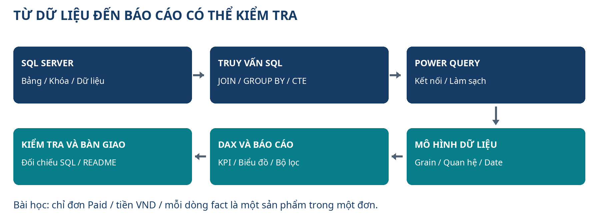
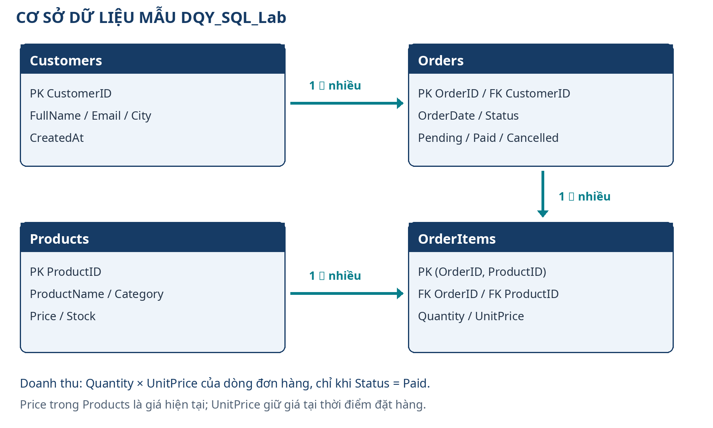
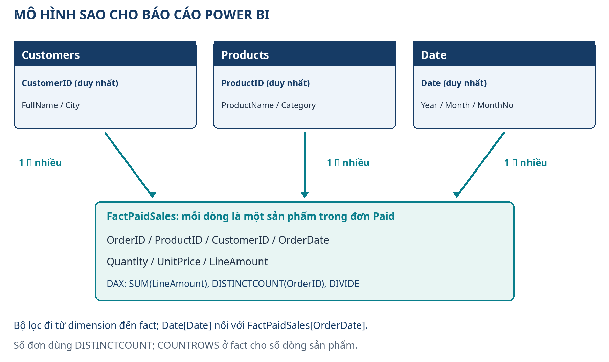

# Bắt đầu từ đây: học SQL để phân tích dữ liệu và làm báo cáo

Cẩm nang này dành cho bạn muốn học cơ sở dữ liệu từ đầu, hoặc đã quên các thao tác, rồi tiến tới công việc **phân tích dữ liệu, báo cáo và Power BI**. Nội dung sử dụng SQL Server làm hệ quản trị chính, SSMS để thao tác trên Windows, và Power BI Desktop để xây mô hình và báo cáo. Mỗi phần giải thích việc cần làm, lý do, kết quả cần kiểm tra và lỗi thường gặp.

Bạn không cần nhớ tất cả câu lệnh ngay. Một buổi học có thể chỉ gồm: đọc một khái niệm, chạy một truy vấn, đối chiếu kết quả và ghi lại điều đã hiểu. Mục tiêu là tự làm được một báo cáo có dữ liệu đúng, giải thích được cách tính và bàn giao được cho người khác.

## SQL, SQL Server, MySQL và MongoDB khác nhau thế nào?

**SQL** là ngôn ngữ dùng để truy vấn và làm việc với dữ liệu trong các hệ quản trị quan hệ. **SQL Server** là sản phẩm cơ sở dữ liệu của Microsoft, dùng phương ngữ T-SQL. **MySQL** và **PostgreSQL** là các hệ quản trị quan hệ khác: cùng có SELECT, JOIN, GROUP BY và các khái niệm nền tảng, nhưng khác một số cú pháp và cách vận hành. **MongoDB** chủ yếu tổ chức dữ liệu theo document; cách truy vấn và thiết kế không giống việc viết T-SQL.

Cẩm nang chọn SQL Server vì phù hợp hướng Microsoft, báo cáo doanh nghiệp, Power BI và các dự án sử dụng hệ sinh thái này. Các kỹ năng đọc bảng, xác định khóa, nối dữ liệu, tổng hợp và kiểm tra kết quả chuyển được sang nhiều hệ quản trị khác. Chương 26 giúp bạn nhận ra những điểm cần đổi khi chuyển công cụ.

Việc chọn SQL Server ở đây là một lựa chọn học tập theo mục tiêu của bạn, không phải bảng xếp hạng tuyển dụng. Khi tìm việc, đọc yêu cầu các vị trí phù hợp khu vực và trình độ của mình: SQL Server/T-SQL, PostgreSQL, MySQL, Excel, Power BI hoặc các công cụ khác có thể được yêu cầu theo công ty.

## Phần mềm nào giữ dữ liệu, phần mềm nào giúp bạn thao tác?

| Công cụ | Nó làm gì? | Bạn sử dụng trong bài học |
|---|---|---|
| SQL Server | Máy chủ lưu, kiểm tra và xử lý dữ liệu | Chạy cơ sở dữ liệu DQY_SQL_Lab |
| SSMS | Ứng dụng kết nối và quản lý SQL Server | Mở query, chạy SQL, đọc kết quả |
| Power BI Desktop | Làm sạch, mô hình hóa và trực quan hóa dữ liệu | Tạo báo cáo bán hàng và measures DAX |
| GitHub | Lưu mã, tài liệu và lịch sử thay đổi | Bàn giao script SQL và portfolio dữ liệu |

Cài SSMS chưa có nghĩa đã cài SQL Server. Đóng cửa sổ SSMS cũng không có nghĩa dịch vụ SQL Server đã dừng. Power BI kết nối đến máy chủ dữ liệu bằng địa chỉ và thông tin xác thực, giống nguyên tắc client/server đã học trong cẩm nang Postman.

Lộ trình mặc định dùng Windows để thao tác SSMS và Power BI Desktop. Người dùng macOS/Linux cần đọc phần lựa chọn client và máy chủ ở chương 3; các phần mềm này không có cùng cách cài trên mọi hệ điều hành. SQL Server trong container có yêu cầu nền tảng riêng; không mặc định một hướng dẫn Docker dùng được trên mọi máy Mac hoặc mọi CPU.

## Bộ tệp đi kèm

- **Cam-nang-SQL-Server-Power-BI.docx:** bản Word có mục lục, dùng để đọc và ghi chú.
- **Cam-nang-SQL-Server-Power-BI.pdf:** bản PDF để đọc và in, bố cục cố định.
- **Bo-thuc-hanh-SQL-Server.zip:** script tạo cơ sở dữ liệu, schema, dữ liệu mẫu, bài tập, lời giải, kiểm tra và phần nâng cao.
- **README-thuc-hanh.md trong ZIP:** thứ tự thực hiện, điều kiện cài đặt và cách chạy bộ bài học.

Giải nén ZIP vào thư mục riêng. Đọc README trước khi chạy script. Những tệp nâng cao có thể tạo view, procedure hoặc index; tệp reset được đặt riêng và có cơ chế xác nhận. Việc reset chỉ phục vụ cơ sở dữ liệu bài học, không phải bước bắt buộc trước mọi truy vấn.

## Học phần nào trước để đi theo hướng Data Analyst/BI?

| Giai đoạn | Nội dung ưu tiên | Bạn phải tự làm được |
|---|---|---|
| Bắt đầu | Chương 1–8 | Kết nối, đọc bảng, lọc và hiểu NULL/kiểu dữ liệu |
| Phân tích SQL | Chương 9–14 và 16 | JOIN đúng, tổng hợp, CTE, window functions, tính KPI |
| Bàn giao dữ liệu | Chương 15, 21 và 23 | View, tham số, quyền đọc và script có lịch sử |
| Báo cáo Power BI | Chương 25 và 27 | Power Query, mô hình sao, DAX, dashboard và đối chiếu SQL |
| Chuẩn bị việc làm | Chương 28–30 | Portfolio, giải thích lựa chọn, luyện phỏng vấn và tra cứu lỗi |
| Mở rộng chuyên sâu | Chương 17–24, 26 | Đọc transaction, index, backup và khác biệt hệ quản trị khi công việc cần |

Chương 17–24 vẫn có đầy đủ nội dung nâng cao. Với hướng phân tích dữ liệu, bạn nên hoàn thành truy vấn và báo cáo trước khi dành nhiều thời gian cho quản trị máy chủ, khóa và phục hồi sự cố. Lộ trình 90 ngày ở chương 29 chia thời gian theo mục tiêu này.

## Quy trình từ dữ liệu đến một báo cáo đáng tin



Trước khi vẽ biểu đồ, phải thống nhất câu hỏi kinh doanh. “Doanh thu” là doanh thu của đơn nào, theo ngày nào, đơn vị tiền gì? Có tính đơn hủy không? Một dòng dữ liệu đại diện cho đơn hàng hay sản phẩm trong đơn? Câu trả lời quyết định truy vấn và cách tạo measures.

Trong bộ bài học, doanh thu được định nghĩa là **tổng Quantity × UnitPrice của các đơn Status = Paid**, đơn vị VND, theo OrderDate. Dữ liệu không có thuế, giảm giá, hoàn hàng hay giá vốn; các chỉ số yêu cầu những thông tin đó cần mở rộng dữ liệu và định nghĩa riêng trước khi tính.

## Cơ sở dữ liệu bán hàng mẫu



Cơ sở dữ liệu gồm Customers, Products, Orders và OrderItems. Một khách hàng có thể chưa có đơn hoặc có nhiều đơn; một sản phẩm có thể chưa được đặt hoặc xuất hiện ở nhiều đơn. OrderItems giữ từng sản phẩm trong một đơn, với khóa ghép OrderID và ProductID.

**Grain** nghĩa là một dòng dữ liệu đang đại diện cho điều gì. Trong view dùng cho Power BI, mỗi dòng là **một sản phẩm trong một đơn đã thanh toán**, không phải một đơn đầy đủ. Một đơn có hai sản phẩm tạo ra hai dòng; COUNTROWS ở bảng fact vì vậy không phải số đơn. Số đơn cần DISTINCTCOUNT(OrderID).

Price trong Products là giá hiện tại. UnitPrice trong OrderItems lưu giá ở thời điểm đơn hàng; báo cáo lịch sử dùng UnitPrice. Nếu đổi giá sản phẩm hiện tại mà doanh thu cũ thay đổi theo, báo cáo đang sử dụng sai trường hoặc mô hình.

## Những số liệu để tự đối chiếu

Bộ dữ liệu nhỏ giúp bạn có thể kiểm tra bằng tay trước khi chuyển sang dữ liệu lớn. Các mốc này được dùng ở bài tập và lời giải; hãy kiểm tra trên dữ liệu gốc, trước khi thử thay đổi hoặc reset.

| Chỉ số | Giá trị của dữ liệu mẫu | Cách hiểu |
|---|---|---|
| Bảng nguồn | 6 khách hàng, 6 sản phẩm, 8 đơn, 13 dòng đơn | Dữ liệu cố định để học |
| Đơn đã thanh toán | 6 đơn; 11 dòng fact | Một đơn có thể có nhiều dòng sản phẩm |
| Doanh thu Paid | 57.200.000 VND | Chỉ tính đơn Paid |
| Khách có đơn Paid | 4 khách hàng | Đếm CustomerID khác nhau của đơn Paid |
| Số lượng sản phẩm bán | 20 đơn vị | SUM(Quantity) của các dòng Paid |
| Giá trị đơn trung bình | 9.533.333,33 VND khi làm tròn | 57.200.000 chia 6, không phải trung bình từng dòng |

Doanh thu theo tháng 2025: tháng 1 là 25.300.000 VND, tháng 2 là 1.600.000 VND, tháng 3 là 15.000.000 VND, tháng 4 là 15.300.000 VND. Dữ liệu các tháng sau không có giao dịch; cách hiển thị trống hay số 0 trong biểu đồ cần được chọn rõ.

Giá trị có thể thay đổi sau khi bạn chạy INSERT/UPDATE/DELETE. Với bài sửa dữ liệu có ROLLBACK, đọc hướng dẫn transaction để biết dữ liệu đã được hoàn tác. Nếu kết quả khác, kiểm tra trạng thái dữ liệu trước khi sửa câu truy vấn hoặc nới kỳ vọng.

## Cách đọc mã và thao tác trong tài liệu

- Nội dung trong khung `sql` chạy trong cửa sổ query kết nối SQL Server, không chạy ở PowerShell.
- Các lệnh `docker`, `sqlcmd` hoặc `node` chạy ở terminal theo hướng dẫn tương ứng.
- **GO** là dấu phân tách batch của các công cụ như SSMS/sqlcmd. Nó không phải câu lệnh mà SQL Server tự hiểu khi gửi nguyên chuỗi qua mọi thư viện ứng dụng.
- Chọn đúng database trước khi Execute/F5; thường script có `USE DQY_SQL_Lab` để làm rõ ngữ cảnh.
- `dbo.Customers` chỉ rõ schema và tên bảng. Không bỏ tên schema khi việc đó làm bạn nhầm đối tượng.
- Chuỗi tiếng Việt trong T-SQL dùng dạng `N'...'` khi làm việc với dữ liệu Unicode.
- Các tên như `TEN_MAY_CUA_BAN`, `DUONG_DAN_BACKUP` là chỗ thay theo máy thật. Không gõ nguyên một đường dẫn minh họa rồi đoán rằng thư mục đã tồn tại.

SELECT dùng để đọc. UPDATE/DELETE cần kiểm tra điều kiện WHERE và số dòng trước khi chạy. Một script lấy từ Internet có thể thay đổi dữ liệu; bạn cần đọc nội dung và chạy trong môi trường phù hợp. Bài học dùng dữ liệu giả trong database riêng trên máy của bạn.

## Cách tra cứu Word/PDF

Trong Microsoft Word trên máy, mở **View → Navigation Pane** để xem các đề mục. Mục lục có liên kết; bấm hoặc Ctrl+bấm tùy ứng dụng. Tìm từ bằng Ctrl+F trên Windows hoặc Command+F trên macOS. Sau khi tự sửa tài liệu, cập nhật mục lục bằng Update Table/Update Field khi cần.

Số trang Word có thể khác nhẹ giữa phông chữ và ứng dụng. Bản PDF giữ bố cục cố định. Nếu phần xem trước trên trình duyệt không mở được, tải tệp về hoặc dùng bản đọc trực tiếp trên GitHub.

## Phiên bản và phạm vi kiểm tra

Tài liệu biên soạn ngày **11/10/2026**. Bộ bài học ưu tiên T-SQL tương thích SQL Server 2022 trở lên, trong khi phần chọn và cài công cụ giải thích các khác biệt của phiên bản hiện hành. Không coi các hạn mức Express hoặc tính năng riêng của SQL Server 2025 là giống nhau ở mọi phiên bản.

Phần nguồn và nghiệm thu cuối cẩm nang ghi rõ nguồn đã đối chiếu, các phép kiểm tra đã thực hiện và những phần bạn cần thao tác trên máy/tài khoản của mình. Các bước Power BI là hướng dẫn tạo báo cáo; bộ tài liệu không khẳng định đã kết nối máy tính của bạn, phát hành báo cáo lên tenant của bạn hoặc triển khai cơ sở dữ liệu doanh nghiệp.


# Chương 1. Hiểu cơ sở dữ liệu và công việc có thể làm với SQL

## 1.1. Học để giải quyết việc gì?

Một doanh nghiệp bán hàng có khách hàng, sản phẩm, đơn hàng và các dòng sản phẩm trong mỗi đơn. Nếu ghi mọi thứ vào một bảng Excel, tên khách có thể bị nhập khác nhau, giá sản phẩm thay đổi làm sai báo cáo cũ và hai người sửa cùng lúc có thể làm mất dữ liệu. Cơ sở dữ liệu giúp tổ chức thông tin có quy tắc, tìm kiếm nhanh và kiểm soát việc thay đổi.

SQL là ngôn ngữ để làm việc với cơ sở dữ liệu quan hệ. Bạn dùng SQL để trả lời câu hỏi như: tháng trước bán được bao nhiêu, khách nào chưa mua hàng, sản phẩm nào sắp hết tồn kho, có đơn hàng bị thiếu thông tin hay không? Khi viết một website, SQL còn giúp lưu tài khoản, đọc sản phẩm và ghi đơn hàng. SQL không chỉ phục vụ lập trình viên.

Mục tiêu của cẩm nang là giúp bạn hiểu câu lệnh, dự đoán kết quả và kiểm tra kết quả. Gõ lại một câu đúng chưa đủ; bạn cần giải thích được nó đọc bảng nào, giữ dòng nào và có thay đổi dữ liệu không. Đây là năng lực dùng được trong công việc và khi phỏng vấn.

Hướng chính của tài liệu là **phân tích dữ liệu, báo cáo và Power BI**. Bạn sẽ luyện từ câu hỏi nghiệp vụ đến dữ liệu đúng, rồi trình bày kết quả. Các phần ứng dụng và quản trị giúp bạn phối hợp với đồng nghiệp; chúng không phải điều kiện để bắt đầu làm báo cáo đầu tiên.

## 1.2. Phân biệt dữ liệu, database và phần mềm quản lý

Hãy hình dung một kho hồ sơ. Một hồ sơ có các trường thông tin; các hồ sơ cùng loại được xếp cùng nhóm; nhiều nhóm tạo thành một kho. Người quản lý kho quyết định ai được xem, được sửa và cách lấy hồ sơ.

| Khái niệm | Hiểu đơn giản | Ví dụ trong bài thực hành |
|---|---|---|
| Dữ liệu | Giá trị cụ thể được lưu | Tên khách, giá 300000, ngày đặt hàng |
| Bảng, hay table | Một nhóm dữ liệu có cấu trúc cột | `dbo.Customers`, `dbo.Products` |
| Database | Tập hợp bảng và các đối tượng liên quan | `DQY_SQL_Lab` |
| DBMS | Phần mềm quản lý database | Microsoft SQL Server |

Một dòng, hay row, thường biểu diễn một đối tượng hoặc một sự kiện. Một cột, hay column, mô tả một thuộc tính. Ví dụ, bảng sản phẩm có một dòng cho mỗi sản phẩm; các cột `ProductID`, `ProductName`, `Price`, `Stock` cho biết mã, tên, giá và tồn kho.

Trong SQL Server, một máy chủ có thể chạy nhiều instance, tức các bản dịch vụ độc lập. Mỗi instance có thể chứa nhiều database. Trong mỗi database có các schema; `dbo` là schema dùng trong bộ thực hành. Tên đầy đủ `dbo.Products` giúp xác định rõ bảng thuộc schema nào. Schema không phải thư mục trên ổ C.

Luồng làm việc là: bạn mở SSMS → kết nối một instance SQL Server → chọn database → chạy câu SQL → đọc kết quả. SSMS là công cụ khách; SQL Server là dịch vụ xử lý. Chỉ cài SSMS thì chưa tự có một máy chủ để lưu dữ liệu.

## 1.3. Vì sao dùng nhiều bảng thay vì một bảng rất lớn?

Trong bài bán hàng, một khách có thể đặt nhiều đơn. Một đơn có thể chứa nhiều sản phẩm. Nếu sao chép tên, email, địa chỉ khách vào mọi dòng đơn hàng, bạn phải sửa nhiều nơi khi khách đổi thông tin. Nếu lưu giá hiện tại của sản phẩm và dùng nó cho mọi báo cáo quá khứ, doanh thu cũ có thể thay đổi khi bảng giá mới được cập nhật.

Bộ thực hành chia thành bốn bảng:

| Bảng | Mỗi dòng biểu diễn | Cột liên kết quan trọng |
|---|---|---|
| `Customers` | Một khách hàng | `CustomerID` |
| `Products` | Một sản phẩm | `ProductID` |
| `Orders` | Một đơn hàng của khách | `OrderID`, `CustomerID` |
| `OrderItems` | Một sản phẩm trong một đơn | `OrderID`, `ProductID` |

`Orders.CustomerID` chỉ về khách sở hữu đơn. `OrderItems.OrderID` chỉ về đơn; `OrderItems.ProductID` chỉ về sản phẩm. Giá lúc bán được lưu ở `OrderItems.UnitPrice`. Vì vậy, đổi `Products.Price` cho lần bán sau không tự sửa doanh thu đã ghi nhận.

Quy tắc này chưa thay thế toàn bộ nghiệp vụ kế toán. Hệ thống thật còn có hoàn tiền, thuế, giảm giá, tiền tệ và chứng từ. Bài học quan trọng là xác định dữ liệu nào cần giữ tại thời điểm giao dịch, thay vì suy ngược từ dữ liệu đang thay đổi.

Với người làm báo cáo, hãy hỏi **một dòng đang đại diện cho điều gì?** Đây là mức chi tiết, hay grain. Một dòng `Orders` là một đơn; một dòng `OrderItems` là một sản phẩm trong một đơn. Nếu nối hai bảng, một đơn có ba sản phẩm sẽ xuất hiện trong ba dòng kết quả. Đếm ba dòng đó như ba đơn là báo cáo sai. Trước khi tính tổng hoặc đếm, hãy ghi mức chi tiết của kết quả bằng một câu.

## 1.4. SQL gồm những nhóm thao tác nào?

| Nhóm thao tác | Câu lệnh thường gặp | Công dụng |
|---|---|---|
| Đọc dữ liệu | `SELECT` | Lọc, nối bảng, tổng hợp và lập báo cáo |
| Thay đổi dữ liệu | `INSERT`, `UPDATE`, `DELETE` | Thêm, sửa, xóa dòng |
| Thay đổi cấu trúc | `CREATE`, `ALTER`, `DROP` | Tạo hoặc đổi bảng và đối tượng |
| Điều khiển giao dịch, quyền | `BEGIN TRAN`, `COMMIT`, `ROLLBACK`, `GRANT` | Kiểm soát tính toàn vẹn và quyền truy cập |

Một câu `SELECT` chỉ đọc dữ liệu thường là điểm bắt đầu an toàn cho người học. `UPDATE` hoặc `DELETE` có thể tác động nhiều dòng nếu điều kiện sai. Các lệnh thay đổi cấu trúc có thể ảnh hưởng cả ứng dụng. Vì vậy, cẩm nang sẽ dạy cách xem trước phạm vi, sử dụng giao dịch và kiểm tra database hiện tại trước khi sửa.

SQL Server sử dụng T-SQL, tức Transact-SQL. T-SQL bao gồm SQL và các phần mở rộng như biến, xử lý lỗi và stored procedure. Khi chuyển sang PostgreSQL hoặc MySQL, tư duy bảng, khóa, lọc, JOIN và GROUP BY vẫn dùng được; một số cú pháp cần đổi.

## 1.5. Những hướng nghề nghiệp có thể dùng SQL

| Hướng công việc | Việc dùng SQL thường gặp | Kiến thức cần bổ sung |
|---|---|---|
| Phân tích dữ liệu, BI | Làm sạch, tổng hợp, giải thích số liệu | Excel, Power BI, thống kê, hiểu nghiệp vụ |
| Backend, phát triển ứng dụng | Đọc và ghi dữ liệu, giao dịch, API | Một ngôn ngữ lập trình, bảo mật, Git, kiểm thử |
| Kiểm thử phần mềm | Chuẩn bị dữ liệu, xác minh API và database | Quy trình kiểm thử, Postman, tự động hóa |
| DBA, kỹ sư dữ liệu | Vận hành, khôi phục, tối ưu, xây luồng dữ liệu | Hệ điều hành, mạng, backup, ETL, giám sát |

SQL mở thêm hướng công việc khi đi cùng kỹ năng phù hợp. Cẩm nang không hứa một mức lương hay đảm bảo có việc. Bạn có thể tăng sức thuyết phục bằng một dự án nhỏ có dữ liệu, câu hỏi nghiệp vụ, truy vấn rõ ràng, kiểm tra đúng sai và README để người khác chạy lại.

Nếu bạn từng làm văn phòng, hãy bắt đầu từ câu hỏi báo cáo doanh thu và khách hàng. Nếu thích làm website, hãy chú ý CRUD, khóa ngoại và giao dịch. Nếu muốn làm QA, tập đối chiếu response API với bản ghi database và kiểm tra các trường hợp nhập sai.

## 1.6. Bài tập nhận diện trước khi gõ SQL

1. Viết ra ba loại dữ liệu doanh nghiệp bạn quan tâm: ví dụ khách hàng, hợp đồng, thanh toán.
2. Với mỗi loại, chọn ba thuộc tính và một mã định danh.
3. Mô tả bằng lời quan hệ giữa chúng. Ví dụ: một khách có nhiều hợp đồng.
4. Viết ba câu hỏi cần trả lời. Câu hỏi phải có mốc thời gian, phạm vi và ý nghĩa rõ ràng.

Ví dụ tốt: “Tổng giá trị các đơn có trạng thái Paid trong tháng 1 năm 2025 là bao nhiêu?” Ví dụ chưa rõ: “Doanh thu tháng trước?” vì bạn chưa xác định tháng theo múi giờ nào, trạng thái nào và có trừ hoàn tiền không.

**Kết quả cần đạt:** bạn phân biệt được SQL, SQL Server và SSMS; giải thích được bảng, dòng, cột; hiểu vì sao dữ liệu bán hàng được chia thành nhiều bảng. Nếu vẫn thấy chúng giống nhau, đọc lại mục 1.2 trước khi cài phần mềm.

# Chương 2. Chọn SQL Server làm công cụ chính và hiểu các lựa chọn khác

## 2.1. Nên học SQL Server, MySQL hay MongoDB?

Trong cẩm nang này, bạn sẽ học **Microsoft SQL Server** với **SQL Server Management Studio, viết tắt SSMS**. SQL Server là hệ quản trị; SSMS là công cụ để kết nối, viết SQL và xem kết quả. Lựa chọn này phù hợp để luyện SQL quan hệ, làm các bài nghiệp vụ bán hàng và tiếp cận môi trường dùng Microsoft, .NET hoặc Power BI.

Với mục tiêu phân tích dữ liệu của bạn, SQL Server và SSMS tạo một đường học rõ: kiểm tra dữ liệu bằng SQL → xây truy vấn báo cáo có định nghĩa → kết nối Power BI Desktop trên Windows → làm dashboard. Power BI là công cụ phân tích và trình bày; nó không tự chứng minh số liệu đầu vào đúng. Phần kiểm tra dữ liệu bằng SQL vẫn rất cần thiết.

Không có một hệ quản trị đứng đầu mọi dự án. Khi tìm việc, hãy đọc tin tuyển dụng ở địa phương và ngành bạn muốn vào. Ghi lại yêu cầu thực tế: SQL Server, PostgreSQL, MySQL, MongoDB, Power BI, Python hoặc Java. Sự xuất hiện của một tên phần mềm trong vài tin tuyển dụng không đủ để kết luận thị phần.

Điều có giá trị lâu dài là hiểu cách thiết kế dữ liệu, viết truy vấn đúng, xử lý giao dịch và bảo vệ dữ liệu. Một người biết giải thích JOIN, NULL và chỉ mục thường chuyển hệ quản trị dễ hơn người chỉ nhớ vị trí nút bấm.

## 2.2. Bảng so sánh để ra quyết định

| Công cụ | Kiểu dữ liệu chủ đạo | Phù hợp khi | Điều cần nhớ |
|---|---|---|---|
| SQL Server | Bảng quan hệ, T-SQL | Hệ thống doanh nghiệp, .NET, báo cáo và vận hành Microsoft | Nhiều edition; giấy phép và tính năng phải đối chiếu phiên bản |
| PostgreSQL | Bảng quan hệ, SQL và mở rộng | Backend, phân tích và hệ thống cần tính năng quan hệ phong phú | Khác SQL Server ở cú pháp và công cụ quản trị |
| MySQL | Bảng quan hệ, SQL | Nhiều ứng dụng web và hệ thống đã dùng MySQL | Chọn đúng phiên bản, engine và chế độ SQL |
| MongoDB | Tài liệu dạng BSON | Dữ liệu theo tài liệu, cấu trúc thay đổi có kiểm soát | Truy vấn và mô hình khác SQL; vẫn cần thiết kế và chỉ mục |

MongoDB không phải một phiên bản SQL Server. Bạn thường thao tác document bằng các bộ lọc và pipeline riêng. Document có thể chứa mảng và đối tượng lồng nhau. MongoDB cũng có schema validation, chỉ mục và giao dịch trong các điều kiện hỗ trợ; vì vậy không nên hiểu “NoSQL” là không có cấu trúc, không có giao dịch hoặc cứ lưu tùy ý.

Ví dụ, một giỏ hàng có thể được biểu diễn như một document chứa mảng các mặt hàng. Với quan hệ, bạn có thể dùng bảng giỏ hàng và bảng dòng giỏ hàng. Hai cách đều cần cân nhắc việc cập nhật, truy vấn, kiểm soát đồng thời và kích thước dữ liệu.

## 2.3. Phân biệt SQL Server với MySQL

Hai tên cùng có chữ SQL nhưng là hai sản phẩm độc lập. Cài MySQL Workbench không giúp kết nối một instance SQL Server theo cách thông thường. Cài SSMS cũng không tạo một máy chủ MySQL.

Trong SQL Server, ví dụ lấy năm dòng đầu là:

```sql
SELECT TOP (5) ProductID, ProductName, Price
FROM dbo.Products
ORDER BY ProductID;
```

Trong PostgreSQL và MySQL, cách thường gặp là:

```sql
SELECT ProductID, ProductName, Price
FROM Products
ORDER BY ProductID
LIMIT 5;
```

Ví dụ thứ hai minh họa khác biệt cú pháp; không chạy nguyên văn trong SQL Server. Các khái niệm “chọn cột”, “sắp xếp” và “giới hạn số dòng” vẫn giống nhau. Tên bảng và quy tắc chữ hoa, chữ thường cũng có thể khác theo hệ quản trị và cấu hình.

## 2.4. Những kiến thức học một lần, dùng nhiều nơi

Bạn nên xây nền ở các phần sau: bảng và kiểu dữ liệu; khóa chính và khóa ngoại; NULL; SELECT và điều kiện lọc; JOIN; GROUP BY; hàm tổng hợp; subquery và CTE; transaction; index; kế hoạch thực thi; phân quyền; backup và restore.

Khi chuyển hệ quản trị, lập một bảng đối chiếu nhỏ:

| Nhu cầu | SQL Server trong cẩm nang | Khi chuyển hệ khác |
|---|---|---|
| Tự tăng mã | `IDENTITY(1,1)` | Kiểm tra identity, sequence hoặc auto increment tương ứng |
| Thời điểm UTC hiện tại | `SYSUTCDATETIME()` | Kiểm tra hàm thời gian, kiểu timestamp và múi giờ |
| Giới hạn số dòng | `TOP`, `OFFSET ... FETCH` | Kiểm tra `LIMIT`, `OFFSET` hoặc cú pháp tương ứng |
| Chuỗi Unicode | `nvarchar`, literal `N'...'` | Kiểm tra charset, collation và kiểu chuỗi của hệ đích |

Đừng đổi tên hàm rồi giả định mọi thứ hoạt động giống nhau. Cách xử lý ngày giờ, khóa, lỗi và isolation level có thể khác. Với dự án thật, chạy kiểm thử trên chính hệ quản trị đích.

## 2.5. Vì sao dùng Developer cho việc học?

SQL Server Developer dành cho phát triển, thử nghiệm và minh họa theo điều khoản của edition tương ứng; không dùng làm máy chủ phục vụ công việc sản xuất. SQL Server 2022 Developer có khả năng của edition Enterprise. SQL Server 2025 có Standard Developer và Enterprise Developer, tương ứng với khả năng của hai edition đó. Cả hai gói Developer 2025 vẫn chỉ dành cho phát triển và thử nghiệm, không phải giấy phép production.

SQL Server Express cũng là lựa chọn miễn phí, thường dùng cho nhu cầu nhỏ và có giới hạn tài nguyên, dung lượng, tính năng. Ví dụ, giới hạn kích thước database quan hệ của Express 2022 là 10 GB, còn Express 2025 là 50 GB. Đây không phải dung lượng đĩa máy tính hay một cam kết mọi khối dữ liệu đều được tính giống nhau. Bạn cần xem bảng edition của đúng phiên bản và các giới hạn tài nguyên khác trước khi dùng cho hệ thống thật.

Bộ thực hành này dùng cú pháp tương thích SQL Server 2022 trở lên và không yêu cầu tính năng trả phí đặc biệt. Bạn có thể dùng một bản Developer phù hợp máy của mình. Nếu đã có SQL Server 2022 chạy ổn, không cần gỡ chỉ để học các bài nền tảng.

## 2.6. Chọn đường học theo mục tiêu

Nếu chưa biết mình thích hướng nào, hãy học SQL Server và hoàn thành báo cáo bán hàng trước. Sau đó chọn một nhánh:

1. **Phân tích dữ liệu:** xuất kết quả kiểm tra được, đưa vào Power BI hoặc Excel, giải thích vì sao các con số có ý nghĩa.
2. **Backend:** xây API đơn hàng, dùng truy vấn có tham số và giao dịch, tránh ghép chuỗi SQL từ đầu vào.
3. **QA:** chuẩn bị dữ liệu, gọi API bằng Postman, xác minh database và bảo đảm test dọn dữ liệu.
4. **Vận hành dữ liệu:** học quyền tối thiểu, giám sát, backup, restore thử và xử lý truy vấn chậm.

Bạn có thể học thêm MongoDB sau khi nắm một mô hình dữ liệu quan hệ. Khi học hệ thứ hai, dùng cùng một bài bán hàng để so sánh. Hỏi rõ: tài liệu nào cần chứa dữ liệu lồng nhau, phần nào cần tham chiếu, và thay đổi giá bán có làm sai lịch sử hay không?

## 2.7. Bài tập chọn công cụ có căn cứ

Tìm năm tin tuyển dụng còn hiệu lực thuộc hướng bạn quan tâm. Lập bảng gồm tên vị trí, công nghệ database được yêu cầu, kỹ năng đi cùng và một điểm bạn còn thiếu. Không cần nộp đơn ngay. Mục tiêu là chọn nội dung học theo yêu cầu cụ thể.

Sau đó viết một câu quyết định: “Tôi học SQL Server trước vì muốn làm ...; tôi sẽ chứng minh bằng dự án ...; sau dự án, tôi học thêm ...”. Ví dụ: “Tôi học SQL Server trước vì muốn làm QA cho ứng dụng doanh nghiệp; tôi sẽ chứng minh bằng bài kiểm tra API đơn hàng và truy vấn đối chiếu; sau đó tôi học Git và tự động hóa”.

**Kết quả cần đạt:** biết công cụ chính của cẩm nang, hiểu MongoDB thuộc hướng mô hình khác và có một lý do học phù hợp mục tiêu. Bạn không cần cài đồng thời bốn hệ quản trị.

# Chương 3. Cài SQL Server và SSMS từng bước

## 3.1. Chuẩn bị trước khi tải

Đường cài thuận tiện nhất của cẩm nang là máy Windows được phiên bản SQL Server và SSMS bạn chọn hỗ trợ. Windows 11 trên máy x64 là một lựa chọn thường gặp. Kiểm tra tài liệu hệ thống của đúng phiên bản; đừng mặc định một máy Windows cũ hoặc Windows ARM có thể cài mọi bản máy chủ.

Bạn cần quyền cài phần mềm, mạng để tải bộ cài và dung lượng trống đủ cho phần mềm, database, log và backup. Đóng ứng dụng không cần thiết trước khi cài. Không tải bản “crack”, không tắt phần mềm bảo vệ chỉ vì một video hướng dẫn yêu cầu.

| Việc chuẩn bị | Cách kiểm tra | Vì sao cần |
|---|---|---|
| Kiến trúc, hệ điều hành | Mở Settings → System → About | Chọn bộ cài được hỗ trợ |
| Dung lượng trống | Mở File Explorer → This PC | Bộ cài và database cần chỗ ghi |
| Quyền cài đặt | Kiểm tra bạn có thể chấp thuận cửa sổ quản trị | Dịch vụ SQL Server cần quyền cài |
| Nguồn chính thức | Bắt đầu từ trang tải SQL Server của Microsoft | Tránh bộ cài bị sửa hoặc quá cũ |

Hai địa chỉ để bắt đầu là trang tải SQL Server tại `https://www.microsoft.com/sql-server/sql-server-downloads` và hướng dẫn SSMS tại `https://learn.microsoft.com/ssms/install/install`. Giao diện trang, số phiên bản và trình cài có thể thay đổi. Hãy đối chiếu tên sản phẩm và publisher Microsoft trước khi chạy.

## 3.2. Cài máy chủ: SQL Server Developer

Các bước dưới đây mô tả mục đích của lựa chọn; tên nút có thể khác giữa các phiên bản.

1. Mở trang tải chính thức, chọn gói Developer thích hợp cho việc học và hệ điều hành được hỗ trợ.
2. Chạy bộ cài từ thư mục Downloads. Nếu Windows hỏi quyền quản trị, xác minh publisher rồi chấp thuận.
3. Nếu trình tải có lựa chọn Basic, Custom, Download Media, người mới có thể chọn Basic để cài nhanh. Custom phù hợp khi bạn muốn kiểm soát instance, đường dẫn và cấu hình.
4. Đọc điều khoản, chọn ngôn ngữ và đường dẫn phù hợp rồi bắt đầu cài.
5. Khi hoàn tất, ghi lại tên instance và thông tin kết nối mà trình cài hiển thị. Không chụp ảnh kèm mật khẩu rồi đưa lên GitHub.
6. Nếu cài bằng wizard tùy chỉnh, chọn tính năng **Database Engine Services**. Những tính năng khác chỉ thêm khi bài học hoặc dự án cần.
7. Ở bước cấu hình database engine, dùng Windows Authentication cho bài học cục bộ, thêm tài khoản Windows của bạn vào nhóm quản trị SQL khi wizard có nút tương ứng.

Vì sao dùng Windows Authentication? SQL Server có thể xác minh tài khoản Windows đang đăng nhập, nên bạn không phải tạo và ghi nhớ một mật khẩu SQL riêng cho lần học đầu. Tài khoản được wizard thêm làm quản trị chỉ nhằm thuận tiện trong máy lab; ứng dụng thật nên dùng quyền giới hạn.

Nếu bạn cài named instance, hãy ghi cả tên máy và tên instance. Ví dụ instance tên `SQLEXPRESS` thường kết nối bằng `.\SQLEXPRESS`, còn default instance thường dùng `localhost` hoặc `.`. Ký hiệu chấm ở đây là máy hiện tại. Không tự thêm `\SQLEXPRESS` khi bạn cài default instance.

**Kết quả cần thấy:** bộ cài hoàn thành, có dịch vụ SQL Server và biết instance cần kết nối. Cửa sổ “installation successful” chưa chứng minh bạn đã cài SSMS; đó là bước riêng.

## 3.3. Cài công cụ: SSMS

SSMS chạy trên Windows. Nó không được cài tự động cùng mọi bản SQL Server. Mở trang hướng dẫn cài SSMS của Microsoft, tải bản được hỗ trợ và chạy bộ cài. Các bản mới có thể dùng quy trình cài qua Visual Studio Installer; làm theo hướng dẫn của bản bạn tải, không cố tìm nút giống ảnh của một video cũ.

Sau khi cài, tìm “SQL Server Management Studio” trong Start và mở. Nếu lần đầu công cụ hỏi thiết lập hoặc đăng nhập một dịch vụ, đọc mục đích lựa chọn. Đăng nhập tài khoản Microsoft để dùng một tính năng đám mây không đồng nghĩa với Windows Authentication của instance SQL Server cục bộ.

Azure Data Studio đã được Microsoft cho nghỉ vào ngày 28/02/2026. Không dùng việc cài Azure Data Studio như lộ trình chính cho người mới. Trên Windows, cẩm nang dùng SSMS; trên macOS hoặc Linux, bạn có thể dùng Visual Studio Code với extension MSSQL của Microsoft, hoặc DBeaver có kết nối SQL Server.

## 3.4. Kết nối lần đầu

Trong hộp Connect, chọn kiểu kết nối Database Engine khi giao diện có mục này. Nhập server name dựa trên tên instance bạn đã cài, chọn Windows Authentication và bấm Connect.

| Trường | Ví dụ cho máy lab | Giải thích |
|---|---|---|
| Server name | `localhost` | Default instance trên máy của bạn |
| Server name nếu có named instance | `.\SQLEXPRESS` | Chỉ dùng nếu instance thực sự mang tên này |
| Authentication | Windows Authentication | Dùng danh tính Windows đã được cấp quyền |
| Database | Để mặc định lúc kết nối đầu | Chọn `DQY_SQL_Lab` sau khi tạo database |

Không cần thay firewall để kết nối cục bộ theo cấu hình thông thường của máy lab. Không mở cổng SQL Server ra Internet chỉ để hoàn thành bài đầu. Với máy chủ công ty, phải dùng server name, VPN và phương thức đăng nhập do người quản trị cung cấp.

### Khi gặp lỗi chứng chỉ

Các công cụ mới có thể bật mã hóa kết nối và kiểm tra chứng chỉ theo mặc định. Một instance cục bộ vừa cài thường chưa có chứng chỉ do một cơ quan được máy khách tin cậy cấp. Khi đó bạn có thể gặp lỗi certificate chain not trusted hoặc hostname mismatch.

Ưu tiên đọc đúng lỗi và xác định bạn đang kết nối chính instance lab của mình. Với **lab cục bộ bạn kiểm soát**, lựa chọn Trust server certificate có thể là một ngoại lệ rõ ràng để dùng chứng chỉ tự ký. Lựa chọn này bỏ bước xác minh danh tính chứng chỉ; nó không thay thế cấu hình TLS đúng cho máy chủ thật. Giữ lựa chọn mã hóa phù hợp, ghi nhớ bạn đã dùng ngoại lệ và không áp dụng nó tự động cho server công ty hoặc server Internet.

Nếu gặp lỗi với chế độ Strict, kiểm tra khả năng hỗ trợ của server và hướng dẫn của phiên bản công cụ. Không mặc định hạ bảo mật. Với kết nối thật, cần chứng chỉ tin cậy và tên máy chủ khớp chứng chỉ; nhờ quản trị viên xử lý.

## 3.5. Xác minh bằng một truy vấn nhỏ

Khi Object Explorer hiện server, bấm New Query và chạy:

```sql
SELECT
    @@VERSION AS ServerVersion,
    SERVERPROPERTY('Edition') AS Edition,
    SERVERPROPERTY('InstanceName') AS InstanceName,
    DB_NAME() AS CurrentDatabase;
```

`@@VERSION` cho biết bản máy chủ thực sự chạy, không phải bản SSMS. `InstanceName` bằng NULL có thể là default instance; đây không nhất thiết là lỗi. `CurrentDatabase` lúc đầu có thể là `master`. Database bài tập sẽ được tạo sau.

Lưu lại tên instance, edition và số phiên bản vào ghi chú riêng. Không cần ghi toàn bộ thông tin máy lên repository công khai. Nếu kết quả khác điều bạn nghĩ đã cài, kiểm tra xem bạn đang kết nối instance cũ nào không.

## 3.6. Nếu không kết nối được

| Triệu chứng | Kiểm tra trước | Hướng xử lý |
|---|---|---|
| Không tìm thấy server, lỗi 26 hoặc 40 | Tên instance và trạng thái dịch vụ | Mở SQL Server Configuration Manager hoặc Services, kiểm tra đúng dịch vụ |
| Login failed, lỗi 18456 | Authentication và tài khoản được cấp quyền | Dùng tài khoản đã được thêm khi cài; xem log nếu cần |
| Lỗi chứng chỉ | Bạn đang vào server nào, chế độ mã hóa nào | Dùng chứng chỉ tin cậy; ngoại lệ chỉ cho lab cục bộ đã xác định |
| Kết nối máy khác bị timeout | VPN, tên host, TCP port, firewall | Dùng thông tin quản trị cung cấp; không mở tất cả cổng |

Tên dịch vụ có thể hiện `SQL Server (MSSQLSERVER)` cho default instance hoặc tên khác trong ngoặc cho named instance. SQL Server Browser không phải bản thân Database Engine; chỉ khởi động Browser không làm một dịch vụ Database Engine đang dừng chạy lên.

## 3.7. Nếu dùng macOS, Linux hoặc Docker

SSMS là công cụ Windows. Trên macOS/Linux, dùng DBeaver để kết nối một SQL Server đang chạy trên máy chủ, máy ảo hoặc môi trường container được hỗ trợ. Câu SQL của bộ bài vẫn là T-SQL; đổi công cụ khách không tự đổi ngôn ngữ database.

SQL Server Linux/container có yêu cầu nền tảng và kiến trúc cụ thể. Các image SQL Server thông dụng là cho x86-64. Mac Apple Silicon không nên được hứa rằng chạy image bằng giả lập là một cấu hình SQL Server được Microsoft hỗ trợ. Cách học ổn định hơn có thể là kết nối một máy SQL Server x64 từ xa được cấp quyền, hoặc một máy ảo/máy Windows phù hợp.

Nếu đã quen Docker trên máy x64 và có tài nguyên đủ, có thể dùng container SQL Server. Hãy đọc điều khoản, đặt mật khẩu mạnh, lưu bí mật ngoài Git và chỉ bind cổng vào `127.0.0.1` cho bài học. Container là cách đóng gói máy chủ, không phải một bản database khác. Khi xóa container mà không có volume phù hợp, dữ liệu có thể mất.

Người mới chưa cần học Docker trước SQL. Hoàn thành một truy vấn thành công trên một máy chủ được hỗ trợ là mục tiêu đầu tiên.

## 3.8. Bài tập xác nhận cài đặt

Ghi bốn dòng: công cụ khách bạn dùng; phiên bản SQL Server; server name; phương thức đăng nhập. Sau đó chạy truy vấn ở mục 3.5, đóng cửa sổ query, mở lại và chạy một lần nữa.

**Kết quả cần đạt:** kết nối được hai lần, biết instance mình đang dùng và phân biệt bản SSMS với bản SQL Server. Nếu chỉ mở được SSMS nhưng chưa kết nối, hãy xử lý bước này trước khi mở bộ bài thực hành.

# Chương 4. Làm quen SSMS và chạy bộ thực hành đúng thứ tự

## 4.1. Nhìn giao diện như một bàn làm việc

Các vùng quan trọng gồm Object Explorer bên trái, query editor ở giữa và Results/Messages bên dưới sau khi chạy. Object Explorer cho thấy cấu trúc các đối tượng mà tài khoản của bạn có quyền xem. Query editor là nơi viết SQL. Results hiển thị dữ liệu trả về; Messages hiển thị thông báo, lỗi và số dòng bị tác động.

Mỗi cửa sổ query có kết nối và database riêng. Hai tab nhìn giống nhau có thể đang dùng hai server khác nhau. Trước một lệnh thay đổi dữ liệu, kiểm tra tên server và database ở thanh công cụ hoặc chạy `SELECT DB_NAME();` trong chính tab đó.

## 4.2. Giải nén bộ thực hành

Tải bộ thực hành đi kèm cẩm nang và giải nén vào một thư mục bạn dễ tìm, ví dụ `Documents\DQY-SQL-Lab`. Không chạy file SQL trực tiếp trong cửa sổ ZIP. Đọc README trước; nó ghi phiên bản yêu cầu, thứ tự file và cách xác minh.

| File | Vai trò | Khi nào chạy |
|---|---|---|
| `01-create-database.sql` | Tạo database lab | Lần chuẩn bị đầu |
| `02-schema.sql`, `03-seed.sql` | Tạo bảng và dữ liệu mẫu | Theo thứ tự sau file 01 |
| `04-exercises.sql`, `05-solutions.sql` | Bài tập và lời giải | Sau khi đọc yêu cầu, tự thử trước |
| `06-validate.sql`, `07-advanced.sql`, `08-reset-lab.sql` | Xác minh, bài nâng cao, đặt lại lab | Theo README; reset chỉ khi chủ động làm lại |

Tên database của bộ bài là `DQY_SQL_Lab`. Không đổi sang một database công ty để “tận dụng dữ liệu sẵn”. Bài học có thao tác sửa và xóa; phải dùng dữ liệu giả trong lab riêng.

## 4.3. Chạy ba file khởi tạo

1. Trong SSMS, vào File → Open → File và mở `01-create-database.sql`.
2. Kiểm tra server đang kết nối là instance lab của bạn.
3. Đọc phần chú thích đầu file. File tạo database cần tài khoản có quyền tương ứng; Windows account quản trị của lab thường đã có.
4. Bấm Execute hoặc F5. Nếu bạn bôi đen một đoạn, SSMS chạy đoạn đang chọn; bỏ chọn để chạy cả file như README yêu cầu.
5. Xem tab Messages. Khi có lỗi, đọc số lỗi, dòng và tên đối tượng; không tiếp tục file sau khi file trước chưa hoàn tất.
6. Mở và chạy `02-schema.sql`, rồi `03-seed.sql`, theo đúng thứ tự.
7. Mở Object Explorer → Databases, Refresh nếu chưa thấy `DQY_SQL_Lab` → Tables. Bạn cần thấy bốn bảng `dbo.Customers`, `dbo.Products`, `dbo.Orders`, `dbo.OrderItems`.

Không chạy seed nhiều lần để “chắc ăn”. Nếu một script từ chối chạy lại vì dữ liệu đã có, đó là dấu hiệu cần đọc README và trạng thái hiện tại, không phải lý do xóa mọi bảng. File reset tồn tại cho lúc bạn chủ động tạo lại dữ liệu lab, không phải một bước sau mỗi SELECT.

## 4.4. Chọn đúng database trong query mới

Bạn có thể chọn `DQY_SQL_Lab` trên danh sách database của tab query hoặc ghi rõ ở đầu script:

```sql
USE DQY_SQL_Lab;
GO

SELECT DB_NAME() AS CurrentDatabase;
SELECT TOP (5) CustomerID, FullName, Email
FROM dbo.Customers
ORDER BY CustomerID;
```

`USE` đổi database hiện tại của kết nối. `GO` là dấu phân tách batch được SSMS và một số công cụ hiểu; nó không phải câu lệnh T-SQL gửi đến database engine. Khi gửi SQL qua một thư viện ứng dụng, bạn không mặc định nhét `GO` vào chuỗi truy vấn.

`CurrentDatabase` cần là `DQY_SQL_Lab`. Nếu báo Invalid object name 'dbo.Customers', hãy kiểm tra database hiện tại và việc chạy file schema trước. Đừng vội tạo một bảng khác cùng tên trong `master`.

## 4.5. Đọc kết quả ban đầu

Chạy truy vấn chỉ đọc sau:

```sql
SELECT N'Customers' AS TableName, COUNT(*) AS [RowCount]
FROM dbo.Customers
UNION ALL
SELECT N'Products', COUNT(*) FROM dbo.Products
UNION ALL
SELECT N'Orders', COUNT(*) FROM dbo.Orders
UNION ALL
SELECT N'OrderItems', COUNT(*) FROM dbo.OrderItems;
```

Dữ liệu ban đầu của bộ bài có 6 khách hàng, 6 sản phẩm, 8 đơn và 13 dòng đơn. Phần `UNION ALL` gộp các tập kết quả có cấu trúc tương thích; bạn sẽ học kỹ hơn ở các chương sau. Ở bước này, chỉ cần đọc tên bảng và số dòng.

Một database đã được dùng làm bài sửa dữ liệu có thể khác số đếm ban đầu. Vì vậy, đừng dùng số đếm như tiêu chuẩn đúng cho mọi thời điểm. Hãy ghi nhận việc mình đã làm và kiểm tra lab ở trạng thái nào. Script xác minh có các bài thử trong giao dịch rồi rollback; các kiểm thử có thể tiêu thụ giá trị identity dù không để lại dòng mới. Identity tăng có khoảng trống không đồng nghĩa có bản ghi bị mất.

## 4.6. Execute, chọn đoạn và lưu file

Nếu query editor chứa nhiều câu, Execute chạy toàn bộ phần được chọn hoặc toàn bộ nội dung khi không có lựa chọn. Điều này giải thích lỗi thường gặp: người học bôi đen `SELECT` để xem trước, rồi tưởng toàn bộ script transaction đã chạy.

Lưu bài bằng File → Save As, đặt tên như `Bai-01-loc-san-pham.sql`. Một file `.sql` chỉ là văn bản câu lệnh; nó không phải bản sao database và không tự chứa kết quả. Khi mở file trên máy khác, cần có database phù hợp và quyền truy cập.

Chú thích một dòng dùng `--`. Chú thích nhiều dòng dùng `/* ... */`. Hãy ghi mục đích nghiệp vụ và giả định, ví dụ “chỉ tính đơn Paid, giá dùng UnitPrice tại thời điểm bán”. Không ghi mật khẩu, connection string có bí mật hoặc dữ liệu khách thật trong chú thích.

```sql
-- Bài 01: xem sản phẩm có tồn kho không quá 15.
-- Chỉ đọc dữ liệu; không thay đổi tồn kho.
SELECT ProductID, ProductName, Stock
FROM dbo.Products
WHERE Stock <= 15
ORDER BY Stock, ProductID;
```

## 4.7. Những thao tác GUI nên dùng có chủ đích

Refresh giúp làm mới danh sách đối tượng, không chạy lại dữ liệu seed. Select Top 1000 Rows tạo câu SELECT để xem nhanh, nhưng con số này chỉ là giới hạn hiển thị của câu truy vấn. Một bảng có thể có nhiều hơn 1000 dòng.

Edit Top 200 Rows cho sửa trực tiếp trong lưới. Người mới nên dùng câu SQL có điều kiện và giao dịch thay vì sửa lưới tùy ý, vì việc giải thích, kiểm tra và lưu lịch sử bằng script rõ hơn. Đừng coi giao diện bảng giống Excel rồi dán hàng loạt dữ liệu vào database thật.

Hủy một truy vấn đang chạy bằng nút Cancel chỉ là yêu cầu dừng. Không đóng ứng dụng rồi giả định mọi thay đổi đã được rollback; bạn cần hiểu trạng thái giao dịch. Nếu nghi ngờ tab đang giữ giao dịch mở, kiểm tra theo hướng dẫn chương giao dịch.

## 4.8. Bài tập thao tác không cần nhớ câu lệnh dài

1. Mở một New Query, chọn lab và chạy `SELECT DB_NAME();`.
2. Mở một New Query khác, kiểm tra database của tab thứ hai.
3. Chạy câu SELECT sản phẩm ở mục 4.6; đọc sản phẩm, tồn kho và thứ tự.
4. Lưu câu SQL vào file, đóng tab, mở lại file và chạy.
5. Ghi vào README cá nhân: “Tôi đã khởi tạo lab; số dòng ban đầu là ...; file bài đầu của tôi là ...”.

**Kết quả cần đạt:** bạn chạy được script theo thứ tự, biết xem lỗi ở Messages, biết chỉ chạy đoạn đã chọn và không nhầm file SQL với database. Nếu chưa biết mình đang dùng database nào, chưa thực hiện bài UPDATE hoặc DELETE.

# Chương 5. Kiểu dữ liệu, NULL, khóa và quy tắc bảo vệ dữ liệu

## 5.1. Vì sao không lưu mọi thứ thành chuỗi?

Một ô có nội dung `15000000` có thể là số tiền hoặc một đoạn chữ. Nếu lưu thành chữ, việc cộng và so sánh cần chuyển đổi; thứ tự chữ cũng có thể khác thứ tự số. Ngày `01/02/2025` còn có thể bị hiểu là ngày 1 tháng 2 hoặc ngày 2 tháng 1 tùy định dạng.

Kiểu dữ liệu xác định giá trị hợp lệ, cách so sánh và dung lượng. Chọn kiểu đúng giúp database từ chối nhiều dữ liệu sai trước khi chúng làm hỏng báo cáo. Một cột không thể thay thế toàn bộ quy tắc nghiệp vụ, nhưng là lớp kiểm soát rất hữu ích.

| Kiểu trong lab | Dùng cho | Ví dụ |
|---|---|---|
| `int` | Số nguyên và mã định danh | `Quantity = 2`, `Stock = 10` |
| `decimal(18,2)` | Số thập phân chính xác theo độ chia đã chọn | `Price = 300000.00` |
| `nvarchar(100)` | Văn bản Unicode | Tên khách, thành phố có dấu |
| `varchar(200)`, `datetime2(0)` | Chuỗi theo cấu hình charset; thời điểm chính xác đến giây | Email mẫu; thời điểm UTC trong lab |

`decimal(18,2)` có tổng 18 chữ số, trong đó 2 chữ số sau dấu thập phân. Nó không có nghĩa giới hạn giá trị đến 18 đồng. `float` là số gần đúng, phù hợp một số phép đo nhưng thường không phải lựa chọn đầu cho giá và tiền cần chính xác. Với bài bán hàng này, dùng decimal.

SQL Server còn có `bit`, `date`, `bigint`, `uniqueidentifier` và nhiều kiểu khác. Chưa cần nhớ hết. Khi gặp một cột, hãy hỏi nó là số, văn bản, thời điểm hay trạng thái; có cần phần thập phân; có cần NULL; khoảng giá trị dự kiến là gì?

## 5.2. Unicode và chữ có dấu

Trong lab, tên và thành phố dùng `nvarchar` để lưu Unicode. Khi viết literal Unicode trong T-SQL, đặt `N` ngay trước dấu nháy:

```sql
SELECT N'Hà Nội' AS CityName;
```

Nếu cần một dấu nháy đơn trong chuỗi, viết hai dấu nháy liên tiếp:

```sql
SELECT N'Khách hàng tên O''Brien' AS ExampleText;
```

Không dùng dấu nháy kép thay cho mọi chuỗi chỉ vì quen một ngôn ngữ khác. Với literal T-SQL, dấu nháy đơn là cách cần luyện. Ký hiệu `[Tên cột]` dùng cho identifier trong những tình huống cần; nó không biểu diễn một giá trị văn bản.

`nvarchar(100)` quy định độ dài theo đơn vị lưu trữ UTF-16 tương ứng, không nên hiểu là cam kết mọi ký tự Unicode đặc biệt đều chiếm đúng một đơn vị. Với tên tiếng Việt thông thường trong bài, độ dài này đủ. Hệ thống thật phải kiểm tra dữ liệu và yêu cầu trước khi chọn giới hạn.

`varchar` không luôn có nghĩa “chỉ chứa chữ không dấu”: khả năng biểu diễn phụ thuộc collation, bao gồm cấu hình UTF-8 trong các phiên bản phù hợp. Cẩm nang dùng `nvarchar` cho nội dung Unicode để đường học dễ hiểu, và dùng email giả dạng ASCII trong cột varchar của lab.

## 5.3. NULL không phải số 0 hay chuỗi rỗng

NULL biểu diễn không có một giá trị đã biết ở cột đó. Thành phố NULL có thể nghĩa chưa thu thập; không tự suy ra khách không sống ở thành phố nào. `0` là một số cụ thể. `N''` là chuỗi rỗng. Chúng không giống nhau.

Các cột của lab đều NOT NULL, ngoại trừ `Customers.City`. Hãy chạy:

```sql
SELECT CustomerID, FullName, City
FROM dbo.Customers
WHERE City IS NULL
ORDER BY CustomerID;
```

Điều kiện đúng là `IS NULL`, không phải `= NULL`. Muốn lấy thành phố đã có giá trị thì dùng `IS NOT NULL`. Khi so sánh một giá trị với NULL, kết quả thường là UNKNOWN trong logic ba giá trị; WHERE chỉ giữ những dòng có điều kiện TRUE.

```sql
SELECT
    CustomerID,
    FullName,
    COALESCE(City, N'Chưa có thông tin') AS CityForDisplay
FROM dbo.Customers
ORDER BY CustomerID;
```

`COALESCE` ở đây chọn giá trị không NULL đầu tiên để trình bày; không sửa dữ liệu trong bảng. Đừng thay NULL bằng số 0 hoặc chữ “không” ngay trong nguồn nếu điều đó làm thay đổi ý nghĩa. Người làm báo cáo cần phân biệt chưa biết, không áp dụng và giá trị thật bằng 0.

## 5.4. Ngày giờ: lưu rõ, lọc rõ

`datetime2(0)` trong lab chứa ngày và giờ đến giây, không chứa múi giờ. Quy ước của lab là các thời điểm được lưu dưới dạng UTC. `SYSUTCDATETIME()` lấy thời điểm UTC hiện tại; mặc định của cột sẽ ép về độ chính xác cột.

```sql
SELECT
    SYSUTCDATETIME() AS UtcNow,
    CAST('2025-01-01T00:00:00' AS datetime2(0)) AS StartOfYear;
```

Định dạng ISO có `T` giữa ngày và giờ giúp tránh cách hiểu theo ngày/tháng khác nhau. Với dữ liệu giao dịch thật, nên gửi tham số ngày giờ có kiểu qua ứng dụng. Không ghép một chuỗi ngày theo thiết lập vùng của máy người dùng rồi mong database hiểu đúng.

Nếu báo cáo theo ngày kinh doanh ở Việt Nam, ngày UTC và ngày Việt Nam có thể khác quanh nửa đêm. Cần chuyển mốc bắt đầu, kết thúc về cùng quy ước hoặc xử lý múi giờ đúng. Đừng lấy `CreatedAt` để tính ngày đặt hàng khi yêu cầu nói về `OrderDate`; cùng là thời điểm nhưng mang ý nghĩa khác.

## 5.5. Khóa chính và identity

Khóa chính, PRIMARY KEY, nhận diện duy nhất một dòng và không cho NULL. `Customers.CustomerID` là khóa chính của khách hàng. Giá trị như 1, 2, 3 được tạo tự động nhờ `IDENTITY(1,1)` trong lab.

Identity là cơ chế cấp số, không phải số đếm chính xác các dòng còn tồn tại. Sau khi thử thêm dữ liệu rồi rollback, một số identity có thể đã bị tiêu thụ. Dòng bị xóa cũng có thể để lại khoảng trống. Muốn biết số dòng, dùng COUNT; không lấy mã lớn nhất làm số khách hàng.

Bạn thường không tự truyền `CustomerID` khi INSERT vào bảng có identity. Nếu cần mã khách bên ngoài doanh nghiệp, đó có thể là một cột riêng với quy tắc riêng. Không dùng việc “mã phải liên tục” làm lý do sửa toàn bộ khóa chính.

`OrderItems` có khóa chính ghép `(OrderID, ProductID)`. Điều này nghĩa một sản phẩm xuất hiện tối đa một lần trong một đơn theo mô hình lab; nếu muốn thêm cùng sản phẩm, hệ thống có thể cộng số lượng. Hệ thống cần nhiều dòng cùng sản phẩm với chương trình giảm giá khác nhau có thể chọn mô hình khác.

## 5.6. Khóa ngoại giữ quan hệ hợp lệ

Khóa ngoại, FOREIGN KEY, kiểm tra một giá trị tham chiếu có tồn tại trong bảng đích. `Orders.CustomerID` tham chiếu `Customers.CustomerID`. Bạn không thể tạo một đơn với CustomerID không tồn tại chỉ vì mã đó trông hợp lý.

Hai khóa ngoại ở `OrderItems` đảm bảo dòng đơn thuộc một đơn có thật và một sản phẩm có thật. Việc xóa một khách đang có đơn có thể bị từ chối theo quy tắc của lab. Không tắt kiểm tra khóa ngoại để “xóa cho được” mà chưa hiểu ảnh hưởng.

Khóa ngoại không tự trả lời mọi yêu cầu nghiệp vụ. Nó không kiểm tra khách có đủ tín dụng, sản phẩm có thể bán cho vùng đó hay đơn đã thanh toán. Các quy tắc này cần logic phù hợp ở database và ứng dụng.

## 5.7. UNIQUE, CHECK, DEFAULT và NOT NULL

| Quy tắc | Tác dụng trong lab | Lỗi giúp ngăn |
|---|---|---|
| `UNIQUE` | Email khách không trùng | Hai khách có cùng email theo quy tắc so sánh của cột |
| `CHECK` | Giá không âm, tồn kho không âm, số lượng dương | Nhập Price = -1 hoặc Quantity = 0 |
| `DEFAULT` | Có thời điểm UTC khi không truyền cột tương ứng | Bỏ quên giá trị có mặc định hợp lệ |
| `NOT NULL` | Cột bắt buộc có giá trị | Thiếu tên hoặc trạng thái cần thiết |

`Orders.Status` chỉ nhận `Pending`, `Paid`, `Cancelled`. Lab giới hạn tập trạng thái bằng CHECK. Bạn không tự chèn `Refunded` rồi mong bài báo cáo Paid hiểu cách tính mới.

DEFAULT được áp dụng khi câu INSERT không truyền cột đó hoặc dùng từ khóa DEFAULT. Nó không tự thay mọi NULL bạn gửi thành giá trị mặc định. Nếu cột NOT NULL mà bạn truyền NULL, database có thể báo lỗi dù cột có default.

## 5.8. Bài tập kiểm tra hiểu biết

1. Xác định kiểu của `Price`, `Quantity`, `FullName` và `OrderDate` trong Object Explorer.
2. Viết câu hỏi: “NULL ở City nghĩa gì trong dữ liệu mình đang có?”; không tự suy luận ngoài thông tin đã thu thập.
3. Dùng SELECT và COALESCE để hiển thị thành phố thiếu bằng chữ dễ đọc.
4. Giải thích vì sao mã lớn nhất không phải số khách.
5. Giải thích vì sao doanh thu lịch sử dùng `OrderItems.UnitPrice`, không lấy giá hiện tại ở Products.

**Kết quả cần đạt:** chọn được kiểu dữ liệu cho một cột đơn giản, hiểu NULL và biết bốn lớp bảo vệ dữ liệu. Đây là nền để bạn đọc lỗi INSERT đúng nghĩa thay vì xóa constraint để vượt lỗi.

# Chương 6. Đọc cấu trúc bảng và hiểu CREATE, ALTER

## 6.1. Người làm báo cáo có cần biết DDL?

Bạn không cần quyền sửa cấu trúc database công ty để làm báo cáo. Nhưng cần đọc cấu trúc để biết cột nào bắt buộc, khóa liên kết nằm đâu và vì sao dữ liệu có giới hạn. Các câu lệnh thay đổi cấu trúc được gọi là DDL.

Ở môi trường thật, tạo hoặc đổi bảng cần quy trình migration, đánh giá tác động và quyền phù hợp. Trong cẩm nang, bạn thực hành DDL trong database lab. Không sao chép một bài CREATE hoặc ALTER vào kết nối production.

## 6.2. Xem cấu trúc trước khi viết truy vấn

Trong Object Explorer, mở `DQY_SQL_Lab` → Tables → `dbo.Customers` → Columns. Nhìn kiểu dữ liệu, dấu cho phép NULL và khóa. Cũng có thể dùng:

```sql
USE DQY_SQL_Lab;
GO

EXEC sp_help N'dbo.Customers';
EXEC sp_help N'dbo.OrderItems';
```

`sp_help` là thủ tục cung cấp thông tin về đối tượng. Nó có thể trả nhiều lưới kết quả: cột, identity, index và constraint. Đọc tên cột, kiểu và khóa trước, chưa cần thuộc mọi trường.

Với quyền phù hợp, Script Table as → CREATE To → New Query Editor Window giúp xem câu tạo bảng hiện tại. Chỉ đọc script để hiểu; không chạy lại CREATE TABLE cùng tên trong database đang có bảng.

## 6.3. Đọc cấu trúc chính của bộ thực hành

Bốn bảng đã được tạo trong `02-schema.sql`. Mở file đó và đối chiếu:

| Bảng | Khóa chính | Quan hệ |
|---|---|---|
| `dbo.Customers` | `CustomerID` | Email UNIQUE, City cho phép NULL |
| `dbo.Products` | `ProductID` | Price, Stock có CHECK |
| `dbo.Orders` | `OrderID` | CustomerID → Customers |
| `dbo.OrderItems` | `OrderID`, `ProductID` | OrderID → Orders; ProductID → Products |

Khi đọc một khai báo như `FOREIGN KEY (CustomerID) REFERENCES dbo.Customers(CustomerID)`, phần trước REFERENCES là cột trong bảng đang tạo, phần sau là bảng và cột đích. Thứ tự tạo bảng trong kit giúp bảng đích tồn tại trước khi tạo khóa ngoại.

`Quantity int NOT NULL CHECK (Quantity > 0)` gồm ba ý: số nguyên, bắt buộc có giá trị và phải lớn hơn 0. `UnitPrice decimal(18,2) NOT NULL CHECK (UnitPrice >= 0)` không tự lấy giá từ Products; giá đó phải được truyền hoặc được logic nghiệp vụ xác định.

## 6.4. Tạo một bảng phụ để luyện an toàn trong lab

Ví dụ sau tạo `dbo.LabNotes`, một bảng ghi chú riêng, không thay cấu trúc bốn bảng chuẩn. Chạy cả khối trong đúng database lab. Nếu bảng đã tồn tại, khối không tạo thêm lần nữa.

```sql
USE DQY_SQL_Lab;
GO

IF OBJECT_ID(N'dbo.LabNotes', N'U') IS NULL
BEGIN
    CREATE TABLE dbo.LabNotes
    (
        NoteID int IDENTITY(1,1) NOT NULL
            CONSTRAINT PK_LabNotes PRIMARY KEY,
        CustomerID int NULL,
        NoteText nvarchar(200) NOT NULL,
        CreatedAt datetime2(0) NOT NULL
            CONSTRAINT DF_LabNotes_CreatedAt
            DEFAULT SYSUTCDATETIME(),
        CONSTRAINT FK_LabNotes_Customers
            FOREIGN KEY (CustomerID)
            REFERENCES dbo.Customers(CustomerID)
    );
END;
GO
```

`OBJECT_ID` giúp kiểm tra một bảng đã tồn tại theo tên; `N'U'` biểu diễn loại user table. Đây là cách viết ví dụ có thể chạy lại mà không tạo bảng trùng, không phải một công cụ migration hoàn chỉnh. Nếu một bảng cùng tên nhưng có cấu trúc khác đã tồn tại, khối không tự sửa nó.

`CustomerID` ở bảng ghi chú cho phép NULL vì một ghi chú có thể không gắn với khách cụ thể. Nếu truyền một CustomerID khác NULL, khóa ngoại vẫn yêu cầu khách tồn tại. Đây là ví dụ NULL có ý nghĩa có chủ đích.

Sau khi chạy, dùng `EXEC sp_help N'dbo.LabNotes';`. **Kết quả cần thấy:** bảng có bốn cột ban đầu, NoteID là identity và có khóa ngoại. Chưa có ghi chú nào được thêm.

## 6.5. ALTER để thêm một cột trong bảng phụ

Giả sử ghi chú cần ghi nguồn, thêm cột `SourceName` cho phép NULL:

```sql
IF COL_LENGTH(N'dbo.LabNotes', N'SourceName') IS NULL
BEGIN
    ALTER TABLE dbo.LabNotes
        ADD SourceName nvarchar(80) NULL;
END;
GO
```

Chạy sau khi đã tạo LabNotes. `COL_LENGTH` trả thông tin độ dài của cột theo metadata hoặc NULL khi không tìm thấy/không nhìn thấy theo quyền; ví dụ này dùng quyền quản trị lab. Thêm cột NULL vào một bảng có dòng không bắt buộc điền mọi dòng ngay lập tức.

Nếu thêm cột NOT NULL vào một bảng đang có dữ liệu, bạn cần kế hoạch giá trị cho các dòng hiện có. Thay đổi độ dài, kiểu hoặc collation cũng có thể thất bại, cắt dữ liệu hoặc ảnh hưởng index và ứng dụng. Không sửa kiểu chỉ để truy vấn của riêng bạn chạy.

## 6.6. DROP và thay đổi cấu trúc không có nút hoàn tác đơn giản

DROP TABLE bỏ đối tượng bảng và dữ liệu của nó. Đây không giống DELETE một vài dòng có điều kiện. Một số DDL trong SQL Server có thể được rollback khi nằm trong transaction phù hợp, nhưng người mới không nên coi mọi thao tác cấu trúc đều có thể Ctrl+Z.

Việc backup phải có khả năng restore đã được kiểm tra; “tôi có một file backup” chưa chứng minh khôi phục được. Trong lab, giữ nguyên bảng phụ là được. Nếu muốn làm lại toàn bộ, dùng file reset theo README và hiểu phạm vi của file đó; không dùng DROP tùy tiện.

## 6.7. Bài tập đọc và giải thích

1. Mở `02-schema.sql`, tìm tất cả PRIMARY KEY, FOREIGN KEY, CHECK và DEFAULT.
2. Viết bên cạnh từng khóa ngoại câu tiếng Việt “cột ... tham chiếu ...”.
3. Tạo LabNotes, thêm SourceName và xác minh lại bằng sp_help.
4. Viết lý do City được phép NULL nhưng FullName không được phép NULL.
5. Nêu một thay đổi cấu trúc có thể làm hỏng báo cáo cũ, chẳng hạn đổi cách lưu Status.

**Kết quả cần đạt:** đọc được DDL của bảng đang truy vấn và hiểu cấu trúc cũng là hợp đồng dữ liệu. Bạn chưa cần quyền ALTER trong hệ thống thật để chứng minh năng lực phân tích.

# Chương 7. INSERT, UPDATE, DELETE và cách luyện không làm hỏng dữ liệu

## 7.1. Vì sao người phân tích vẫn cần hiểu thao tác ghi?

Trong công việc phân tích, quyền thường tập trung vào đọc dữ liệu. Tuy nhiên, hiểu thao tác ghi giúp bạn giải thích dữ liệu được tạo ra thế nào, chuẩn bị dữ liệu thử và kiểm tra chất lượng. Khi có quyền ghi vào một bảng staging hoặc bảng nghiệp vụ, việc kiểm soát phạm vi càng quan trọng.

Quy trình dễ nhớ là: xác định database → SELECT xem trước → kiểm tra điều kiện → chạy trong giao dịch khi phù hợp → kiểm tra kết quả → COMMIT hoặc ROLLBACK có chủ đích. Bài ở chương này dùng ROLLBACK để giữ dữ liệu lab.

Trong tab dùng cho chương này, chạy phần chọn lab trước, rồi xác nhận tên database:

```sql
USE DQY_SQL_Lab;
GO
SELECT DB_NAME() AS CurrentDatabase;
```

Chỉ thực hiện các khối còn lại khi CurrentDatabase là `DQY_SQL_Lab` trên instance học tập của bạn. Nếu mở một tab mới, kiểm tra lại; việc chọn database ở tab trước không thay thế bước này.

## 7.2. INSERT cần chỉ rõ danh sách cột

Không nên viết INSERT phụ thuộc thứ tự tất cả cột của bảng. Liệt kê cột làm ý định rõ ràng và giảm lỗi khi cấu trúc được bổ sung. Ví dụ dưới đây thêm một khách giả trong giao dịch rồi bỏ thay đổi:

```sql
SET XACT_ABORT ON;

BEGIN TRY
    BEGIN TRAN;

    INSERT INTO dbo.Customers (FullName, Email, City)
    VALUES
    (
        N'Khách thực hành SQL',
        'sql.practice@example.test',
        N'Hà Nội'
    );

    SELECT CustomerID, FullName, Email, City, CreatedAt
    FROM dbo.Customers
    WHERE Email = 'sql.practice@example.test';

    ROLLBACK;
END TRY
BEGIN CATCH
    IF @@TRANCOUNT > 0
        ROLLBACK;
    THROW;
END CATCH;
```

Chạy toàn bộ khối, không chỉ chọn đoạn INSERT. Trong Results bạn thấy khách vừa thêm trong giao dịch. Sau khi khối hoàn tất, chạy lại SELECT theo email và cần thấy không còn dòng ấy. ID đã cấp có thể tạo khoảng trống; đó là hành vi bình thường.

`CreatedAt` không được truyền nên dùng default UTC của bảng. Nếu email đã tồn tại từ một lần bạn chủ động lưu dữ liệu, UNIQUE có thể báo lỗi. Hãy kiểm tra bằng SELECT; không xóa khách khác để vượt lỗi.

Trong ví dụ, `SET XACT_ABORT ON` và TRY/CATCH giúp xử lý lỗi của giao dịch. Bạn sẽ học chi tiết ở chương transaction. `THROW` đưa lỗi ra để biết thao tác không thành công; không nuốt lỗi rồi báo “xong”.

## 7.3. INSERT nhiều dòng và dữ liệu hợp lệ

Bạn có thể viết nhiều bộ giá trị trong một VALUES. Dùng bảng LabNotes đã tạo ở chương 6 để thử:

```sql
BEGIN TRAN;

INSERT INTO dbo.LabNotes (CustomerID, NoteText, SourceName)
VALUES
    (1, N'Ghi chú dành cho khách 1', N'Bài thực hành'),
    (NULL, N'Ghi chú chung về chất lượng dữ liệu', N'Bài thực hành');

SELECT NoteID, CustomerID, NoteText, SourceName
FROM dbo.LabNotes
ORDER BY NoteID;

ROLLBACK;
```

Ví dụ dùng dữ liệu lab, trong đó CustomerID 1 đã tồn tại. Nếu bạn chưa chạy phần tạo LabNotes và SourceName, câu này sẽ lỗi; quay lại chương 6. Nếu bất kỳ câu nào lỗi trước ROLLBACK, kiểm tra tab giao dịch và chạy `IF @@TRANCOUNT > 0 ROLLBACK;` trong chính kết nối lab để dọn giao dịch mình vừa mở.

Không thực hành thêm dòng khóa ngoại với mã đoán bừa. Database có thể từ chối đúng quy tắc, nhưng điều cần học là tra mã hợp lệ trước, không thử đủ mã đến khi một mã lọt qua.

## 7.4. UPDATE phải có điều kiện có nghĩa

Giả sử cần kiểm tra cách sửa giá của ProductID 2. Bắt đầu bằng SELECT:

```sql
SELECT ProductID, ProductName, Price
FROM dbo.Products
WHERE ProductID = 2;
```

Ở seed ban đầu, đây là sản phẩm chuột có giá 300000.00. Nếu kết quả không phải đối tượng bạn muốn sửa, dừng trước UPDATE. Sau đó chạy toàn bộ khối thử:

```sql
SET XACT_ABORT ON;

BEGIN TRY
    BEGIN TRAN;

    UPDATE dbo.Products
    SET Price = 320000.00
    WHERE ProductID = 2;

    SELECT @@ROWCOUNT AS UpdatedRows;

    SELECT ProductID, ProductName, Price
    FROM dbo.Products
    WHERE ProductID = 2;

    ROLLBACK;
END TRY
BEGIN CATCH
    IF @@TRANCOUNT > 0
        ROLLBACK;
    THROW;
END CATCH;
```

`@@ROWCOUNT` cần đọc ngay sau câu UPDATE vì các câu tiếp theo có thể làm nó đổi. Với seed chuẩn, UpdatedRows bằng 1. SELECT trong giao dịch cho thấy giá tạm thời 320000; sau rollback, SELECT lại cho thấy giá trước đó.

UPDATE báo một dòng tác động không tự chứng minh giá đã đổi: nếu bạn gán cùng giá hiện có, dòng vẫn có thể được tính là đã được UPDATE. Hãy kiểm tra cả giá trị và ý nghĩa nghiệp vụ.

Nếu bỏ WHERE trong `UPDATE dbo.Products SET Price = 320000`, bạn có thể sửa giá mọi sản phẩm. Đây là lý do phải đọc điều kiện và phạm vi trước. Người làm phân tích thường không nên có quyền này trên bảng nguồn thật.

## 7.5. DELETE thử một khách chưa có đơn

Trong seed chuẩn, khách 5 và 6 chưa có đơn. Hãy xác minh trước khi luyện DELETE, vì dữ liệu đã thay đổi có thể khác seed:

```sql
SELECT c.CustomerID, c.FullName
FROM dbo.Customers AS c
WHERE c.CustomerID = 6
  AND NOT EXISTS
      (
          SELECT 1
          FROM dbo.Orders AS o
          WHERE o.CustomerID = c.CustomerID
      );
```

`NOT EXISTS` kiểm tra không có dòng đơn phù hợp; sẽ học kỹ ở chương truy vấn. Nếu SELECT không có dòng, không cố xóa. Nếu có, thử trong giao dịch:

```sql
SET XACT_ABORT ON;

BEGIN TRY
    BEGIN TRAN;

    DELETE FROM dbo.Customers
    WHERE CustomerID = 6
      AND NOT EXISTS
          (
              SELECT 1
              FROM dbo.Orders
              WHERE Orders.CustomerID = Customers.CustomerID
          );

    SELECT @@ROWCOUNT AS DeletedRows;

    SELECT CustomerID, FullName
    FROM dbo.Customers
    WHERE CustomerID = 6;

    ROLLBACK;
END TRY
BEGIN CATCH
    IF @@TRANCOUNT > 0
        ROLLBACK;
    THROW;
END CATCH;
```

Trong seed chuẩn, DeletedRows bằng 1 và SELECT trong giao dịch không thấy khách 6. Sau rollback, khách có lại. Nếu bạn đã tự tạo LabNotes tham chiếu khách này và đã COMMIT, khóa ngoại bảng ghi chú cũng có thể ngăn DELETE; đó là quy tắc bảo vệ, không phải database bị hỏng.

## 7.6. DELETE, TRUNCATE và DROP khác nhau

| Thao tác | Phạm vi cơ bản | Điều cần nhớ |
|---|---|---|
| `DELETE` | Xóa các dòng phù hợp điều kiện; không có WHERE thì mọi dòng | Vẫn giữ cấu trúc bảng; có thể bị khóa ngoại hoặc trigger ảnh hưởng |
| `TRUNCATE TABLE` | Làm rỗng bảng theo các điều kiện hỗ trợ | Không có WHERE, thường đặt lại identity; có hạn chế khóa ngoại |
| `DROP TABLE` | Bỏ cả đối tượng bảng | Mất cấu trúc và dữ liệu của bảng |

TRUNCATE không phải “DELETE nhanh với WHERE”; bạn không thể dùng nó để xóa riêng khách 6. Trong SQL Server, TRUNCATE có thể rollback trong transaction phù hợp, nên cũng không đúng khi nói mọi TRUNCATE đều không thể hoàn tác. Dù vậy, đây vẫn là thao tác có phạm vi lớn và không cần dùng trong bài đọc dữ liệu đầu tiên.

Không thay DELETE bằng TRUNCATE để vượt một lỗi khóa ngoại. Với database thật, quyết định lưu lịch sử, xóa mềm, ẩn danh hoặc xóa vật lý còn phụ thuộc nghiệp vụ, pháp lý và quy trình dữ liệu.

## 7.7. COMMIT chỉ khi đã quyết định lưu

COMMIT lưu các thay đổi của transaction đang mở. ROLLBACK bỏ chúng. Trong các ví dụ của chương, luôn giữ ROLLBACK. Đừng đổi thành COMMIT chỉ vì muốn thấy kết quả tồn tại lâu hơn trước khi hiểu ảnh hưởng đến bài sau.

Giao dịch đang mở có thể giữ khóa và chặn người khác. Trong lab một người, bạn vẫn nên hoàn tất sớm. Khi một script lỗi hoặc bạn chỉ chạy một phần, kiểm tra:

```sql
SELECT @@TRANCOUNT AS OpenTransactionCount;
```

Trong chính kết nối lab do bạn kiểm soát, nếu muốn bỏ các thay đổi mình đang thử và còn giao dịch mở, dùng:

```sql
IF @@TRANCOUNT > 0
    ROLLBACK;
```

Không chạy câu này tùy ý trong một phiên ứng dụng thật mà bạn không hiểu transaction đang phục vụ việc gì. Trong SQL Server, rollback toàn bộ còn có ảnh hưởng đến giao dịch lồng; chương giao dịch sẽ làm rõ.

## 7.8. Bài tập thói quen kiểm tra

1. Chạy ví dụ INSERT, kiểm tra dòng trong giao dịch và kiểm tra không còn dòng sau rollback.
2. Chạy ví dụ UPDATE, giải thích vì sao phải đọc @@ROWCOUNT ngay.
3. Chạy SELECT xác minh khách 6 chưa có đơn trước ví dụ DELETE.
4. Viết ra tác hại của UPDATE thiếu WHERE, DELETE thiếu WHERE và TRUNCATE nhầm bảng.
5. Đảm bảo `@@TRANCOUNT` bằng 0 khi kết thúc buổi học.

**Kết quả cần đạt:** bạn hiểu thao tác ghi và có thể luyện bằng dữ liệu giả mà không để lại thay đổi. Khi xin việc phân tích, thói quen kiểm tra và quyền đọc phù hợp có giá trị hơn việc thực hiện thao tác nguy hiểm thật nhanh.

# Chương 8. SELECT, WHERE, ORDER BY và các bộ lọc dùng hằng ngày

## 8.1. Câu truy vấn đầu tiên cần rõ cột và thứ tự

SELECT chọn dữ liệu trả về, FROM xác định nguồn, WHERE giữ các dòng thỏa điều kiện, ORDER BY xác định thứ tự kết quả. Một câu đơn giản:

```sql
SELECT ProductID, ProductName, Price, Stock
FROM dbo.Products
WHERE Stock > 0
ORDER BY ProductID;
```

Với seed chuẩn, sáu sản phẩm đều có Stock dương nên kết quả có sáu dòng. Sau một bài tự sửa dữ liệu, số dòng có thể khác. Kết quả đúng là kết quả phù hợp dữ liệu hiện tại và điều kiện, không phải cứ phải bằng một số đã học thuộc.

`SELECT *` thuận tiện để nhìn nhanh một bảng nhỏ trong lab. Với báo cáo và mã ứng dụng, nên liệt kê cột cần thiết. Điều này giảm dữ liệu thừa, làm hợp đồng kết quả rõ và tránh việc thêm cột nhạy cảm vào bảng rồi tự động kéo vào báo cáo.

## 8.2. Alias giúp trình bày nhưng không đổi dữ liệu

```sql
SELECT
    ProductID AS MaSanPham,
    ProductName AS TenSanPham,
    Price AS GiaHienTai,
    Price * Stock AS GiaTriTonKhoTheoGiaBan
FROM dbo.Products
ORDER BY ProductID;
```

Alias là tên hiển thị trong kết quả, không đổi tên cột trong bảng. Phép nhân trên là giá trị tồn kho tính theo giá bán hiện tại, **không phải giá vốn hàng tồn kho**. Người phân tích cần đặt nhãn đúng ý nghĩa; một phép tính đúng số học vẫn có thể tạo báo cáo sai nếu gọi nhầm chỉ tiêu.

Có thể dùng alias trong ORDER BY của cùng truy vấn. Nhưng thông thường không dùng alias vừa tạo ở SELECT trong WHERE cùng cấp, vì WHERE được xử lý theo thứ tự logic trước SELECT. Nếu cần lọc theo một biểu thức, lặp biểu thức phù hợp hoặc dùng subquery/CTE.

## 8.3. So sánh và kết hợp điều kiện

Các toán tử cơ bản gồm `=`, `<>`, `>`, `>=`, `<`, `<=`. Kết hợp điều kiện bằng AND, OR, NOT. Dùng dấu ngoặc để ý định rõ ràng:

```sql
SELECT ProductID, ProductName, Price, Stock
FROM dbo.Products
WHERE Price >= 900000.00
  AND Stock <= 20
ORDER BY Price DESC, ProductID;
```

Trong seed chuẩn, truy vấn trả các sản phẩm Laptop, Monitor, Desk, Webcam theo giá giảm dần. ProductID ở ORDER BY là khóa phụ để thứ tự ổn định khi giá bằng nhau.

AND được ưu tiên trước OR trong biểu thức thông thường. Ví dụ `A OR B AND C` được hiểu theo nhóm `A OR (B AND C)`, không tự là `(A OR B) AND C`. Khi yêu cầu nói “một trong hai trạng thái nhưng đều phải thuộc tháng này”, viết ngoặc bao nhóm trạng thái.

```sql
SELECT OrderID, CustomerID, OrderDate, Status
FROM dbo.Orders
WHERE (Status = 'Paid' OR Status = 'Pending')
  AND OrderDate >= '2025-01-01T00:00:00'
  AND OrderDate <  '2025-02-01T00:00:00'
ORDER BY OrderDate, OrderID;
```

## 8.4. IN, BETWEEN và LIKE

`IN` chọn từ một tập giá trị:

```sql
SELECT ProductID, ProductName, Price
FROM dbo.Products
WHERE ProductID IN (2, 3, 6)
ORDER BY ProductID;
```

Với seed, đó là Mouse, Keyboard và Webcam. `BETWEEN` bao gồm cả hai đầu; giá nằm giữa 300000 và 900000 sẽ bao gồm cả 300000 và 900000:

```sql
SELECT ProductID, ProductName, Price
FROM dbo.Products
WHERE Price BETWEEN 300000.00 AND 900000.00
ORDER BY Price, ProductID;
```

`LIKE` kiểm tra mẫu chuỗi. `%` đại diện cho số lượng ký tự bất kỳ, `_` đại diện cho một ký tự trong mẫu theo quy tắc áp dụng. Ví dụ:

```sql
SELECT ProductID, ProductName
FROM dbo.Products
WHERE ProductName LIKE N'%o%'
ORDER BY ProductID;
```

Kết quả phụ thuộc tên thật và collation. Không cần học thuộc số dòng của mẫu chữ này. Nếu người dùng tìm chính ký tự `%` hoặc `_`, bạn cần escape hoặc cách biểu diễn mẫu đúng; đừng trực tiếp coi đầu vào là mẫu khi họ muốn tìm chuỗi literal.

## 8.5. Chữ hoa, chữ thường và dấu phụ thuộc collation

SQL Server có quy tắc collation điều khiển nhiều hành vi so sánh và sắp xếp văn bản. Một cấu hình case insensitive có thể coi `Paid` và `paid` bằng nhau; case sensitive có thể phân biệt. Accent sensitivity điều khiển việc có phân biệt dấu trong các tình huống tương ứng.

Bạn có thể xem collation của database:

```sql
SELECT DATABASEPROPERTYEX(DB_NAME(), 'Collation') AS DatabaseCollation;
```

Một cột có thể có collation riêng, nên giá trị database chưa mô tả mọi cột. Điều cần nhớ là không kết luận SQL Server luôn không phân biệt chữ hoa hoặc luôn bỏ dấu. Khi đối chiếu email hoặc tên, hiểu quy tắc được cấu hình và yêu cầu nghiệp vụ.

## 8.6. Lọc khoảng thời gian bằng đầu đóng, cuối mở

Muốn lấy tháng 1 năm 2025, dùng mốc bắt đầu tháng 1 và trước mốc bắt đầu tháng 2:

```sql
SELECT OrderID, CustomerID, OrderDate, Status
FROM dbo.Orders
WHERE OrderDate >= '2025-01-01T00:00:00'
  AND OrderDate <  '2025-02-01T00:00:00'
ORDER BY OrderDate, OrderID;
```

Đây là khoảng `[bắt đầu, kết thúc)`. Nó bao gồm mọi thời điểm của tháng 1 mà không đoán “giây cuối” hay độ chính xác của kiểu dữ liệu. Viết BETWEEN đến `2025-01-31` có thể chỉ bao gồm nửa đêm đầu ngày 31, làm mất đơn trong phần còn lại của ngày.

Lọc bằng `YEAR(OrderDate) = 2025 AND MONTH(OrderDate) = 1` có thể đúng về tập kết quả theo quy ước thời gian, nhưng áp dụng hàm lên cột thường kém thuận lợi hơn cho việc tìm theo chỉ mục. Hãy ưu tiên khoảng trực tiếp khi phù hợp; chương tối ưu sẽ giải thích kế hoạch thực thi.

Nhớ rằng lab lưu UTC. Với tháng nghiệp vụ theo Việt Nam, các mốc UTC tương ứng có thể không phải đúng `00:00:00` cùng ngày. Hỏi người phụ trách định nghĩa trước khi làm dashboard.

## 8.7. TOP không có ORDER BY không phải “mới nhất”

```sql
SELECT TOP (3) ProductID, ProductName, Price
FROM dbo.Products
ORDER BY Price DESC, ProductID;
```

Trong seed chuẩn, ba sản phẩm có giá cao nhất là Laptop, Monitor và Desk. Nếu chỉ viết TOP (3) mà không ORDER BY, database không cam kết trả ba dòng theo giá, theo mã hay theo thời điểm mới nhất. Thứ tự bạn thấy hôm nay có thể đổi sau khi thêm dữ liệu, tạo index hoặc có kế hoạch khác.

Muốn ba đơn mới nhất, dùng `ORDER BY OrderDate DESC, OrderID DESC`. Khóa phụ giúp xác định thứ tự khi nhiều đơn cùng thời điểm. `WITH TIES` có thể trả hơn ba dòng nếu các giá trị dùng để xác định hòa bằng nhau; đó là một yêu cầu khác với “đúng ba dòng”.

## 8.8. DISTINCT dùng đúng mục đích

```sql
SELECT DISTINCT Status
FROM dbo.Orders
ORDER BY Status;
```

Seed chuẩn có ba trạng thái: Cancelled, Paid, Pending. DISTINCT loại các dòng kết quả trùng trên toàn bộ tổ hợp cột được chọn. `SELECT DISTINCT City, FullName` không chỉ loại các thành phố trùng; hai khách cùng thành phố mà tên khác vẫn là hai dòng khác nhau.

Đừng thêm DISTINCT vào mọi truy vấn JOIN để che lỗi nhân dòng. Nếu một đơn có nhiều dòng sản phẩm, sự lặp OrderID sau JOIN là điều có thể dự đoán từ mức chi tiết. Cần chọn phép tổng hợp hoặc mô hình phù hợp, không xóa trùng rồi mất thông tin.

## 8.9. CASE để gắn nhãn dễ đọc

```sql
SELECT
    ProductID,
    ProductName,
    Stock,
    CASE
        WHEN Stock <= 10 THEN N'Cần theo dõi'
        WHEN Stock <= 20 THEN N'Tồn kho vừa'
        ELSE N'Tồn kho nhiều'
    END AS StockLabel
FROM dbo.Products
ORDER BY Stock, ProductID;
```

CASE xét lần lượt các điều kiện, lấy nhánh phù hợp đầu tiên. Các mức ở đây là quy tắc minh họa, không phải tiêu chuẩn quản lý tồn kho cho mọi công ty. Khi đưa vào báo cáo thật, cần thống nhất ngưỡng và chủ sở hữu quy tắc.

Nếu không có nhánh ELSE và không điều kiện nào đúng, CASE có thể trả NULL. Khi CASE phân loại doanh thu hoặc trạng thái, kiểm tra xem có dòng nào rơi vào nhóm ngoài dự kiến không.

## 8.10. Thứ tự logic giúp đọc câu dài

Với một SELECT thông thường, cách suy nghĩ hữu ích là: FROM xác định nguồn → WHERE lọc dòng → GROUP BY gom nhóm → HAVING lọc nhóm → SELECT tính cột → DISTINCT nếu có → ORDER BY sắp xếp → TOP giới hạn kết quả theo quy tắc câu lệnh. Các chương tiếp theo sẽ thêm JOIN và hàm tổng hợp.

Đây là thứ tự **logic**, không phải lời hứa máy chủ thực thi vật lý đúng thứ tự đó. Optimizer có thể chọn cách đọc dữ liệu khác mà vẫn bảo toàn kết quả. Bạn không nên dựa vào thứ tự biểu thức WHERE để bảo đảm một phép chuyển kiểu chỉ chạy trên các dòng “đã lọc trước”.

## 8.11. Bộ bài luyện cho báo cáo đầu tiên

1. Lấy mã, tên và giá của tất cả sản phẩm, sắp xếp giá giảm dần và mã tăng dần.
2. Lấy sản phẩm có Stock không quá 15. Với seed chuẩn, tập mã là 1, 5, 6.
3. Lấy sản phẩm có Price từ 300000 đến 900000, kể cả hai đầu. Với seed chuẩn, tập mã là 2, 3, 6.
4. Lấy đơn Paid trong tháng 1 năm 2025 bằng khoảng thời gian đầu đóng, cuối mở; không tính doanh thu ở bước này.
5. Hiển thị khách có City NULL và tạo cột trình bày “Chưa có thông tin”.
6. Lấy ba sản phẩm đắt nhất; giải thích vì sao phải có ORDER BY.
7. Viết câu tiếng Việt mô tả một dòng kết quả của mỗi bài: sản phẩm, đơn hay khách. Đây là bước kiểm tra mức chi tiết trước khi tổng hợp.

**Kết quả cần đạt:** viết được truy vấn đọc dữ liệu rõ phạm vi, có thứ tự khi cần và xử lý ngày, NULL có chủ đích. Trước khi học JOIN, hãy bảo đảm bạn giải thích được từng điều kiện WHERE bằng lời và không nhầm giá trị tồn kho với giá vốn.


# Chương 9. JOIN: ghép bảng mà không làm sai số liệu

## 9.1. Một câu hỏi kinh doanh thường cần nhiều bảng

Khách hàng nằm trong `dbo.Customers`, đơn hàng nằm trong `dbo.Orders`, sản phẩm nằm trong `dbo.Products`, còn số lượng và giá tại thời điểm đặt hàng nằm trong `dbo.OrderItems`. Tách như vậy giúp chúng ta lưu mỗi thông tin ở nơi phù hợp. Khi xem một đơn hàng, ta vẫn muốn thấy tên khách, ngày đặt, tên sản phẩm và thành tiền cùng lúc. `JOIN` thực hiện việc nối những thông tin đó thông qua khóa.

Trong chương này, mở SSMS, kết nối đến SQL Server rồi mở cửa sổ **New Query**. Chạy `USE DQY_SQL_Lab;` trước các ví dụ. Đọc phần hướng dẫn trước khi chọn và chạy cả đoạn mã; đừng chạy riêng một dòng nằm giữa câu lệnh. Các ví dụ truy vấn dữ liệu trong chương này không sửa bảng gốc.

```sql
USE DQY_SQL_Lab;
GO

SELECT
    o.OrderID,
    o.OrderDate,
    c.FullName,
    o.Status
FROM dbo.Orders AS o
INNER JOIN dbo.Customers AS c
    ON c.CustomerID = o.CustomerID
ORDER BY o.OrderID;
```

`o` và `c` là tên ngắn của bảng trong riêng câu lệnh này. `ON` mô tả điều kiện ghép: `CustomerID` của đơn phải bằng `CustomerID` của khách. Kết quả trên bộ dữ liệu ban đầu có tám dòng, tương ứng tám đơn. Khóa ngoại bảo đảm mỗi đơn thuộc một khách tồn tại, còn khóa chính của khách bảo đảm không có hai khách cùng mã. Đây là lý do việc ghép này không làm tăng số dòng của bảng đơn.

Không ghép hai bảng chỉ vì chúng có cột cùng tên hoặc cùng kiểu dữ liệu. Hai cột `CreatedAt` và `OrderDate` đều là thời gian nhưng không phải khóa liên kết. Điều kiện ghép cần phản ánh quan hệ thực tế và được xác nhận từ thiết kế dữ liệu.

## 9.2. INNER JOIN và số dòng sau khi ghép

`INNER JOIN` chỉ giữ những tổ hợp thỏa điều kiện. Một đơn có hai sản phẩm sẽ tạo hai dòng khi ghép với chi tiết đơn; đó là kết quả đúng ở mức chi tiết, không phải lỗi dữ liệu.

```sql
SELECT
    o.OrderID,
    c.CustomerID,
    p.ProductName,
    oi.Quantity,
    oi.UnitPrice,
    oi.Quantity * oi.UnitPrice AS LineAmount
FROM dbo.Orders AS o
INNER JOIN dbo.Customers AS c
    ON c.CustomerID = o.CustomerID
INNER JOIN dbo.OrderItems AS oi
    ON oi.OrderID = o.OrderID
INNER JOIN dbo.Products AS p
    ON p.ProductID = oi.ProductID
ORDER BY o.OrderID, p.ProductID;
```

Bộ dữ liệu ban đầu có 13 dòng chi tiết, vì tám đơn chứa tổng cộng 13 loại sản phẩm theo từng đơn. Cặp `(OrderID, ProductID)` là khóa chính của bảng chi tiết, nên một sản phẩm không xuất hiện hai dòng riêng biệt trong cùng một đơn. Nếu muốn đặt thêm cùng sản phẩm, hệ thống cập nhật `Quantity` theo quy tắc của ứng dụng.

Trước khi cộng tiền, hãy viết một câu ngắn: “Mỗi dòng kết quả đại diện cho điều gì?”. Nếu câu trả lời là “một dòng sản phẩm của một đơn”, bạn được cộng `LineAmount`. Nếu kết quả đã chứa tổng tiền đơn lặp lại trên nhiều sản phẩm, cộng cột tổng đó sẽ sai. Khả năng nhận ra mức chi tiết của dữ liệu giúp ích trong phỏng vấn và khi rà soát dashboard hơn việc nhớ nhiều cú pháp.

## 9.3. LEFT JOIN để giữ cả trường hợp không có dữ liệu

Báo cáo cần liệt kê tất cả khách hàng, kể cả người chưa đặt đơn, thì dùng `LEFT JOIN`. Bảng bên trái xác định đối tượng bắt buộc xuất hiện. Khi không tìm thấy bên phải, các cột của bảng bên phải nhận `NULL`.

```sql
SELECT
    c.CustomerID,
    c.FullName,
    o.OrderID,
    o.Status
FROM dbo.Customers AS c
LEFT JOIN dbo.Orders AS o
    ON o.CustomerID = c.CustomerID
ORDER BY c.CustomerID, o.OrderID;
```

Kết quả có mười dòng: tám đơn và thêm một dòng trống ở phía đơn cho mỗi khách 5, 6. Đừng suy luận rằng có mười khách; mỗi khách có thể xuất hiện nhiều lần. Để đếm khách, dùng dữ liệu ở mức khách hoặc đếm các mã khách phân biệt theo đúng câu hỏi.

Muốn tìm khách chưa từng có đơn:

```sql
SELECT c.CustomerID, c.FullName
FROM dbo.Customers AS c
LEFT JOIN dbo.Orders AS o
    ON o.CustomerID = c.CustomerID
WHERE o.OrderID IS NULL
ORDER BY c.CustomerID;
```

Kết quả ban đầu là khách 5 và 6. Ta kiểm tra `o.OrderID` vì đây là khóa không được `NULL` trong bảng thật. Kiểm tra một cột vốn được phép `NULL` có thể nhầm giữa “không có bản ghi” và “có bản ghi nhưng thiếu giá trị”. Chương 12 trình bày cách diễn đạt tương tự bằng `NOT EXISTS`.

## 9.4. ON và WHERE khác nhau rõ nhất với LEFT JOIN

Yêu cầu “liệt kê mọi khách, kèm những đơn đã thanh toán nếu có” cần đặt điều kiện trạng thái vào `ON`:

```sql
SELECT c.CustomerID, o.OrderID, o.Status
FROM dbo.Customers AS c
LEFT JOIN dbo.Orders AS o
    ON o.CustomerID = c.CustomerID
   AND o.Status = 'Paid'
ORDER BY c.CustomerID, o.OrderID;
```

Ở đây khách 5 và 6 vẫn xuất hiện với `OrderID` bằng `NULL`. Nếu chuyển điều kiện thành `WHERE o.Status = 'Paid'`, hai dòng đó bị loại vì `NULL = 'Paid'` không đúng. Khi ấy kết quả hoạt động như lọc chỉ những khách có đơn Paid, trái với yêu cầu giữ mọi khách.

Hãy thực hành cả hai cách rồi so sánh số dòng. Không có quy tắc “mọi điều kiện luôn đặt trong ON” hoặc “mọi điều kiện luôn đặt trong WHERE”. Điều kiện xác định bên phải nào được ghép thường đặt trong `ON`; điều kiện lựa chọn đối tượng cuối cùng thường đặt trong `WHERE`. Với khách ở Hà Nội có hoặc không có đơn Paid, lọc `c.City` trong `WHERE` vẫn giữ logic này vì `c` là bảng trái.

## 9.5. CROSS JOIN và lỗi thiếu điều kiện ghép

`CROSS JOIN` tạo mọi tổ hợp. Sáu khách ghép với sáu sản phẩm cho 36 dòng. Nó phù hợp khi chủ động tạo ma trận, chẳng hạn mọi sản phẩm với mọi tháng để sau đó điền doanh thu bằng không.

```sql
SELECT c.CustomerID, p.ProductID
FROM dbo.Customers AS c
CROSS JOIN dbo.Products AS p
ORDER BY c.CustomerID, p.ProductID;
```

Không dùng câu trên để tìm sản phẩm khách đã mua; nó chỉ tạo tổ hợp khả dĩ. Với hai bảng 100.000 dòng, mọi tổ hợp có thể lên tới mười tỷ dòng. Khi số dòng tăng bất thường, dừng trước khi thêm bảng tiếp theo, xem lại điều kiện ghép và số bản ghi của từng khóa.

Một cách kiểm tra quan hệ rất hữu ích là xem số con của mỗi cha:

```sql
SELECT OrderID, COUNT(*) AS ItemRows
FROM dbo.OrderItems
GROUP BY OrderID
ORDER BY OrderID;
```

Đơn 1, 2, 3, 5, 8 có hai dòng chi tiết; đơn 4, 6, 7 có một dòng. Bảng này giải thích vì sao truy vấn ở mức đơn và truy vấn ở mức sản phẩm có số dòng khác nhau.

## 9.6. Bài tự kiểm tra trước khi chuyển chương

Viết truy vấn liệt kê tám đơn kèm tên khách. Tiếp theo liệt kê 13 dòng chi tiết kèm tên sản phẩm. Sau đó tìm hai khách chưa đặt đơn và một sản phẩm chưa từng xuất hiện trong chi tiết đơn. Với sản phẩm, đặt `Products` bên trái và kiểm tra khóa phía `OrderItems` bằng `IS NULL`; kết quả là sản phẩm 6, Webcam.

Khi kết quả sai, kiểm tra theo thứ tự: đã chọn đúng cơ sở dữ liệu chưa, tên bảng đã có `dbo` chưa, ghép khóa nào với khóa nào, mỗi dòng đang đại diện cho gì, rồi mới xem biểu thức tính tiền. Nếu bạn chỉ thêm `DISTINCT` đến khi số dòng “trông hợp lý”, rất có thể bạn đang che một điều kiện JOIN sai. `DISTINCT` chỉ dùng khi kết quả cần các giá trị khác nhau theo yêu cầu cụ thể, không phải thuốc chữa mọi trường hợp bị nhân dòng.

# Chương 10. GROUP BY, HAVING và tổng hợp không đếm trùng

## 10.1. Bắt đầu từ đơn vị mà bạn muốn báo cáo

`GROUP BY` gom các dòng có cùng giá trị thành nhóm. Sau đó các hàm `SUM`, `COUNT`, `AVG`, `MIN`, `MAX` tính trên từng nhóm. Để viết đúng, hãy xác định mỗi dòng báo cáo sẽ là một khách, một đơn, một sản phẩm hay một tháng. “Tổng doanh thu” cũng phải có định nghĩa: trong bài này, doanh thu bài tập là tổng `Quantity * UnitPrice` của đơn có `Status = 'Paid'`, đơn vị VND.

Đây là định nghĩa học tập cho dữ liệu đã cho. Dữ liệu không chứa thuế, hoàn tiền, phí giao hàng hay giá vốn, nên chưa đủ để kết luận doanh thu kế toán hoặc lợi nhuận của doanh nghiệp. Không tự thêm những con số đó vào báo cáo rồi trình bày như kết quả có thật.

```sql
SELECT
    o.OrderID,
    SUM(oi.Quantity * oi.UnitPrice) AS OrderAmount
FROM dbo.Orders AS o
INNER JOIN dbo.OrderItems AS oi
    ON oi.OrderID = o.OrderID
WHERE o.Status = 'Paid'
GROUP BY o.OrderID
ORDER BY o.OrderID;
```

Kết quả có sáu dòng: đơn 1 là 15.600.000, đơn 2 là 9.700.000, đơn 3 là 1.600.000, đơn 5 là 9.000.000, đơn 7 là 6.000.000, đơn 8 là 15.300.000 VND. Đơn 4 Pending và đơn 6 Cancelled không được cộng vào doanh thu bài tập.

## 10.2. SUM, COUNT và NULL

`COUNT(*)` đếm dòng. `COUNT(cột)` đếm giá trị khác `NULL` trong cột đó. `SUM` và `AVG` bỏ qua `NULL`; nếu không có giá trị nào để cộng, `SUM` trả `NULL`, không tự trả số không. Khác biệt này rất quan trọng khi kết hợp `LEFT JOIN` với thống kê.

```sql
SELECT
    c.CustomerID,
    c.FullName,
    COUNT(o.OrderID) AS PaidOrderCount
FROM dbo.Customers AS c
LEFT JOIN dbo.Orders AS o
    ON o.CustomerID = c.CustomerID
   AND o.Status = 'Paid'
GROUP BY c.CustomerID, c.FullName
ORDER BY c.CustomerID;
```

Số đơn Paid theo khách 1–6 lần lượt là `2, 1, 1, 2, 0, 0`. Nếu đổi thành `COUNT(*)`, hai khách cuối bị đếm thành 1, vì phép JOIN vẫn tạo một dòng để giữ khách đó. Nếu tiếp tục ghép chi tiết đơn rồi đếm `o.OrderID`, các đơn nhiều sản phẩm lại bị đếm nhiều lần.

`COUNT(DISTINCT o.OrderID)` có thể đếm đúng số đơn trên kết quả đã ghép chi tiết, nhưng cần hiểu tại sao phải dùng nó. Khi có nhiều chỉ số ở nhiều mức chi tiết, tổng hợp từng mức trước thường dễ kiểm soát hơn.

## 10.3. Báo cáo vừa đếm đơn vừa cộng tiền

Gom chi tiết thành một dòng cho mỗi đơn rồi mới nối với khách:

```sql
WITH PaidOrders AS (
    SELECT
        o.OrderID,
        o.CustomerID,
        SUM(oi.Quantity * oi.UnitPrice) AS OrderAmount
    FROM dbo.Orders AS o
    INNER JOIN dbo.OrderItems AS oi
        ON oi.OrderID = o.OrderID
    WHERE o.Status = 'Paid'
    GROUP BY o.OrderID, o.CustomerID
)
SELECT
    c.CustomerID,
    COUNT(po.OrderID) AS PaidOrderCount,
    COALESCE(SUM(po.OrderAmount), 0) AS PaidAmount
FROM dbo.Customers AS c
LEFT JOIN PaidOrders AS po
    ON po.CustomerID = c.CustomerID
GROUP BY c.CustomerID
ORDER BY c.CustomerID;
```

`WITH` tạo một CTE, sẽ học kỹ ở chương 13. Ở đây bạn có thể hiểu nó là kết quả trung gian mang tên `PaidOrders`. Bảng kết quả có sáu khách. Tổng tiền theo khách 1–6 là `17.200.000; 9.700.000; 6.000.000; 24.300.000; 0; 0`. Cộng sáu số này bằng 57.200.000 VND.

`COALESCE` đổi kết quả tổng trống thành số không để thể hiện “không có doanh thu từ các đơn đủ điều kiện”. Không tự động thay mọi `NULL` bằng 0 trong dữ liệu nguồn: giá chưa biết và giá bằng 0 là hai điều khác nhau.

## 10.4. WHERE lọc trước, HAVING lọc sau tổng hợp

Muốn lấy sản phẩm có doanh thu Paid từ 10 triệu VND trở lên:

```sql
SELECT
    p.ProductID,
    p.ProductName,
    SUM(oi.Quantity * oi.UnitPrice) AS PaidRevenue
FROM dbo.Products AS p
INNER JOIN dbo.OrderItems AS oi
    ON oi.ProductID = p.ProductID
INNER JOIN dbo.Orders AS o
    ON o.OrderID = oi.OrderID
WHERE o.Status = 'Paid'
GROUP BY p.ProductID, p.ProductName
HAVING SUM(oi.Quantity * oi.UnitPrice) >= 10000000
ORDER BY PaidRevenue DESC, p.ProductID;
```

`WHERE` loại đơn chưa thanh toán trước khi nhóm. `HAVING` loại các nhóm có tổng chưa đủ mức yêu cầu. Kết quả là Laptop 30 triệu, Monitor 12 triệu và Desk 12 triệu. Mouse 1,8 triệu, Keyboard 1,4 triệu không đạt điều kiện; Webcam chưa có doanh thu.

Không viết `WHERE SUM(...) >= ...`: tại bước lọc dòng, tổng nhóm chưa được xác định. Trong SQL Server, bí danh như `PaidRevenue` thường dùng được ở `ORDER BY`, nhưng không dùng trực tiếp như một cột nguồn trong `WHERE` hay `HAVING` của cùng lớp truy vấn. Nếu muốn dùng lại tên đó, đặt phép tổng hợp vào CTE hoặc truy vấn con rồi lọc ở lớp ngoài.

## 10.5. Lỗi cộng tổng đơn sau khi đã ghép nhiều sản phẩm

Giả sử truy vấn trung gian đã tính `OrderAmount`, rồi bạn JOIN nó với `OrderItems` để lấy tên sản phẩm. Tổng tiền đơn xuất hiện một lần cho mỗi sản phẩm. Đơn 1 có hai sản phẩm, nên số 15,6 triệu xuất hiện hai lần. `SUM(OrderAmount)` ở lớp đó sẽ cộng sai.

`SUM(DISTINCT OrderAmount)` cũng không phải cách sửa chung. Hai đơn khác nhau có thể cùng tổng tiền; DISTINCT sẽ xóa một giá trị hợp lệ và làm thiếu tiền. Cách sửa là giữ từng chỉ số ở đúng mức: doanh thu theo sản phẩm dùng thành tiền dòng sản phẩm; doanh thu theo đơn tổng hợp dòng sản phẩm một lần; doanh thu theo khách cộng các tổng đơn sau khi mỗi đơn chỉ còn một dòng.

Một cách rà soát khi chưa hiểu dữ liệu là thêm tạm `OrderID`, `ProductID`, `Quantity`, `UnitPrice` vào kết quả chi tiết và xem từng dòng trước khi viết tổng. Chỉ vài dòng minh họa cũng giúp phát hiện quan hệ một-nhiều đã làm lặp chỉ số.

## 10.6. Trung bình cần mẫu số đúng

Giá trị đơn trung bình trong bài này là tổng tiền Paid chia số đơn Paid. Không phải trung bình giá sản phẩm, cũng không phải trung bình thành tiền của 11 dòng chi tiết Paid.

```sql
WITH PaidOrderAmounts AS (
    SELECT
        o.OrderID,
        SUM(oi.Quantity * oi.UnitPrice) AS OrderAmount
    FROM dbo.Orders AS o
    INNER JOIN dbo.OrderItems AS oi
        ON oi.OrderID = o.OrderID
    WHERE o.Status = 'Paid'
    GROUP BY o.OrderID
)
SELECT
    COUNT(*) AS PaidOrders,
    SUM(OrderAmount) AS PaidRevenue,
    AVG(CAST(OrderAmount AS decimal(19, 2))) AS AverageOrderValue
FROM PaidOrderAmounts;
```

Kết quả có sáu đơn, doanh thu 57.200.000 và trung bình khoảng 9.533.333,33 VND. Làm tròn chỉ khi trình bày; giữ kiểu decimal khi tính để tránh việc làm tròn nhiều lần trong các bước trung gian.

## 10.7. Bài tự kiểm tra

Tự viết ba báo cáo: số đơn theo trạng thái, số lượng sản phẩm đã bán trong đơn Paid, và doanh thu theo khách có cả khách chưa mua. Kết quả số đơn là Paid 6, Pending 1, Cancelled 1. Tổng số lượng Paid theo sản phẩm 1–6 là `2, 6, 2, 4, 6, 0`.

Đối với mỗi báo cáo, ghi ngay phía trên câu SQL ba điều: điều kiện tính, một dòng đại diện cho gì và chỉ số kỳ vọng. Khi gửi bài cho người khác, kèm dữ liệu mẫu hoặc tên bộ thực hành để họ chạy lại. Câu truy vấn chạy được chưa đủ; kết quả phải trả lời đúng câu hỏi và có cách đối chiếu độc lập.

# Chương 11. CASE, chuỗi, ngày tháng và phép tính đáng tin cậy

## 11.1. CASE dùng để diễn đạt quy tắc kinh doanh

Một báo cáo thường cần diễn giải mã trạng thái bằng tiếng Việt hoặc chia nhóm theo doanh thu. `CASE` trả một giá trị tùy điều kiện, không chạy một nhánh chương trình như câu lệnh `IF` trong thủ tục. Dữ liệu trong bảng vẫn giữ các mã ổn định `Pending`, `Paid`, `Cancelled`; phần hiển thị có thể đổi theo nhu cầu.

```sql
SELECT
    OrderID,
    Status,
    CASE Status
        WHEN 'Paid' THEN N'Đã thanh toán'
        WHEN 'Pending' THEN N'Đang chờ'
        WHEN 'Cancelled' THEN N'Đã hủy'
        ELSE N'Cần kiểm tra'
    END AS StatusLabel
FROM dbo.Orders
ORDER BY OrderID;
```

Chữ `N` trước chuỗi tiếng Việt tạo chuỗi Unicode phù hợp với `nvarchar`. Đừng bỏ nó trong câu SQL chứa tên, địa chỉ hoặc nhãn tiếng Việt; kết quả còn phụ thuộc cột và collation, nên tốt nhất dùng đúng kiểu ngay từ đầu.

Một dạng khác đánh giá điều kiện theo thứ tự:

```sql
SELECT
    ProductID,
    ProductName,
    Stock,
    CASE
        WHEN Stock = 0 THEN N'Hết hàng'
        WHEN Stock < 10 THEN N'Sắp hết'
        ELSE N'Còn hàng'
    END AS StockLabel
FROM dbo.Products
ORDER BY ProductID;
```

Điều kiện đầu tiên đúng sẽ được chọn. Nếu đặt `Stock >= 0` lên đầu, mọi sản phẩm hợp lệ đều vào nhánh đó và các nhánh sau không thể được chọn. Với dữ liệu ban đầu, Desk tồn 8 nên thuộc nhóm sắp hết; các sản phẩm còn lại được đánh dấu còn hàng. Đây chỉ là ngưỡng bài tập, cần xác nhận lại với doanh nghiệp khi áp dụng thật.

## 11.2. COALESCE, NULLIF và giá trị chưa biết

`NULL` nghĩa là chưa có hoặc không áp dụng một giá trị, không bằng chuỗi rỗng và cũng không bằng số không. Dùng `IS NULL`, không dùng `= NULL`. Khi trình bày thành phố khách chưa khai báo, có thể tạo nhãn mà không sửa dữ liệu gốc:

```sql
SELECT
    CustomerID,
    FullName,
    COALESCE(City, N'Chưa cung cấp') AS CityLabel
FROM dbo.Customers
ORDER BY CustomerID;
```

`COALESCE` trả giá trị đầu tiên khác `NULL`. Khách 5 có thành phố `NULL`, nên nhận nhãn thay thế. Nếu dữ liệu còn có chuỗi chỉ gồm dấu cách, `COALESCE` một mình không xử lý được. Có thể chuẩn hóa khi hiển thị bằng `COALESCE(NULLIF(TRIM(City), N''), N'Chưa cung cấp')`. `TRIM` dạng cơ bản được hỗ trợ trên các phiên bản SQL Server dùng trong tài liệu này; cú pháp vị trí mới hơn phụ thuộc phiên bản và compatibility level.

`NULLIF(a, b)` trả `NULL` nếu hai giá trị bằng nhau, còn lại trả `a`. Nó giúp tránh chia cho số không khi định nghĩa tỷ lệ:

```sql
SELECT
    CAST(6 AS decimal(19, 4)) / NULLIF(8, 0) AS PaidOrderRatio;
```

Kết quả là 0,75, tức 75%. Nếu mẫu số là 0, kết quả tỷ lệ là `NULL`: chưa có cơ sở để tính. Đừng tự đổi thành 0% khi “không có đơn nào” có ý nghĩa khác “có đơn nhưng không có đơn Paid”. Chỉ dùng nhãn hiển thị thay thế sau khi đã thống nhất cách đọc với người sử dụng báo cáo.

## 11.3. Phép chia số nguyên và độ chính xác của tiền

Trong T-SQL, `6 / 8` dùng hai số nguyên và cho kết quả 0. SQL Server không tự suy ra bạn muốn tỷ lệ thập phân. Ép ít nhất một toán hạng sang decimal trước khi chia:

```sql
SELECT
    6 / 8 AS IntegerDivision,
    CAST(6 AS decimal(19, 4)) / 8 AS DecimalDivision,
    CAST(100.0 * 6 / 8 AS decimal(9, 2)) AS PaidPercent;
```

Kết quả lần lượt là 0, 0,75 và 75,00. `float` phù hợp một số phép đo gần đúng nhưng thường không phải lựa chọn đầu tiên để lưu tiền hoặc đối chiếu tài chính. Các cột `Price`, `UnitPrice` dùng `decimal(18, 2)` để giữ biểu diễn thập phân có độ chính xác cố định. Kết quả phép nhân, phép chia decimal còn có quy tắc precision và scale; khi biểu thức phức tạp, kiểm tra kiểu và giới hạn số thay vì giả định vô hạn.

Giá dòng bán hàng phải dùng `OrderItems.UnitPrice`. `Products.Price` là giá niêm yết hiện tại. Nếu giá niêm yết thay đổi tháng sau, doanh thu của đơn năm 2025 vẫn cần phản ánh giá đã chốt khi đặt hàng. Đây là lý do bảng chi tiết lưu một bản chụp giá.

## 11.4. Làm việc với chuỗi có mục đích

Các hàm thường gặp là `TRIM`, `LOWER`, `UPPER`, `LEFT`, `RIGHT`, `SUBSTRING`, `REPLACE`, `CONCAT` và `LEN`. Dùng chúng để hiển thị, chuẩn hóa dữ liệu đầu vào có quy tắc hoặc khám phá dữ liệu. Đừng tự ý sửa tên người hoặc email trong dữ liệu thật chỉ vì thấy khác chữ hoa.

```sql
SELECT
    CustomerID,
    FullName,
    LOWER(Email) AS EmailDisplay,
    LEFT(FullName, 12) AS NamePreview,
    CONCAT(N'Khách #', CustomerID, N' - ', FullName) AS Label
FROM dbo.Customers
ORDER BY CustomerID;
```

`CONCAT` chuyển kiểu và xem `NULL` như chuỗi rỗng khi nối. Toán tử `+` nối chuỗi có hành vi với `NULL` khác, nên cần biết trước cách mong muốn. `LEN` bỏ qua dấu cách cuối chuỗi; `DATALENGTH` đếm byte, không đồng nghĩa số ký tự, đặc biệt với Unicode. Không dùng hai hàm thay nhau khi kiểm tra độ dài đầu vào.

`LIKE N'%Ngọc%'` có thể dùng tìm tên chứa “Ngọc”. Kết quả phân biệt chữ hoa, dấu tiếng Việt hay không tùy collation. Tìm bằng `%từ%` thuận tiện nhưng có thể tốn chi phí trên dữ liệu lớn. Cần tìm gần đúng hoặc toàn văn ở quy mô lớn thì tìm hiểu full-text search, yêu cầu nghiệp vụ và chỉ mục, không chỉ thêm nhiều hàm vào cột trong `WHERE`.

## 11.5. Ngày tháng: dùng khoảng đầu bao gồm, cuối không bao gồm

`OrderDate` là `datetime2`, gồm cả ngày và giờ. Yêu cầu lấy đơn tháng Một nên viết từ đầu tháng Một đến trước đầu tháng Hai:

```sql
DECLARE @FromDate date = '2025-01-01';
DECLARE @ToDateExclusive date = '2025-02-01';

SELECT OrderID, OrderDate, Status
FROM dbo.Orders
WHERE OrderDate >= @FromDate
  AND OrderDate < @ToDateExclusive
ORDER BY OrderDate, OrderID;
```

Kết quả là đơn 1 và 2. Nếu viết `BETWEEN '2025-01-01' AND '2025-01-31'`, mốc cuối được hiểu là đầu ngày 31, nên có thể bỏ sót những đơn xảy ra sau nửa đêm ngày đó. Viết đến `23:59:59.999` cũng gắn với độ chính xác của kiểu thời gian và dễ mắc lỗi. Khoảng nửa mở `>= đầu` và `< đầu kỳ kế tiếp` tránh những vấn đề này.

Trong câu lệnh máy đọc, dùng dạng ISO rõ ràng. Thời gian đầy đủ có thể viết `'2025-01-05T09:00:00'`. Tránh chuỗi như `'01/02/2025'` vì cách hiểu ngày/tháng có thể khác theo ngôn ngữ và thiết lập session. Khi nhận tham số từ ứng dụng, truyền giá trị date/datetime đúng kiểu thay vì ghép chuỗi định dạng của người dùng.

## 11.6. DATEADD, DATEDIFF và nhóm theo tháng

`DATEADD` thêm một số đơn vị thời gian. `DATEDIFF` đếm số ranh giới đơn vị bị đi qua, không phải luôn là khoảng thời gian tròn đã hoàn thành. Hai thời điểm cách nhau vài giây nhưng vượt qua nửa đêm có thể cho `DATEDIFF(day, ...) = 1`. Vì vậy không dùng một phép DATEDIFF đơn giản để kết luận tuổi chính xác hoặc số ngày trọn vẹn nếu quy tắc cần khác.

```sql
SELECT
    DATEADD(month, 1, CAST('2025-01-01' AS date)) AS NextMonth,
    DATEDIFF(day, '2025-01-01', '2025-01-05') AS DayBoundaries;
```

Để tạo khóa tháng cho báo cáo, dùng ngày đầu tháng:

```sql
SELECT
    DATEFROMPARTS(YEAR(OrderDate), MONTH(OrderDate), 1) AS MonthStart,
    COUNT(*) AS PaidOrderCount
FROM dbo.Orders
WHERE Status = 'Paid'
  AND OrderDate >= '2025-01-01'
  AND OrderDate < '2026-01-01'
GROUP BY DATEFROMPARTS(YEAR(OrderDate), MONTH(OrderDate), 1)
ORDER BY MonthStart;
```

Có bốn tháng với số đơn lần lượt 2, 1, 2, 1. Nhóm theo `MONTH(OrderDate)` một mình sẽ trộn tháng Một của nhiều năm. Hàm như `YEAR(OrderDate) = 2025` trong điều kiện lọc có thể hạn chế khả năng tận dụng chỉ mục; dùng khoảng trên cột gốc thường dễ tối ưu hơn. Các hàm ngày trong phần nhóm vẫn có mục đích rõ ràng.

`datetime2` không tự lưu múi giờ. Bộ bài tập dùng các mốc cố định để học và không giả lập giao dịch nhiều múi giờ. Dự án thật cần quy ước UTC hoặc múi giờ nghiệp vụ, lựa chọn kiểu như `datetimeoffset` khi phù hợp, và thống nhất ngày báo cáo. Một báo cáo theo ngày có thể sai ngay từ khâu chuyển múi giờ dù câu SUM hoàn toàn đúng.

## 11.7. Bài tự kiểm tra

Tạo nhãn trạng thái tiếng Việt; đếm tỷ lệ Paid trong tất cả tám đơn; lấy đơn tháng Ba bằng khoảng nửa mở; nhóm số đơn Paid theo tháng trong năm 2025. Tháng Ba có đơn 5, 6, 7 nhưng chỉ đơn 5 và 7 Paid. Tỷ lệ Paid toàn bộ là 75%, còn doanh thu Paid tháng Ba là 15 triệu VND.

Lưu truy vấn dùng kiểu dữ liệu đúng trước, rồi mới thêm định dạng tiền hoặc phần trăm để trình bày. Nếu bạn chuyển tiền thành chuỗi có dấu phân cách quá sớm, công cụ BI hoặc Excel có thể không còn nhận đó là một số để tính tiếp. Phân tách bước tính và bước hiển thị giúp người khác dùng lại dữ liệu dễ hơn.

# Chương 12. Truy vấn con, EXISTS và cách tìm phần còn thiếu

## 12.1. Truy vấn con là một câu SELECT phục vụ câu SELECT khác

Khi cần so sánh giá từng sản phẩm với giá trung bình, giá trung bình chỉ là một con số nhưng được tính từ nhiều dòng. Một truy vấn con trong điều kiện diễn đạt việc này trực tiếp:

```sql
SELECT ProductID, ProductName, Price
FROM dbo.Products
WHERE Price > (
    SELECT AVG(Price)
    FROM dbo.Products
)
ORDER BY Price DESC, ProductID;
```

Giá trung bình ban đầu là 3.650.000 VND; chỉ Laptop có giá cao hơn. Câu bên trong là truy vấn con trả một giá trị. Nếu đem một truy vấn có thể trả nhiều dòng dùng ở nơi cần một giá trị, SQL Server báo lỗi. Đừng chữa bằng `TOP (1)` không có lý do nghiệp vụ hoặc không có `ORDER BY`: như vậy chỉ chọn ngẫu nhiên một trường hợp.

Một truy vấn con cũng có thể đặt trong `FROM` để tạo bảng dẫn xuất. Bảng dẫn xuất cần bí danh; lớp bên ngoài chỉ thấy các cột mà lớp bên trong đã chọn. CTE ở chương tiếp theo thường giúp viết nhiều bước như vậy dễ đọc hơn, nhưng cả hai đều là cách tổ chức truy vấn.

## 12.2. IN thích hợp khi kiểm tra thuộc một tập giá trị

Tìm khách đã có ít nhất một đơn Paid:

```sql
SELECT CustomerID, FullName
FROM dbo.Customers
WHERE CustomerID IN (
    SELECT CustomerID
    FROM dbo.Orders
    WHERE Status = 'Paid'
)
ORDER BY CustomerID;
```

Kết quả gồm khách 1, 2, 3, 4. Dù khách 1 có hai đơn Paid, mỗi khách chỉ xuất hiện một lần vì câu ngoài đang đọc bảng khách. Danh sách bên trong có giá trị lặp không làm nhân các dòng của câu ngoài. Với JOIN, ngược lại, một khách có nhiều đơn phù hợp sẽ xuất hiện nhiều lần trừ khi bạn chủ động nhóm hoặc chọn một mức khác.

Không kết luận `IN` luôn chậm hay `EXISTS` luôn nhanh. Bộ tối ưu SQL Server có thể chuyển các cách viết thành kế hoạch tương đương. Chọn cách thể hiện đúng câu hỏi, sau đó dùng execution plan và đo trên dữ liệu phù hợp để tối ưu.

## 12.3. EXISTS diễn đạt “có ít nhất một bản ghi phù hợp”

```sql
SELECT c.CustomerID, c.FullName
FROM dbo.Customers AS c
WHERE EXISTS (
    SELECT 1
    FROM dbo.Orders AS o
    WHERE o.CustomerID = c.CustomerID
      AND o.Status = 'Paid'
)
ORDER BY c.CustomerID;
```

Đây là truy vấn con tương quan: nó tham chiếu `c.CustomerID` của câu ngoài. Ý nghĩa là với mỗi khách, kiểm tra có đơn Paid của chính khách đó hay không. `SELECT 1` chỉ diễn đạt rằng ta cần sự tồn tại, không cần lấy cột dữ liệu bên trong. Nó không có nghĩa SQL Server bắt buộc chạy toàn bộ truy vấn một lần riêng biệt cho từng khách; kế hoạch thực thi do bộ tối ưu quyết định.

`EXISTS` đặc biệt hữu ích khi muốn chọn đối tượng mà không thêm các dòng con vào kết quả. Ví dụ tìm khách từng mua Laptop trong đơn Paid:

```sql
SELECT c.CustomerID, c.FullName
FROM dbo.Customers AS c
WHERE EXISTS (
    SELECT 1
    FROM dbo.Orders AS o
    INNER JOIN dbo.OrderItems AS oi
        ON oi.OrderID = o.OrderID
    WHERE o.CustomerID = c.CustomerID
      AND o.Status = 'Paid'
      AND oi.ProductID = 1
)
ORDER BY c.CustomerID;
```

Kết quả là khách 1 và 4. Khách 3 có một đơn Pending chứa Laptop nhưng không được tính là đã mua theo định nghĩa Paid. Khi sửa truy vấn cho báo cáo khác, hãy giữ rõ trạng thái nào đủ điều kiện; “có đơn” và “đã mua” có thể là hai câu hỏi khác nhau.

## 12.4. NOT EXISTS để tìm đối tượng chưa có hoạt động

```sql
SELECT c.CustomerID, c.FullName
FROM dbo.Customers AS c
WHERE NOT EXISTS (
    SELECT 1
    FROM dbo.Orders AS o
    WHERE o.CustomerID = c.CustomerID
)
ORDER BY c.CustomerID;
```

Kết quả là khách 5 và 6, chưa có bất kỳ đơn nào. Nếu thêm `AND o.Status = 'Paid'`, câu hỏi chuyển thành “chưa có đơn Paid”. Trên seed ban đầu kết quả vẫn trùng nhau, nhưng trong dữ liệu thật một khách chỉ có đơn Pending cũng phải thuộc nhóm thứ hai. Vì hai truy vấn tình cờ cho cùng kết quả ở bộ dữ liệu nhỏ, bạn càng cần đọc điều kiện chứ không chỉ nhìn ảnh chụp kết quả.

Tìm sản phẩm chưa từng bán trong đơn Paid:

```sql
SELECT p.ProductID, p.ProductName
FROM dbo.Products AS p
WHERE NOT EXISTS (
    SELECT 1
    FROM dbo.OrderItems AS oi
    INNER JOIN dbo.Orders AS o
        ON o.OrderID = oi.OrderID
    WHERE oi.ProductID = p.ProductID
      AND o.Status = 'Paid'
)
ORDER BY p.ProductID;
```

Webcam là sản phẩm duy nhất trong kết quả ban đầu. Một sản phẩm chỉ xuất hiện trong đơn Cancelled cũng sẽ thuộc nhóm này. Điều đó phù hợp câu hỏi chưa bán được, khác với chưa từng được đặt.

## 12.5. Bẫy NULL của NOT IN

Nếu tập bên phải `NOT IN` chứa `NULL`, điều kiện có thể trở thành UNKNOWN và loại những dòng bạn tưởng sẽ được giữ. Thử ví dụ độc lập sau; nó không sửa dữ liệu:

```sql
SELECT v.ProductID
FROM (VALUES (1), (2), (3)) AS v(ProductID)
WHERE v.ProductID NOT IN (
    SELECT x.ProductID
    FROM (VALUES (1), (CAST(NULL AS int))) AS x(ProductID)
);
```

Kết quả không có dòng, mặc dù bạn có thể đang mong 2 và 3. Muốn biết một giá trị “khác tất cả phần tử”, SQL còn phải biết nó khác `NULL` hay không. So sánh với giá trị chưa biết không cho TRUE; `WHERE` chỉ giữ TRUE, không giữ UNKNOWN.

Cách diễn đạt tương ứng bằng `NOT EXISTS`:

```sql
SELECT v.ProductID
FROM (VALUES (1), (2), (3)) AS v(ProductID)
WHERE NOT EXISTS (
    SELECT 1
    FROM (VALUES (1), (CAST(NULL AS int))) AS x(ProductID)
    WHERE x.ProductID = v.ProductID
)
ORDER BY v.ProductID;
```

Kết quả là 2 và 3. Trong trường hợp cột bên ngoài cũng có thể `NULL`, phải quyết định nghiệp vụ muốn giữ hay loại nó; hai cách viết không thể thay nhau một cách máy móc. Với các khóa chính trong bộ thực hành, bên ngoài không có `NULL`, nên việc kiểm tra sự vắng mặt bằng `NOT EXISTS` rất rõ ràng.

`Orders.CustomerID` trong schema này không được `NULL`, do đó `NOT IN (SELECT CustomerID FROM Orders)` không gặp bẫy NULL hiện tại. Tuy nhiên, học `NOT EXISTS` giúp bạn viết truy vấn bền vững khi nguồn bên trong đến từ LEFT JOIN, dữ liệu nhập hoặc cột nullable.

## 12.6. Truy vấn con tương quan cần liên kết đúng

Một lỗi thường gặp là quên `o.CustomerID = c.CustomerID` trong EXISTS. Khi đó câu bên trong chỉ hỏi toàn hệ thống có đơn Paid hay không. Vì đang có đơn Paid, tất cả sáu khách đều được chọn, kể cả khách chưa từng đặt hàng. Truy vấn vẫn chạy và trông hợp lý nếu bạn không kiểm tra khách 5, 6.

Hãy luôn đặt bí danh cho mọi cột trong truy vấn tương quan, nhất là khi hai bảng có tên cột giống nhau. Một tên cột thiếu tiền tố có thể được SQL Server phân giải từ phạm vi bên ngoài nếu không tìm thấy trong bảng bên trong, tạo lỗi logic khó phát hiện. Viết rõ `o.CustomerID` và `c.CustomerID` giúp tránh tình huống đó.

## 12.7. Bài tự kiểm tra

Viết ba câu truy vấn cho cùng yêu cầu “khách có đơn Paid”: dùng JOIN kèm cách xử lý nhiều đơn, dùng IN và dùng EXISTS. So sánh danh sách mã khách, không chỉ tổng số dòng. Sau đó viết câu tìm khách chưa có đơn và câu tìm sản phẩm chưa bán trong đơn Paid.

Cuối bài, tự giải thích vì sao ví dụ NOT IN có NULL trả kết quả trống, vì sao EXISTS không làm khách xuất hiện nhiều lần, và vì sao bỏ điều kiện tương quan chọn nhầm mọi khách. Người phỏng vấn thường kiểm tra những tình huống biên này để đánh giá liệu bạn hiểu dữ liệu hay chỉ nhớ mẫu câu.

# Chương 13. CTE, bảng tạm và tổ chức truy vấn nhiều bước

## 13.1. Tách câu hỏi lớn thành các bước có thể kiểm tra

Khi truy vấn cần lọc đơn Paid, tính tổng từng đơn, nhóm theo khách rồi xếp hạng, một câu SQL rất dài dễ làm bạn bỏ sót điều kiện. CTE, bảng dẫn xuất và bảng tạm giúp chia việc thành những bước có tên. Mục tiêu trước tiên là hiểu và kiểm tra đúng dữ liệu; tên cấu trúc không tự bảo đảm truy vấn sẽ nhanh.

CTE là **Common Table Expression**, một biểu thức bảng có tên trong phạm vi một câu lệnh. Nó không phải bảng lưu lâu dài, cũng không mặc định lưu kết quả tính sẵn để mọi chỗ sử dụng lại.

```sql
;WITH PaidOrderAmounts AS (
    SELECT
        o.OrderID,
        o.CustomerID,
        SUM(oi.Quantity * oi.UnitPrice) AS OrderAmount
    FROM dbo.Orders AS o
    INNER JOIN dbo.OrderItems AS oi
        ON oi.OrderID = o.OrderID
    WHERE o.Status = 'Paid'
    GROUP BY o.OrderID, o.CustomerID
), CustomerAmounts AS (
    SELECT
        CustomerID,
        COUNT(*) AS PaidOrderCount,
        SUM(OrderAmount) AS PaidAmount
    FROM PaidOrderAmounts
    GROUP BY CustomerID
)
SELECT CustomerID, PaidOrderCount, PaidAmount
FROM CustomerAmounts
ORDER BY PaidAmount DESC, CustomerID;
```

Hai CTE trong cùng câu lệnh cách nhau bằng dấu phẩy; không viết thêm một `WITH` thứ hai. CTE sau được tham chiếu CTE trước. Kết quả xếp khách theo doanh thu Paid: khách 4, 1, 2, 3. Khách 5, 6 không có đơn Paid nên không nằm trong tập này; nếu muốn giữ họ, JOIN bảng khách ở lớp cuối như chương 10.

Dấu chấm phẩy trước `WITH` bảo đảm câu lệnh trước đó đã kết thúc. Chọn chạy toàn bộ đoạn từ `;WITH` đến hết SELECT. Chạy riêng SELECT cuối sẽ báo không tìm thấy CTE, vì nó chưa được khai báo trong câu lệnh đó.

## 13.2. Kiểm tra CTE ở từng bước

Khi sai tổng, tạm đổi SELECT cuối thành `SELECT * FROM PaidOrderAmounts ORDER BY OrderID;` để xem sáu tổng đơn. Khi sáu dòng đúng rồi mới kiểm tra `CustomerAmounts`. Đây là cách gỡ lỗi từ dữ liệu nhỏ đến kết quả lớn, rất phù hợp khi làm báo cáo cho đồng nghiệp.

Sau khi câu lệnh kết thúc, `SELECT * FROM CustomerAmounts;` trong câu tiếp theo không chạy được. Nếu bạn cần cùng kết quả cho nhiều câu SELECT riêng biệt, bảng tạm có thể phù hợp hơn. Đừng sao chép cùng một CTE vào năm chỗ rồi giả định kết quả chỉ được tính một lần.

## 13.3. Bảng tạm cục bộ để dùng kết quả nhiều lần

Bảng tên bắt đầu bằng `#` nằm trong `tempdb`, có phạm vi phiên kết nối theo các quy tắc của SQL Server. Ví dụ dưới đây chỉ tạo và xóa bảng tạm, không sửa bảng doanh nghiệp:

```sql
DROP TABLE IF EXISTS #PaidOrderAmounts;

SELECT
    o.OrderID,
    o.CustomerID,
    o.OrderDate,
    SUM(oi.Quantity * oi.UnitPrice) AS OrderAmount
INTO #PaidOrderAmounts
FROM dbo.Orders AS o
INNER JOIN dbo.OrderItems AS oi
    ON oi.OrderID = o.OrderID
WHERE o.Status = 'Paid'
GROUP BY o.OrderID, o.CustomerID, o.OrderDate;

SELECT COUNT(*) AS PaidOrders, SUM(OrderAmount) AS Revenue
FROM #PaidOrderAmounts;

SELECT CustomerID, SUM(OrderAmount) AS Revenue
FROM #PaidOrderAmounts
GROUP BY CustomerID
ORDER BY Revenue DESC, CustomerID;

DROP TABLE #PaidOrderAmounts;
```

Câu SELECT INTO tạo bảng và điền dữ liệu. Báo cáo thứ nhất trả sáu đơn và 57,2 triệu VND; báo cáo thứ hai trả bốn khách mua hàng. Bảng tạm có thể được tạo chỉ mục và có thông tin thống kê phục vụ tối ưu. Nó cũng có chi phí ghi đọc, nên không tự động nhanh hơn CTE.

Chạy trong cùng cửa sổ SSMS để giữ cùng phiên. Nếu mở cửa sổ mới, bảng tạm cục bộ của phiên cũ thường không thấy ở phiên mới. Sau dòng DROP cuối, bảng cũng không còn. Tránh bảng tạm toàn cục `##` trong bài tập vì các phiên khác có thể nhìn thấy và va chạm tên.

## 13.4. Biến bảng và phạm vi batch

Biến bảng được khai báo bằng `DECLARE @Tên TABLE (...)`. Nó hữu ích cho tập dữ liệu nhỏ, có cấu trúc và phạm vi giới hạn:

```sql
DECLARE @ChosenProducts TABLE (
    ProductID int PRIMARY KEY
);

INSERT INTO @ChosenProducts (ProductID)
VALUES (1), (4), (5);

SELECT p.ProductID, p.ProductName, p.Price
FROM dbo.Products AS p
INNER JOIN @ChosenProducts AS cp
    ON cp.ProductID = p.ProductID
ORDER BY p.ProductID;
```

Đoạn này chỉ chèn vào biến bảng, không chèn sản phẩm thật. Biến tồn tại trong phạm vi batch hoặc thủ tục liên quan; đặt `GO` giữa khai báo và SELECT sẽ làm ví dụ mất biến. `GO` là lệnh phân tách batch của công cụ như SSMS, không phải từ khóa T-SQL mà ứng dụng gửi trực tiếp cho SQL Server.

Không gọi biến bảng là bảng “luôn nằm hoàn toàn trong RAM”. Cũng không dùng quy tắc cứng “dưới 100 dòng dùng biến bảng, trên đó dùng bảng tạm”. Hành vi ước lượng số dòng thay đổi theo phiên bản; SQL Server 2019 trở lên có table variable deferred compilation khi compatibility level phù hợp. Với tập lớn, nhiều phép JOIN hoặc số dòng thay đổi mạnh, cần xem kế hoạch thực thi và đo thực tế.

## 13.5. Chọn cấu trúc theo nhu cầu

| Nhu cầu | Cách bắt đầu | Điều cần kiểm tra |
|---|---|---|
| Một SELECT có vài bước | CTE | Mỗi bước có mức dữ liệu rõ |
| Nhiều SELECT dùng cùng kết quả | Bảng tạm `#` | Chi phí tạo bảng và chỉ mục |
| Danh sách nhỏ trong một batch | Biến bảng | Ước lượng số dòng, phạm vi |
| Báo cáo được dùng nhiều nơi | View hoặc procedure | Quyền, tham số và quy ước chỉ số |

CTE đệ quy phù hợp một số quan hệ cây hoặc tạo chuỗi, nhưng phải có điều kiện dừng và hiểu giới hạn đệ quy. Đối với báo cáo 12 tháng năm 2025, dùng danh sách 12 tháng bằng VALUES là đủ rõ ràng; chưa cần viết đệ quy chỉ để thể hiện kỹ thuật.

## 13.6. Bài tự kiểm tra

Viết lại báo cáo doanh thu theo khách bằng CTE, rồi bằng bảng tạm. So sánh mã khách và tổng tiền từng khách, không chỉ so tổng toàn hệ thống. Thêm một báo cáo trung bình tổng đơn vào ví dụ bảng tạm và chạy trước DROP. Cuối cùng, giải thích vì sao một CTE không dùng được trong SELECT thứ hai và vì sao biến bảng mất sau GO.

Khi đưa truy vấn vào portfolio, ưu tiên tên diễn đạt ý nghĩa như `PaidOrderAmounts`, `CustomerAmounts`. Các tên `a`, `b`, `t1` ở mọi bước khiến người đọc phải suy đoán. Tên rõ ràng cùng một ghi chú về mức dữ liệu giúp nhà tuyển dụng đánh giá cách bạn giải quyết vấn đề.

# Chương 14. Window functions: xếp hạng, lũy kế và so sánh kỳ trước

## 14.1. Tính theo nhóm mà vẫn giữ từng dòng

`GROUP BY` gộp nhiều dòng thành một dòng nhóm. Window function tính trên một tập dòng liên quan nhưng vẫn giữ các dòng của lớp truy vấn. Cú pháp quan trọng là `OVER`, bên trong có thể có `PARTITION BY`, `ORDER BY` và khung `ROWS` hoặc `RANGE`.

Ví dụ dưới đây giữ từng tổng đơn Paid và thêm tổng doanh thu của chính khách đó:

```sql
;WITH PaidOrders AS (
    SELECT
        o.OrderID,
        o.CustomerID,
        SUM(oi.Quantity * oi.UnitPrice) AS OrderAmount
    FROM dbo.Orders AS o
    INNER JOIN dbo.OrderItems AS oi
        ON oi.OrderID = o.OrderID
    WHERE o.Status = 'Paid'
    GROUP BY o.OrderID, o.CustomerID
)
SELECT
    OrderID,
    CustomerID,
    OrderAmount,
    SUM(OrderAmount) OVER (PARTITION BY CustomerID) AS CustomerPaidAmount
FROM PaidOrders
ORDER BY CustomerID, OrderID;
```

Kết quả vẫn có sáu dòng đơn. Tổng 17,2 triệu của khách 1 xuất hiện ở cả đơn 1 và 3. Đừng cộng cột `CustomerPaidAmount` ở kết quả này để tìm doanh thu toàn hệ thống vì đó là tổng khách được lặp lại trên từng đơn. Window function giúp so sánh, nhưng không thay đổi trách nhiệm hiểu mức dữ liệu.

## 14.2. ROW_NUMBER để đánh số và tìm bản ghi mới nhất

```sql
;WITH RankedOrders AS (
    SELECT
        OrderID,
        CustomerID,
        OrderDate,
        Status,
        ROW_NUMBER() OVER (
            PARTITION BY CustomerID
            ORDER BY OrderDate DESC, OrderID DESC
        ) AS rn
    FROM dbo.Orders
)
SELECT OrderID, CustomerID, OrderDate, Status
FROM RankedOrders
WHERE rn = 1
ORDER BY CustomerID;
```

Kết quả mới nhất theo khách 1–4 là đơn `3, 6, 7, 8`. Đơn mới nhất của khách 2 là Cancelled, vì truy vấn đang xét mọi trạng thái. Muốn đơn Paid mới nhất, thêm `WHERE Status = 'Paid'` trong CTE trước bước xếp hạng; khi đó khách 2 nhận đơn 2. Đặt điều kiện ở ngoài sau `rn = 1` sẽ tạo câu hỏi khác: chỉ giữ khách mà đơn mới nhất của họ là Paid.

`OrderID DESC` là điều kiện phụ để phân định khi hai đơn cùng thời gian. `ROW_NUMBER` cần thứ tự đủ duy nhất nếu muốn kết quả ổn định. Chỉ sắp theo `OrderDate` có thể chọn khác nhau giữa các lần chạy khi có thời điểm trùng. Kết quả cuối cũng cần `ORDER BY`; thứ tự bên trong OVER không bảo đảm cách hiển thị toàn bộ kết quả.

## 14.3. RANK và DENSE_RANK xử lý đồng hạng

```sql
;WITH ProductRevenue AS (
    SELECT
        p.ProductID,
        p.ProductName,
        SUM(oi.Quantity * oi.UnitPrice) AS Revenue
    FROM dbo.Products AS p
    INNER JOIN dbo.OrderItems AS oi
        ON oi.ProductID = p.ProductID
    INNER JOIN dbo.Orders AS o
        ON o.OrderID = oi.OrderID
    WHERE o.Status = 'Paid'
    GROUP BY p.ProductID, p.ProductName
)
SELECT
    ProductID,
    ProductName,
    Revenue,
    ROW_NUMBER() OVER (ORDER BY Revenue DESC, ProductID) AS RowNo,
    RANK() OVER (ORDER BY Revenue DESC) AS RevenueRank,
    DENSE_RANK() OVER (ORDER BY Revenue DESC) AS DenseRevenueRank
FROM ProductRevenue
ORDER BY Revenue DESC, ProductID;
```

Laptop đứng đầu. Monitor và Desk cùng 12 triệu, cùng hạng 2. Với RANK, Mouse đứng hạng 4 vì hai vị trí trước cùng hạng; với DENSE_RANK, Mouse đứng hạng 3 vì không bỏ số hạng. ROW_NUMBER vẫn đánh các dòng là 1, 2, 3, 4, 5.

Đừng thêm `ProductID` vào ORDER BY bên trong RANK nếu muốn doanh thu bằng nhau được đồng hạng; khóa phụ sẽ khiến chúng không còn bằng nhau theo toàn bộ tiêu chí xếp hạng. Khóa phụ vẫn nên dùng ở ORDER BY cuối để hiển thị ổn định. “Top 3 sản phẩm” theo số dòng và “top 3 mức doanh thu” có thể trả số sản phẩm khác nhau; hãy hỏi rõ trước khi làm dashboard.

## 14.4. Tổng lũy kế theo tháng với khung ROWS rõ ràng

```sql
;WITH MonthlyRevenue AS (
    SELECT
        DATEFROMPARTS(YEAR(o.OrderDate), MONTH(o.OrderDate), 1) AS MonthStart,
        SUM(oi.Quantity * oi.UnitPrice) AS Revenue
    FROM dbo.Orders AS o
    INNER JOIN dbo.OrderItems AS oi
        ON oi.OrderID = o.OrderID
    WHERE o.Status = 'Paid'
      AND o.OrderDate >= '2025-01-01'
      AND o.OrderDate < '2026-01-01'
    GROUP BY DATEFROMPARTS(YEAR(o.OrderDate), MONTH(o.OrderDate), 1)
)
SELECT
    MonthStart,
    Revenue,
    SUM(Revenue) OVER (
        ORDER BY MonthStart
        ROWS BETWEEN UNBOUNDED PRECEDING AND CURRENT ROW
    ) AS RevenueToDate
FROM MonthlyRevenue
ORDER BY MonthStart;
```

Lũy kế tháng Một đến tháng Tư là 25,3; 26,9; 41,9; 57,2 triệu VND. Đang có một dòng cho mỗi tháng, nên MonthStart là khóa thứ tự duy nhất của tập này. Nếu tính lũy kế theo từng đơn, dùng `ORDER BY OrderDate, OrderID` và cùng khung ROWS.

Với hàm tổng hợp window có ORDER BY mà không ghi frame, trường hợp áp dụng mặc định thường là `RANGE BETWEEN UNBOUNDED PRECEDING AND CURRENT ROW`. Các dòng có cùng giá trị ORDER BY được xem là những dòng ngang hàng trong RANGE, nên tổng có thể nhảy qua cả nhóm cùng thời điểm. ROWS diễn đạt theo vị trí dòng; thứ tự vẫn cần đủ rõ để quyết định dòng nào trước. Viết frame tường minh giúp người khác đọc đúng ý định của bạn.

## 14.5. LAG để so kỳ trước và tính biến động

```sql
;WITH MonthlyRevenue AS (
    SELECT
        DATEFROMPARTS(YEAR(o.OrderDate), MONTH(o.OrderDate), 1) AS MonthStart,
        SUM(oi.Quantity * oi.UnitPrice) AS Revenue
    FROM dbo.Orders AS o
    INNER JOIN dbo.OrderItems AS oi
        ON oi.OrderID = o.OrderID
    WHERE o.Status = 'Paid'
      AND o.OrderDate >= '2025-01-01'
      AND o.OrderDate < '2026-01-01'
    GROUP BY DATEFROMPARTS(YEAR(o.OrderDate), MONTH(o.OrderDate), 1)
), WithPrevious AS (
    SELECT
        MonthStart,
        Revenue,
        LAG(Revenue) OVER (ORDER BY MonthStart) AS PreviousRevenue
    FROM MonthlyRevenue
)
SELECT
    MonthStart,
    Revenue,
    PreviousRevenue,
    CAST(100.0 * (Revenue - PreviousRevenue)
        / NULLIF(PreviousRevenue, 0) AS decimal(12, 2)) AS GrowthPercent
FROM WithPrevious
ORDER BY MonthStart;
```

Tháng Một không có kỳ trước trong tập này nên tỷ lệ là NULL. Tháng Hai giảm khoảng 93,68%; tháng Ba tăng 837,50%; tháng Tư tăng 2,00%. Con số tăng rất mạnh tháng Ba chịu ảnh hưởng nền tháng Hai nhỏ; báo cáo cần trình bày cả giá trị tiền để tránh người đọc chỉ nhìn phần trăm.

`LAG` lấy dòng trước trong thứ tự, không tự tìm tháng lịch trước. Nếu dữ liệu thiếu tháng Hai, LAG của tháng Ba có thể là tháng Một. Muốn so đúng từng tháng liên tiếp, tạo lịch tháng đầy đủ và điền doanh thu không phát sinh trước khi dùng LAG. Chương 16 trình bày cách tạo đủ 12 tháng.

## 14.6. Lọc kết quả window ở lớp ngoài

Bạn không đặt `WHERE ROW_NUMBER() OVER (...) = 1` trong cùng lớp SELECT. Lọc dòng bằng WHERE xảy ra trước bước tính các biểu thức window của lớp đó. Dùng CTE hoặc truy vấn con để tính trước, rồi lọc `rn = 1` ở lớp ngoài như ví dụ đầu chương.

Trong tài liệu T-SQL, thứ tự xử lý logic giúp giải thích các quy tắc tên và phạm vi: FROM/ON/JOIN, WHERE, GROUP BY, HAVING, SELECT, DISTINCT, ORDER BY, TOP cùng các trường hợp liên quan. Đây là mô hình hiểu ngôn ngữ; execution plan thực tế có thể sắp xếp vật lý khác để tối ưu mà vẫn giữ nghĩa.

## 14.7. Bài tự kiểm tra

Lấy đơn Paid mới nhất của mỗi khách; xếp hạng doanh thu sản phẩm và giải thích đồng hạng; tính lũy kế doanh thu theo sáu đơn Paid. Giá trị lũy kế cuối phải bằng 57,2 triệu. Với truy vấn mới nhất, kết quả theo khách 1–4 là đơn 3, 2, 7, 8.

Sau khi chạy đúng, thay thử thứ tự xếp hạng từ doanh thu giảm dần thành tăng dần rồi giải thích vì sao kết quả thay đổi. Học window functions bằng câu hỏi thực tế giúp bạn nhớ chức năng hơn là học riêng danh sách tên hàm.

# Chương 15. View, stored procedure và tham số an toàn

## 15.1. Đóng gói logic để nhiều báo cáo dùng cùng định nghĩa

Nếu mỗi người viết một điều kiện doanh thu khác nhau, dashboard có thể đưa ra các tổng khác nhau. View giúp đặt tên cho một SELECT dùng chung. Stored procedure đóng gói một hoặc nhiều thao tác và nhận tham số. Người làm Data Analyst nên hiểu cả hai để trao đổi với kỹ sư dữ liệu và dùng nguồn báo cáo nhất quán.

Các đoạn CREATE trong chương này thay đổi đối tượng của cơ sở dữ liệu, khác với SELECT ở các chương trước. Chỉ chạy trong `DQY_SQL_Lab` của bộ thực hành. Chúng không sửa dữ liệu bốn bảng gốc, nhưng có thể thay định nghĩa view/procedure cùng tên. Trong dự án thật, thay đổi qua quy trình review và quyền được cấp. SQL Server hỗ trợ `CREATE OR ALTER` trên các phiên bản hiện hành dùng cho bộ thực hành.

```sql
USE DQY_SQL_Lab;
GO
CREATE OR ALTER VIEW dbo.vw_PaidOrderTotals
AS
SELECT
    o.OrderID,
    o.CustomerID,
    o.OrderDate,
    CAST(SUM(oi.Quantity * oi.UnitPrice) AS decimal(18, 2)) AS OrderTotal
FROM dbo.Orders AS o
INNER JOIN dbo.OrderItems AS oi
    ON oi.OrderID = o.OrderID
WHERE o.Status = 'Paid'
GROUP BY o.OrderID, o.CustomerID, o.OrderDate;
GO

SELECT *
FROM dbo.vw_PaidOrderTotals
ORDER BY OrderDate, OrderID;
```

View này có mức một dòng cho một đơn Paid, tổng cộng sáu dòng ban đầu. View thông thường lưu định nghĩa truy vấn, không tự lưu một bản sao dữ liệu cố định và không bảo đảm thứ tự kết quả. Thêm ORDER BY ở câu truy vấn sử dụng view. Indexed view là chủ đề khác với điều kiện và chi phí riêng, không phải cứ tạo view là truy vấn sẽ nhanh.

## 15.2. View fact phục vụ Power BI

Bộ thực hành `07-advanced.sql` còn tạo `dbo.vw_FactPaidSales`. Mức dữ liệu của view này là một sản phẩm trong một đơn Paid, khóa dòng `(OrderID, ProductID)`. Nó có 11 dòng, cùng tổng 57,2 triệu VND với view tổng đơn. Các cột là `OrderID`, `ProductID`, `CustomerID`, `OrderDate` kiểu date, `Quantity`, `UnitPrice`, `LineAmount`.

View fact thích hợp phân tích theo sản phẩm; view tổng đơn thích hợp kiểm tra giá trị đơn. Hai nguồn có mức dữ liệu khác nhau dù doanh thu bằng nhau. Đừng ghép fact với tổng đơn rồi cộng `OrderTotal`, vì số tiền đơn sẽ lặp theo từng sản phẩm. Nếu view chưa tồn tại, làm bước tạo đối tượng của bộ thực hành hoặc nhờ người quản trị thực hiện; không sửa tên schema để truy cập ngẫu nhiên một bảng khác.

## 15.3. Procedure nhận khoảng ngày rõ ràng

```sql
CREATE OR ALTER PROCEDURE dbo.usp_GetPaidOrdersByDate
    @FromDate date,
    @ToDateExclusive date
AS
BEGIN
    SET NOCOUNT ON;

    IF @FromDate IS NULL OR @ToDateExclusive IS NULL
       OR @FromDate >= @ToDateExclusive
        THROW 50201, N'Ngày đầu phải nhỏ hơn ngày cuối; ngày cuối không bao gồm.', 1;

    SELECT OrderID, CustomerID, OrderDate, OrderTotal
    FROM dbo.vw_PaidOrderTotals
    WHERE OrderDate >= @FromDate
      AND OrderDate < @ToDateExclusive
    ORDER BY OrderDate, OrderID;
END;
GO

EXEC dbo.usp_GetPaidOrdersByDate
    @FromDate = '2025-01-01',
    @ToDateExclusive = '2025-02-01';
```

Chọn chạy nguyên batch CREATE trước GO. Kết quả EXEC là đơn 1 và 2, tổng 25,3 triệu. Tham số ngày cuối không bao gồm giúp mọi nơi gọi dùng cùng quy ước. `SET NOCOUNT ON` giảm các thông báo số dòng bị ảnh hưởng trong procedure; nó không ngăn SELECT trả dữ liệu. THROW báo lỗi đầu vào rõ ràng thay vì im lặng trả một bảng trống do khoảng ngày bị đảo.

Thử ngày đầu bằng ngày cuối để xác nhận nhận lỗi 50201. Đây là bài kiểm tra dự kiến, không phải cần sửa procedure để nó bỏ kiểm tra. Quyền EXECUTE procedure và quyền SELECT trực tiếp bảng là những quyền khác nhau, được quản trị theo vai trò. Tài khoản phân tích không cần quyền quản trị hệ thống chỉ để chạy báo cáo.

## 15.4. Tham số không đồng nghĩa ghép chuỗi SQL

Ứng dụng phải truyền tham số đúng kiểu qua thư viện kết nối, thay vì nối nội dung người dùng vào câu SQL. Ví dụ `WHERE CustomerID = @CustomerID` là cấu trúc truy vấn, còn giá trị khách là một tham số riêng. Chuỗi người dùng không được trở thành tên bảng, điều kiện hay lệnh mới.

Trong trường hợp thực sự cần SQL động, `sp_executesql` có thể nhận giá trị tham số riêng:

```sql
DECLARE @CustomerID int = 1;

EXEC sys.sp_executesql
    N'SELECT OrderID, CustomerID, OrderDate
      FROM dbo.Orders
      WHERE CustomerID = @CustomerID
      ORDER BY OrderDate, OrderID;',
    N'@CustomerID int',
    @CustomerID = @CustomerID;
```

Ví dụ này không cần SQL động để giải bài toán; mục đích là thấy vị trí tham số. Dùng sp_executesql nhưng vẫn ghép dữ liệu người dùng vào chuỗi SQL thì vẫn có rủi ro SQL injection. Tham số giá trị cũng không đại diện trực tiếp tên cột hoặc hướng ORDER BY; các lựa chọn cấu trúc phải được giới hạn bằng danh sách cho phép và thiết kế cẩn thận.

## 15.5. Bài tự kiểm tra

Từ view tổng đơn, lọc tháng Ba và đối chiếu hai đơn Paid 5, 7, tổng 15 triệu. Gọi procedure cho cùng khoảng rồi so danh sách mã đơn. Gọi khoảng cả năm 2025 và xác nhận sáu dòng. Cuối cùng, giải thích tại sao view fact có 11 dòng nhưng không có 11 đơn.

Khi gửi một thay đổi view lên GitHub, lưu câu CREATE OR ALTER thành tệp SQL và mô tả mức dữ liệu, điều kiện Paid, đơn vị VND cùng kết quả kiểm chứng. Người đọc cần hiểu hợp đồng dữ liệu trước khi đưa nó vào báo cáo dùng chung.

# Chương 16. Phân tích dữ liệu kinh doanh và chuẩn bị nguồn cho Power BI

## 16.1. Bắt đầu từ câu hỏi, định nghĩa và mức dữ liệu

Mục tiêu hướng Data Analyst của bạn là dùng dữ liệu để trả lời câu hỏi có thể kiểm chứng. Trong bài tập, câu hỏi là: “Các đơn đã thanh toán năm 2025 tạo bao nhiêu doanh thu, từ bao nhiêu khách và sản phẩm nào?”. Trước khi vẽ biểu đồ, ghi hợp đồng chỉ số: chỉ Paid, lọc ngày đặt đơn trong năm 2025, tiền VND, thành tiền bằng Quantity nhân giá đã lưu trong chi tiết.

Nguồn `dbo.vw_FactPaidSales` được tạo trong `07-advanced.sql`, chỉ chứa Paid. Mỗi dòng là một sản phẩm trong một đơn, không phải một đơn và không phải một khách. Các bảng Customers, Products là nguồn mô tả khách và sản phẩm. Khi đưa vào Power BI, đây là nền tảng cho mô hình fact-dimension; chương lộ trình nghề nghiệp hướng dẫn thao tác giao diện và measure tiếp theo.

```sql
SELECT
    COUNT(*) AS FactRows,
    COUNT(DISTINCT OrderID) AS PaidOrders,
    COUNT(DISTINCT CustomerID) AS ActiveCustomers,
    SUM(Quantity) AS Units,
    SUM(LineAmount) AS Revenue,
    CAST(SUM(LineAmount) / NULLIF(COUNT(DISTINCT OrderID), 0)
        AS decimal(18, 2)) AS AverageOrderValue
FROM dbo.vw_FactPaidSales
WHERE OrderDate >= '2025-01-01'
  AND OrderDate < '2026-01-01';
```

Đối chiếu bộ ban đầu: 11 dòng fact, sáu đơn Paid, bốn khách mua, 20 sản phẩm theo số lượng, 57.200.000 VND doanh thu và giá trị đơn trung bình 9.533.333,33 VND. `AVG(LineAmount)` là trung bình giá trị dòng sản phẩm, không phải AOV. Đếm dòng fact cũng không phải số đơn.

## 16.2. Báo cáo theo tháng có cả tháng không phát sinh

Không có dòng tháng Năm trong fact không đồng nghĩa hệ thống bị lỗi. Tuy nhiên, biểu đồ theo năm nên có trục thời gian đủ 12 tháng nếu yêu cầu trình bày đủ năm. Tạo tập tháng rồi LEFT JOIN doanh thu:

```sql
;WITH Months AS (
    SELECT DATEFROMPARTS(2025, v.MonthNo, 1) AS MonthStart
    FROM (VALUES (1), (2), (3), (4), (5), (6),
                 (7), (8), (9), (10), (11), (12)) AS v(MonthNo)
), RevenueByMonth AS (
    SELECT
        DATEFROMPARTS(YEAR(OrderDate), MONTH(OrderDate), 1) AS MonthStart,
        SUM(LineAmount) AS Revenue
    FROM dbo.vw_FactPaidSales
    WHERE OrderDate >= '2025-01-01'
      AND OrderDate < '2026-01-01'
    GROUP BY DATEFROMPARTS(YEAR(OrderDate), MONTH(OrderDate), 1)
)
SELECT m.MonthStart, COALESCE(r.Revenue, 0) AS Revenue
FROM Months AS m
LEFT JOIN RevenueByMonth AS r
    ON r.MonthStart = m.MonthStart
ORDER BY m.MonthStart;
```

Kết quả có 12 dòng. Tháng Một 25,3 triệu; tháng Hai 1,6 triệu; tháng Ba 15 triệu; tháng Tư 15,3 triệu; các tháng còn lại bằng 0 trong bộ mẫu. Chỉ được gọi là 0 khi biết nguồn đã bao phủ đủ kỳ và thực sự không có giao dịch. Trong dự án thật, dữ liệu chưa được nạp hoặc nguồn bị gián đoạn không nên bị che thành doanh thu 0.

## 16.3. Báo cáo ngày, tồn kho và khách chưa mua

Tổng hợp ngày từ cột date của fact cho sáu ngày có Paid: 05/01, 10/01, 03/02, 08/03, 25/03, 02/04/2025. Nếu cần đủ ngày, dùng bảng lịch ngày thay vì danh sách ngày có giao dịch. Chọn ngày đặt đơn hay ngày thanh toán phải được thỏa thuận; schema hiện tại chưa có `PaidAt`, nên không thể báo theo ngày thanh toán thực tế.

Tồn kho hiện tại nằm ở Products.Stock. Đây không phải số tồn ở ngày 31/03/2025. Vì thiếu lịch sử nhập, xuất và điều chỉnh, không thể suy ra tồn cuối tháng chỉ từ đơn hàng. Báo cáo có thể ghi “tồn hiện tại của dữ liệu mẫu” và đặt cạnh số bán trong năm, nhưng không gắn nhãn tồn lịch sử.

Khách 5, 6 chưa có bất kỳ đơn. Khách có đơn Pending nhưng chưa Paid là một phân khúc khác. Báo cáo chăm sóc khách cần định nghĩa hoạt động nào được tính và tuân theo quyền truy cập dữ liệu cá nhân. Portfolio công khai dùng dữ liệu giả trong lab, không đưa email thật của doanh nghiệp lên GitHub.

## 16.4. Cohort: thống nhất thời điểm bắt đầu trước khi tính giữ chân

Cohort là nhóm đối tượng cùng một mốc bắt đầu, chẳng hạn tháng đăng ký hoặc tháng mua Paid đầu tiên. Hai cách này trả lời những câu hỏi khác nhau. Với mốc mua Paid đầu tiên, khách 1, 2 bắt đầu tháng Một; khách 3, 4 bắt đầu tháng Ba.

```sql
;WITH FirstPaid AS (
    SELECT CustomerID, MIN(OrderDate) AS FirstPaidDate
    FROM dbo.vw_FactPaidSales
    GROUP BY CustomerID
)
SELECT
    DATEFROMPARTS(YEAR(FirstPaidDate), MONTH(FirstPaidDate), 1) AS CohortMonth,
    COUNT(*) AS Customers
FROM FirstPaid
GROUP BY DATEFROMPARTS(YEAR(FirstPaidDate), MONTH(FirstPaidDate), 1)
ORDER BY CohortMonth;
```

Đây là số khách trong cohort, chưa phải retention. Để tính giữ chân, cần xác định tháng tương đối từ mốc bắt đầu, đếm khách có hoạt động Paid ở từng tháng và chia cho số khách ban đầu của cohort. Khách chưa đủ thời gian quan sát không được coi là rời bỏ. Bộ dữ liệu nhỏ phục vụ học cách tính; không dùng nó để kết luận xu hướng thị trường hoặc hiệu quả chiến dịch có ý nghĩa thống kê.

## 16.5. Mười bài thực chiến tự làm trước khi đọc lời giải

| Bài | Câu hỏi | Kết quả đối chiếu seed |
|---|---|---|
| 1 | Có bao nhiêu dòng fact và bao nhiêu đơn Paid? | 11 dòng, 6 đơn |
| 2 | Tổng doanh thu Paid năm 2025? | 57.200.000 VND |
| 3 | AOV và số khách có Paid? | 9.533.333,33 VND; 4 khách |
| 4 | Doanh thu từng tháng, gồm tháng trống? | 12 dòng; tổng 57,2 triệu |
| 5 | Ba sản phẩm doanh thu cao nhất theo số dòng? | Laptop, Monitor, Desk |
| 6 | Sản phẩm chưa từng được đặt? | ProductID 6, Webcam |
| 7 | Khách chưa có bất kỳ đơn? | CustomerID 5, 6 |
| 8 | Khách có doanh thu cao nhất? | CustomerID 4, 24,3 triệu |
| 9 | Đơn Paid mới nhất của từng khách mua? | Theo khách 1–4: 3, 2, 7, 8 |
| 10 | Lũy kế doanh thu đến tháng Ba? | 41,9 triệu VND |

Với bài 5, dùng thứ tự Revenue giảm dần rồi ProductID để ổn định hai sản phẩm đồng doanh thu. Giải thích lựa chọn “ba dòng” thay vì “ba mức doanh thu”. Với bài 6, đừng chỉ dùng fact nếu câu hỏi là chưa từng được đặt: fact đã loại Pending và Cancelled, nên nó không chứa toàn bộ lịch sử đặt hàng.

## 16.6. Quy trình xác nhận trước khi gửi dashboard

Đầu tiên, kiểm tra nguồn fact không trùng khóa dòng bằng GROUP BY OrderID, ProductID HAVING COUNT(*) > 1; kết quả phải trống. Tiếp theo, kiểm tra tổng doanh thu ở mức dòng và mức đơn bằng nhau. Đối chiếu số khách, số đơn bằng COUNT DISTINCT thay vì số dòng. Sau đó xác nhận lọc ngày, trạng thái và trường giá đều đúng hợp đồng.

Khi đưa dữ liệu vào Power BI, giữ Price và LineAmount là số thập phân, Quantity là số nguyên, OrderDate là ngày. Dùng quan hệ từ dimension sang fact bằng khóa, ưu tiên mô hình rõ ràng thay vì bật lọc hai chiều khắp nơi để một biểu đồ “chạy”. Kiểm tra measure tổng doanh thu và đếm đơn trên card không lọc trước, rồi mới kiểm tra theo sản phẩm, khách và tháng.

Portfolio nên có tệp SQL, ảnh mô hình dữ liệu, dashboard, bảng định nghĩa KPI và ghi chú giới hạn nguồn. Viết ba nhận xét có bằng chứng: tháng Một có doanh thu lớn nhất 25,3 triệu; Laptop đóng góp 30 triệu; hai khách chưa đặt đơn trong mẫu. Tách đề xuất cần thêm dữ liệu khỏi điều đã đo được. Nhà tuyển dụng đánh giá cao một phân tích tái chạy được và biết giới hạn hơn một báo cáo nhiều biểu đồ nhưng không giải thích được tổng tiền.


# Chương 17. Transaction: giữ đơn hàng và tồn kho luôn nhất quán

## 17.1. Vì sao chạy đúng từng câu lệnh vẫn có thể làm sai dữ liệu?

Một lần đặt hàng thường cần làm nhiều việc: kiểm tra khách hàng, lấy giá sản phẩm, trừ tồn kho, tạo đơn và ghi chi tiết đơn. Nếu chỉ tạo được `Orders` nhưng chưa tạo `OrderItems`, báo cáo có thể xuất hiện một đơn không có hàng. Nếu trừ kho rồi mất kết nối trước khi tạo đơn, hàng biến mất khỏi tồn kho mà không có giao dịch giải thích. Một câu SQL riêng lẻ chạy thành công chưa chứng minh toàn bộ nghiệp vụ thành công.

Transaction gom những thay đổi liên quan thành một đơn vị. `COMMIT` chấp nhận toàn bộ; `ROLLBACK` hủy phần thay đổi chưa commit. Đây là tính nguyên tử trong ACID. Tính nhất quán còn dựa vào constraint và quy tắc nghiệp vụ; isolation quyết định các giao dịch cùng lúc nhìn thấy và tác động lên nhau thế nào; durability giúp thay đổi đã commit tồn tại sau lỗi hệ thống theo cơ chế của SQL Server. Transaction không tự biết doanh nghiệp có cho phép tồn kho âm hay không: bạn vẫn phải thiết kế điều kiện đúng.

Ví dụ gần công việc thực tế nhất trong bộ thực hành là đặt một sản phẩm. Giá ở `Products.Price` là giá hiện tại; `OrderItems.UnitPrice` là giá được chốt cho đơn. Sửa giá sản phẩm ngày mai không được làm doanh thu của đơn hôm qua đổi theo. Việc sao chép giá tại thời điểm đặt hàng là quyết định nghiệp vụ, không phải dữ liệu thừa cần xóa.

## 17.2. Bài đầu tiên: thay đổi rồi hoàn tác có kiểm soát

Mở một cửa sổ truy vấn riêng, chọn `DQY_SQL_Lab` và bảo đảm chưa có transaction đang mở. Script dưới đây cố ý hoàn tác để dữ liệu mẫu được giữ nguyên. Điều kiện trong `UPDATE` giúp trừ kho chỉ khi đủ hàng.

```sql
USE DQY_SQL_Lab;
GO

IF @@TRANCOUNT <> 0
    THROW 51001, N'Hãy kết thúc transaction cũ trước khi chạy bài này.', 1;

SET XACT_ABORT ON;
DECLARE @ProductID int;
DECLARE @Quantity int = 1;

SELECT TOP (1) @ProductID = ProductID
FROM dbo.Products
WHERE Stock >= @Quantity
ORDER BY ProductID;

IF @ProductID IS NULL
    THROW 51002, N'Không có sản phẩm đủ tồn kho cho bài thực hành.', 1;

BEGIN TRY
    BEGIN TRANSACTION;

    UPDATE dbo.Products
    SET Stock = Stock - @Quantity
    WHERE ProductID = @ProductID
      AND Stock >= @Quantity;

    IF @@ROWCOUNT <> 1
        THROW 51003, N'Tồn kho không đủ hoặc sản phẩm không còn tồn tại.', 1;

    SELECT ProductID, ProductName, Stock AS StockDuringTransaction
    FROM dbo.Products
    WHERE ProductID = @ProductID;

    ROLLBACK TRANSACTION;

    SELECT ProductID, ProductName, Stock AS StockAfterRollback
    FROM dbo.Products
    WHERE ProductID = @ProductID;
END TRY
BEGIN CATCH
    IF XACT_STATE() <> 0
        ROLLBACK TRANSACTION;
    THROW;
END CATCH;
```

Hai kết quả cho cùng một sản phẩm phải khác nhau một đơn vị: kết quả trong transaction thấp hơn, kết quả sau rollback trở về mức ban đầu. Nếu không có sản phẩm đủ hàng, script dừng với thông báo rõ ràng. Hãy đọc kết quả theo sản phẩm được chọn, không dựa vào một `ProductID` đoán trước. `@@ROWCOUNT` phải được đọc ngay sau `UPDATE`; một câu lệnh khác chen vào có thể thay giá trị đó.

`XACT_ABORT ON` giúp nhiều lỗi lúc thực thi làm transaction bị hủy hoặc rơi vào trạng thái phải rollback. Nó không thay cho `TRY/CATCH`, không xử lý mọi lỗi biên dịch và không thay cho điều kiện nghiệp vụ. `THROW;` trong `CATCH` phát lại lỗi gốc để ứng dụng hoặc người vận hành biết thao tác thất bại. Đừng nuốt lỗi bằng một dòng `PRINT` rồi báo đặt hàng thành công.

## 17.3. Dùng procedure đặt hàng của bộ thực hành

Chạy `07-advanced.sql` trong bộ thực hành trước để tạo `dbo.usp_CreateOrder`. Procedure nhận một khách hàng, một sản phẩm, số lượng và trả `OrderID` qua tham số `OUTPUT`. Nó tạo đơn `Pending`, chụp giá vào chi tiết và giảm kho trong cùng transaction. Đây là ví dụ nhỏ của một đơn có một loại sản phẩm; hệ thống thật thường cần bảng dữ liệu đầu vào cho nhiều dòng hàng, tính thuế, vận chuyển và thanh toán.

```sql
USE DQY_SQL_Lab;
GO

IF @@TRANCOUNT <> 0
    THROW 51004, N'Hãy dùng một cửa sổ chưa mở transaction.', 1;

SET XACT_ABORT ON;
DECLARE @CustomerID int;
DECLARE @ProductID int;
DECLARE @OrderID int;

SELECT TOP (1) @CustomerID = CustomerID
FROM dbo.Customers ORDER BY CustomerID;

SELECT TOP (1) @ProductID = ProductID
FROM dbo.Products WHERE Stock >= 1 ORDER BY ProductID;

IF @CustomerID IS NULL OR @ProductID IS NULL
    THROW 51005, N'Cần khách hàng và sản phẩm đủ kho để thực hành.', 1;

BEGIN TRY
    BEGIN TRANSACTION;

    EXEC dbo.usp_CreateOrder
        @CustomerID = @CustomerID,
        @ProductID = @ProductID,
        @Quantity = 1,
        @OrderID = @OrderID OUTPUT;

    SELECT * FROM dbo.Orders WHERE OrderID = @OrderID;
    SELECT * FROM dbo.OrderItems WHERE OrderID = @OrderID;
    SELECT ProductID, Stock FROM dbo.Products WHERE ProductID = @ProductID;

    ROLLBACK TRANSACTION;
    SELECT @OrderID AS OrderIDUsedOnlyForRollbackDemo;
END TRY
BEGIN CATCH
    IF XACT_STATE() <> 0 ROLLBACK TRANSACTION;
    THROW;
END CATCH;
```

Bạn thấy đơn và chi tiết trong lúc transaction mở, nhưng không giữ đơn sau `ROLLBACK`. Giá trị `IDENTITY` đã cấp có thể không được lấy lại sau rollback. Vì vậy khoảng trống giữa các mã đơn không tự chứng minh có mất dữ liệu. Không dùng `IDENTITY` làm số chứng từ bắt buộc liên tục nếu nghiệp vụ yêu cầu một quy trình đánh số khác.

Procedure của kit có thể tham gia transaction do caller mở. Nếu chưa có transaction, nó tự mở và tự kết thúc. Nếu đã có, nó dùng savepoint và không tự commit phần việc của caller. Khi transaction bị lỗi đến mức `XACT_STATE() = -1`, rollback về savepoint không đủ; caller phải rollback toàn bộ transaction. Trên SQL Server, `BEGIN TRAN` lồng nhau không tạo những giao dịch độc lập có thể commit riêng từng lớp.

## 17.4. Hai người mua cùng lúc: kiểm tra rồi trừ kho thế nào?

Mẫu dễ sai là `SELECT Stock`, kiểm tra ở ứng dụng, rồi một lúc sau `UPDATE` mà không còn điều kiện `Stock >= @Quantity`. Hai request có thể cùng đọc một giá trị trước khi bên nào cập nhật. Trong kit, procedure khóa dòng sản phẩm theo cách phù hợp cho việc đọc giá và cập nhật, đồng thời toàn bộ việc đặt hàng nằm trong transaction. Điều kiện kiểm tra và thay đổi phải được xem như cùng một quyết định cạnh tranh.

Thử quan sát blocking bằng hai cửa sổ riêng. Trước tiên chạy `SELECT TOP (1) ProductID FROM dbo.Products WHERE Stock >= 1 ORDER BY ProductID;` và ghi đúng mã sản phẩm. Trong cả hai cửa sổ thay số `1` bên dưới bằng mã vừa tìm; không chạy cả hai trên cùng một connection.

```sql
-- Cửa sổ A: giữ khóa khoảng 8 giây, rồi hoàn tác.
USE DQY_SQL_Lab;
GO
SET XACT_ABORT ON;
IF @@TRANCOUNT <> 0 THROW 51006, N'Cửa sổ A còn transaction cũ.', 1;
BEGIN TRY
    BEGIN TRANSACTION;
    UPDATE dbo.Products
    SET Stock = Stock - 1
    WHERE ProductID = 1 AND Stock >= 1;
    SELECT @@ROWCOUNT AS RowsChangedInA;
    WAITFOR DELAY '00:00:08';
    ROLLBACK TRANSACTION;
END TRY
BEGIN CATCH
    IF XACT_STATE() <> 0 ROLLBACK TRANSACTION;
    THROW;
END CATCH;
```

```sql
-- Cửa sổ B: gửi trong lúc A đang chờ; B có thể phải đợi khóa.
USE DQY_SQL_Lab;
GO
SET XACT_ABORT ON;
IF @@TRANCOUNT <> 0 THROW 51007, N'Cửa sổ B còn transaction cũ.', 1;
BEGIN TRY
    BEGIN TRANSACTION;
    UPDATE dbo.Products
    SET Stock = Stock - 1
    WHERE ProductID = 1 AND Stock >= 1;
    SELECT @@ROWCOUNT AS RowsChangedInB;
    ROLLBACK TRANSACTION;
END TRY
BEGIN CATCH
    IF XACT_STATE() <> 0 ROLLBACK TRANSACTION;
    THROW;
END CATCH;
```

Bài này chứng minh hai câu cập nhật có cạnh tranh khóa và giữ nguyên dữ liệu sau khi kết thúc. Vì A rollback và tồn kho ban đầu có thể lớn, đây chưa phải bài chứng minh người cuối cùng mua hết hàng. Để kiểm thử chống bán vượt kho, một môi trường kiểm thử riêng phải tạo sản phẩm có tồn kho biết trước, gửi nhiều lời gọi procedure cùng lúc, đếm số đơn thành công và kiểm tra tổng lượng bán không vượt kho. Chỉ đo số request thành công mà không kiểm tra đơn và tồn kho là chưa đủ.

## 17.5. Kỹ năng cần mang vào dự án thật

Giữ transaction ngắn: tính toán cần thiết rồi ghi dữ liệu, không chờ người dùng bấm xác nhận trong khi đang giữ khóa. Tránh gọi HTTP đến cổng thanh toán bên trong transaction dài. Với nghiệp vụ đi qua nhiều hệ thống, tìm hiểu trạng thái đơn, idempotency key, outbox và xử lý bù; không hứa một transaction SQL sẽ tự bảo đảm mọi dịch vụ bên ngoài thành công.

Một lỗi kết nối sau `COMMIT` có thể làm ứng dụng không biết đơn đã được tạo hay chưa. Thử lại mù quáng có thể tạo hai đơn. Đây là lý do API tạo đơn cần mã yêu cầu có tính duy nhất và quy tắc trả lại kết quả của yêu cầu đã xử lý. Khi phỏng vấn, hãy giải thích được cả bảo vệ tồn kho và việc tránh đặt trùng; hai vấn đề này liên quan nhưng cần hai cơ chế khác nhau.

# Chương 18. Isolation, khóa, blocking và deadlock

## 18.1. Isolation giải quyết vấn đề nào?

Một truy vấn không chạy trong khoảng trống: trong lúc bạn đọc báo cáo, người khác có thể thêm đơn, đổi tồn kho hoặc sửa khách hàng. Isolation quyết định mức ổn định của những gì bạn đọc và cách giao dịch phối hợp. Chọn mức cao nhất cho tất cả không phải lựa chọn mặc định tốt; nó có thể giữ nhiều khóa hơn, làm chậm request khác và tăng khả năng deadlock.

Dirty read là đọc dữ liệu chưa commit rồi dữ liệu đó có thể bị rollback. Nonrepeatable read là đọc lại cùng một dòng trong transaction và thấy nó đã thay đổi. Phantom là cùng điều kiện truy vấn nhưng lần sau có thêm hoặc mất dòng phù hợp. Trong hệ thống đặt hàng, còn phải quan tâm write conflict và các tình huống hai giao dịch cùng quyết định dựa trên trạng thái cũ. Học tên hiện tượng giúp bạn diễn đạt chính xác yêu cầu, thay vì chỉ nói "SQL trả số không đúng".

| Mức hoặc chế độ | Cách đọc chính | Điều cần cân nhắc |
|---|---|---|
| READ UNCOMMITTED | Có thể đọc chưa commit | Không phù hợp khi cần số liệu đáng tin |
| READ COMMITTED | Tránh dirty read | Có thể dùng khóa hoặc row versioning tùy database |
| REPEATABLE READ | Giữ ổn định các dòng đã đọc | Có thể vẫn có phantom và giữ khóa lâu hơn |
| SERIALIZABLE | Bảo vệ cả phạm vi truy vấn phù hợp | Mức khóa cao hơn, cần transaction ngắn |

`SNAPSHOT` và `READ_COMMITTED_SNAPSHOT`, thường gọi RCSI, cần được giải thích riêng vì chúng dựa vào row versioning. Bảng trên là định hướng; khóa thực tế còn phụ thuộc kế hoạch truy vấn, index, cách cập nhật và những tùy chọn đã bật.

## 18.2. Đọc cấu hình trước khi giải thích kết quả

```sql
USE DQY_SQL_Lab;
GO

SELECT name,
       is_read_committed_snapshot_on,
       snapshot_isolation_state_desc,
       recovery_model_desc
FROM sys.databases
WHERE name = DB_NAME();

DBCC USEROPTIONS;
```

`is_read_committed_snapshot_on = 1` nghĩa là truy vấn ở mức READ COMMITTED dùng cơ chế versioning cho việc đọc theo quy tắc của chế độ này. `snapshot_isolation_state_desc = ON` nghĩa là database cho phép transaction dùng SNAPSHOT. Hai tùy chọn khác nhau: bật một không có nghĩa đã bật cả hai. `DBCC USEROPTIONS` giúp xem tùy chọn của session, bao gồm mức isolation đang sử dụng.

READ COMMITTED là mức isolation mặc định thường gặp trên SQL Server. Khi RCSI tắt, nhiều truy vấn đọc sử dụng shared lock và có thể bị writer chặn. Khi RCSI bật, từng statement đọc một phiên bản nhất quán theo thời điểm bắt đầu statement; hai câu `SELECT` liên tiếp vẫn có thể thấy hai trạng thái khác nhau. SNAPSHOT cung cấp góc nhìn theo transaction, đồng thời có thể báo xung đột nếu bạn cập nhật dữ liệu đã bị giao dịch khác thay đổi.

Row versioning giảm một số cạnh tranh giữa reader và writer, không xóa mọi khóa. Các writer vẫn cạnh tranh với nhau; thay đổi schema vẫn có thể cần khóa schema. Dữ liệu phiên bản phải được lưu và dọn dẹp, nên transaction đọc quá lâu cũng có chi phí. Nếu Accelerated Database Recovery được bật, nơi lưu phiên bản còn có điểm khác với mô hình chỉ nghĩ tới `tempdb`; hãy đọc tài liệu tương ứng cấu hình hệ thống đang dùng.

Không tự bật RCSI hay SNAPSHOT cho database doanh nghiệp bằng một câu lệnh sao chép từ mạng. Thay đổi có ảnh hưởng đến connection, không gian lưu trữ, hành vi ứng dụng và yêu cầu phối hợp triển khai. Đặc biệt, một lệnh dùng `ROLLBACK IMMEDIATE` có thể hủy giao dịch của người đang làm việc. Kit không cần bạn thay các cài đặt database này để học truy vấn.

## 18.3. Mở và kết thúc một transaction đọc có chủ ý

```sql
USE DQY_SQL_Lab;
GO

IF @@TRANCOUNT <> 0
    THROW 51101, N'Cần connection không có transaction đang mở.', 1;

BEGIN TRY
    SET TRANSACTION ISOLATION LEVEL SERIALIZABLE;
    BEGIN TRANSACTION;

    SELECT ProductID, ProductName, Stock
    FROM dbo.Products
    WHERE Price >= 100000 AND Price < 1000000;

    ROLLBACK TRANSACTION;
    SET TRANSACTION ISOLATION LEVEL READ COMMITTED;
END TRY
BEGIN CATCH
    IF XACT_STATE() <> 0 ROLLBACK TRANSACTION;
    SET TRANSACTION ISOLATION LEVEL READ COMMITTED;
    THROW;
END CATCH;
```

Script minh họa việc thay mức isolation trong phạm vi session và phục hồi sau bài học. Nó không cố tình giữ transaction lâu. Nếu môi trường thực tế có mức mặc định khác, hãy phục hồi đúng cấu hình ban đầu thay vì mặc định đổi về READ COMMITTED. Connection pooling trong ứng dụng càng làm việc quản lý trạng thái session quan trọng: không để một kết nối trả lại pool với transaction còn mở.

Bạn có thể thêm một khoảng chờ ngắn trong lab để quan sát session khác, nhưng đừng dùng cách đó cho server dùng chung. Khi chọn SERIALIZABLE để bảo vệ một quy tắc, hãy kiểm tra index và phạm vi khóa. Một câu đọc thiếu index có thể làm phạm vi bị ảnh hưởng lớn hơn những gì bạn tưởng từ điều kiện `WHERE`.

## 18.4. Blocking khác deadlock như thế nào?

Blocking là một session chờ tài nguyên do session khác giữ. Nó có thể hoàn toàn bình thường và kết thúc khi giao dịch kia commit hoặc rollback. Deadlock là một vòng chờ: A giữ tài nguyên B cần, B giữ tài nguyên A cần, hoặc một chuỗi nhiều session tương tự. SQL Server chọn một giao dịch làm nạn nhân, rollback nó và trả lỗi 1205; đây không phải lỗi "database đã hỏng".

Trong truy vấn chẩn đoán dưới đây, các cột cho biết session đang chạy, thời gian chờ và session đang chặn. Việc xem mọi session cần quyền theo phiên bản và cấu hình; trên SQL Server 2022, nhiều DMV liên quan hiệu năng yêu cầu `VIEW SERVER PERFORMANCE STATE`. Nếu tài khoản ứng dụng bị từ chối, nhờ DBA hoặc dùng tài khoản quản trị riêng trong lab; không cấp quyền quản trị rộng cho ứng dụng để đọc một màn hình.

```sql
SELECT session_id,
       status,
       command,
       blocking_session_id,
       wait_type,
       wait_time,
       wait_resource
FROM sys.dm_exec_requests
WHERE session_id <> @@SPID
  AND (blocking_session_id <> 0 OR wait_type LIKE 'LCK%');
```

Một danh sách trống chỉ nói không thấy request phù hợp ở thời điểm chụp. Nó không chứng minh server chưa bao giờ có blocking. Với sự cố kéo dài, cần thời gian bắt đầu, mẫu truy vấn, số lần lặp lại và thông tin môi trường. Với deadlock, đồ thị deadlock trong Extended Events, thường từ session `system_health`, giúp thấy tài nguyên và thứ tự truy cập; chỉ dựa vào một ảnh chụp DMV sau sự cố có thể bỏ lỡ toàn bộ vòng chờ.

## 18.5. Cách giảm cạnh tranh mà vẫn giữ dữ liệu đúng

Giữ thứ tự cập nhật nhất quán giữa các procedure. Nếu đặt nhiều sản phẩm, sắp xếp và truy cập theo cùng một quy tắc như `ProductID` tăng dần để giảm vòng chờ; đây là một biện pháp giảm rủi ro, không bảo đảm không có deadlock. Có index cho điều kiện tìm kiếm thường giúp giảm phạm vi đọc và khóa không cần thiết. Tách thao tác chuẩn bị dữ liệu khỏi transaction ghi, nhưng giữ những kiểm tra có thể bị thay đổi đồng thời bên trong quyết định an toàn.

Ứng dụng có thể thử lại lỗi deadlock với số lần giới hạn và thời gian chờ thích hợp. Phải thử lại toàn bộ đơn vị nghiệp vụ và chỉ làm vậy khi biết thao tác an toàn, có bảo vệ trùng lặp. Đừng thử lại mọi lỗi, vì vi phạm constraint, sai quyền hoặc thiếu dữ liệu đầu vào thường không tự hết sau lần thứ hai. Log nên ghi mã lỗi, mã request và bối cảnh cần thiết, đồng thời tránh ghi mật khẩu và dữ liệu khách hàng không cần dùng.

`NOLOCK` không phải thuốc chữa chậm. Nó có thể trả dữ liệu chưa commit, thiếu dòng hoặc kết quả không phù hợp cho một số tình huống đọc, và vẫn không tránh mọi loại khóa. Không dùng nó mặc định cho doanh thu, công nợ hoặc tồn kho. Nếu nhóm chọn một mức nhất quán thấp cho một nhu cầu đặc biệt, phải biết chính xác báo cáo chấp nhận sai lệch nào.

## 18.6. Bài tự kiểm tra trước khi đóng cửa sổ

Sau khi thực hành, chạy `SELECT @@TRANCOUNT AS OpenTransactions, XACT_STATE() AS TransactionState;`. Kết quả mong đợi trên connection lab là `0` và `0`. Nếu còn transaction của chính bạn, tìm hiểu nó thuộc bài nào và hoàn tác khi đúng phạm vi; không bấm commit chỉ để làm con số về không. Không đóng phiên làm việc mà chưa hiểu dữ liệu nào có thể bị rollback.

Khi phỏng vấn, bạn cần kể được một tình huống: hai người mua cùng một món hàng, điều kiện cập nhật nguyên tử giữ kho không âm; báo cáo bị writer chặn, cần đo và xem isolation; deadlock cần dữ liệu chẩn đoán và cơ chế thử lại phù hợp. Giải thích ba tình huống riêng giúp nhà tuyển dụng thấy bạn hiểu hành vi của database, không chỉ nhớ tên isolation level.

# Chương 19. Index: tìm dữ liệu nhanh hơn với chi phí có kiểm soát

## 19.1. Index giúp gì và phải trả giá ở đâu?

Không có index phù hợp, SQL Server có thể phải đọc nhiều trang để tìm những dòng cần trả. Index tổ chức khóa theo cấu trúc giúp tìm kiếm, nối bảng, sắp xếp hoặc tổng hợp hiệu quả hơn trong một số truy vấn. Với rowstore, cấu trúc cây thường được mô tả là B+ tree: các mức trên dẫn đường xuống leaf. Người học không cần viết cây này, nhưng nên hiểu vì sao điều kiện tìm theo phần đầu khóa có thể giảm lượng đọc.

Index là dữ liệu phải lưu và bảo trì. `INSERT`, `UPDATE` và `DELETE` có thể phải sửa các index liên quan; nhiều index làm tăng dung lượng, log và chi phí ghi. Vì vậy một bảng nhỏ không cần index trên mọi cột. Mục tiêu là tối ưu những truy vấn có giá trị với workload thực tế, trong khi giữ tốc độ ghi và vận hành chấp nhận được.

Không có lời hứa "thêm index là nhanh hơn 100 lần" cho bộ lab vài chục dòng. Optimizer có thể chọn scan vì toàn bộ bảng đã rất nhỏ. Cách học đúng là hiểu index hỗ trợ điều kiện nào, xem kế hoạch và đo lượng đọc; khi có dữ liệu lớn hơn mới đánh giá được tác động vận hành đáng tin hơn.

## 19.2. Clustered và nonclustered

Trong rowstore, clustered index có các dòng dữ liệu ở leaf, được tổ chức theo khóa clustered. Mỗi bảng có tối đa một clustered index. Một heap là bảng không có clustered index. Nonclustered index là cấu trúc riêng chứa khóa và thông tin để tìm dòng tương ứng; vị trí tham chiếu phụ thuộc bảng nền là heap hay có clustered index.

Primary key là constraint bảo đảm duy nhất và không null; clustered là lựa chọn lưu trữ/index. Chúng không phải hai tên cho cùng một khái niệm. Khi tạo primary key mà không chỉ định, SQL Server thường tạo unique clustered index nếu thích hợp và chưa có clustered index, nhưng bạn phải kiểm tra script thực tế. Một primary key có thể được hỗ trợ bằng nonclustered index, và clustered index không bắt buộc là primary key.

Khóa clustered rộng thường làm các nonclustered index tốn thêm dung lượng vì giá trị khóa clustered được dùng làm bộ định vị dòng. Với nhiều workload, khóa hẹp, ổn định là lựa chọn tốt. Tuy nhiên `IDENTITY` tăng dần không phải lời giải cho mọi hiện tượng tranh chấp ghi và không tự tạo một chiến lược phân vùng hay chống nghẽn ở tải cao.

```sql
USE DQY_SQL_Lab;
GO

SELECT t.name AS TableName,
       i.name AS IndexName,
       i.type_desc,
       i.is_unique,
       i.is_primary_key
FROM sys.tables AS t
JOIN sys.indexes AS i ON i.object_id = t.object_id
WHERE t.schema_id = SCHEMA_ID(N'dbo')
ORDER BY t.name, i.index_id;
```

Hãy đọc kết quả cho cả `Orders` và `OrderItems`. Primary key ghép của chi tiết đơn hỗ trợ tìm các dòng theo đơn. Nó không tự bảo đảm mọi truy vấn bắt đầu bằng `ProductID` đều được hỗ trợ tốt như truy vấn bắt đầu bằng khóa đầu tiên.

## 19.3. Thứ tự cột trong index và cột INCLUDE

Kit có `IX_Orders_CustomerID_OrderDate` với khóa `(CustomerID, OrderDate)` và `INCLUDE (Status)`. Khi cần đơn của một khách hàng trong khoảng thời gian, SQL Server có thể tìm phần `CustomerID` rồi khoảng `OrderDate`. Nếu chỉ lọc theo `OrderDate` mà không có khách hàng, index này có thể kém phù hợp hơn một index có ngày ở đầu. Cấu trúc khóa quyết định những đường tìm kiếm thuận lợi, dù optimizer vẫn có các lựa chọn khác tùy dữ liệu.

Kit cũng có `IX_Orders_Status_OrderDate` với khóa `(Status, OrderDate)` và `INCLUDE (CustomerID)`. Cột `Status` chỉ có vài giá trị nên tính chọn lọc của riêng cột có thể thấp, nhưng kết hợp trạng thái với một khoảng ngày hẹp có thể hữu ích. Đừng suy luận "ít giá trị thì tuyệt đối không được index" hoặc "lọc ở WHERE thì nhất định phải ở đầu index".

```sql
DECLARE @CustomerID int = 1;
DECLARE @FromDate datetime2 = '2025-01-01T00:00:00';
DECLARE @ToDate datetime2 = '2026-01-01T00:00:00';

SELECT OrderID, CustomerID, OrderDate, Status
FROM dbo.Orders
WHERE CustomerID = @CustomerID
  AND OrderDate >= @FromDate
  AND OrderDate < @ToDate
ORDER BY OrderDate;
```

Hãy thay khách hàng và khoảng ngày theo dữ liệu của bạn. Các cột `INCLUDE` nằm ở leaf để có thể trả thông tin bổ sung mà không làm chúng thành phần sắp xếp của khóa index. Một covering index có đủ dữ liệu cần cho một truy vấn cụ thể; nó không phải loại index riêng đảm bảo bao phủ mọi truy vấn trên bảng. `OrderID` có thể sẵn trong nonclustered index nếu đó là khóa clustered, nhưng cần kiểm tra thiết kế thực tế.

Trong kế hoạch, key lookup nghĩa là một nhánh phải về cấu trúc nền lấy thêm cột. Một vài lookup có thể rất rẻ; hàng trăm nghìn lookup có thể tốn nhiều đọc. Không thêm mọi cột vào `INCLUDE` chỉ để làm lookup biến mất. Bạn đang đổi chi phí đọc lấy dung lượng và chi phí ghi, và cần đo giao dịch thật.

## 19.4. SARGability: viết điều kiện để index có cơ hội được dùng

SARGable thường được dùng để mô tả điều kiện mà optimizer có thể tận dụng để tìm kiếm hiệu quả trên index. Ví dụ với một index phù hợp trên ngày, lọc bằng khoảng ngày thường hữu ích hơn bọc cột trong hàm `YEAR`. Không nên xem đây là luật tuyệt đối cho mọi biểu thức, vì optimizer có thể xử lý một số trường hợp đặc biệt.

```sql
-- Bài so sánh: cùng mục tiêu lọc một năm.
SELECT OrderID, OrderDate
FROM dbo.Orders
WHERE YEAR(OrderDate) = 2025;

SELECT OrderID, OrderDate
FROM dbo.Orders
WHERE OrderDate >= '2025-01-01T00:00:00'
  AND OrderDate <  '2026-01-01T00:00:00';
```

Khoảng nửa mở từ đầu năm đến trước đầu năm sau còn tránh lỗi bỏ sót những giờ cuối ngày. `BETWEEN` có bao gồm hai đầu; với `datetime2`, viết ngày cuối năm mà không có giờ có thể chỉ bao gồm lúc 00:00 của ngày đó. Đây là vấn đề độ đúng trước cả vấn đề tốc độ.

Tránh chuyển kiểu ngầm trên cột khi có thể. Nếu `Email` là `varchar(200)`, tham số tìm kiếm nên có kiểu phù hợp; nếu `CustomerID` là `int`, không truyền giá trị chuỗi rồi ép cột sang chuỗi để so sánh. Trong các trường hợp cụ thể, precedence kiểu dữ liệu có thể gây conversion trên cột và ảnh hưởng tìm kiếm. Hãy đọc cảnh báo conversion trong plan và đo thay vì suy đoán từ tên kiểu.

`LIKE 'Nguyen%'` có cơ hội tận dụng index khác với `LIKE '%Nguyen%'`. Tìm chuỗi ở giữa có thể cần full-text search hoặc thiết kế khác nếu quy mô đủ lớn. Thêm một index thông thường không biến mọi bài tìm văn bản thành seek nhanh.

## 19.5. Statistics và ước lượng số dòng

Optimizer dùng statistics để ước lượng số dòng phù hợp và chọn kế hoạch. Histogram gắn với cột đầu tiên của statistics; dữ liệu lệch, thay đổi nhiều hoặc tương quan giữa cột có thể làm ước lượng khác thực tế. Khi actual rows và estimated rows chênh lớn, hãy tìm nguyên nhân trước khi chỉ nghĩ đến thiếu index.

```sql
SELECT OBJECT_NAME(s.object_id) AS TableName,
       s.name AS StatisticsName,
       STATS_DATE(s.object_id, s.stats_id) AS LastUpdated
FROM sys.stats AS s
WHERE s.object_id IN (
    OBJECT_ID(N'dbo.Orders'),
    OBJECT_ID(N'dbo.OrderItems'),
    OBJECT_ID(N'dbo.Products')
)
ORDER BY TableName, StatisticsName;
```

Không chạy cập nhật toàn bộ statistics bằng `FULLSCAN` sau mỗi truy vấn. Kiểm tra cơ chế tự cập nhật, mức thay đổi dữ liệu và tác động đến workload trước. Trên lab nhỏ, việc cập nhật có thể diễn ra nhanh nhưng không đại diện cho bảng hàng trăm triệu dòng. Cùng lý do đó, không mang thói quen rebuild mọi index mỗi đêm sang doanh nghiệp mà chưa xem mức phân mảnh, lượng trang, thời gian bảo trì và giới hạn tài nguyên.

## 19.6. Làm một báo cáo đề xuất index có căn cứ

Báo cáo tốt nêu truy vấn cần cải thiện, tần suất chạy, số dòng, độ phân bố dữ liệu và chỉ số trước/sau. Kèm kế hoạch truy vấn, logical reads, thời gian trên vài lần chạy có điều kiện rõ ràng, và chi phí ghi nếu có thể đo. Nếu dữ liệu lab quá nhỏ để chứng minh tốc độ, hãy nói điều đó và trình bày index hỗ trợ dạng điều kiện nào.

Missing-index suggestion trong plan hoặc DMV là manh mối, không phải lệnh bắt buộc phải chạy. Nhiều gợi ý gần giống nhau có thể cần gộp; một gợi ý có thể chứa quá nhiều cột hoặc chưa tính đầy đủ workload ghi. Trước khi tạo index trên production, kiểm tra index đã có, khả năng trùng lặp, thời gian khóa, dung lượng và hỗ trợ thao tác online theo phiên bản/edition.

Trong CV, câu "Phân tích truy vấn báo cáo đơn hàng, giải thích lựa chọn index và đo IO" đáng tin hơn "Tối ưu database nhanh 100 lần" khi không có số liệu. Người phỏng vấn có thể hỏi index nào giúp và vì sao; hãy giữ query, plan và bảng đo trong portfolio để trả lời bằng bằng chứng.

# Chương 20. Đọc execution plan và điều tra truy vấn chậm

## 20.1. Plan là bản thiết kế cách SQL Server thực hiện truy vấn

Bạn viết điều cần lấy; optimizer chọn cách lấy. Execution plan mô tả đường đọc dữ liệu, phép nối, sắp xếp, tổng hợp và các bước khác. Estimated plan được tạo mà không thực thi truy vấn; actual plan bổ sung thông tin lúc thực thi như số dòng thực tế. "Actual" không có nghĩa đây là kế hoạch tối ưu duy nhất, và một hình plan đẹp không tự chứng minh API đang nhanh.

Trên SSMS, chọn Include Actual Execution Plan hoặc nhấn Ctrl+M rồi chạy một câu `SELECT`. Sau khi xong, mở thẻ Execution Plan. Ctrl+L thường dùng xem estimated plan. Phím tắt và vị trí nút có thể khác theo phiên bản, nên có thể dùng menu Query. Khi truy vấn là `UPDATE` hoặc procedure ghi dữ liệu, actual plan vẫn cần chạy thao tác thật; hãy dùng transaction rollback hoặc một bản sao lab phù hợp.

DBeaver và các công cụ khác cũng có chức năng giải thích kế hoạch, nhưng không nên giả định cách hiển thị, quyền yêu cầu hoặc mức thông tin giống hệt SSMS. Bạn có thể lưu file `.sqlplan` từ SSMS để review. Plan có thể chứa tên object, giá trị tham số và thông tin nội bộ; kiểm tra trước khi đưa lên GitHub công khai.

## 20.2. Đo IO và thời gian trước khi thay câu SQL

```sql
USE DQY_SQL_Lab;
GO

SET STATISTICS IO ON;
SET STATISTICS TIME ON;

SELECT o.OrderID,
       o.CustomerID,
       o.OrderDate,
       SUM(oi.Quantity * oi.UnitPrice) AS OrderTotal
FROM dbo.Orders AS o
JOIN dbo.OrderItems AS oi ON oi.OrderID = o.OrderID
WHERE o.Status = 'Paid'
  AND o.OrderDate >= '2025-01-01T00:00:00'
  AND o.OrderDate <  '2026-01-01T00:00:00'
GROUP BY o.OrderID, o.CustomerID, o.OrderDate;

SET STATISTICS IO OFF;
SET STATISTICS TIME OFF;
```

Trong thẻ Messages, logical reads là số lần đọc trang từ buffer cache cho những object được báo. CPU time nói về công xử lý; elapsed time là thời gian trôi qua và có thể bao gồm chờ. Một truy vấn chờ khóa lâu có thể CPU thấp mà elapsed cao. Đừng cộng hoặc so sánh các con số mà chưa xem chúng ở mức câu lệnh, compile hay execution.

Thực hành chạy vài lần và ghi bối cảnh: lượng dữ liệu, phiên bản engine, có tác vụ cạnh tranh không, kết quả có được trả đầy đủ không. Lần đầu có thể bao gồm compile hoặc đưa dữ liệu vào cache; lần sau khác không chứng minh SQL bạn viết đã tự tốt hơn. Không xóa plan cache hay buffer cache của server dùng chung chỉ để có "kết quả benchmark sạch". Trên lab riêng cũng phải nêu rõ khi đã thay điều kiện thử nghiệm.

## 20.3. Đọc các operator quan trọng theo câu hỏi

Index seek thường là tìm tới một phạm vi khóa; index scan hoặc table scan thường đọc nhiều hơn. Tuy vậy seek không luôn nhanh hơn scan. Nếu truy vấn cần phần lớn bảng, scan tuần tự có thể hợp lý. Một seek có predicate dư và rất nhiều lookup cũng có thể tốn nhiều đọc.

Nested loops thường phù hợp khi một nhánh trả ít dòng và nhánh kia được truy cập hiệu quả. Hash join có thể hữu ích với tập dữ liệu lớn không sắp xếp theo khóa; merge join thường tận dụng hai đầu vào được sắp xếp phù hợp. Không thay join hint chỉ vì bạn thích tên một operator. Hãy xem kích thước đầu vào, estimate, index và memory grant.

Sort có thể phục vụ `ORDER BY`, window function hoặc một operator phía sau. Nếu dữ liệu vượt khả năng bộ nhớ được cấp, một số operator có thể spill ra nơi lưu tạm và phát cảnh báo. Điều này có thể đến từ estimate sai, truy vấn lấy quá nhiều dữ liệu hoặc tài nguyên bị giới hạn; thêm RAM chưa chắc là giải pháp đầu tiên. Xem warning và thuộc tính của operator giúp xác định vấn đề cụ thể.

Mũi tên dày thể hiện lượng dữ liệu theo thông tin plan hiển thị, nhưng cần xem con số chính xác trong tooltip hoặc Properties. Chi phí phần trăm trên hình chủ yếu là ước lượng chi phí trong plan, không phải tỷ lệ thời gian thực đo của từng bước. Nếu một operator hiện 80%, đừng khẳng định nó đã dùng đúng 80% số giây chạy.

## 20.4. So sánh estimate với actual trước khi chữa triệu chứng

Với truy vấn báo cáo đơn trả tiền, xem số dòng sau lọc `Status` và khoảng ngày, rồi xem số dòng sau join chi tiết. Nếu estimate chỉ vài dòng mà actual rất nhiều, chọn join hoặc memory grant có thể không phù hợp. Hỏi dữ liệu có lệch không, statistics có phản ánh đủ không, predicate có conversion/hàm không, và tham số khi compile có đại diện cho lần chạy này không.

Nếu kết quả bị nhân đôi vì nối sai, đó là lỗi logic; index không sửa được nó. Nếu truy vấn trả mọi cột và hàng triệu dòng cho một trang chỉ cần 20 dòng, thiết kế phân trang và hợp đồng API là một phần của tối ưu. Giảm truyền dữ liệu không cần dùng thường có giá trị hơn việc cố làm một `SELECT *` khổng lồ nhanh hơn vài phần trăm.

Giữ bản gốc và chỉ thay một yếu tố mỗi lần nếu có thể: dạng điều kiện, index hoặc cách tổng hợp. Kiểm tra số dòng, giá trị tổng và trường hợp không có dữ liệu sau thay đổi. Một truy vấn nhanh vì vô tình mất khách hàng chưa có đơn không phải cải tiến. Kế hoạch và đo IO phải đi cùng kiểm tra độ đúng.

## 20.5. Parameter sniffing: cùng câu SQL nhưng dữ liệu khác nhau

SQL Server có thể dùng giá trị tham số khi compile để ước lượng và tạo một plan được cache. Plan hợp lý cho một khách hàng có hai đơn có thể không hợp lý cho khách hàng có hàng trăm nghìn đơn. Hiện tượng này thường được gọi parameter sniffing, nhưng việc dùng thông tin tham số vốn giúp optimizer; vấn đề là có nhiều dạng dữ liệu cần các cách thực thi khác nhau.

```sql
DECLARE @CustomerID int = 1;

EXEC sys.sp_executesql
    N'SELECT OrderID, OrderDate, Status
      FROM dbo.Orders
      WHERE CustomerID = @CustomerID
      ORDER BY OrderDate DESC;',
    N'@CustomerID int',
    @CustomerID = @CustomerID;
```

Tham số hóa giúp tách dữ liệu đầu vào khỏi mã SQL và có cơ hội tái sử dụng plan. Nó không làm biến mất mọi vấn đề chọn plan. Không dùng local variable hoặc `OPTION (RECOMPILE)` như mẹo mặc định cho mọi câu. Recompile có thể tạo plan phù hợp lần chạy nhưng thêm chi phí compile; `OPTIMIZE FOR` và các hint khác cần hiểu phạm vi và sự biến động dữ liệu.

SQL Server 2022 có Parameter Sensitive Plan optimization cho các trường hợp đủ điều kiện, với compatibility level 160 và cấu hình phù hợp, gồm `PARAMETER_SENSITIVE_PLAN_OPTIMIZATION`. Nó không chữa mọi query và không mặc nhiên hoạt động chỉ vì bạn đã cài engine mới. Các phiên bản mới có thể mở rộng hành vi; hãy đối chiếu tài liệu chính thức trước khi mô tả tính năng của một server cụ thể. Kit không dựa vào PSP để chạy đúng.

## 20.6. Query Store: nhìn lịch sử thay vì chụp một lần

Query Store lưu lịch sử truy vấn, plan và số liệu runtime theo cấu hình database. Nó giúp hỏi một truy vấn có chậm sau lần triển khai không, plan nào từng ổn định và thời điểm nào workload thay đổi. SQL Server 2022 trở lên bật Query Store mặc định ở chế độ READ_WRITE cho database mới theo cấu hình mặc định, nhưng database được nâng cấp, phục hồi hoặc tạo theo cấu hình khác có thể không như vậy. Luôn kiểm tra.

```sql
SELECT actual_state_desc,
       desired_state_desc,
       current_storage_size_mb,
       max_storage_size_mb,
       readonly_reason
FROM sys.database_query_store_options;
```

Nếu Query Store đang tắt hoặc read-only, hỏi lý do và kế hoạch quản trị trước khi thay setting. Một người học không nên tăng dung lượng hay ép plan trên database đang phục vụ người dùng chỉ để thử chức năng. Forced plan có thể là biện pháp xử lý hồi quy, nhưng cần theo dõi trường hợp ép thất bại, thay đổi schema và workload; ép một plan mãi mãi không phải thay cho tìm nguyên nhân.

Quy trình xử lý chậm thực tế bắt đầu từ câu hỏi rõ ràng: request nào, chậm bao lâu, từ khi nào, với tham số nào và ảnh hưởng bao nhiêu người. Sau đó xác định thời gian nằm ở database hay ứng dụng/mạng, xem blocking/waits, plan, estimate và IO. Kết thúc bằng số liệu sau thay đổi và một cách theo dõi để biết vấn đề có quay lại. Đây là năng lực vận hành có giá trị hơn việc thuộc danh sách hint.

# Chương 21. Bảo mật database và ngăn SQL injection

## 21.1. Tách tài khoản quản trị khỏi tài khoản ứng dụng

Tài khoản có thể làm mọi thứ thuận tiện khi dựng lab, nhưng nguy hiểm khi ứng dụng dùng nó hằng ngày. Nếu một API bị khai thác và tài khoản kết nối là `sa`, phạm vi tác động có thể vượt xa một bảng. Nguyên tắc least privilege là chỉ cấp những quyền cần cho công việc, ở phạm vi nhỏ hợp lý, và có cách thay đổi/thu hồi được kiểm soát.

Login dùng để xác thực ở mức server; user là danh tính bên trong database và được ánh xạ hoặc cấu hình theo mô hình xác thực. Database role gom quyền cho một nhóm công việc. Ví dụ nhân viên báo cáo có thể được đọc một view tổng hợp, còn API bán hàng được execute procedure đặt hàng; cả hai không nhất thiết cần sửa schema hay đọc mọi dữ liệu khách hàng.

Windows Authentication thường thích hợp trong môi trường Windows/domain được quản lý. Microsoft Entra và các lựa chọn tích hợp phụ thuộc sản phẩm, phiên bản và cấu hình. SQL Authentication cần quản lý tên đăng nhập, mật khẩu, chính sách và chu kỳ đổi bí mật. Container Linux lab thường dùng SQL login để bắt đầu, nhưng điều đó không biến `sa` thành tài khoản ứng dụng được khuyến nghị.

## 21.2. Bài quyền tối thiểu với user không có login

User `WITHOUT LOGIN` phù hợp cho bài kiểm tra quyền trong database bằng `EXECUTE AS`; nó không cho bạn đăng nhập từ DBeaver bằng tên đó. Script dưới đây cần quyền quản trị database lab, cần view `dbo.vw_PaidOrderTotals` đã được tạo, và sẽ rollback để không giữ user/role mới.

```sql
USE DQY_SQL_Lab;
GO

IF @@TRANCOUNT <> 0
    THROW 51201, N'Hãy kết thúc transaction cũ trước bài quyền.', 1;
IF OBJECT_ID(N'dbo.vw_PaidOrderTotals', N'V') IS NULL
    THROW 51202, N'Hãy chạy 07-advanced.sql để tạo view trước.', 1;
IF USER_ID(N'LabReportReader') IS NOT NULL
   OR DATABASE_PRINCIPAL_ID(N'LabReportingRole') IS NOT NULL
    THROW 51203, N'Tên user hoặc role đã tồn tại; đừng ghi đè.', 1;

DECLARE @Impersonating bit = 0;

BEGIN TRY
    BEGIN TRANSACTION;
    CREATE USER LabReportReader WITHOUT LOGIN;
    CREATE ROLE LabReportingRole;
    ALTER ROLE LabReportingRole ADD MEMBER LabReportReader;
    GRANT SELECT ON OBJECT::dbo.vw_PaidOrderTotals TO LabReportingRole;

    EXECUTE AS USER = N'LabReportReader';
    SET @Impersonating = 1;

    SELECT USER_NAME() AS CurrentDatabaseUser;
    SELECT * FROM dbo.vw_PaidOrderTotals;
    SELECT HAS_PERMS_BY_NAME(N'dbo.Products', N'OBJECT', N'UPDATE')
           AS CanUpdateProductsDirectly;

    REVERT;
    SET @Impersonating = 0;
    ROLLBACK TRANSACTION;
END TRY
BEGIN CATCH
    IF @Impersonating = 1 REVERT;
    IF XACT_STATE() <> 0 ROLLBACK TRANSACTION;
    THROW;
END CATCH;
```

Kết quả mong đợi là danh tính `LabReportReader`, đọc được view và không có quyền cập nhật sản phẩm trực tiếp. Đây là kiểm tra nhỏ theo context trong lab; hệ thống thật còn cần kiểm tra đường đi qua procedure, ownership chaining, role khác và quyền ở server. Việc đọc được view không có nghĩa đã được quyền `SELECT` trực tiếp mọi bảng nguồn.

Không thêm tài khoản API vào `db_owner` cho nhanh rồi quên thu hồi. Cũng không cấp `db_datareader` nếu ứng dụng chỉ cần một view báo cáo: role đó thường cho đọc rộng hơn phạm vi cần. `GRANT`, `DENY` và `REVOKE` có ngữ nghĩa khác nhau; thu hồi một grant không luôn làm user hết quyền nếu một role khác vẫn cấp. Hãy kiểm tra quyền hiệu lực theo danh tính sử dụng thật.

## 21.3. SQL injection xảy ra khi dữ liệu trở thành mã

Giả sử ứng dụng nối email người dùng vào chuỗi `WHERE Email = '...'`. Dấu nháy và nội dung do người dùng gửi có thể làm thay đổi ý nghĩa SQL. Việc kiểm tra "có ký tự lạ" hoặc thay một số dấu nháy không phải cơ chế phòng vệ chính. Cách cơ bản là truyền tham số đúng kiểu qua driver/ORM hoặc `sp_executesql` khi cần SQL động phía server.

```sql
USE DQY_SQL_Lab;
GO

DECLARE @Email varchar(200) = 'learner@example.test';

EXEC sys.sp_executesql
    N'SELECT CustomerID, FullName, City
      FROM dbo.Customers
      WHERE Email = @Email;',
    N'@Email varchar(200)',
    @Email = @Email;
```

Trong ví dụ, nội dung email là giá trị, không ghép vào mã SQL. Nếu email không có trong dữ liệu mẫu, trả không dòng là bình thường. Đừng sửa script thành `EXEC(N'...'+@Email+N'...')` rồi nghĩ đã an toàn vì có dùng `EXEC`. Stored procedure cũng có thể bị injection nếu bên trong nối chuỗi đầu vào vào SQL động.

Tên bảng, cột hoặc hướng sắp xếp không được tham số hóa giống giá trị thông thường. Nếu API cho chọn thứ tự sắp xếp, dùng danh sách cho phép gồm các cột đã định nghĩa và ánh xạ cố định sang mã SQL. `QUOTENAME` giúp bao định danh khi dùng đúng, nhưng không thay cho kiểm tra tên có nằm trong phạm vi cho phép. Không cho client tùy chọn cả tên database hoặc schema để nối vào câu truy vấn.

Giới hạn kiểu, độ dài và tập giá trị đầu vào vẫn cần thiết để có dữ liệu hợp lệ, bảo vệ tài nguyên và trả lỗi dễ hiểu. Tuy nhiên validation nghiệp vụ bổ sung cho parameterization; nó không phải lý do để quay lại nối chuỗi SQL. Khi lưu nội dung người dùng, còn cần xử lý đúng ở nơi hiển thị để tránh các lỗi khác như XSS; database không tự bảo đảm mọi tầng ứng dụng an toàn.

## 21.4. Mã hóa kết nối và chứng chỉ

Driver hiện đại có thể bật mã hóa mặc định và yêu cầu kiểm tra chứng chỉ. Vì thế lab local dùng chứng chỉ tự ký có thể xuất hiện lỗi certificate chain hoặc hostname mismatch dù mật khẩu đúng. Hãy đọc lỗi: kết nối được tới server chưa, TLS thất bại ở bước nào, tên máy có khớp tên trong chứng chỉ không.

Nếu hướng dẫn lab yêu cầu tin cậy chứng chỉ tự ký của chính container local, chỉ áp dụng cho connection lab đó. `TrustServerCertificate=True` có thể cho phép kênh mã hóa mà bỏ kiểm tra chứng chỉ trong các chế độ tương ứng của driver; nó không phải cấu hình production mặc định nên chọn. Chế độ mã hóa strict và các driver khác có quy tắc riêng. Khi dùng SQL Server thật, cấu hình chứng chỉ hợp lệ, tên server đúng và kiểm tra theo tài liệu driver.

Không tắt mã hóa toàn cục hay sửa cấu hình để mọi server được tin cậy. Nếu DBeaver, SSMS và ứng dụng báo lỗi khác nhau, kiểm tra phiên bản driver và thuộc tính connection, không kết luận engine hỏng. Không chụp màn hình có mật khẩu, chuỗi kết nối bí mật hoặc dữ liệu thật để đưa lên GitHub.

## 21.5. Bảo vệ secrets, backup và dữ liệu cá nhân

Mật khẩu lab nằm trong `.env` riêng không được commit. File mẫu chỉ ghi tên biến và giá trị giả; `.gitignore` không thể xóa bí mật đã nằm trong lịch sử Git. Nếu lỡ công khai bí mật thật, thu hồi hoặc đổi ngay, rồi xử lý lịch sử theo quy trình của nhóm. Đổi tên file hoặc xóa ở commit mới chưa làm bí mật cũ hết hiệu lực.

Backup có thể chứa toàn bộ khách hàng, email và dữ liệu giao dịch; không coi `.bak` là một file vô hại vì mở bằng Word không đọc được. Bảo vệ quyền truy cập nơi lưu, mã hóa theo khả năng và yêu cầu vận hành, kiểm soát người phục hồi được dữ liệu. Đừng upload backup doanh nghiệp lên repository public để nhờ người khác xem.

Trong portfolio, dùng dữ liệu tổng hợp hoặc dữ liệu giả đã xác định rõ. Đổi tên khách hàng nhưng giữ email, số điện thoại và lịch sử giao dịch vẫn có thể lộ thông tin. Log, ảnh plan, CSV xuất và script seed cũng phải được xem như những đường có thể đưa dữ liệu ra ngoài.

## 21.6. Một cuộc review bảo mật có thể thực hiện được

Hãy kiểm tra ứng dụng đang dùng danh tính nào, đọc/ghi được object nào, có quyền sửa schema không và secret được lấy từ đâu. Sau đó kiểm tra một đường API có dùng parameter đúng kiểu, lỗi có lộ câu SQL hay stack nhạy cảm không, dữ liệu trả về có thừa email hoặc cột nội bộ không. Tiếp tục xem backup và file export được ai đọc, và quyền của nhân viên nghỉ việc được thu hồi thế nào.

Bạn không cần nhận mình là chuyên gia an toàn thông tin để làm những việc này. Trong công việc junior, biết tránh SQL injection, không dùng `sa` cho API và không đưa secret lên Git đã giúp giảm nhiều lỗi thực tế. Khi cần tính năng như row-level security, Always Encrypted hoặc mã hóa dữ liệu lưu trữ, hãy học tiếp cùng mô hình đe dọa và giới hạn của từng cơ chế, không chỉ bật tên tính năng cho đẹp CV.

# Chương 22. Backup, restore và phục hồi có kiểm chứng

## 22.1. Có backup chưa chắc đã khôi phục được

Một file backup tồn tại không chứng minh nội dung đủ, file còn nguyên hoặc bạn có quyền và đường dẫn để restore khi khẩn cấp. Người quản trị phải biết cần phục hồi đến thời điểm nào, mất bao nhiêu dữ liệu chấp nhận được và thời gian ngừng dịch vụ cho phép. RPO mô tả khoảng dữ liệu có thể mất; RTO mô tả thời gian mục tiêu để dịch vụ trở lại. Hai chỉ tiêu cần dựa trên yêu cầu doanh nghiệp, không mặc định "mỗi đêm backup là đủ".

Xóa nhầm đơn lúc 15:00 với backup cuối cùng lúc 00:00 có thể mất rất nhiều giao dịch nếu không có chuỗi log hoặc phương án khác. Ngược lại, giữ backup mỗi phút nhưng restore mất nhiều giờ vẫn có thể không đáp ứng RTO. Khả năng phục hồi là một quy trình được diễn tập, bao gồm dữ liệu, quyền truy cập, ứng dụng và những thành phần nằm ngoài database.

Kit không phát hành `.bak` chứa dữ liệu thật. Bạn tự backup `DQY_SQL_Lab` và thực hành restore sang một tên database khác. Không thử restore đè database đang chạy chỉ vì muốn xem lệnh có hoạt động.

## 22.2. Đường dẫn backup thuộc máy chạy SQL Server

`BACKUP DATABASE ... TO DISK` được SQL Server thực hiện. Nếu engine chạy trong Docker, `/var/opt/mssql/data/...` là đường dẫn bên trong container; nó không tự trở thành một file trong thư mục Downloads trên Windows. Nếu engine chạy trên một máy Windows khác, `D:\SqlBackup` là ổ của server, không phải máy đang mở SSMS.

Tài khoản dịch vụ SQL Server phải có quyền ghi thư mục đích, và thư mục phải tồn tại. Trong lab container, thư mục dữ liệu đã có volume giúp file sống qua những lần khởi động phù hợp. Tuy nhiên backup cùng ổ/volume với dữ liệu không bảo vệ được sự cố mất toàn bộ ổ đó. Doanh nghiệp cần bản sao ở nơi độc lập theo chính sách, kiểm tra được và có quyền phù hợp.

## 22.3. Tạo một full backup riêng cho bài học

Ví dụ sau dùng đường dẫn Linux trong container lab, tạo tên file theo thời gian UTC kèm GUID để tránh hai lần chạy trong cùng giây dùng chung file, và không chủ động ghi đè file cũ. Nếu cài SQL Server trên Windows, thay thư mục bằng đường dẫn server đã tạo và cấp quyền. Ghi lại giá trị `BackupFile` để dùng đúng file ở những bước sau.

```sql
USE master;
GO

DECLARE @BackupFile nvarchar(4000) =
    N'/var/opt/mssql/data/DQY_SQL_Lab_manual_' +
    REPLACE(CONVERT(nvarchar(19), SYSUTCDATETIME(), 126), N':', N'') +
    N'_' + CONVERT(nvarchar(36), NEWID()) +
    N'.bak';

BACKUP DATABASE DQY_SQL_Lab
TO DISK = @BackupFile
WITH COPY_ONLY, CHECKSUM, STATS = 10;

SELECT @BackupFile AS BackupFile;
```

`COPY_ONLY` tạo full backup không thay đổi differential base của lịch backup thông thường. `CHECKSUM` yêu cầu kiểm tra/tạo thông tin checksum theo cơ chế hỗ trợ của backup; nó giúp phát hiện một số lỗi nhưng không thay mọi kiểm tra tính nhất quán. `STATS` chỉ hiển thị tiến độ. Compression có thể hữu ích và được hỗ trợ theo edition/tính năng, nhưng ví dụ không cần bật để học quy trình.

Nếu báo "Cannot open backup device" hoặc lỗi hệ điều hành về đường dẫn/quyền, trước tiên kiểm tra thư mục ở server/container và danh tính dịch vụ. Không đổi mật khẩu đăng nhập SQL liên tục để sửa một lỗi quyền filesystem. Nếu báo thiếu quyền backup, dùng tài khoản có quyền backup phù hợp trong lab; không nâng mọi tài khoản ứng dụng thành sysadmin.

## 22.4. Kiểm tra file và đọc tên logic

Thay đường dẫn mẫu bằng chính `BackupFile` vừa nhận. Chuỗi `YOUR_BACKUP_FILE.bak` là chỗ giữ chỗ, không phải một file kit có sẵn.

```sql
RESTORE HEADERONLY
FROM DISK = N'/var/opt/mssql/data/YOUR_BACKUP_FILE.bak';

RESTORE FILELISTONLY
FROM DISK = N'/var/opt/mssql/data/YOUR_BACKUP_FILE.bak';

RESTORE VERIFYONLY
FROM DISK = N'/var/opt/mssql/data/YOUR_BACKUP_FILE.bak'
WITH CHECKSUM;
```

`HEADERONLY` cho biết các backup set có trong file, tên database, thời điểm, loại backup và thông tin liên quan. Một file có thể chứa nhiều backup set nếu được ghi nối; phải chọn đúng vị trí khi phục hồi. `FILELISTONLY` trả tên logic của file data/log và đường dẫn gốc. `MOVE` trong bước restore sử dụng tên logic đó, không đoán từ tên file `.bak`.

`VERIFYONLY` kiểm tra backup có thể đọc và kiểm tra theo tùy chọn, nhưng không restore toàn bộ database rồi chạy workload để chứng minh phục hồi hoàn chỉnh. Kết quả verify thành công chưa thay thế được diễn tập restore. Với yêu cầu độ tin cậy cao, cần restore sang môi trường kiểm tra, kiểm tra tính nhất quán và nghiệp vụ quan trọng.

## 22.5. Restore sang database mới, tránh ghi đè

Script mẫu giả định tên logic data/log là `DQY_SQL_Lab` và `DQY_SQL_Lab_log`. Hãy xác nhận trong `FILELISTONLY`; nếu khác, sửa đúng hai giá trị sau `MOVE`. Không chạy khi chưa thay đường dẫn backup. Nếu database đích đã tồn tại, script dừng thay vì ghi đè.

```sql
USE master;
GO

IF DB_ID(N'DQY_SQL_RestoreCheck') IS NOT NULL
    THROW 51301, N'Database kiểm tra đã tồn tại; hãy chọn tên mới.', 1;

RESTORE DATABASE DQY_SQL_RestoreCheck
FROM DISK = N'/var/opt/mssql/data/YOUR_BACKUP_FILE.bak'
WITH
    MOVE N'DQY_SQL_Lab'
      TO N'/var/opt/mssql/data/DQY_SQL_RestoreCheck.mdf',
    MOVE N'DQY_SQL_Lab_log'
      TO N'/var/opt/mssql/data/DQY_SQL_RestoreCheck_log.ldf',
    CHECKSUM,
    RECOVERY,
    STATS = 10;
```

Với Windows, đổi cả hai đường dẫn đích sang thư mục server có quyền ghi. Nếu các file đích đã tồn tại hoặc backup có nhiều file data, cần lập mapping `MOVE` đầy đủ và chọn đường dẫn không trùng. Ví dụ này không dùng `WITH REPLACE`, không ngắt mọi connection và không xóa database cũ để né lỗi.

Sau restore, mở connection đến `DQY_SQL_RestoreCheck`, kiểm tra số lượng bốn bảng và chạy một truy vấn tổng tiền đơn đã biết. Có thể dùng `DBCC CHECKDB(N'DQY_SQL_RestoreCheck') WITH NO_INFOMSGS;` với quyền phù hợp để kiểm tra tính nhất quán, đồng thời lưu kết quả và thời gian. Một kiểm tra count đơn giản chưa đủ phát hiện mọi lỗi logic hoặc thiếu dữ liệu.

Bạn có thể giữ database kiểm tra để học đối chiếu. Nếu muốn dọn sau này, chỉ dọn đúng database lab bạn tạo và đã xác nhận không cần dùng. Tài liệu không yêu cầu một thao tác xóa hàng loạt để hoàn thành chương này. Backup file đã tạo cũng cần quản lý dung lượng khi làm bài nhiều lần.

## 22.6. Recovery model và chuỗi backup

SIMPLE, FULL và BULK_LOGGED quyết định các khả năng/logging liên quan đến phục hồi. SIMPLE không hỗ trợ log backup theo chuỗi cho phục hồi đến một thời điểm như FULL. FULL cần chiến lược full, differential nếu dùng và log backup liên tục; chỉ chuyển sang FULL không tự tạo đầy đủ một chuỗi phục hồi hữu ích. Sau khi thay từ SIMPLE sang FULL, cần khởi tạo chuỗi phù hợp bằng data backup theo hướng dẫn của SQL Server.

```sql
SELECT name, recovery_model_desc
FROM sys.databases
WHERE name IN (N'DQY_SQL_Lab', N'DQY_SQL_RestoreCheck');
```

Ví dụ quy trình phục hồi FULL là restore full với `NORECOVERY`, restore differential phù hợp nếu có cũng với `NORECOVERY`, rồi các log backup liên tiếp theo đúng chuỗi. Bước cuối dùng `RECOVERY` và có thể dùng thời điểm dừng khi điều kiện chuỗi cho phép. Tail-log backup có thể cần trước khi phục hồi một database hỏng hoặc sắp bị thay thế để giảm dữ liệu mất, tùy trạng thái thực tế. Đây là thao tác vận hành cần người chịu trách nhiệm, không phải một lệnh bắt buộc cho lab cơ bản.

Đừng xóa file log, shrink thường xuyên hoặc đổi recovery model sang SIMPLE chỉ vì ổ gần đầy. Cần tìm nguyên nhân log không được tái sử dụng: thiếu log backup, transaction dài, replication/availability hoặc những trạng thái khác. Một cách chữa dung lượng có thể phá khả năng phục hồi và gây hậu quả nặng hơn.

## 22.7. Biên bản diễn tập phục hồi

Ghi rõ nguồn backup, thời điểm, phiên bản engine, đích restore, tổng thời gian và kết quả kiểm tra. Lưu các lỗi đã gặp như thiếu quyền thư mục, logical filename khác hoặc sai phiên bản. SQL Server thường không cho restore backup từ phiên bản mới xuống engine cũ; compatibility level không làm định dạng backup thành phiên bản cũ. Khi cần chuyển xuống phiên bản thấp hơn, phải có chiến lược di chuyển schema/dữ liệu được kiểm tra riêng.

Cuối cùng kiểm tra ứng dụng có thể đăng nhập, quyền có đúng và object ngoài database như login, job, credential hay dependency có được chuẩn bị không. Backup database không tự chứa mọi thứ của server hoặc hệ thống xung quanh. Một doanh nghiệp cần dịch vụ hoạt động trở lại, không chỉ cần cửa sổ SSMS báo restore thành công.

# Chương 23. Thay đổi schema và quản lý migration bằng Git

## 23.1. Database thay đổi cùng sản phẩm

Ngày đầu bạn có bốn bảng đủ cho lab. Sau đó doanh nghiệp cần mức tồn kho cảnh báo, số điện thoại, trạng thái giao hàng hoặc cách lưu địa chỉ mới. Đổi schema có thể tác động code API, báo cáo, quyền, index và dữ liệu đã có. Migration là một thay đổi có phiên bản và quy trình thực hiện rõ ràng, giúp nhóm biết database nào đã áp dụng thay đổi nào.

Không chỉnh bảng bằng tay trên production rồi mong đồng nghiệp nhớ làm tương tự. Script trong Git cần mô tả điều kiện trước khi chạy, thay đổi cần thực hiện, kiểm tra sau và kế hoạch nếu thất bại. Môi trường development, test và production phải có cách đối chiếu phiên bản; database drift xảy ra khi một nơi được sửa ngoài quy trình và không còn giống script.

Schema SQL Server, MySQL và SQLite có cú pháp và hành vi khác nhau. Một migration chạy trên SQLite trong test không tự chứng minh sẽ chạy đúng trên SQL Server: kiểu dữ liệu, constraint, locking, `ALTER TABLE` và transaction DDL có khác biệt. Với dự án dùng SQL Server, ít nhất những migration quan trọng phải được kiểm tra trên engine tương ứng.

## 23.2. Thêm cột: null, default và dữ liệu cũ

Thêm một cột nullable thường giúp triển khai từng bước: code mới hiểu cột, dữ liệu cũ chưa có giá trị thì giữ null hợp lệ. Thêm cột NOT NULL vào bảng có dữ liệu cần một cách cung cấp giá trị cho dòng cũ. Default là giá trị dùng khi thao tác phù hợp bỏ qua cột, không phải phép tính tự cập nhật mỗi khi cột khác đổi.

Ví dụ sau là một phần mở rộng riêng, không phải cột đã có trong schema kit. Nó thêm `ReorderLevel` cho sản phẩm, kiểm tra trong transaction rồi rollback. `0` được chọn chỉ cho minh họa; ngưỡng cảnh báo thật cần nghiệp vụ quyết định theo sản phẩm.

```sql
USE DQY_SQL_Lab;
GO

IF @@TRANCOUNT <> 0
    THROW 51401, N'Hãy dùng connection chưa có transaction.', 1;
IF COL_LENGTH(N'dbo.Products', N'ReorderLevel') IS NOT NULL
    THROW 51402, N'Cột ReorderLevel đã tồn tại; không chạy lại tùy tiện.', 1;

SET XACT_ABORT ON;
BEGIN TRY
    BEGIN TRANSACTION;

    ALTER TABLE dbo.Products
    ADD ReorderLevel int NOT NULL
        CONSTRAINT DF_Products_ReorderLevel DEFAULT (0) WITH VALUES;

    EXEC sys.sp_executesql
        N'ALTER TABLE dbo.Products
          ADD CONSTRAINT CK_Products_ReorderLevel
              CHECK (ReorderLevel >= 0);';

    EXEC sys.sp_executesql
        N'SELECT ProductID, ProductName, ReorderLevel
          FROM dbo.Products ORDER BY ProductID;';

    ROLLBACK TRANSACTION;
END TRY
BEGIN CATCH
    IF XACT_STATE() <> 0 ROLLBACK TRANSACTION;
    THROW;
END CATCH;
```

Dùng `sp_executesql` cho câu thêm CHECK và câu đọc cột vừa thêm giúp tránh một số tình huống binding/compile khi cột chưa tồn tại lúc batch được phân tích. `GO` là dấu phân batch của công cụ, không phải câu lệnh T-SQL; đặt `GO` giữa các phần có thể làm biến hoặc khối `TRY/CATCH` không còn cùng phạm vi. Vì vậy không tự chèn `GO` vào giữa script trên.

Sau rollback, `SELECT COL_LENGTH(N'dbo.Products', N'ReorderLevel');` phải trả null. Nếu lỗi nói constraint đã tồn tại dù cột chưa tồn tại, kiểm tra tên object hoặc một lần thực hành khác; không xóa một constraint có sẵn mà chưa biết nó thuộc đâu. Các tên constraint rõ nghĩa giúp vận hành dễ hơn so với tên tự sinh khó đối chiếu.

## 23.3. Triển khai theo từng bước khi hệ thống còn chạy

Một đổi tên cột trực tiếp có thể làm code cũ lỗi ngay. Một chiến lược thường dùng là expand và contract: thêm cấu trúc mới theo cách code cũ vẫn hoạt động, triển khai code có thể dùng cấu trúc mới, chuyển dữ liệu/đường đọc ghi, theo dõi, rồi bỏ cấu trúc cũ sau khi mọi bên không còn dùng. Đây là quy trình cần điều phối, không phải chỉ thay `sp_rename` bằng một lệnh khác.

Ví dụ khi thêm trường liên hệ, có thể thêm nullable trước, cập nhật code để ghi khi có dữ liệu, backfill theo quy tắc rồi mới cân nhắc NOT NULL. Không điền một số điện thoại giả giống nhau cho mọi khách hàng chỉ để constraint chấp nhận. Nếu không biết thông tin, null có thể trung thực hơn một giá trị "đầy đủ" nhưng sai.

Với bảng lớn, backfill một lần trong transaction khổng lồ có thể tăng log, giữ khóa và kéo dài phục hồi. Có thể cần chia batch, lưu tiến độ và kiểm tra retry. Batch cũng tạo trạng thái chuyển tiếp mà code phải hiểu; không phải cứ chia nhỏ là tự an toàn. Trước khi bắt đầu, xác định điều kiện chọn những dòng chưa chuyển và cách biết đã hoàn tất.

## 23.4. Một cấu trúc repository cho migration

Có thể giữ `database/migrations`, `database/seeds`, `database/queries` và `database/tests`, cùng README mô tả thứ tự chạy. Mỗi file migration có mã phiên bản tăng theo quy tắc như `20261011_001_add_reorder_level.sql`. Đây là ví dụ tổ chức, không yêu cầu bạn tạo mọi thư mục ngay. Nếu dùng công cụ như Flyway, Liquibase, DbUp hoặc migration của ORM, phải theo quy ước và trạng thái thực thi của công cụ đó.

Migration đã triển khai thường được coi là lịch sử: sửa lỗi bằng migration mới thay vì âm thầm sửa nội dung cũ trên một môi trường rồi mất khả năng đối chiếu. Công cụ có thể ghi checksum và phát hiện sửa đổi. Seed dữ liệu mẫu cũng phải tách khỏi dữ liệu nghiệp vụ thật; không chạy script reset lab ở production.

Git diff giúp review câu SQL nhưng không biết môi trường đang có bao nhiêu dòng hoặc lock sẽ kéo dài bao lâu. Pull request cần nêu ảnh hưởng: thêm cột/index gì, có backfill không, có đổi quyền không, có hỗ trợ code cũ không, đã test trên engine nào và khi lỗi sẽ làm gì. Đính kèm dữ liệu giả hoặc kết quả kiểm tra, không kèm chuỗi kết nối production.

## 23.5. Rollback không có nghĩa khôi phục mọi thứ dễ dàng

Rollback một transaction chưa commit khác với chạy migration ngược sau khi thay đổi đã đưa vào sử dụng. Xóa một cột mới để "undo" có thể xóa dữ liệu người dùng vừa nhập. Đổi kiểu sang kiểu hẹp có thể mất độ chính xác hoặc không chạy được với giá trị đã có. Backup là một lớp bảo vệ quan trọng, nhưng restore toàn bộ database có thể làm mất những giao dịch hợp lệ sau backup.

Khi thiết kế migration, phân biệt thay đổi có thể đảo ngược an toàn, thay đổi chỉ có thể đảo cấu trúc nhưng mất dữ liệu, và thay đổi cần forward fix. Viết kế hoạch cụ thể: nếu bước backfill thất bại, dừng và chạy tiếp từ đâu; nếu code mới lỗi, code cũ có dùng được schema mới không; nếu cần phục hồi, doanh nghiệp chấp nhận ảnh hưởng nào. "Có script down" không tự đáp ứng những câu hỏi này.

Trên SQL Server, nhiều DDL có thể nằm trong transaction, nhưng không suy rộng thành mọi thao tác vận hành đều có thể rollback như `UPDATE`. Một số thao tác có giới hạn riêng; backup/restore và thay đổi database không nên được đặt vào một mẫu transaction chung rồi giả định sẽ đảo ngược. Đọc tài liệu của lệnh đang dùng và thử trong môi trường riêng trước.

## 23.6. Kiểm tra trước và sau migration

Trước khi thêm UNIQUE, tìm bản ghi trùng theo đúng quy tắc collation và null của thiết kế. Trước khi thêm foreign key, tìm dòng mồ côi. Trước khi đặt NOT NULL, đếm null và quyết định xử lý. Trước khi đổi kiểu, kiểm tra giá trị không chuyển được và phạm vi giá trị. `TRY_CONVERT` hữu ích để tìm dữ liệu không phù hợp, nhưng chuyển không được rồi âm thầm ghi null có thể làm mất thông tin.

```sql
-- Ví dụ kiểm tra quy tắc dự định trước khi triển khai.
SELECT Email, COUNT_BIG(*) AS Occurrences
FROM dbo.Customers
GROUP BY Email
HAVING COUNT_BIG(*) > 1;

SELECT oi.OrderID, oi.ProductID
FROM dbo.OrderItems AS oi
LEFT JOIN dbo.Orders AS o ON o.OrderID = oi.OrderID
LEFT JOIN dbo.Products AS p ON p.ProductID = oi.ProductID
WHERE o.OrderID IS NULL OR p.ProductID IS NULL;
```

Với kit đã có constraint, cả hai truy vấn thường không trả dòng. Đây là cách đọc kiểm tra, không phải chứng minh bạn đã sửa mọi database ngoài kia. Trong hệ thống có constraint bị disabled hoặc dữ liệu nạp theo quy trình khác, kết quả có thể khác. Sau migration, kiểm tra trạng thái constraint và index, kiểm tra số dòng và chạy đường nghiệp vụ quan trọng.

Hồ sơ dự án xin việc nên có ít nhất một migration thực tế, một lý do thay đổi, một kiểm tra dữ liệu cũ và một kế hoạch triển khai. Trình bày cả rủi ro và cách giảm rủi ro giúp người xem biết bạn suy nghĩ về sản phẩm đang sử dụng, không chỉ làm lại một bảng rỗng.

# Chương 24. JSON, XML, nhập dữ liệu và kết nối công cụ báo cáo

## 24.1. Dữ liệu quan hệ vẫn là nền tảng của lab

Bốn bảng của kit giúp database kiểm tra khách hàng của đơn, sản phẩm của chi tiết và giá trị hợp lệ của số lượng. JSON và XML hữu ích khi trao đổi dữ liệu với API hoặc nguồn bên ngoài, nhưng không phải lý do gộp toàn bộ cửa hàng vào một cột văn bản khổng lồ. Nếu một thuộc tính cần join, constraint, báo cáo thường xuyên và cập nhật độc lập, hãy cân nhắc thiết kế quan hệ trước.

MongoDB là document database, không phải một giao diện SQL khác của SQL Server. Các kiến thức về mô hình dữ liệu, index, transaction, quyền và backup vẫn giúp bạn học tiếp, nhưng cú pháp truy vấn và lựa chọn mô hình có khác. Với lộ trình này, học SQL Server chắc trước; sau đó làm một bài so sánh nhỏ dựa vào nhu cầu sản phẩm để tránh học nhiều tên phần mềm mà chưa làm được một báo cáo đúng.

## 24.2. Đọc JSON bằng OPENJSON và định nghĩa kiểu rõ ràng

`OPENJSON` có từ SQL Server 2016 và cần compatibility level 130 trở lên. Các ví dụ dùng `nvarchar` để không phụ thuộc kiểu JSON native mới. Kiểm tra compatibility level trước; engine mới không bảo đảm một database cũ đã được nâng level.

```sql
USE DQY_SQL_Lab;
GO

SELECT name, compatibility_level
FROM sys.databases
WHERE name = DB_NAME();

DECLARE @Payload nvarchar(max) = N'{
  "customerId": 1,
  "items": [
    {"productId": 1, "quantity": 2},
    {"productId": 2, "quantity": 1}
  ]
}';

SELECT ISJSON(@Payload) AS IsValidJson;

SELECT CustomerID,
       JSON_QUERY(ItemsJson) AS ItemsJson
FROM OPENJSON(@Payload)
WITH (
    CustomerID int '$.customerId',
    ItemsJson nvarchar(max) '$.items' AS JSON
);

SELECT ProductID, Quantity
FROM OPENJSON(@Payload, '$.items')
WITH (
    ProductID int '$.productId',
    Quantity int '$.quantity'
);
```

Kết quả cuối có hai dòng với mã và số lượng theo JSON. Mã `1` và `2` trong payload chỉ minh họa dữ liệu trao đổi, không chứng minh đó là hai sản phẩm thật của database. Script chỉ đọc JSON, không tạo đơn hoặc trừ kho. Nếu dùng nó làm đầu vào API, phải kiểm tra từng sản phẩm tồn tại, số lượng dương, giới hạn số dòng và quy tắc trùng sản phẩm trước khi áp dụng transaction.

JSON hợp lệ về cú pháp chưa chắc hợp lệ về nghiệp vụ. `ISJSON = 1` không chứng minh mọi thuộc tính có mặt hoặc có kiểu đúng. Những path thiếu trong chế độ lax có thể trả null; path dùng strict có hành vi báo lỗi khi không tồn tại theo quy tắc hàm. Chọn cách phù hợp và xử lý lỗi có chủ ý thay vì để dữ liệu thiếu âm thầm đi vào nghiệp vụ.

## 24.3. JSON_VALUE, JSON_QUERY và xuất JSON

`JSON_VALUE` lấy giá trị scalar như một mã hoặc chuỗi; `JSON_QUERY` lấy object/array dạng JSON. `JSON_VALUE` theo cách dùng truyền thống có giới hạn kết quả chuỗi `nvarchar(4000)` và các quy tắc lax/strict; với chuỗi dài, có thể dùng `OPENJSON` cùng kiểu `nvarchar(max)` phù hợp. Đừng lấy cả mảng bằng hàm dành cho scalar rồi kết luận JSON bị hỏng.

```sql
DECLARE @Payload nvarchar(max) =
    N'{"customerId":1,"items":[{"productId":1,"quantity":2}]}';

SELECT JSON_VALUE(@Payload, '$.customerId') AS CustomerIdText,
       JSON_QUERY(@Payload, '$.items') AS ItemsJson;

SELECT TOP (5)
       ProductID AS productId,
       ProductName AS productName,
       Price AS price,
       Stock AS stock
FROM dbo.Products
ORDER BY ProductID
FOR JSON PATH;
```

`FOR JSON PATH` xuất dữ liệu thành JSON theo cấu trúc path bạn chọn. Nó là một khả năng tạo dữ liệu, không tự biến database thành API có xác thực, rate limit và quản lý lỗi. API cần quyền truy cập và hợp đồng response riêng; không cho client gửi bất kỳ `SELECT` nào chỉ vì database có thể trả JSON.

Kiểu JSON native đã được công bố khả dụng chính thức trong SQL Server 2025; SQL Server 2022 chưa có kiểu này. Điều đó không có nghĩa mọi tính năng JSON mới, như các dạng index hoặc hàm mới, đều có cùng trạng thái hỗ trợ: phải kiểm tra từng tính năng theo sản phẩm, bản build và tài liệu hiện hành. Bộ lab không yêu cầu đổi các cột hiện có sang JSON native; ví dụ trên chủ yếu sử dụng các khả năng lâu năm tương thích mục tiêu SQL Server 2022.

## 24.4. XML trong hệ thống tích hợp

Một số hệ thống kế toán, hóa đơn hoặc tích hợp cũ trao đổi XML. SQL Server có kiểu `xml` và các phương thức như `.nodes()` và `.value()` để đọc. XML có namespace, schema và escaping riêng; bạn không nên xử lý bằng cách tách chuỗi theo dấu `<` hoặc thay ký tự thủ công.

```sql
DECLARE @OrderXml xml = N'
<order customerId="1">
  <item productId="1" quantity="2" />
  <item productId="2" quantity="1" />
</order>';

SELECT n.Item.value('(@productId)[1]', 'int') AS ProductID,
       n.Item.value('(@quantity)[1]', 'int') AS Quantity
FROM @OrderXml.nodes('/order/item') AS n(Item);
```

Kết quả là hai dòng minh họa. Nếu tài liệu XML có namespace mặc định, path không khai báo namespace có thể trả không dòng dù bạn nhìn thấy thẻ `item`. Khi debug, kiểm tra cấu trúc, namespace và kiểu dữ liệu trước khi sửa XPath ngẫu nhiên. Với nguồn không tin cậy, giới hạn kích thước và cách parser xử lý cũng cần được xem xét ở tầng tiếp nhận.

Học đọc được JSON/XML giúp bạn làm việc với API và nguồn nhập, nhưng phần giá trị nghề nghiệp là chuyển dữ liệu đó thành mô hình hợp lệ, lưu được, kiểm tra được và báo cáo được. Không chỉ chụp màn hình một chuỗi JSON rồi coi đã hoàn thành tích hợp.

## 24.5. Nhập CSV: làm staging trước khi ghi vào bảng nghiệp vụ

CSV có thể đến từ Excel, đối tác hoặc export từ hệ thống cũ. Các lỗi thường gặp là encoding tiếng Việt, dấu phẩy trong dữ liệu được đặt trong dấu nháy, dấu phân cách vùng miền, ngày dạng `dd/MM/yyyy`, giá có dấu phân cách nghìn và dòng trống. Đổi đuôi một file Excel thành `.csv` không tạo CSV hợp lệ.

Quy trình an toàn là nhận file vào staging với các cột chuỗi đủ lớn, giữ thông tin nguồn và số dòng nếu công cụ hỗ trợ, kiểm tra chuyển kiểu và quy tắc, ghi nhận dòng lỗi, rồi mới áp dụng vào bảng chính bằng transaction phù hợp. Không bỏ qua mọi dòng lỗi để báo import thành công; báo cáo phải cho biết nhận bao nhiêu, hợp lệ bao nhiêu, loại bao nhiêu và vì sao.

```sql
-- Ví dụ staging trong bộ nhớ của batch; không tạo bảng mới lâu dài.
DECLARE @Stage TABLE (
    SourceRow int,
    ProductNameText nvarchar(120),
    PriceText nvarchar(50),
    StockText nvarchar(50)
);

INSERT INTO @Stage VALUES
    (1, N'Sản phẩm thử', N'125000.50', N'10'),
    (2, N'Giá bị lỗi', N'không rõ', N'5'),
    (3, N'Kho âm', N'100000', N'-2');

SELECT SourceRow, ProductNameText, PriceText, StockText
FROM @Stage
WHERE TRY_CONVERT(decimal(18,2), PriceText) IS NULL
   OR TRY_CONVERT(decimal(18,2), PriceText) < 0
   OR TRY_CONVERT(int, StockText) IS NULL
   OR TRY_CONVERT(int, StockText) < 0;
```

Bạn phải thấy dòng 2 và 3 bị chọn để kiểm tra. Đây mới là một phần validation: vẫn cần xét tên trống, độ dài, sản phẩm trùng, category bắt buộc và quy tắc nghiệp vụ. Không `INSERT` những dòng này vào `Products`; mục tiêu là tập tìm lỗi trước khi làm thay đổi dữ liệu.

## 24.6. BULK INSERT và đường dẫn server

`BULK INSERT` đọc file ở nơi SQL Server truy cập được; file trong Downloads của máy mở DBeaver không tự hiện ra trong container. Bản thân server phải đọc được đường dẫn, có quyền phù hợp và hiểu encoding/format. Các tùy chọn CSV, UTF-8, field terminator và row terminator cần đối chiếu phiên bản và nền tảng, đặc biệt khi chạy Linux. Hãy dùng file mẫu nhỏ đã biết kết quả trước khi nhập hàng triệu dòng.

Bạn có thể học DBeaver Data Transfer để nhập CSV qua client: chọn đúng bảng đích hoặc staging, kiểm tra mapping, kiểu, preview và chế độ commit. Tính năng import của GUI không miễn bạn khỏi kiểm tra constraint hoặc quyền. Nếu preview bị lệch cột, dừng và sửa separator/quote/encoding; không nhấn tiếp để rồi "sửa dữ liệu sau".

Không dùng ví dụ `BULK INSERT` với đường dẫn giả rồi kết luận driver lỗi khi file không tồn tại trên server. Trong portfolio, ghi rõ import bằng client hay server, file gốc có cấu trúc gì, quy tắc validation và kết quả đối soát. Với import chạy định kỳ, cần biết chạy lại có tạo trùng không và xử lý một lô nhập dở dang thế nào.

## 24.7. Excel và Power BI: hiểu dữ liệu trước khi kéo thả

Excel có thể kết nối SQL Server bằng Power Query để lấy một bảng/view hoặc một truy vấn phù hợp. Dùng tài khoản đọc riêng, chọn cột cần thiết và lọc sớm nếu hợp lý. Refresh là thao tác chạy lại lấy dữ liệu; nó không có nghĩa bạn được phép dùng quyền quản trị hay tải toàn bộ thông tin khách hàng vào máy cá nhân.

Power BI thường có chế độ Import và DirectQuery với các đặc điểm khác nhau. Import đưa dữ liệu vào model và cần lịch refresh; DirectQuery gửi truy vấn về nguồn khi tương tác theo giới hạn của công cụ và connector. DirectQuery không tự đảm bảo dữ liệu tức thời tuyệt đối hoặc dashboard luôn nhanh. Chất lượng model, quan hệ, measure, index nguồn, quyền và gateway đều ảnh hưởng.

Với bộ lab, bắt đầu bằng view doanh thu đơn đã trả tiền và một bảng ngày nếu cần phân tích theo thời gian. Phải xác định grain: một dòng là một đơn hay một chi tiết đơn? Nối tổng tiền đơn với nhiều dòng sản phẩm rồi SUM lại có thể nhân đôi doanh thu. Đối chiếu tổng trong dashboard với một câu SQL rõ ràng trước khi trang trí biểu đồ.

Khi xuất CSV/Excel, ghi thời điểm và bộ lọc; dữ liệu export là một snapshot, không tự cập nhật. Giữ đúng kiểu tiền, ngày và mã nếu có thể, tránh biến mã có số 0 đầu thành số. Một báo cáo đẹp nhưng tổng sai hoặc dùng quyền quá rộng không giúp doanh nghiệp ra quyết định tốt.

## 24.8. Bài kết nối toàn bộ kỹ năng

Chọn một file dữ liệu giả về sản phẩm, kiểm tra nó ở staging, ghi nhận dòng lỗi và chỉ đề xuất những dòng hợp lệ. Tạo một query báo cáo có grain rõ, một view nếu phù hợp và một index có lý do. Trả kết quả bằng JSON hoặc kết nối công cụ báo cáo, rồi đối chiếu tổng và phân tích dữ liệu bị thiếu. Giữ toàn bộ script, mô tả cách chạy và hình kết quả không chứa secrets trong Git.

Để nâng cao, viết quy trình chạy lại không tạo trùng và thử lỗi ở giữa một lô. Giải thích transaction bảo vệ phần nào, file nguồn được giữ ra sao và người vận hành biết dòng lỗi thế nào. Đây là bài thực chiến nhỏ nhưng thể hiện nhiều năng lực: SQL, mô hình dữ liệu, chất lượng dữ liệu, tích hợp, an toàn và khả năng hướng dẫn người khác tiếp quản.


# Chương 25. SQL Server → Power BI: từ dữ liệu đến báo cáo doanh nghiệp

## 25.1. Hai cách bắt đầu và phần mềm cần có

Chương này đưa kiến thức SQL vào hướng bạn chọn: phân tích dữ liệu, báo cáo và Power BI. Bạn sẽ tạo báo cáo doanh thu trên dữ liệu giả của `DQY_SQL_Lab`, giải thích được mỗi KPI, rồi kiểm tra số liệu bằng SQL hoặc bộ giá trị chuẩn. Bản cẩm nang cung cấp hướng dẫn và dữ liệu; bạn sẽ tự tạo file `.pbix` trên máy Windows. Không có file `.pbix` đã dựng sẵn hoặc báo cáo đã xuất bản thay cho bạn.

Cách chính là kết nối Power BI Desktop với SQL Server sau khi chạy script của bộ thực hành, bao gồm view `dbo.vw_FactPaidSales`. Nếu chưa cài được SQL Server, bạn vẫn có thể học Power BI bằng ba file CSV trong thư mục `powerbi-csv`: `Customers.csv`, `Products.csv`, `FactPaidSales.csv`. Hai cách đưa tới cùng mô hình và KPI mẫu, nhưng CSV không chứng minh kết nối SQL Server đã hoạt động.

Power BI Desktop chạy trên Windows. Lấy từ trang Microsoft chính thức hoặc Microsoft Store; không lấy bộ cài bẻ khóa hay chia sẻ không rõ nguồn. Với máy Mac hoặc Linux, cần môi trường Windows phù hợp như máy Windows từ xa hoặc máy ảo, có giấy phép và tài nguyên phù hợp. Power BI trong trình duyệt và Power BI Desktop không phải một ứng dụng có toàn bộ thao tác giống nhau.

Tại thời điểm học, dùng Windows được Microsoft hỗ trợ, chẳng hạn Windows 11 64-bit, rồi kiểm tra yêu cầu hệ thống trên trang tải hiện hành. Mở Power BI Desktop, đọc phiên bản trong mục About nếu cần ghi vào README. Tên nút, biểu tượng và vị trí pane có thể đổi theo bản cập nhật; tài liệu dùng các tên chức năng như Get data, Transform data, Model view và New measure để bạn tìm tương ứng.

Bạn có thể dựng và lưu báo cáo local trong Desktop mà không cần xuất bản lên dịch vụ. Đăng nhập tài khoản và quyền sử dụng các tính năng dịch vụ được xét khi bạn muốn Publish/chia sẻ. Cài phần mềm trước, mở được trang trống, rồi lưu `DQY-Sales-Analytics.pbix` trong thư mục dự án của mình.

## 25.2. Hiểu luồng SQL, Power Query, mô hình và DAX

Luồng học là: SQL Server hoặc CSV → Power Query → mô hình quan hệ trong Power BI → DAX measures → biểu đồ và slicer → kiểm tra với giá trị chuẩn. Mỗi lớp giải quyết một việc. SQL chuẩn bị dữ liệu và trả lời câu hỏi; Power Query nhập/biến đổi dữ liệu; mô hình quyết định cách bộ lọc lan truyền; DAX tính chỉ số theo ngữ cảnh; biểu đồ trình bày kết quả.

Không nên đẩy mọi vấn đề vào DAX. Nếu ngày đang là chuỗi hoặc ProductID trùng ở bảng Products, sửa lớp dữ liệu và Power Query trước. Nếu bộ lọc sản phẩm không làm doanh thu thay đổi, kiểm tra relationship trước khi viết measure phức tạp. Nếu doanh thu sai do lấy giá hiện tại thay giá đã chốt, sửa định nghĩa nghiệp vụ và nguồn dữ liệu.

Bộ dữ liệu mẫu có 6 khách, 6 sản phẩm và 11 dòng bán hàng đã thanh toán trong fact. Fact gồm 6 đơn Paid, 4 khách đã mua, 20 đơn vị sản phẩm và doanh thu 57.200.000. Số 11 là số dòng hàng, không phải số đơn. Dữ liệu dùng giá trị tiền theo quy ước đồng Việt Nam của bài học; ghi đơn vị này trên báo cáo.

## 25.3. Cách chính: kết nối SQL Server bằng Import

Trước hết mở SSMS và kết nối tới SQL Server theo các chương cài đặt. Chạy các script theo đúng thứ tự trong README bộ thực hành. Xác nhận database và view:

```sql
USE DQY_SQL_Lab;
GO
SELECT DB_NAME() AS CurrentDatabase;
SELECT COUNT(*) AS FactRowCount FROM dbo.vw_FactPaidSales;
SELECT SUM(LineAmount) AS Revenue FROM dbo.vw_FactPaidSales;
```

Giá trị kỳ vọng của seed chuẩn là 11 dòng và 57.200.000 doanh thu. Bạn phải tự chạy bước này trên SQL Server. Việc cẩm nang có câu truy vấn không đồng nghĩa câu đó đã được thực thi trên máy của bạn. Nếu view chưa có, kiểm tra script tạo view trong bộ thực hành; không tự nối bảng theo trí nhớ rồi gọi là cùng nguồn.

Trong Power BI Desktop chọn Home → Get data → SQL Server. Nhập Server đúng tên đã kết nối thành công ở SSMS và Database là `DQY_SQL_Lab`. Ví dụ tên instance local có thể là `localhost\SQLEXPRESS`, trong khi SQL Server qua TCP cổng đã biết có thể dùng `127.0.0.1,1433` trong ô Server. Đừng thay các ví dụ này cho nhau nếu máy bạn dùng cấu hình khác.

Nếu SQL Server nằm trong container và cổng host là 14330, Power BI chạy trên Windows host có thể cần `127.0.0.1,14330`, theo cấu hình ánh xạ cổng thật. `localhost` ở một máy cloud không trỏ tới SQL Server trên laptop của bạn. Cách đáng tin nhất là ghi lại tên server/cổng đã kiểm chứng trên đúng máy và công cụ kết nối.

Chọn Data connectivity mode là **Import** cho bài học. Import đưa bản dữ liệu vào mô hình trong Power BI; cần Refresh khi nguồn thay đổi. DirectQuery gửi truy vấn về nguồn khi sử dụng báo cáo và có các giới hạn/đánh đổi khác. Nó không phải lựa chọn “luôn mới nên luôn tốt hơn”. Với bộ dữ liệu nhỏ và mục tiêu hiểu mô hình, Import dễ học hơn.

Chọn kiểu xác thực phù hợp: Windows nếu tài khoản Windows đã có quyền, hoặc Database với login SQL được cấp quyền đọc cần thiết. Không chọn `sa` chỉ vì gặp lỗi. Nếu dùng tài khoản đọc riêng, nó cần quyền SELECT trên view cùng các bảng dimensions được chọn theo thiết kế quyền đã áp dụng.

Trong Navigator chọn `dbo.Customers`, `dbo.Products`, `dbo.vw_FactPaidSales`, rồi chọn **Transform data** để vào Power Query. Chưa bấm Load ngay: bạn cần kiểm tra kiểu và tên trước khi tạo mô hình. Không nhập cả Orders và OrderItems chỉ để có nhiều bảng; fact đã biểu diễn các dòng Paid cần cho dashboard này.

## 25.4. Nếu bị lỗi chứng chỉ hoặc chưa có SQL Server: dùng CSV

Nếu connector báo lỗi certificate/SSL, đọc nguyên thông báo, kiểm tra tên máy chủ, chứng chỉ và hướng dẫn hiện hành của Microsoft. Môi trường công ty cần chứng chỉ và cấu hình xác minh được người quản trị chấp thuận. Không chỉnh registry hay tắt kiểm tra TLS toàn máy để làm cho bài chạy. Quyền hoặc mạng cũng có thể là nguyên nhân khác; không tự kết luận mọi lỗi kết nối đều là chứng chỉ.

Để không bị chặn việc học mô hình, bạn có thể dùng CSV của lab. Trong Desktop chọn Get data → Text/CSV → chọn `powerbi-csv/Customers.csv`. Kiểm tra delimiter là dấu phẩy và phần preview đọc được chữ Việt, rồi chọn Transform data. Lặp lại cho Products.csv và FactPaidSales.csv. Tên query nên lần lượt là `Customers`, `Products`, `FactPaidSales`.

Ba CSV có cùng dữ liệu giả dành cho bài này. Chúng là snapshot; bấm Refresh sẽ đọc lại file, không đọc SQL Server. Khi sau này đổi sang SQL, phải kiểm tra tên cột, kiểu và kết quả lại. Ghi rõ nguồn đang dùng trong README và trên ghi chú báo cáo, chẳng hạn “Dữ liệu giả 2025 — CSV snapshot”.

Nếu lỡ nhập cả SQL và CSV, đừng tạo mô hình trùng kiểu FactPaidSales và FactPaidSales (2). Giữ một bộ nguồn cho bài đầu tiên. Kiểm tra dependency trước khi xóa query nếu đã dùng trong visual. Bạn có thể mở file PBIX mới để thực hành sạch mà không ảnh hưởng báo cáo cũ.

## 25.5. Power Query: đổi tên, kiểu và kiểm tra chất lượng

Trong Power Query Editor, nhìn bên trái là danh sách query, giữa là preview và bên phải là Applied Steps. Bấm một query; trong Query Settings đổi tên nếu cần. Với view SQL, đổi tên query từ `vw_FactPaidSales` thành **FactPaidSales** để các công thức DAX trong sách khớp. Đổi tên query không đổi tên view ở SQL Server.

Kiểm tra cột của FactPaidSales: OrderID, ProductID, CustomerID, OrderDate, Quantity, UnitPrice, LineAmount. OrderDate của view đã CAST thành date. Chọn các ID và Quantity → Data type → Whole number. OrderDate → Date. UnitPrice và LineAmount → Fixed decimal number nếu dữ liệu phù hợp phạm vi kiểu này. Giá trị decimal(18,2) rất lớn có thể vượt phạm vi fixed decimal của Power BI; bộ lab nhỏ nằm trong phạm vi phù hợp.

Customers.CustomerID và Products.ProductID phải là Whole number tương ứng. FullName, Email, City, ProductName, Category là Text. Products.Price dùng kiểu tiền phù hợp; Products.Stock là Whole number. Nếu bảng có các cột khác như CreatedAt, giữ đúng kiểu, nhưng bạn không cần đưa mọi cột vào visual.

CSV dùng số có dấu chấm và ngày ISO. Nếu Power Query nhận sai do regional settings, chọn cột → Change Type → Using Locale, chọn kiểu dữ liệu cần và locale **English (United States)** cho các chuỗi số theo định dạng này. Với ngày ISO, kiểm tra preview sau chuyển; đừng chỉ tin bước tự tạo Changed Type. Trong menu chuột phải, tên chức năng có thể được dịch theo ngôn ngữ giao diện.

Không tự thay dấu chấm thành dấu phẩy bằng Replace Values trên tất cả cột. Làm vậy có thể hỏng email, chuỗi hoặc ngày. Nếu xuất hiện Error, bấm xem chi tiết ở vài hàng, xác định chuỗi nào không chuyển được và sửa quy tắc chuyển kiểu. Giữ dữ liệu lỗi để điều tra trước khi quyết định loại bỏ.

Bật View → Column quality/Column distribution/Column profile nếu phiên bản hỗ trợ vị trí này. Kiểm tra ID của Customers và Products không trùng, khóa fact không rỗng, Quantity dương và LineAmount không âm. Với dataset lớn, tính năng profile có thể mặc định chỉ dựa trên một phần hàng; chuyển chế độ toàn bộ khi cần kiểm chứng và máy đáp ứng.

Không dùng Remove Duplicates lên FactPaidSales để làm “dữ liệu sạch” khi chưa hiểu grain. OrderID xuất hiện nhiều lần là đúng vì một đơn có nhiều sản phẩm. Khóa của fact là cặp OrderID–ProductID, không phải riêng OrderID. Xóa trùng riêng OrderID có thể làm mất các dòng doanh thu hợp lệ.

Sau khi kiểm tra, chọn Home → Close & Apply. Power BI nạp dữ liệu và trở về báo cáo. Nếu lỗi, đọc query và bước đang lỗi; sửa trong Transform data rồi apply lại. Lưu file PBIX để giữ các bước nguồn, biến đổi và báo cáo.

## 25.6. Mô hình sao: ba dimensions lọc một fact

Chuyển tới Model view, thường là biểu tượng sơ đồ quan hệ ở cạnh trái. Bạn cần FactPaidSales ở giữa và Customers, Products, Date xung quanh. Customers và Products là dimension mô tả “ai” và “cái gì”; Date mô tả “khi nào”; FactPaidSales giữ sự kiện bán hàng và các số đo.



Grain của FactPaidSales là **một sản phẩm trong một đơn đã thanh toán**, định danh bởi OrderID–ProductID. Vì vậy một OrderID có thể xuất hiện ở nhiều dòng. Kiến thức grain giúp bạn chọn SUM(LineAmount), SUM(Quantity) và DISTINCTCOUNT(OrderID) đúng chỗ. Không gọi mỗi dòng fact là một đơn hàng.

Kiểm tra quan hệ do Power BI tự phát hiện trước khi thêm. Giữ hoặc tạo: Customers.CustomerID → FactPaidSales.CustomerID; Products.ProductID → FactPaidSales.ProductID. Mỗi quan hệ có cardinality **One to many (1:*)**, dimension ở phía 1, fact ở phía nhiều, active và Cross-filter direction **Single** từ dimension tới fact.

Nếu hiện many-to-many, dừng để kiểm tra ID trùng, kiểu khác hoặc chọn sai cột. Đừng chọn Both chỉ để slicer có vẻ hoạt động. Lọc hai chiều và nhiều đường quan hệ có thể tạo mô hình khó hiểu; bài đầu tiên dùng star schema đơn giản với Single. Không nối Customers với Products hoặc nối thêm Orders khiến nhiều đường lọc không cần thiết.

Chọn Hide in report view cho một số khóa kỹ thuật và trường không dùng trực tiếp nếu phù hợp; ẩn không xóa dữ liệu và không tạo bảo mật. Người phát triển vẫn cần ID để quản lý quan hệ. Giữ tên trường rõ ràng; có thể đổi display name nhưng ghi ánh xạ với nguồn trong tài liệu.

## 25.7. Tạo bảng Date đủ 12 tháng năm 2025

Trong Desktop chọn Modeling → New table và nhập:

```dax
Date =
ADDCOLUMNS (
    CALENDAR ( DATE ( 2025, 1, 1 ), DATE ( 2025, 12, 31 ) ),
    "Year", YEAR ( [Date] ),
    "MonthNumber", MONTH ( [Date] ),
    "MonthName", FORMAT ( [Date], "MMM" ),
    "YearMonth", FORMAT ( [Date], "yyyy-MM" ),
    "YearMonthSort", YEAR ( [Date] ) * 100 + MONTH ( [Date] )
)
```

DAX này tạo bảng 365 ngày cho năm 2025, không lấy thời gian hiện tại làm giới hạn. Khi mở rộng dữ liệu sang năm khác, mở rộng CALENDAR theo phạm vi nghiệp vụ. Nếu cài đặt DAX của máy dùng dấu chấm phẩy làm dấu phân cách đối số, đổi dấu phân cách theo cấu hình thay vì đổi định nghĩa measure.

Đánh dấu bảng Date là date table bằng chức năng Mark as date table, chọn cột Date. Kiểm tra cột là kiểu Date, giá trị duy nhất, không NULL và liên tục. Sau đó tạo quan hệ Date.Date → FactPaidSales.OrderDate, 1:* active Single từ Date tới fact. Với fact OrderDate có giờ, quan hệ với Date có thể không khớp; view và CSV của bài đã dùng ngày không có phần giờ.

Chọn Date.MonthName → Sort by column → MonthNumber. Chọn Date.YearMonth → Sort by column → YearMonthSort. Nếu làm biểu đồ nhiều năm, dùng YearMonth để tránh gộp cùng tháng của các năm khác nhau. Không kéo Date hierarchy tự tạo của cột fact khi bạn đã dùng bảng Date riêng.

Tháng 5–12 không có doanh thu trong seed mẫu. Dùng dimension Date giúp có khung thời gian đầy đủ để trình bày các tháng này. Nếu biểu đồ không hiện tháng rỗng, bật Show items with no data cho trường trục theo chức năng visual, và dùng measure hiển thị 0 có chủ ý nếu muốn. Không thêm dòng bán hàng giả chỉ để biểu đồ có đủ tháng.

## 25.8. Tạo measures DAX và hiểu ngữ cảnh lọc

Chọn bảng FactPaidSales trong Fields/Data pane, chọn New measure. Nhập từng measure riêng, không dán cả năm công thức vào một measure:

```dax
Revenue = SUM ( FactPaidSales[LineAmount] )
```

```dax
Units = SUM ( FactPaidSales[Quantity] )
```

```dax
Paid Orders = DISTINCTCOUNT ( FactPaidSales[OrderID] )
```

```dax
Active Customers = DISTINCTCOUNT ( FactPaidSales[CustomerID] )
```

```dax
Average Order Value = DIVIDE ( [Revenue], [Paid Orders] )
```

View fact chỉ chứa Paid nên Revenue của bài tự mang nghĩa doanh thu đã thanh toán. Nếu nhập fact gồm mọi trạng thái, bạn cần định nghĩa bộ lọc Paid khác; không áp dụng nguyên measure mà đổi ý nghĩa nguồn. Units ở đây là đơn vị sản phẩm trong đơn Paid, không phải số ProductID khác nhau.

Measure tính theo filter context. Khi chọn tháng 1 trên slicer, Revenue chỉ tổng những dòng fact khớp bộ lọc truyền từ Date. Khi đặt Products.Category vào bảng, mỗi hàng tạo ngữ cảnh category riêng. Relationship đúng giúp bạn không cần viết một SUM cho từng sản phẩm.

Average Order Value dùng tổng doanh thu chia số đơn distinct. `AVERAGE(FactPaidSales[LineAmount])` tính trung bình dòng hàng và trả một ý nghĩa khác. `COUNTROWS(FactPaidSales)` là 11 ở trạng thái không lọc, không phải 6 đơn. Đây là hai lỗi phổ biến cần tự giải thích trước khi gửi dashboard.

Khi lọc một Category hoặc một ProductName, Average Order Value ở trên trở thành **doanh thu phần sản phẩm được chọn / số đơn có phần đó**. Nó chưa phải trung bình tổng giá trị đầy đủ của các đơn có mua sản phẩm đó. Với bài đầu tiên, ghi rõ measure chịu ngữ cảnh lọc hiện tại. Nếu doanh nghiệp muốn chỉ số thứ hai, cần xác định tập OrderID rồi tính toàn bộ dòng của tập đơn theo quy tắc riêng; không đổi nhãn nhưng giữ nguyên phép tính.

Paid Orders và Active Customers là phép đếm distinct, nên tổng theo category không nhất thiết bằng tổng chung: một đơn hoặc khách có thể xuất hiện ở nhiều category. Power BI tính lại measure ở dòng tổng theo ngữ cảnh tổng; không cộng tay các hàng rồi gọi đó là số đơn hoặc số khách toàn bộ.

Định dạng Revenue và Average Order Value là tiền hoặc số với đơn vị VND rõ ràng; Units, Paid Orders, Active Customers là số nguyên. Formatting không thay dữ liệu gốc. Nếu card tự hiện 57,2M, bạn vẫn nên ghi doanh thu VND và kiểm tra giá trị đầy đủ trong bảng, không chỉ nhìn số rút gọn.

Nếu muốn tháng không có hàng hiện 0, tạo thêm `Revenue Display = COALESCE([Revenue], 0)` và dùng cho visual phù hợp. Measure Revenue gốc có thể trả BLANK trong ngữ cảnh không có dữ liệu. Không ép mọi measure thành 0 vì một tỷ lệ không có mẫu số có thể nên để trống.

## 25.9. Dựng trang tổng quan từng bước

Trở lại Report view. Đặt tên page là “Tổng quan 2025”. Thêm tiêu đề “Doanh thu đã thanh toán — dữ liệu giả 2025” cùng dòng đơn vị VND. Dùng màu và font đơn giản, tương phản đủ đọc. Không cần nhiều hiệu ứng để chứng minh khả năng phân tích.

Tạo card cho Revenue; tiếp theo Paid Orders, Active Customers, Units và Average Order Value. Dùng card riêng hoặc visual card hỗ trợ nhiều giá trị theo bản hiện hành. Đảm bảo các card lấy measures, không kéo cột OrderID rồi để visual tự chọn Count.

Tạo column chart hoặc line chart: trục là Date.YearMonth, giá trị Revenue hoặc Revenue Display. Kiểm tra sort tăng dần theo thời gian. Tạo bar chart: Products.ProductName ở trục category và Revenue ở giá trị, sort theo Revenue giảm. Nếu muốn top 5, dùng bộ lọc Top N của visual theo Revenue và apply filter; tổng dataset có 6 sản phẩm nhưng có sản phẩm chưa bán.

Tạo một table visual gồm Customers.CustomerID, Customers.FullName, Revenue, Paid Orders và Average Order Value. Có CustomerID giúp không gộp hai khách khác nhau chỉ vì trùng tên; seed hiện tại không có trường hợp đó nhưng dữ liệu thật có thể có. Không đưa Email lên trang nếu không có nhu cầu phân tích. Có thể thêm slicer Date.YearMonth và Products.Category. Chọn slicer rồi thử một giá trị; kiểm tra các visual thay đổi đúng. Nếu card đứng yên, kiểm tra Edit interactions và relationship trước.

Tạo trang “Chi tiết” với OrderID, ProductID, ProductName, Quantity, UnitPrice và LineAmount. Ở table visual này, đặt các cột ID và số liệu dòng thành **Don't summarize** khi tùy chọn có sẵn; giữ cặp OrderID–ProductID để mỗi dòng biểu diễn đúng một sản phẩm trong một đơn. Đây là bảng chi tiết, khác với các card sử dụng measures tổng hợp. Người xem có thể đối chiếu một đơn cụ thể. Nếu dùng Drillthrough, cấu hình trường và kiểm tra đường chuyển trang; với bài đầu tiên, một trang chi tiết có slicer OrderID đã đủ thực dụng.

Thêm ghi chú: chỉ tính Paid, UnitPrice là giá đã chốt, không tính lợi nhuận vì chưa có giá vốn, nguồn là SQL Import hoặc CSV snapshot. Ghi ngày bạn Refresh thật. Không tự ghi “real-time” cho báo cáo Import chưa có lịch refresh hoặc cho file CSV tĩnh.

## 25.10. Đối chiếu các con số trước khi lưu

Xóa mọi lựa chọn slicer và filter ngoài ý muốn. Với seed chuẩn không lọc, card cần có:

| Chỉ số | Giá trị kỳ vọng | Cách tính | Lỗi cần tránh |
|---|---|---|---|
| Revenue | 57.200.000 VND | SUM LineAmount | Dùng giá hiện tại |
| Paid Orders | 6 | DISTINCTCOUNT OrderID | COUNTROWS fact = 11 |
| Active Customers | 4 | DISTINCTCOUNT CustomerID fact | Đếm cả 6 khách |
| Units | 20 | SUM Quantity | Đếm ProductID |

Average Order Value là 57.200.000 / 6 = khoảng **9.533.333,33 VND**. Đây là giá trị được định dạng làm tròn để hiển thị; phép chia gốc có phần thập phân kéo dài. Doanh thu theo tháng: tháng 1 là 25.300.000; tháng 2 là 1.600.000; tháng 3 là 15.000.000; tháng 4 là 15.300.000; các tháng còn lại chưa có Paid sales.

Thử chọn tháng 1, bỏ chọn rồi chọn một sản phẩm, cuối cùng chọn một khách. Đối chiếu bằng query SQL có cùng bộ lọc hoặc tính từ CSV. Tổng tháng 1–4 phải bằng 57.200.000. Nếu không khớp, kiểm tra nguồn, kiểu số, hàng bị xóa khi transform, quan hệ, filter và measure theo thứ tự; không sửa số card bằng nhập tay.

Các giá trị chuẩn này được đối chiếu độc lập từ bộ dữ liệu của cẩm nang. Chúng không thay cho việc bạn thực sự chạy T-SQL trên SQL Server hoặc mở báo cáo trong Power BI Desktop. Ghi rõ phần nào bạn đã làm trên máy, phần nào mới đọc hướng dẫn.

## 25.11. Refresh, lưu và chia sẻ có kiểm soát

Trong Desktop, Refresh đọc lại nguồn đã cấu hình. Với SQL Import, dữ liệu vừa thay đổi trong SQL Server chưa tự xuất hiện cho tới khi refresh thành công. Với CSV, file nguồn phải còn ở đường dẫn có thể đọc. Khi chuyển máy, dùng Data source settings/đường dẫn nguồn để cập nhật phù hợp và kiểm tra lại.

Lưu PBIX với tên rõ ràng và giữ bản công việc trước thay đổi lớn. PBIX có thể chứa dữ liệu Import cùng thông tin mô hình, nên phải coi là một file dữ liệu; đừng chỉ kiểm tra hình biểu đồ rồi công khai. Dự án này dùng dữ liệu giả nên có thể đưa bản phù hợp vào portfolio sau khi tự kiểm tra không có thông tin thật hoặc bí mật.

Publish đưa báo cáo lên Power BI service theo tài khoản và workspace có quyền. Khả năng chia sẻ, cộng tác và người nhận xem phụ thuộc license Pro/PPU, loại workspace/capacity và cấu hình tổ chức. Kiểm tra chính sách cùng giá hiện hành; không dùng việc bạn có tài khoản miễn phí làm bằng chứng mọi người sẽ xem được link riêng.

Nguồn SQL Server trên laptop hoặc mạng nội bộ thường cần gateway phù hợp cho refresh từ dịch vụ, cùng credentials và đường mạng được quản trị. Publish PBIX không tự làm dịch vụ truy cập được `localhost` của bạn. Bài học có thể hoàn tất bằng Desktop và ảnh/PDF; publishing là bước tùy chọn khi bạn hiểu quyền, license và nguồn.

Không dùng Publish to web cho dữ liệu nhạy cảm. Cách đó có thể tạo nội dung công khai và không tương đương chia sẻ riêng có đăng nhập. Với portfolio dữ liệu giả, bạn vẫn phải hiểu loại chia sẻ mình chọn; ghi rõ báo cáo có thật đã xuất bản hay chỉ là ảnh minh họa.

## 25.12. Kết nối với Postman và backend: phần mở rộng

Nếu sau này làm cùng team backend, luồng API là: Postman gửi HTTP → backend kiểm tra quyền/body → truy vấn tham số hóa SQL → response JSON. SSMS kiểm tra dữ liệu trực tiếp; Power BI phân tích dữ liệu; Postman kiểm tra API. Không có công cụ nào thay toàn bộ hai công cụ còn lại.

Backend không được nối email hay ID người dùng vào chuỗi SQL tùy ý. Driver phải truyền tham số đúng kiểu; tài khoản ứng dụng có quyền tối thiểu và cấu hình bí mật nằm ngoài repository. Tạo đơn cùng dòng hàng/trừ kho cần transaction và xử lý cạnh tranh. Connection pool tái sử dụng kết nối, không tự tạo transaction cho nhiều bước.

Khi Analyst đối chiếu API với báo cáo, cần hiểu cùng định nghĩa: API lấy đơn Paid hay mọi đơn, giá hiện tại hay giá đã chốt, múi giờ nào, có phân trang không. HTTPS cho API và mã hóa kết nối database là hai lớp khác nhau. Đừng đặt thông tin đăng nhập database trong mã JavaScript của trình duyệt.

Bạn không cần viết backend hoàn chỉnh để hoàn thành hướng Data Analyst/BI. Biết ranh giới này giúp đặt câu hỏi đúng với người phát triển và xác định nguồn sai số. Sau khi hoàn thành dashboard, hãy ưu tiên chất lượng KPI, giải thích kết quả và portfolio trước khi mở rộng sang công nghệ khác.

**Hoàn thành chương:** bạn tự tạo được PBIX từ SQL hoặc CSV, kiểm tra kiểu dữ liệu, dựng mô hình sao Single filter, tạo năm measures, dựng trang tổng quan và đối chiếu đúng 57.200.000 doanh thu với 6 đơn. Bạn cũng giải thích được giới hạn Import, nguồn local và chia sẻ dịch vụ.

# Chương 26. Chuyển kiến thức sang MySQL, PostgreSQL và MongoDB

## 26.1. Chọn một hệ chính để học chắc

Cẩm nang này lấy SQL Server làm hệ chính. Nó phù hợp để luyện T-SQL, mô hình quan hệ, ứng dụng .NET và các công việc trong hệ Microsoft hoặc BI. Điều đó không có nghĩa mọi doanh nghiệp đều dùng SQL Server, hay học nó bảo đảm có việc. Khi xem tin tuyển dụng mục tiêu, bạn sẽ biết khu vực và loại công ty mình muốn vào dùng công cụ nào.

MySQL và PostgreSQL là các hệ quản trị cơ sở dữ liệu quan hệ được sử dụng trong nhiều ứng dụng. MongoDB là hệ cơ sở dữ liệu tài liệu; cách mô hình hóa và API truy vấn khác SQL. Kỹ năng phân tích dữ liệu, tính toàn vẹn, index, transaction và tối ưu vẫn có nhiều ý tưởng chuyển được giữa các hệ, nhưng cú pháp, công cụ và chi tiết vận hành cần học lại.

Nếu mới bắt đầu, hãy hoàn thành một dự án SQL Server trước. Sau đó lấy cùng một tập câu hỏi nghiệp vụ, viết lại trên hệ thứ hai. Học sâu `JOIN`, `GROUP BY`, NULL, transaction và index có ích hơn việc chỉ cài bốn phần mềm rồi nhớ một vài câu lệnh của mỗi loại.

| Hệ | Mô hình chính | Công cụ thường dùng | Hướng học sau phần nền |
|---|---|---|---|
| SQL Server | Quan hệ, T-SQL | SSMS và driver ứng dụng | BI, .NET, quản trị |
| PostgreSQL | Quan hệ, có kiểu JSON | psql, pgAdmin, driver | Backend, dữ liệu |
| MySQL | Quan hệ | mysql client, Workbench | Web, backend |
| MongoDB | Tài liệu BSON | mongosh, Compass | Mô hình tài liệu, ứng dụng |

Công cụ đồ họa chỉ là giao diện. Bấm được nút trong Workbench không thay cho hiểu MySQL; tương tự, SSMS không phải SQL Server. Khi chuyển hệ, hãy ghi tên engine, phiên bản, driver và công cụ vào README để người khác biết bạn thực sự sử dụng gì.

## 26.2. Những phần SQL chuyển được và những phần phải đổi

`SELECT`, `WHERE`, nhiều phép `JOIN`, `GROUP BY`, `HAVING` và `ORDER BY` khá tương đồng. Sự khác biệt thường xuất hiện ở giới hạn số hàng, tự tăng ID, kiểu ngày, hàm chuỗi, upsert, cú pháp định danh, transaction và quyền. Cùng một câu trả lời nghiệp vụ không luôn có cùng câu SQL.

Lấy năm sản phẩm giá cao nhất, có ProductID làm tiêu chí phụ để thứ tự ổn định:

```sql
-- SQL Server
SELECT TOP (5) ProductID, ProductName, Price
FROM dbo.Products
ORDER BY Price DESC, ProductID ASC;
```

```sql
-- PostgreSQL hoặc MySQL: cần bảng tương ứng trong hệ đó
SELECT ProductID, ProductName, Price
FROM Products
ORDER BY Price DESC, ProductID ASC
LIMIT 5;
```

Đoạn SQL Server không chạy nguyên xi trong MySQL vì có `TOP` và thường không có schema `dbo`. `LIMIT` không dùng theo cú pháp này trong T-SQL. Nếu muốn phân trang SQL Server, dùng `ORDER BY ... OFFSET ... ROWS FETCH NEXT ... ROWS ONLY` với thứ tự xác định. Với mọi hệ, phân trang offset sâu có thể tốn kém; keyset pagination là bước nâng cao cần so với nhu cầu thực tế.

## 26.3. ID, tên cột và kiểu dữ liệu

SQL Server thường khai báo số tự tăng bằng `IDENTITY(1,1)`. PostgreSQL hiện đại có `GENERATED BY DEFAULT AS IDENTITY` hoặc `GENERATED ALWAYS AS IDENTITY`. MySQL thường dùng `AUTO_INCREMENT`. MongoDB thường tạo trường `_id` dạng ObjectId nếu bạn không chỉ định. ObjectId không phải khóa ngoại SQL và không tự tạo quan hệ giữa hai collection.

ID tự tăng có thể có khoảng trống do rollback, xóa hoặc cơ chế cấp số. Đừng sửa lại tất cả ID chỉ để dãy số đẹp. Số đơn hàng hiển thị cho khách và khóa kỹ thuật có thể là hai thứ riêng nếu doanh nghiệp có quy tắc đánh số đặc biệt.

Trong SQL Server, `nvarchar` phù hợp để lưu chữ Unicode như tên tiếng Việt. PostgreSQL thường dùng `text` hoặc `varchar` trong database có encoding phù hợp. MySQL cần cấu hình charset/collation phù hợp, thường là `utf8mb4`. Kiểu `varchar` ở các hệ không mang toàn bộ hành vi giống nhau về Unicode, độ dài và so sánh.

Với tiền, dùng kiểu số thập phân chính xác khi nghiệp vụ yêu cầu. `decimal(18,2)` là lựa chọn của bài học, không phải quy tắc áp dụng cho mọi tiền tệ hoặc mọi phép tính. `float` là số gần đúng, dễ tạo kết quả làm tròn bất ngờ nếu dùng cho tổng tiền. Cần xác định đơn vị tiền, số chữ số thập phân và quy tắc làm tròn.

PostgreSQL chuyển tên định danh không đặt dấu nháy kép về chữ thường; tên tạo với dấu nháy kép có thể phải được gọi đúng hoa thường. MySQL có khác biệt phụ thuộc hệ điều hành và cấu hình với tên bảng. Đừng chỉ nhìn câu SQL tương tự rồi kết luận lỗi dữ liệu; kiểm tra tên và schema thật của hệ đang dùng.

## 26.4. Ngày giờ và múi giờ

`datetime2` trong SQL Server lưu ngày giờ mà không kèm offset. Nó không tự biết một giá trị là UTC hay giờ Việt Nam. Với quy ước lưu UTC, dùng nguồn thời gian UTC và ghi quy ước vào tài liệu. `datetimeoffset` lưu cả offset, nhưng việc quy đổi múi giờ theo địa phương và lịch sử đổi giờ vẫn cần quy tắc rõ ràng.

PostgreSQL có `timestamp without time zone` và `timestamp with time zone` thường gọi là `timestamptz`; tên của kiểu sau không có nghĩa giữ nguyên tên vùng như `Asia/Ho_Chi_Minh` trong mỗi hàng. MySQL có `DATETIME` và `TIMESTAMP` với hành vi múi giờ khác nhau. MongoDB Date lưu thời điểm dưới dạng mili giây tính từ epoch, các công cụ có thể hiển thị theo quy tắc riêng.

Trong dự án bán hàng, hãy thống nhất: OrderDate là thời điểm gì, lưu UTC hay giờ nghiệp vụ, báo cáo nhóm theo ngày của khu vực nào. Đơn phát sinh gần nửa đêm có thể nằm ở ngày khác khi đổi múi giờ. Đây là lỗi báo cáo có thật, không chỉ là khác biệt cú pháp.

## 26.5. Upsert cần khóa duy nhất và hiểu cạnh tranh

Upsert nghĩa là cập nhật nếu hàng đã tồn tại, nếu chưa thì thêm. Nó vẫn phải xác định “tồn tại” theo khóa nào. Nếu theo Email, cần ràng buộc duy nhất trên Email. Chỉ dùng `SELECT` kiểm tra rồi `INSERT` trong hai thao tác không bảo vệ khỏi hai phiên cùng thêm một email.

PostgreSQL thường dùng `INSERT ... ON CONFLICT (...) DO UPDATE`. MySQL có `INSERT ... ON DUPLICATE KEY UPDATE`; điều kiện xung đột là primary key hoặc unique key chứ không phải một biểu thức bất kỳ. SQL Server có những lựa chọn như transaction được thiết kế với khóa thích hợp, hoặc `MERGE` với các giới hạn và tình huống cạnh tranh cần đánh giá. Đừng dùng một câu `MERGE` sao chép trên mạng mà coi như đã giải quyết mọi rủi ro.

Bạn chưa cần học thuộc cả ba cú pháp. Hãy làm bài: tạo ràng buộc duy nhất; chạy hai phiên cập nhật/thêm cùng một email; quan sát kết quả; kiểm tra không có hai khách trùng khóa. Sau đó giải thích cách chương trình xử lý lỗi trùng khóa và retry. Nếu không giải thích được phần cạnh tranh, một upsert chạy thành công một lần vẫn chưa chứng minh tính đúng.

## 26.6. MongoDB: tài liệu, embedding và reference

Một đơn hàng trong MongoDB có thể là một document gồm mã khách, trạng thái, ngày đặt và mảng các dòng hàng. Các dòng hàng có thể chứa tên hoặc giá đã chốt. Cấu trúc này thuận tiện khi thường đọc nguyên đơn cùng các dòng hàng. Một mô hình khác lưu dòng hàng ở collection riêng hoặc tham chiếu dữ liệu khác.

MongoDB có thể biểu diễn quan hệ bằng reference và thực hiện phép nối bằng `$lookup` trong aggregation. Vì vậy “NoSQL không có quan hệ” là cách hiểu sai. Điểm khác là nhiều ràng buộc và lựa chọn mô hình không được triển khai giống foreign key của cơ sở dữ liệu quan hệ. Bạn phải tự xác định quy tắc nhất quán và cách ứng dụng duy trì chúng.

Ví dụ học cú pháp truy vấn, không chạy trong SSMS:

```javascript
// mongosh: ví dụ collection riêng, không phải dữ liệu SQL Server
db.products.find(
  { category: 'Office', stock: { $gt: 0 } },
  { productName: 1, price: 1, stock: 1 }
).sort({ price: -1, _id: 1 }).limit(5);
```

Chọn embedding khi các phần thường được đọc cùng nhau, kích thước có giới hạn hợp lý và vòng đời phù hợp. Cân nhắc reference khi dữ liệu được chia sẻ rộng, thay đổi độc lập hoặc tăng trưởng không giới hạn. Sao chép tên khách vào mọi đơn có thể tiện cho lịch sử, nhưng cần phân biệt bản chụp lịch sử với dữ liệu khách hiện tại.

MongoDB có schema validation và index unique; “linh hoạt schema” không có nghĩa dữ liệu tùy tiện. Nó cũng có transaction nhiều document với điều kiện triển khai và giới hạn cụ thể. Transaction đơn document và transaction nhiều document không giống nhau về chi phí. Không kết luận MongoDB luôn nhanh hơn SQL chỉ vì một thử nghiệm nhỏ.

## 26.7. Bài chuyển hệ có ích cho hồ sơ

Chọn PostgreSQL hoặc MySQL làm hệ thứ hai nếu tin tuyển dụng mục tiêu yêu cầu. Chuyển bốn bảng Customers, Products, Orders và OrderItems; giữ khóa, constraint, tiền và quy tắc trạng thái. Sau đó viết lại mười truy vấn nghiệp vụ đã giải trên SQL Server, kiểm tra số hàng và tổng tiền bằng cùng dữ liệu giả.

Viết bảng đối chiếu trong README: ID tự tăng đổi gì, Unicode đổi gì, cú pháp giới hạn hàng đổi gì, quy tắc ngày giờ là gì, cách kết nối bằng driver nào. Nếu một chức năng không tương đương, ghi hạn chế. Không sửa tên hệ trong CV rồi coi như đã có kinh nghiệm thực tế.

**Hoàn thành chương:** bạn có thể giải thích vì sao lấy SQL Server làm nền, đọc được sự khác nhau giữa TOP và LIMIT, nhận ra MongoDB dùng mô hình khác, và biết SQL có nhiều phần chuyển được nhưng vẫn cần kiểm tra phiên bản, kiểu dữ liệu và hành vi.

# Chương 27. Dự án thực chiến: SQL + Power BI cho báo cáo doanh thu

## 27.1. Bài toán và phạm vi phải viết trước

Dự án hồ sơ nên giải quyết một câu hỏi rõ ràng. Với `DQY_SQL_Lab`, bạn đóng vai người phụ trách dữ liệu cho cửa hàng doanh nghiệp giả định. Cửa hàng cần lưu khách, sản phẩm và đơn hàng; bộ phận kinh doanh cần biết doanh thu, sản phẩm bán tốt, khách có đóng góp lớn và đơn chưa hoàn tất.

Phạm vi chính theo hướng Data Analyst/BI: bốn bảng nguồn, dữ liệu giả, view fact Paid sales, danh mục query KPI, mô hình sao trong Power BI, năm measures, trang tổng quan và tài liệu để người khác tái tạo. Một thử nghiệm hiệu năng SQL có kiểm soát là phần bổ sung tốt. Transaction tạo đơn là bài nâng cao tùy chọn, không phải lý do trì hoãn dashboard. Phần thanh toán thật, dữ liệu cá nhân thật, tích hợp vận chuyển và triển khai sản xuất nằm ngoài dự án này.

Trước khi viết query, ghi năm quyết định: doanh thu chỉ tính đơn `Paid`; số lượng lấy từ OrderItems; giá dùng `UnitPrice` đã chốt; đơn Cancelled không góp doanh thu; thời gian báo cáo dùng quy ước OrderDate của bộ dữ liệu. Với báo cáo theo tháng, dùng dữ liệu giả năm 2025 để kết quả không thay đổi theo ngày hiện tại.

## 27.2. ERD và từ điển dữ liệu

ERD có bốn thực thể. Một Customer có nhiều Orders. Một Order có nhiều OrderItems. Một Product xuất hiện trong nhiều OrderItems. Cặp OrderID–ProductID là khóa chính của OrderItems; thiết kế này cho một sản phẩm xuất hiện tối đa một dòng trong mỗi đơn. Nếu nghiệp vụ cần nhiều dòng cùng sản phẩm với điều kiện khác nhau, thiết kế cần thay đổi có chủ ý.

| Bảng | Khóa và quan hệ | Ý nghĩa | Lưu ý |
|---|---|---|---|
| Customers | CustomerID; Email unique | Hồ sơ khách | City có thể NULL |
| Products | ProductID | Danh mục và tồn kho | Price, Stock không âm |
| Orders | OrderID; CustomerID FK | Phần đầu đơn | Trạng thái có danh sách hợp lệ |
| OrderItems | OrderID + ProductID | Chi tiết từng sản phẩm | Quantity dương; UnitPrice là bản chụp |

Từ điển dữ liệu cần ghi đầy đủ tên cột, kiểu, NULL, khóa và ý nghĩa. Chẳng hạn, `Products.Price decimal(18,2)` là giá hiện tại; `OrderItems.UnitPrice decimal(18,2)` là giá được chốt khi ghi đơn. Hai cột giống kiểu nhưng không được thay thế tùy tiện cho nhau trong báo cáo lịch sử.

Các cột còn lại: `FullName nvarchar(100)`, `Email varchar(200)`, `City` cho phép NULL, `CreatedAt datetime2`; `ProductName nvarchar(120)`, `Category nvarchar(80)`, `Stock int`; `OrderDate datetime2`, `Status varchar(20)` với Pending/Paid/Cancelled; `Quantity int`. Đối chiếu script tạo bảng để ghi chính xác mọi độ dài, default và constraint của bộ thực hành đang dùng.

## 27.3. Bộ dữ liệu kiểm tra cần có trường hợp khó

Một bộ dữ liệu chỉ có khách nào cũng mua và đơn nào cũng Paid sẽ che lỗi. Bạn cần ít nhất: khách chưa có đơn; sản phẩm chưa được mua; khách có City NULL; đơn Pending; đơn Cancelled; nhiều dòng trong một đơn; cùng sản phẩm ở nhiều đơn; giá đã chốt khác giá hiện tại; đơn ở đầu và cuối khoảng báo cáo.

Lập một bảng “mong đợi” nhỏ bằng tính tay cho vài đơn. Ví dụ minh họa độc lập: đơn Paid có hai dòng, một dòng Quantity 2 và UnitPrice 100, một dòng Quantity 1 và UnitPrice 50, thì tổng là 250. Đơn Cancelled có tổng dòng 900 vẫn đóng góp 0 vào doanh thu Paid. Đây là ví dụ để hiểu phép tính, không phải giá trị của một OrderID cụ thể trong seed chuẩn. Với seed chuẩn, dùng các giá trị kiểm toán 57.200.000 doanh thu, 6 đơn Paid, 4 khách hoạt động và 20 đơn vị.

Không đưa dữ liệu khách thật vào repository. Email dùng miền `.test`, tên và địa chỉ hư cấu, mật khẩu không có trong dataset. Khi muốn tạo nhiều dữ liệu thử hiệu năng, ghi cách sinh và số lượng; không dùng bản sao hệ thống doanh nghiệp rồi gọi là dữ liệu mẫu.

## 27.4. Danh mục KPI dùng chung

Tạo thư mục `queries` với từng file có phần mô tả câu hỏi, tham số, ý nghĩa đầu ra và kiểm tra. Bắt đầu bằng doanh thu năm 2025:

```sql
USE DQY_SQL_Lab;
GO
DECLARE @StartDate datetime2 = '20250101';
DECLARE @EndDate datetime2 = '20260101';

SELECT
    COUNT(DISTINCT o.OrderID) AS PaidOrderCount,
    COALESCE(SUM(oi.Quantity * oi.UnitPrice), 0) AS Revenue
FROM dbo.Orders AS o
JOIN dbo.OrderItems AS oi ON oi.OrderID = o.OrderID
WHERE o.Status = 'Paid'
  AND o.OrderDate >= @StartDate
  AND o.OrderDate < @EndDate;
```

Khoảng nửa mở gồm đầu, loại cuối tránh bỏ sót những giờ cuối ngày. `COUNT(DISTINCT o.OrderID)` tránh đếm số dòng hàng thành số đơn. Query này đếm đơn Paid có chi tiết; với mô hình chuẩn, đơn Paid phải có dòng hàng. Nếu hệ thống cho đơn trống, phải định nghĩa KPI và kiểm tra chất lượng dữ liệu riêng, không giấu vấn đề đó.

Doanh thu theo tháng:

```sql
SELECT
    DATEFROMPARTS(YEAR(o.OrderDate), MONTH(o.OrderDate), 1)
        AS MonthStart,
    SUM(oi.Quantity * oi.UnitPrice) AS Revenue
FROM dbo.Orders AS o
JOIN dbo.OrderItems AS oi ON oi.OrderID = o.OrderID
WHERE o.Status = 'Paid'
  AND o.OrderDate >= '20250101'
  AND o.OrderDate < '20260101'
GROUP BY DATEFROMPARTS(YEAR(o.OrderDate), MONTH(o.OrderDate), 1)
ORDER BY MonthStart;
```

Query trả những tháng có doanh thu, không tự thêm tháng bằng 0. Nếu dashboard cần đủ 12 tháng, nối vào bảng lịch hoặc tập tháng trước rồi dùng LEFT JOIN. Đây là quyết định trình bày, và phải được ghi trong mô tả báo cáo.

Sản phẩm có doanh thu cao:

```sql
SELECT TOP (5)
    p.ProductID,
    p.ProductName,
    SUM(oi.Quantity) AS UnitsSold,
    SUM(oi.Quantity * oi.UnitPrice) AS Revenue
FROM dbo.Products AS p
JOIN dbo.OrderItems AS oi ON oi.ProductID = p.ProductID
JOIN dbo.Orders AS o ON o.OrderID = oi.OrderID
WHERE o.Status = 'Paid'
  AND o.OrderDate >= '20250101'
  AND o.OrderDate < '20260101'
GROUP BY p.ProductID, p.ProductName
ORDER BY Revenue DESC, p.ProductID;
```

“Bán tốt” có thể nghĩa là doanh thu, số lượng hoặc lợi nhuận. Dataset chưa có giá vốn nên không thể tính lợi nhuận đúng. Hãy gọi báo cáo này là top doanh thu và trình bày thêm UnitsSold; đừng lấy doanh thu rồi gắn nhãn lợi nhuận.

Khách chưa có đơn nào:

```sql
SELECT c.CustomerID, c.FullName, c.Email
FROM dbo.Customers AS c
WHERE NOT EXISTS (
    SELECT 1
    FROM dbo.Orders AS o
    WHERE o.CustomerID = c.CustomerID
)
ORDER BY c.CustomerID;
```

Khách chưa từng thanh toán là câu hỏi khác. Bạn thêm điều kiện `o.Status = 'Paid'` trong subquery, và có thể nhận cả người đã có đơn Pending. Đặt tên file theo đúng câu hỏi giúp tránh gửi báo cáo sai cho bộ phận kinh doanh.

## 27.5. Các báo cáo bổ sung và cách tự kiểm tra

Bổ sung báo cáo số đơn theo trạng thái, giá trị trung bình mỗi đơn Paid, khách có doanh thu cao, sản phẩm chưa được mua, tồn kho thấp và số khách mới theo tháng. Mỗi báo cáo phải xác định mức chi tiết: mỗi dòng là khách, đơn, sản phẩm hay tháng. Đây là “grain” của đầu ra.

Giá trị trung bình đơn cần tổng hợp mỗi đơn trước rồi lấy trung bình. Nếu lấy `AVG(Quantity * UnitPrice)` ngay trên dòng hàng, bạn tính trung bình giá trị dòng, không phải trung bình giá trị đơn. Với các đơn có số dòng khác nhau, kết quả dễ lệch rõ rệt.

```sql
WITH PaidOrderTotals AS (
    SELECT o.OrderID,
        SUM(oi.Quantity * oi.UnitPrice) AS OrderTotal
    FROM dbo.Orders AS o
    JOIN dbo.OrderItems AS oi ON oi.OrderID = o.OrderID
    WHERE o.Status = 'Paid'
      AND o.OrderDate >= '20250101'
      AND o.OrderDate < '20260101'
    GROUP BY o.OrderID
)
SELECT AVG(OrderTotal) AS AveragePaidOrderValue
FROM PaidOrderTotals;
```

Nếu không có đơn phù hợp, AVG trả NULL. Đây có thể là cách biểu diễn đúng “không có dữ liệu”, hoặc báo cáo có quy tắc hiển thị khác. Đừng tự thay mọi NULL bằng 0 mà không giải thích vì sao.

Kiểm tra ít nhất bốn điều: tổng doanh thu theo tháng bằng tổng năm cùng bộ lọc; tổng theo sản phẩm bằng tổng năm; số đơn không bị nhân lên bởi JOIN; đơn Cancelled không góp doanh thu. Dùng dataset nhỏ tính tay trước, sau đó mới thử dataset lớn.

## 27.6. Tính đúng dữ liệu và hiệu năng là hai bài khác nhau

Tạo truy vấn chậm có kiểm soát trên dữ liệu giả nhiều hơn. Ghi thời gian, logical reads và execution plan trước khi thêm index. Chỉ thêm index phù hợp với điều kiện lọc và JOIN; đo lại với cùng dữ liệu và cùng tham số. Mục tiêu là giải thích lý do, không chỉ có ảnh “sau nhanh hơn”.

Query sai mà chạy nhanh vẫn là query sai. Query đúng trên mười hàng chưa chứng minh hiệu năng trên một triệu hàng. Khi bảng nhỏ, optimizer có thể chọn scan hợp lý; đừng kết luận mọi scan đều lỗi. Giải thích chi phí index với ghi dữ liệu và dung lượng, rồi nêu khi nào index của bạn hữu ích.

Trong hướng Analyst, ưu tiên kiểm tra KPI, khóa dimension, chất lượng dữ liệu và sự nhất quán giữa SQL với Power BI. Nếu muốn mở rộng, thực hành transaction tạo đơn cùng trừ kho; thử số lượng quá lớn để xác nhận rollback; thử trùng email và ProductID không tồn tại để hiểu constraint. Ghi kết quả kiểm tra cụ thể, không chỉ ghi “đã test”.

## 27.7. Chốt ba trang báo cáo Power BI

Trang “Tổng quan 2025” có năm card Revenue, Paid Orders, Active Customers, Units và Average Order Value; doanh thu theo tháng; doanh thu theo sản phẩm; slicer tháng và category. Trang “Khách hàng” có doanh thu, số đơn và giá trị trung bình theo khách. Trang “Chi tiết” cho phép xem OrderID, sản phẩm, số lượng, giá đã chốt và LineAmount. Chỉ dùng những visual trả lời câu hỏi; mỗi visual cần tiêu đề rõ.

Đối chiếu model Customers/Products/Date → FactPaidSales, 1:* Single và năm measures của chương 25. Kiểm tra slicer thật sự ảnh hưởng visual muốn ảnh hưởng. Nếu dùng Edit interactions để giữ một card tổng toàn bộ không đổi, ghi rõ card đó có ý nghĩa riêng; đừng tạo hai chỉ số cùng tên nhưng chịu bộ lọc khác nhau mà không giải thích.

Lập file `docs/validation.md` với cột câu hỏi, SQL hoặc cách tính, giá trị kỳ vọng và giá trị bạn thấy trong Power BI. Trường hợp không lọc cần đúng 57.200.000/6/4/20; tháng 1–4 lần lượt 25.300.000, 1.600.000, 15.000.000, 15.300.000. Thử ít nhất một slicer khách và một slicer sản phẩm, ghi trường hợp cụ thể bạn đã kiểm tra. Giá trị chuẩn trong sách không tự chứng minh PBIX bạn dựng đã đúng.

Chuẩn bị ba nhận xét có căn cứ: mô tả tháng nào cao/thấp; sản phẩm nào đóng góp doanh thu; số khách hoạt động so với tổng khách có trong dataset. Với chỉ sáu đơn Paid, không suy luận thị trường hoặc hành vi dài hạn. Không gán nguyên nhân “do chiến dịch marketing” vì dataset không có chiến dịch. Ghi giả thuyết cần dữ liệu thêm thay vì biến giả thuyết thành kết luận.

Dataset chỉ có năm 2025. Bạn không thể tính tăng trưởng năm trước có ý nghĩa nếu không có dữ liệu 2024; thêm ngày 2024 vào bảng Date không tạo doanh thu 2024. Không thay baseline thiếu bằng 0 rồi kết luận tăng trưởng 100%. Phần time intelligence nên được mở rộng sau khi bạn tạo dataset nhiều năm có quy tắc rõ.

## 27.8. Đóng gói repository để người khác chạy lại

Cấu trúc mẫu sau là đề xuất cho portfolio của bạn; không có nghĩa một hệ thống thật đã được triển khai:

```text
sql-business-portfolio/
  README.md
  .gitignore
  docs/
    erd.png
    powerbi-model.png
    data-dictionary.md
    business-rules.md
    validation.md
    report-overview.png
  powerbi/
    DQY-Sales-Analytics.pbix
  sql/
    01-schema.sql
    02-seed.sql
    queries/
      revenue-year.sql
      revenue-month.sql
      top-products.sql
      customers-without-orders.sql
    transactions/
      create-order.sql
    performance/
      before-after.md
```

README cần trả lời: dự án giải quyết bài toán gì; dùng phiên bản SQL Server và Power BI Desktop nào; chạy file theo thứ tự gì; nguồn PBIX là SQL Import hay CSV; database là gì; dữ liệu có phải giả không; KPI được định nghĩa ra sao; đã kiểm tra gì; giới hạn hiện tại là gì. Nêu bước đổi đường dẫn nguồn khi chuyển máy và Refresh. Với thao tác reset hoặc xóa database, ghi tác động và chỉ sử dụng trên database lab riêng.

Ảnh ERD cần đọc được ở kích thước bình thường. Ảnh query chỉ có tác dụng minh họa; các file SQL mới giúp người xem chạy lại. Không chụp thanh tiêu đề có máy chủ nội bộ, mật khẩu trong kết nối hoặc dữ liệu riêng. Không commit file backup `.bak` có nguồn gốc không rõ.

## 27.9. Tiêu chí đánh giá và phần trình bày

Tự chấm theo năm nhóm chính: mô hình nguồn có khóa và grain rõ; query đúng câu hỏi nghiệp vụ; Power Query và star schema đúng; DAX/visual khớp kiểm toán; tài liệu có thể tái tạo. Mỗi nhóm cần một sản phẩm cụ thể như ERD, file query, ảnh model, validation và hướng dẫn mở PBIX. Index có đo và transaction là phần nâng cao để bổ sung sau.

Chuẩn bị phần trình bày ba phút: bài toán; grain order line; quy tắc Paid và giá đã chốt; một lỗi JOIN bạn phòng tránh; cách đo Revenue/AOV; ảnh dashboard cùng kiểm toán; giới hạn và bước tiếp theo. Nếu đã làm phép đo hiệu năng, trình bày thêm khi được hỏi. Khi được hỏi đã triển khai cho doanh nghiệp chưa, nói rõ đây là dự án học tập với dữ liệu giả.

**Hoàn thành chương:** người khác có thể clone repository, làm theo README trên môi trường phù hợp và tái tạo được dữ liệu, mô hình và báo cáo. Bạn có thể giải thích từng bảng, từng KPI, một measure DAX và một kết luận có giới hạn mà không chỉ đọc thuộc câu lệnh.

# Chương 28. Phỏng vấn Data Analyst/BI và mở rộng cơ hội công việc

## 28.1. SQL xuất hiện trong nhiều vai trò

SQL có ích cho Data Analyst, BI Developer, Backend Developer, QA có kiểm tra dữ liệu, DBA và Data Engineer. Mức độ cần thiết khác nhau. Data Analyst cần truy vấn đúng nghiệp vụ và giải thích số liệu; backend cần transaction, quyền và kết nối; DBA cần vận hành, backup/restore và xử lý sự cố; Data Engineer cần pipeline, dữ liệu lớn và tính ổn định.

| Hướng công việc | SQL cần ưu tiên | Kỹ năng bổ sung | Bằng chứng phù hợp |
|---|---|---|---|
| Analyst/BI | JOIN, tổng hợp, window, kiểm tra dữ liệu | Excel, trực quan hóa, giao tiếp | KPI có định nghĩa và dashboard |
| Backend | CRUD, transaction, index, tham số | Một ngôn ngữ, API, Git | API và kiểm thử dữ liệu |
| QA | Truy vấn đối chiếu, dữ liệu test | Test case, Postman, automation | Bộ ca thử và query xác minh |
| DBA/Data Engineer | Vận hành hoặc pipeline chuyên sâu | Hệ điều hành, scripting, giám sát | Lab restore hoặc pipeline có log |

Bảng này định hướng học, không phải chứng nhận đủ điều kiện nghề nghiệp. Bạn đã chọn Data Analyst/BI, nên ưu tiên SQL đúng nghiệp vụ, Excel/Power Query, mô hình, DAX và trình bày kết quả. Backend/DBA/Data Engineer là các hướng có thể mở rộng sau. Đọc vài tin tuyển dụng junior hoặc thực tập trong khu vực bạn muốn làm, ghi yêu cầu lặp lại và chọn phần phù hợp để luyện.

## 28.2. Cách luyện trả lời

Mỗi câu trả lời tốt có ba phần: giải thích ngắn; ví dụ; giới hạn hoặc tình huống phải cẩn thận. Khi được yêu cầu viết query, hỏi rõ trạng thái đơn nào tính doanh thu, khoảng ngày nào, có cần giữ hàng không có dữ liệu không và mỗi dòng kết quả đại diện cho gì. Làm rõ nghiệp vụ thường quan trọng hơn đoán một câu SQL dài.

Dưới đây là 30 câu hỏi để tự luyện: 25 câu nền dữ liệu/SQL và 5 câu mô hình, DAX, dashboard. Phần transaction/backup giúp bạn hiểu nguồn dữ liệu và phối hợp với team; vị trí Analyst không luôn yêu cầu bạn vận hành như DBA. Hãy trả lời thành lời trước khi xem gợi ý, sau đó chạy ví dụ nếu cần.

### Câu 1. Primary key khác unique constraint thế nào?

Primary key định danh mỗi hàng, không cho NULL và mỗi bảng chỉ có một ràng buộc primary key, có thể gồm nhiều cột. Unique constraint tạo quy tắc duy nhất khác; bảng có thể có nhiều unique constraint. Cách xử lý NULL của unique khác giữa các hệ, nên phải kiểm tra hệ đang dùng. Trong lab, CustomerID là primary key và Email có unique constraint.

### Câu 2. Foreign key giúp gì?

Foreign key bảo đảm giá trị tham chiếu phù hợp với khóa ở bảng đích theo quy tắc định nghĩa. Nó ngăn OrderItems trỏ tới sản phẩm không tồn tại. Nó không tự kiểm tra quyền người dùng hay trạng thái đơn. Khi xóa dữ liệu cha, hành vi phụ thuộc cấu hình; đừng mặc định mọi foreign key đều tự cascade.

### Câu 3. INNER JOIN và LEFT JOIN khác nhau ra sao?

INNER JOIN giữ những hàng khớp điều kiện nối. LEFT JOIN giữ các hàng bên trái, kể cả khi bên phải không khớp và các cột bên phải trở thành NULL. Muốn liệt kê mọi khách kèm đơn nếu có, bắt đầu từ Customers và LEFT JOIN Orders. Điều kiện đặt trong WHERE trên cột bên phải có thể loại các hàng NULL, làm mất ý nghĩa giữ đủ khách.

### Câu 4. Vì sao tổng doanh thu bị nhân đôi sau JOIN?

Có thể bạn nối hai bảng đều có nhiều hàng cho cùng một khóa, tạo tích các tổ hợp. Ví dụ nối dòng hàng với nhiều sự kiện đơn khiến mỗi dòng lặp lại. Kiểm tra grain và số hàng sau mỗi JOIN, tổng hợp về cùng mức trước khi nối nếu cần. DISTINCT không tự sửa mọi lỗi tổng hợp và có thể che vấn đề.

### Câu 5. WHERE khác HAVING thế nào?

WHERE lọc hàng trước khi tổng hợp. HAVING lọc nhóm sau tổng hợp. Lọc đơn Paid dùng WHERE; chỉ lấy khách có tổng doanh thu vượt ngưỡng dùng HAVING. Đặt điều kiện ở nơi phù hợp giúp câu hỏi rõ và có thể giảm lượng dữ liệu cần tổng hợp.

### Câu 6. NULL có bằng NULL không?

NULL biểu diễn giá trị chưa biết hoặc thiếu, không phải số 0 hay chuỗi rỗng. So sánh bằng thông thường không tạo kết quả true cho hai NULL; dùng IS NULL hoặc IS NOT NULL khi kiểm tra. Logic SQL có trạng thái unknown, ảnh hưởng WHERE và CHECK. COALESCE là cách chọn giá trị thay thế có chủ ý, không phải cách sửa mọi dữ liệu thiếu.

### Câu 7. COUNT(*) khác COUNT(City) thế nào?

COUNT(*) đếm hàng; COUNT(City) chỉ đếm các giá trị City không NULL. COUNT(DISTINCT City) đếm những giá trị khác nhau không NULL. Khi LEFT JOIN rồi COUNT(*), một khách không có đơn vẫn có một hàng đầu ra, vì vậy dùng COUNT(OrderID) nếu muốn đếm số đơn phù hợp.

### Câu 8. Tìm khách chưa có đơn bằng cách nào?

Dùng NOT EXISTS với subquery nối CustomerID. LEFT JOIN rồi lọc khóa của Orders IS NULL cũng có thể phù hợp. Cẩn thận NOT IN nếu subquery có NULL vì kết quả có thể không như mong đợi. Trước tiên xác định “chưa có đơn” hay “chưa có đơn Paid”.

### Câu 9. GROUP BY khác window function thế nào?

GROUP BY gom nhiều hàng thành nhóm kết quả. Window function tính trên cửa sổ nhưng vẫn giữ mức chi tiết hàng, ví dụ xếp hạng từng khách theo doanh thu đã tổng hợp. Chúng có thể kết hợp qua CTE hoặc subquery. Chọn công cụ theo đầu ra cần giữ.

### Câu 10. ROW_NUMBER, RANK và DENSE_RANK khác nhau?

ROW_NUMBER đánh số riêng cho từng hàng; cần thứ tự đủ xác định nếu muốn kết quả ổn định. RANK cho các giá trị đồng hạng cùng hạng và bỏ khoảng hạng sau đó. DENSE_RANK không bỏ khoảng. Nếu yêu cầu “top 3 hạng gồm người đồng hạng”, ý nghĩa khác lấy đúng ba hàng.

### Câu 11. CTE có phải bảng lưu vĩnh viễn không?

CTE là biểu thức truy vấn đặt tên trong phạm vi câu lệnh sử dụng nó. Nó giúp cấu trúc query dễ đọc và có thể hỗ trợ đệ quy. CTE không tự đảm bảo dữ liệu được vật hóa hay tăng tốc. Nếu cần tái sử dụng trung gian nhiều lần, hãy đánh giá bảng tạm hoặc lựa chọn khác và đo.

### Câu 12. DELETE, TRUNCATE và DROP khác nhau?

DELETE xóa hàng, có thể có WHERE. TRUNCATE xóa dữ liệu theo cơ chế của hệ với các điều kiện và giới hạn riêng. DROP xóa đối tượng bảng. Quyền, trigger, identity, foreign key và khả năng transaction tùy hệ; trong SQL Server TRUNCATE có thể được rollback trong transaction phù hợp. Đừng chạy thử trên database thật để học sự khác biệt.

### Câu 13. Index có luôn làm ứng dụng nhanh hơn không?

Index có thể giúp tìm, nối và sắp xếp, nhưng tốn dung lượng và làm ghi dữ liệu thêm việc. Index không được dùng hoặc index gần trùng nhau có thể không đáng giữ. Đánh giá workload và execution plan, không chỉ tạo index cho mọi cột được nhìn thấy trong WHERE.

### Câu 14. Clustered và nonclustered index trong SQL Server?

Clustered index tổ chức dữ liệu hàng theo cấu trúc khóa của nó; một bảng có tối đa một clustered index. Nonclustered index là cấu trúc riêng với khóa và bộ định vị hàng, có thể có cột INCLUDE. Primary key không đồng nghĩa tuyệt đối với clustered index; cách tạo quyết định loại index. Đừng suy diễn loại index của hệ khác từ SQL Server.

### Câu 15. SARGable là gì?

Là cách viết điều kiện có khả năng tận dụng hiệu quả cơ chế tìm kiếm bằng index, tùy kế hoạch thực tế. Với ngày, `OrderDate >= @Start AND OrderDate < @End` thường thuận lợi hơn bọc cột bằng YEAR trong điều kiện lọc. Nhưng index, thống kê và dữ liệu vẫn ảnh hưởng; hãy xem plan và logical reads thay vì khẳng định chỉ đổi cú pháp là luôn nhanh.

### Câu 16. ACID là gì?

Atomicity: các bước thành công hoặc rollback cùng nhau; consistency: duy trì quy tắc nhất quán được thiết kế; isolation: kiểm soát tác động của giao dịch đồng thời; durability: dữ liệu đã commit tồn tại theo đảm bảo của hệ và cấu hình. Ví dụ đơn và các dòng hàng phải được ghi theo transaction, không để tồn kho đã trừ mà đơn chưa có.

### Câu 17. Isolation level ảnh hưởng gì?

Nó ảnh hưởng cách giao dịch thấy dữ liệu và tương tác với các giao dịch khác, cùng đánh đổi giữa tính nhất quán, khóa và cạnh tranh. Phân biệt dirty read, nonrepeatable read và phantom với ví dụ hai phiên. Với SQL Server, row versioning và cấu hình database có thể thay đổi hành vi; không chỉ học tên isolation level rồi đoán mọi tình huống.

### Câu 18. Deadlock khác blocking thế nào?

Blocking là một phiên đang chờ tài nguyên phiên khác giữ. Deadlock là chu trình chờ khiến các phiên không thể tự tiến tiếp; hệ chọn nạn nhân. Giảm transaction dài, truy cập đối tượng theo thứ tự nhất quán, tạo index phù hợp và thực hiện retry có giới hạn khi thiết kế cho phép. Không dùng retry để che một nghiệp vụ tạo bản ghi lặp.

### Câu 19. Vì sao dùng truy vấn tham số hóa?

Để truyền đầu vào như giá trị riêng, giảm nguy cơ SQL injection và hỗ trợ kiểu dữ liệu/cấu trúc truy vấn ổn định. Tham số hóa không thay cho phân quyền hoặc validation nghiệp vụ. Tên bảng và lựa chọn sort cần danh sách cho phép, không nối trực tiếp đầu vào tùy ý.

### Câu 20. Lưu giá sản phẩm ở đâu khi tính đơn cũ?

Lưu giá đã chốt ở OrderItems.UnitPrice; giá hiện tại nằm ở Products.Price. Tính doanh thu lịch sử từ UnitPrice để không làm thay đổi đơn cũ khi cập nhật danh mục. Nếu có giảm giá, thuế hoặc hoàn tiền, mô hình phải bổ sung để phản ánh nghiệp vụ thay vì chỉ thay query.

### Câu 21. Backup thành công có đủ không?

Chưa. Cần thử restore và kiểm tra khả năng đáp ứng mục tiêu mất dữ liệu và thời gian khôi phục của hệ thống. File backup phải được bảo vệ và lưu ở nơi phù hợp. Bài lab restore an toàn trên database khác là bằng chứng tốt hơn chỉ có ảnh thông báo backup completed.

### Câu 22. Tối ưu query chậm bắt đầu ở đâu?

Xác nhận query và tham số, quy mô dữ liệu, chậm ổn định hay thỉnh thoảng, thời gian và logical reads, execution plan, blocking và chỉ số hệ thống. Sửa có đo trước/sau. Không bắt đầu bằng thêm hint, NOLOCK hoặc index ngẫu nhiên. Đôi khi API chậm do mạng hoặc pool, không phải bản thân SELECT.

### Câu 23. NOLOCK có nên dùng cho mọi báo cáo?

Không. Trong SQL Server nó liên quan đọc dữ liệu chưa commit và có thể dẫn đến kết quả thiếu, lặp hoặc không nhất quán trong các điều kiện nhất định; nó cũng không xóa mọi loại chờ. Với báo cáo tài chính, hậu quả sai số rất quan trọng. Tìm nguyên nhân blocking và đánh giá isolation/versioning phù hợp thay vì mặc định chèn NOLOCK.

### Câu 24. Schema linh hoạt của MongoDB nghĩa là không cần thiết kế?

Không. Vẫn cần xác định hình dạng document, validation, unique index, cách embedding/reference và chiến lược cập nhật. MongoDB có khả năng transaction và aggregation, nhưng hành vi cùng chi phí không giống mô hình SQL. Chọn theo dữ liệu và pattern truy cập, không theo nhãn “mới hơn”.

### Câu 25. Bạn chứng minh query đúng bằng cách nào?

Đọc lại định nghĩa nghiệp vụ; xác nhận grain và khoảng ngày; tạo bộ dữ liệu có tình huống biên; tính tay một phần; kiểm tra tổng theo các cách độc lập; thử NULL, hàng không khớp và nhiều dòng. “Query không báo lỗi” chỉ chứng minh cú pháp cùng thao tác đã được hệ chấp nhận, chưa chứng minh kết quả nghiệp vụ đúng.

### Câu 26. Fact và dimension khác nhau thế nào?

Fact lưu sự kiện ở grain đã định nghĩa cùng số đo và khóa. Dimension mô tả khách, sản phẩm, ngày hoặc đối tượng để phân tích. Trong lab, FactPaidSales có một dòng cho một sản phẩm trong một đơn Paid; Customers và Products mô tả thực thể. Mô hình sao giúp quan hệ và ngữ cảnh lọc dễ hiểu. Không phân loại bảng chỉ vì nó lớn hay nhỏ.

### Câu 27. Measure khác calculated column thế nào?

Calculated column tạo giá trị theo từng hàng và thường được tính khi dữ liệu được nạp/tính lại trong mô hình Import. Measure được đánh giá theo filter context khi visual cần kết quả. Revenue và AOV nên là measures để thay đổi theo slicer. Thêm cột AOV trên từng dòng rồi lấy trung bình không tự tạo đúng KPI cấp đơn. Cột và measure có vai trò riêng, không thể chọn chỉ theo công thức ngắn hơn.

### Câu 28. Vì sao slicer không lọc doanh thu?

Kiểm tra slicer lấy từ bảng nào, relationship active chưa, ID có cùng kiểu không, hướng Single từ dimension tới fact có đúng không và Edit interactions của visual có bị tắt không. Sau đó đọc measure xem nó có chủ động xóa bộ lọc bằng hàm DAX hay không. Đừng bật Both hoặc tạo many-to-many chỉ để ép kết quả đổi mà chưa hiểu quan hệ.

### Câu 29. Import, DirectQuery và refresh khác nhau?

Import lưu bản dữ liệu trong mô hình và Refresh cập nhật từ nguồn. DirectQuery truy vấn nguồn khi báo cáo cần dữ liệu, với giới hạn và yêu cầu hiệu năng riêng; caching và cấu hình cũng ảnh hưởng trải nghiệm. Gateway cho nguồn nội bộ là cầu kết nối của dịch vụ theo cấu hình, không phải engine database. PBIX ở Desktop có thể đọc localhost của máy bạn nhưng dịch vụ không tự có đường đó.

### Câu 30. Bạn xử lý một kết luận dashboard bị nghi ngờ thế nào?

Đọc định nghĩa KPI và bộ lọc; lấy ví dụ cụ thể; đối chiếu SQL hoặc nguồn; kiểm tra grain, quan hệ và measure; xem dữ liệu có đủ để kết luận không; sửa và ghi tác động. Trong lab sáu đơn Paid, một tháng tăng không chứng minh xu hướng lâu dài hay nguyên nhân marketing. Trình bày sự khác biệt giữa quan sát, giả thuyết và điều cần thu thập thêm thể hiện tư duy Analyst.

## 28.3. Bài phỏng vấn thực hành 45–60 phút

Lấy schema của lab. Trong 15 phút, viết doanh thu Paid theo tháng năm 2025 và khách chưa từng Paid. Trong 15 phút tiếp, giải thích một query bị nhân đôi do JOIN và viết lại. Sau đó vẽ model star schema, viết Revenue/Paid Orders/AOV và giải thích COUNTROWS sai ở đâu; cuối cùng nêu một nhận xét từ dashboard cùng giới hạn dữ liệu.

Tự chấm theo câu hỏi làm rõ, tính đúng, khả năng kiểm tra và cách giải thích. Ghi lỗi vào nhật ký học: “dùng Price hiện tại cho đơn cũ”, “WHERE làm mất khách của LEFT JOIN”, “đếm dòng hàng thành đơn”. Làm lại bài lỗi bằng dữ liệu khác sau vài ngày giúp nhớ sâu hơn đọc đáp án liên tục.

## 28.4. Viết CV và tìm việc có căn cứ

Mô tả một dự án học tập cụ thể: “Xây báo cáo doanh thu từ mô hình đơn hàng SQL Server; chuẩn hóa kiểu bằng Power Query; dựng star schema và measures DAX; đối chiếu KPI với dữ liệu giả; viết hướng dẫn tái tạo.” Nếu chưa kết nối SQL thành công mà chỉ dùng CSV, ghi đúng “dữ liệu giả CSV, query SQL đang thực hành” thay vì khẳng định đã tích hợp. Chỉ nêu phép đo bạn thực sự làm, cùng quy mô và bối cảnh.

Đặt link repository có README dễ đọc. Chọn hai hoặc ba file query tiêu biểu, một ERD và một kiểm thử transaction để người xem nhanh nhận ra năng lực. Nếu bạn học thêm Power BI, mô tả được quan hệ, measure và cách đối chiếu tổng với SQL; ảnh dashboard đẹp chưa chứng minh số đúng.

Khi đọc mô tả tuyển dụng, phân biệt yêu cầu bắt buộc và lợi thế. Có thể ứng tuyển khi bạn chứng minh được nền tảng liên quan dù chưa có mọi công cụ, nhưng cần trả lời trung thực phần chưa làm. Không có số chương học hay chứng chỉ nào tự bảo đảm việc làm; hồ sơ có bằng chứng, cách giải thích và luyện phỏng vấn giúp bạn tiến bộ có kiểm chứng.

**Hoàn thành chương:** bạn hiểu hướng Data Analyst/BI, trả lời 30 câu bằng ví dụ, làm bài có thời gian và viết mô tả dự án đúng với những gì mình đã thực hiện.

# Chương 29. Lộ trình 90 ngày: SQL → Power Query → Power BI → portfolio

## 29.1. Cách sử dụng lịch mà không bị quá tải

Mỗi ngày dành 20–60 phút. Khoảng 20 phút có thể gồm đọc ngắn, chạy một query và ghi kết quả. Với 60 phút, thêm một bài biến thể và giải thích bằng lời. Không cần bù nhiều giờ chỉ vì bỏ một ngày; tiếp tục từ bài đang làm và giữ chất lượng kiểm tra.

Chu trình học: đọc câu hỏi → dự đoán kết quả → viết query → chạy → đối chiếu → ghi một điều đã hiểu và một lỗi. Trước mỗi chương mới, dành vài phút làm lại một bài cũ không nhìn đáp án. Nếu máy không chạy, dùng buổi học đó để xác định lỗi và ghi cách sửa, rồi tiếp tục khi môi trường ổn định.

Bạn có thể đi nhanh hơn nếu đã biết lập trình, hoặc cần nhiều hơn 90 ngày nếu mới làm quen máy tính. Lịch là kế hoạch thực hiện, không phải tuyên bố rằng ai học hết cũng sẵn sàng cho mọi vị trí.

## 29.2. Ngày 1–14: môi trường, SELECT và tư duy dữ liệu

Ngày 1–3: hiểu database và bảng; cài hoặc kết nối SQL Server theo hướng dẫn; mở công cụ; xác nhận server và database; chạy truy vấn đơn giản. Chụp ảnh cấu trúc lab và viết một trang ghi “tôi đang kết nối đến đâu”. Làm rõ công cụ SSMS khác engine SQL Server.

Ngày 4–7: luyện SELECT cột cụ thể, WHERE, ORDER BY, TOP và toán tử. Làm câu hỏi “sản phẩm còn hàng”, “khách ở một thành phố”, “năm sản phẩm giá cao nhất”. Với mỗi bài, thử thay điều kiện và đoán số hàng trước. Khi không có ORDER BY, đừng coi thứ tự đang thấy là đảm bảo.

Ngày 8–10: NULL, LIKE, IN, BETWEEN và khoảng ngày nửa mở. Viết bài tìm City thiếu và đơn trong một khoảng. So sánh `City = NULL` với `City IS NULL` để quan sát. Dùng dữ liệu giả có trường hợp biên, không chỉ các hàng dễ.

Ngày 11–14: aggregate cơ bản, COUNT, SUM, AVG, GROUP BY, HAVING. Ghi sự khác biệt đếm hàng và đếm giá trị không NULL. Sản phẩm cần nộp cuối giai đoạn là khoảng 15 query ngắn có câu hỏi và kết quả kiểm tra, cùng một bảng ghi lỗi thường gặp của chính bạn.

## 29.3. Ngày 15–30: JOIN, thiết kế và CRUD

Ngày 15–20: INNER JOIN, LEFT JOIN, NOT EXISTS. Vẽ quan hệ Customers–Orders–OrderItems–Products rồi giải thích bằng lời. Làm bài giữ cả khách chưa có đơn, tìm sản phẩm chưa bán và tính từng đơn. Sau mỗi JOIN, kiểm tra số hàng và mức chi tiết.

Ngày 21–24: primary key, foreign key, unique, check, NOT NULL và normalisation ở mức nền. Tạo bảng lab nhỏ khác để thử constraint, không sửa bừa dataset chuẩn. Thử trùng email, sản phẩm âm giá và dòng hàng tham chiếu ID không có; đọc thông báo và xác định constraint liên quan.

Ngày 25–27: INSERT, UPDATE, DELETE với điều kiện rõ. Trước UPDATE hoặc DELETE, chạy SELECT cùng WHERE để xem những hàng sắp tác động. Sử dụng transaction cho bài thử có nguy cơ làm mất dữ liệu, kiểm tra rồi rollback khi chỉ muốn quan sát. Không lấy thói quen reset lab áp dụng cho database thật.

Ngày 28–30: tổng hợp lại bằng mini project đơn hàng. Viết ERD, từ điển dữ liệu, năm query KPI và quy tắc chỉ tính Paid. Nếu chưa giải thích được LEFT JOIN và grain, dành thêm buổi ôn trước khi học query dài.

## 29.4. Ngày 31–45: query trung cấp và chất lượng dữ liệu

Ngày 31–35: subquery và CTE; tách query dài thành phần có tên; thử truy vấn khách chưa Paid; kiểm tra CTE không phải bảng lưu vĩnh viễn. Viết mô tả đầu vào và đầu ra cho mỗi phần để thấy vì sao nó có mặt.

Ngày 36–40: window functions, ROW_NUMBER, RANK, DENSE_RANK, tổng lũy kế và LAG theo bài trong cẩm nang. Tạo trường hợp đồng hạng và giải thích khác biệt. Không dùng thứ tự chỉ theo giá nếu muốn đánh số duy nhất ổn định mà còn có hàng bằng giá.

Ngày 41–45: báo cáo doanh thu tháng, giá trị trung bình đơn và top khách. Kiểm tra tổng đối chiếu, tháng không có dữ liệu và trạng thái không hợp lệ. Sản phẩm cuối giai đoạn là danh mục khoảng mười query có kiểm thử nghiệp vụ, không chỉ mười ảnh kết quả.

## 29.5. Ngày 46–60: Excel, Power Query và Power BI Desktop

Ngày 46–50: dùng Excel để đối chiếu một dataset nhỏ, luyện Table, filter và PivotTable nếu có phần mềm phù hợp. Kiểm tra doanh thu Paid bằng tổng dòng đơn và đối chiếu SQL. Sau đó học Power Query: nhập CSV, đổi kiểu, Using Locale, đọc Applied Steps và xử lý dữ liệu thiếu. Excel hữu ích cho đối chiếu và giao tiếp; không dùng một bảng tính nhập tay thay cho nguồn chuẩn mà không ghi rõ.

Ngày 51–55: cài Power BI Desktop trên Windows, thực hiện chương 25 bằng SQL Import hoặc CSV fallback. Đổi tên query, đặt kiểu chính xác và dựng quan hệ Customers/Products → FactPaidSales. Tạo bảng Date2025 và quan hệ Single. Giải thích grain mỗi dòng và kiểm tra khóa dimension duy nhất trước khi dựng nhiều visual.

Ngày 56–60: tạo Revenue, Units, Paid Orders, Active Customers và Average Order Value. Luyện filter context bằng slicer tháng, sản phẩm và khách. Dựng trang tổng quan đầu tiên, đối chiếu 57.200.000/6/4/20. Khi chưa khớp, sửa nguồn/kiểu/model/measure thay vì nhập số kỳ vọng vào card. Giữ file PBIX và ghi nguồn đang dùng.

## 29.6. Ngày 61–75: DAX, dashboard và portfolio Analyst

Ngày 61–65: củng cố DAX measure so với calculated column, CALCULATE theo bài phù hợp và tác động của filter context. Đọc AOV sau khi lọc category để biết ý nghĩa thay đổi. Hoàn thiện trang khách hàng và trang chi tiết. Chỉ thêm measure mới nếu có câu hỏi nghiệp vụ rõ; không dùng time intelligence so với 2024 khi dataset chưa có năm đó.

Ngày 66–70: hoàn thành capstone chương 27, chỉnh visual dễ đọc, thống nhất đơn vị và tiêu đề, thử slicer và ghi validation. Tạo ảnh model/ERD cùng vài ảnh trang báo cáo. Viết ba nhận xét có căn cứ và giới hạn dữ liệu. Cần phân biệt thông tin đã quan sát với nguyên nhân bạn mới giả thuyết.

Ngày 71–75: dọn repository, viết README từ đầu, ghi phiên bản và cách đổi nguồn khi chuyển máy. Nhờ người khác hoặc tự mở môi trường mới làm theo để tìm bước thiếu. Kiểm tra file và ảnh không có bí mật/dữ liệu thật. Nếu còn thời gian, làm một phép đo index hoặc bài transaction/restore trên lab; các phần này nâng hiểu biết nguồn dữ liệu, không thay thế dashboard còn sai.

## 29.7. Ngày 76–90: luyện phỏng vấn và ứng tuyển

Ngày 76–80: mỗi ngày trả lời một nhóm trong 30 câu phỏng vấn, chạy ví dụ nếu còn lúng túng. Làm bài query có thời gian, giải thích star schema và measure trước người chưa biết dataset. Sau đó xem lỗi và làm lại bằng ví dụ khác. Nếu tin tuyển dụng cần MySQL/PostgreSQL, chuyển một phần SQL có kiểm tra và ghi khác biệt; không cần cài mọi engine.

Ngày 81–85: hoàn thiện CV theo hướng nghề đã chọn, chọn link portfolio và vài file nổi bật. Đọc tin tuyển dụng thực tế, ghi yêu cầu còn thiếu và ưu tiên phần ảnh hưởng lớn. Đừng đưa kỹ năng “thành thạo” chỉ vì đã đọc một chương; mô tả được mức thực hành giúp lời giới thiệu đáng tin hơn.

Ngày 86–90: ứng tuyển phù hợp, theo dõi yêu cầu, chuẩn bị câu hỏi về team và công việc, tiếp tục sửa điểm yếu. Không gửi một CV quá rộng cho mọi vị trí nếu có thể điều chỉnh vài dòng dự án theo công việc. Ghi phản hồi phỏng vấn và biến thành bài học tiếp theo.

## 29.8. Điểm kiểm tra để biết nên ôn gì

| Mốc | Bạn cần làm được | Bằng chứng | Nếu chưa làm được |
|---|---|---|---|
| Ngày 14 | Lọc và tổng hợp đúng | Query + tính tay | Ôn NULL, COUNT, GROUP BY |
| Ngày 30 | Nối bảng không mất/nhân hàng | ERD + bài JOIN | Ôn khóa và grain |
| Ngày 60 | Model Power BI và năm measures | PBIX + KPI đối chiếu | Sửa kiểu, quan hệ, ngữ cảnh |
| Ngày 90 | Giải thích dashboard và tái tạo | README + validation + trình bày | Sửa tài liệu và luyện nói |

Giữ một nhật ký ba cột: ngày, bài đã chạy, điều cần sửa. Cuối tuần chọn một lỗi để làm lại không nhìn đáp án. Mục tiêu là tăng khả năng giải quyết vấn đề có bằng chứng, không phải tích đủ số giờ hoặc số trang đã đọc.

**Hoàn thành chương:** bạn có lịch vừa khả năng, một hướng nghề ưu tiên, các mốc kiểm tra rõ và dự án hoàn chỉnh để trình bày. Sau 90 ngày, tiếp tục đào sâu theo yêu cầu công việc thay vì dừng ở danh sách câu lệnh.

# Chương 30. Bảng tra cứu, thuật ngữ và xử lý lỗi thường gặp

## 30.1. Trước khi chạy một câu lệnh

Nhìn ba thứ: server, database và tác động. Chạy `SELECT DB_NAME() AS CurrentDatabase;` khi không chắc đang ở đâu. Đọc toàn bộ script trước khi chạy, nhất là USE, DROP, TRUNCATE, DELETE, UPDATE và lệnh cấp quyền. Tên có chữ “test” không tự bảo đảm đó là môi trường an toàn.

Với truy vấn đọc, hỏi mỗi dòng là gì và có cần ORDER BY không. Với thao tác ghi, xem các hàng bằng SELECT cùng WHERE trước, dự đoán số hàng bị tác động, cân nhắc transaction và kiểm tra sau khi chạy. Với script reset của lab, chỉ chạy đúng database lab và chấp nhận tác động ghi rõ trong README.

## 30.2. Mẫu truy vấn để nhớ cấu trúc

Thứ tự viết SQL thường là SELECT, FROM/JOIN, WHERE, GROUP BY, HAVING, ORDER BY. Thứ tự xử lý logic khác thứ tự viết; ví dụ WHERE không dùng alias mới đặt trong SELECT theo cách thông thường. Hiểu điều này giúp sửa lỗi thay vì chỉ đổi vị trí ngẫu nhiên.

```sql
SELECT p.Category,
       COUNT(*) AS ProductCount,
       AVG(p.Price) AS AveragePrice
FROM dbo.Products AS p
WHERE p.Stock > 0
GROUP BY p.Category
HAVING COUNT(*) >= 1
ORDER BY AveragePrice DESC, p.Category;
```

Mẫu cập nhật có kiểm tra, dùng trên lab và chủ động rollback nếu chỉ muốn thử:

```sql
BEGIN TRAN;

SELECT ProductID, ProductName, Stock
FROM dbo.Products
WHERE ProductID = 1;

UPDATE dbo.Products
SET Stock = Stock + 1
WHERE ProductID = 1;

SELECT ProductID, ProductName, Stock
FROM dbo.Products
WHERE ProductID = 1;

ROLLBACK;
```

Không để transaction mở sau khi thử vì nó có thể giữ khóa. Mẫu rollback giúp học tác động, nhưng một thao tác ngoài database hoặc một số tài nguyên liên quan không tự trở lại chỉ vì bạn rollback SQL. Hiểu phạm vi giao dịch của hệ đang dùng.

## 30.3. Ba mươi lăm thuật ngữ cần hiểu bằng ví dụ

| Thuật ngữ | Nghĩa dễ nhớ | Ví dụ hoặc điều cần chú ý |
|---|---|---|
| 1. Database | Tập đối tượng và dữ liệu được quản lý | DQY_SQL_Lab |
| 2. DBMS | Phần mềm quản trị database | SQL Server, PostgreSQL |
| 3. Table | Bảng lưu hàng theo cấu trúc | Customers |
| 4. Row | Một bản ghi | Một khách hàng |
| 5. Column | Một thuộc tính | Email |
| 6. Data type | Kiểu giá trị và quy tắc lưu | int, nvarchar, decimal |
| 7. Schema | Không gian tên/nhóm đối tượng | dbo trong SQL Server |
| 8. Primary key | Khóa định danh duy nhất | CustomerID |
| 9. Foreign key | Ràng buộc tham chiếu | Orders.CustomerID |
| 10. Unique constraint | Quy tắc không trùng khóa | Customers.Email |
| 11. CHECK | Điều kiện dữ liệu phải đạt | Stock >= 0 |
| 12. NULL | Giá trị chưa biết hoặc thiếu | City chưa có |
| 13. JOIN | Kết hợp hàng theo điều kiện | Khách và đơn |
| 14. Cardinality | Số lượng/quan hệ số hàng | Một khách có nhiều đơn |
| 15. Grain | Mức chi tiết của dữ liệu | Một dòng báo cáo là một tháng |
| 16. Aggregate | Hàm tổng hợp | SUM, COUNT |
| 17. GROUP BY | Gom hàng thành nhóm | Doanh thu theo sản phẩm |
| 18. HAVING | Lọc nhóm đã tổng hợp | Tổng tiền vượt ngưỡng |
| 19. Subquery | Query bên trong query khác | EXISTS tìm đơn |
| 20. CTE | Biểu thức truy vấn đặt tên | WITH OrderTotals AS (...) |
| 21. Window function | Tính trên cửa sổ hàng | ROW_NUMBER, LAG |
| 22. View | Định nghĩa query có tên | View báo cáo |
| 23. Stored procedure | Chương trình SQL lưu trong DB | Thao tác tạo đơn |
| 24. Transaction | Nhóm thao tác giao dịch | Ghi đơn và trừ kho |
| 25. Commit | Chấp nhận giao dịch | Lưu kết quả thành công |
| 26. Rollback | Hoàn tác giao dịch | Hủy khi lỗi |
| 27. Isolation | Kiểm soát tương tác đồng thời | Mức đọc và khóa |
| 28. Deadlock | Chu trình chờ tài nguyên | Hai phiên khóa ngược thứ tự |
| 29. Index | Cấu trúc hỗ trợ truy cập dữ liệu | Index trên điều kiện tìm |
| 30. Execution plan | Kế hoạch thực thi của engine | Join, scan, seek |
| 31. SARGable | Điều kiện thuận lợi cho tìm bằng index | Khoảng ngày trên cột |
| 32. Parameter | Giá trị truyền riêng vào query | @CustomerID |
| 33. Migration | Thay đổi schema có quản lý phiên bản | Thêm cột và constraint |
| 34. Backup/restore | Sao lưu và khôi phục | Thử phục hồi vào DB khác |
| 35. ETL/ELT | Luồng lấy, nạp, biến đổi dữ liệu | Pipeline báo cáo |

Một thuật ngữ có thể có sắc thái khác giữa các hệ. Ví dụ schema trong MongoDB thường nói về hình dạng document, còn schema trong SQL Server cũng là không gian tên đối tượng. Khi trao đổi, luôn đặt thuật ngữ trong bối cảnh engine và bài toán.

## 30.4. Lỗi đăng nhập SQL Server 18456

18456 là nhóm lỗi đăng nhập thất bại; không đủ thông tin để kết luận chỉ vì sai mật khẩu. Kiểm tra tên server/instance, kiểu xác thực, tên tài khoản, trạng thái login và database mặc định. Chi tiết state trong log phía server giúp người quản trị xác định nguyên nhân; ứng dụng thường không thấy đầy đủ vì lý do bảo mật.

Nếu dùng Windows authentication, kiểm tra tài khoản Windows hiện tại có được cấp quyền không. Nếu dùng SQL authentication, kiểm tra server cho phép kiểu xác thực này và login tồn tại. Login trên server và user trong database là hai đối tượng liên quan nhưng không đồng nhất. Login đúng vẫn có thể không truy cập được database mục tiêu.

Không khắc phục bằng cấp sysadmin cho mọi tài khoản. Với môi trường công ty, gửi mã lỗi, thời điểm, database và bước tái hiện cho người quản trị; không gửi mật khẩu. Trong lab, dùng quyền quản trị đúng phạm vi để kiểm tra cấu hình rồi thử lại bằng tài khoản ứng dụng tối thiểu.

## 30.5. Lỗi mạng, lỗi 53 và không tìm thấy instance

Lỗi 53 hoặc thông báo không tìm được server/instance thường liên quan địa chỉ, dịch vụ, giao thức, cổng hoặc đường mạng. Xác nhận dịch vụ SQL Server đang chạy và tên instance chính xác. `localhost`, `localhost\SQLEXPRESS`, `(localdb)\MSSQLLocalDB` và tên container không phải các địa chỉ có thể thay thế tùy ý.

Khi kết nối từ máy khác, kiểm tra hostname/IP, DNS, TCP/IP được bật theo cấu hình, cổng lắng nghe và firewall theo chính sách. Named instance có thể dùng cổng động và cơ chế tìm instance; kết nối chỉ định cổng cụ thể có thể tránh một phần vấn đề tìm kiếm, nhưng cổng phải đúng cổng thật của dịch vụ.

`127.0.0.1` luôn là máy hoặc không gian mạng nơi chương trình đang chạy. Với container, localhost bên trong container khác localhost của máy host. Với môi trường cloud, localhost là máy cloud chứ không phải máy tính cá nhân. Đừng mở mọi cổng hay tắt firewall để thử; tìm đường kết nối cụ thể và chỉ mở điều được phép cần thiết.

## 30.6. Lỗi database context và tên đối tượng

“Invalid object name 'dbo.Products'” có thể do đang ở database khác, chưa chạy schema, tên sai hoặc đối tượng nằm ở schema khác. Chạy `SELECT DB_NAME();`, nhìn Object Explorer, tìm đúng schema và kiểm tra script đã thành công chưa. Chỉ bấm Refresh không tự tạo bảng còn thiếu.

“Invalid column name” có thể do tên sai, query dùng alias chưa có ở vị trí đó, hoặc migration chưa áp dụng. So sánh tên cột thực tế; đừng thêm cột ngẫu nhiên chỉ để query cũ chạy. Nếu tên có chữ hoa thường khác và collation nhạy case, hành vi cần được kiểm tra.

Khi database không mở được, kiểm tra tồn tại, trạng thái và quyền. Không tạo ngay database mới cùng tên nếu có thể đang kết nối nhầm server. Việc tạo trống có thể làm lỗi ban đầu khó nhận biết hơn.

## 30.7. Dấu chấm phẩy, GO và CTE

Dấu chấm phẩy kết thúc câu lệnh T-SQL; dùng đều giúp tránh mơ hồ. Với CTE, câu lệnh trước phải được kết thúc; cách viết `;WITH ...` thường dùng để bảo đảm ranh giới đó. CTE phải được theo ngay bởi câu lệnh sử dụng nó, không thể khai báo rồi chạy nhiều SELECT riêng như một bảng thường.

`GO` là dấu phân cách batch do những công cụ hỗ trợ như SSMS/sqlcmd xử lý, không phải câu lệnh T-SQL gửi trực tiếp cho engine. Nhiều driver backend không hiểu GO. Khi đưa script vào ứng dụng hoặc công cụ migration, sử dụng cơ chế chia batch của công cụ phù hợp hoặc viết script không phụ thuộc GO.

Biến khai báo trong một batch không tự tồn tại sau GO. Nếu DECLARE ở phía trên GO rồi dùng biến ở phía dưới, bạn sẽ gặp lỗi biến chưa khai báo. `USE` thay đổi database context theo môi trường thực thi; không dựa vào một kết nối pool bất kỳ đã nhớ context của phiên SSMS.

## 30.8. Lỗi khi đem cú pháp hệ khác sang SQL Server

`LIMIT` và `AUTO_INCREMENT` thường là cú pháp bạn gặp ở MySQL, không phải cách viết tương ứng của SQL Server. Dấu backtick dùng với định danh ở MySQL khác dấu ngoặc vuông của T-SQL. PostgreSQL có `RETURNING` với INSERT, còn SQL Server thường dùng `OUTPUT`. Hàm ngày và upsert cũng khác.

Khi copy ví dụ, ghi tên hệ và phiên bản trước khi chạy. Tìm hướng dẫn chính thức của hệ đó, rồi đổi cú pháp có chủ ý. Nếu bạn chỉ thay LIMIT thành TOP nhưng bỏ qua kiểu ngày, Unicode và điều kiện conflict, script vẫn có thể sai hoặc không tương đương.

## 30.9. Lỗi dữ liệu trùng, tổng lệch và GROUP BY

Trùng Email bị unique constraint từ chối là cơ chế bảo vệ, không phải lý do xóa constraint. Kiểm tra dữ liệu nguồn, chuẩn hóa theo quy tắc nghiệp vụ và cách ứng dụng xử lý trường hợp trùng. Collation ảnh hưởng so sánh; đừng tự kết luận hai chuỗi nhìn khác chắc chắn khác khóa.

Tổng tiền lệch thường do JOIN nhân hàng, lọc sai trạng thái, dùng Price hiện tại, khoảng ngày sai hoặc tính trung bình ở sai mức. Tách query thành các bước và quan sát một OrderID cụ thể. Nếu dùng DISTINCT để “sửa”, hãy giải thích vì sao hàng bị lặp trước.

Lỗi “cột không nằm trong aggregate hoặc GROUP BY” xuất hiện khi bạn chọn thêm một cột không phù hợp mức nhóm. Quyết định đầu ra mỗi dòng đại diện cho gì rồi nhóm đúng. Không thêm mọi cột vào GROUP BY chỉ để hết lỗi nếu điều đó đổi câu hỏi từ “theo khách” sang “theo từng đơn”.

Với tiền, kiểm tra kiểu dữ liệu và phép tính. Chia hai số nguyên có thể làm mất phần thập phân; dùng kiểu phù hợp trước khi chia. `float` không bảo đảm biểu diễn chính xác các giá trị thập phân thông dụng. Làm tròn cần có quy tắc, không tự thêm ROUND ở mọi nơi để che sai lệch.

## 30.10. Lỗi Power BI thường gặp trong bài thực hành

“Column not found” trong DAX có thể do query vẫn tên `vw_FactPaidSales` trong khi công thức dùng FactPaidSales, hoặc bước Power Query đã đổi/xóa cột. Nhìn đúng tên trong Data pane; sửa công thức hoặc query có chủ ý. Không tạo thêm cột rỗng chỉ để formula hết báo lỗi.

Many-to-many ngoài ý muốn thường do dimension có khóa trùng hoặc chọn sai trường nối. Kiểm tra uniqueness và data type, đọc mô hình 1:* Single trong chương 25. Một OrderID trùng trong fact là bình thường; không dùng OrderID làm phía 1 cho quan hệ khách hoặc sản phẩm.

Ngày tháng hiện toàn BLANK sau khi nối Date có thể do fact còn phần giờ hoặc Date và text khác kiểu. Kiểm tra OrderDate là Date ở nguồn và model, Date table liên tục và quan hệ active. Tên MonthName sort theo chữ cái cần Sort by MonthNumber; nhiều năm dùng YearMonth với sort key tương ứng.

Revenue lệch một trăm hay một nghìn lần sau CSV thường liên quan decimal separator/locale hoặc dữ liệu bị nhận thành Text. Đọc vài giá trị ở Power Query và dùng Using Locale phù hợp nguồn. Nếu số đúng nhưng card hiện 57,2M, đó có thể chỉ là Display units; kiểm tra số đầy đủ trong table và format.

Refresh lỗi “file not found” khi chuyển máy cần cập nhật đường dẫn nguồn; Refresh SQL lỗi credentials/network cần xác nhận server, account và context. Publish thành công nhưng scheduled refresh thất bại với SQL local cần xem gateway, credentials và đường mạng của dịch vụ. Không hứa sửa bằng nhập localhost hoặc Publish lại.

Slicer không tác động, AOV khác dự đoán và số đơn thành 11 là các lỗi logic cần kiểm tra relationship, interactions, filter context và DISTINCTCOUNT. Với dataset nhỏ, chọn một OrderID và nhìn từng dòng để tìm nguyên nhân. Kết quả đẹp không thay thế kiểm toán số liệu.

## 30.11. Một quy trình đọc lỗi có thể dùng lâu dài

Ghi nguyên mã lỗi và thông báo không chứa bí mật; xác định lỗi ở kết nối, cú pháp, quyền, dữ liệu hay hiệu năng; rút ví dụ nhỏ nhất còn tái hiện; kiểm tra context và phiên bản; tra tài liệu chính thức; sửa một yếu tố; chạy lại; ghi nguyên nhân và cách phòng ngừa. Nếu chưa rõ, hỏi người quản trị hoặc đồng nghiệp bằng thông tin cụ thể thay vì “SQL bị lỗi”.

Ví dụ yêu cầu hỗ trợ tốt: “Tôi kết nối instance X bằng tài khoản ứng dụng, database DQY_SQL_Lab; GET sản phẩm báo lỗi lúc 10:15, driver có mã Y; truy vấn SELECT trực tiếp cùng tài khoản cũng lỗi; đây là câu truy vấn đã bỏ dữ liệu bí mật.” Không gửi toàn bộ mật khẩu, connection string chứa bí mật hoặc ảnh màn hình lộ tài khoản.

Khi cần tham khảo, ưu tiên Microsoft Learn cho SQL Server/T-SQL, tài liệu PostgreSQL cho phiên bản dùng, MySQL Reference Manual và MongoDB Manual. Với ví dụ trên diễn đàn, kiểm tra engine, phiên bản, điều kiện và giới hạn. Các đường dẫn nguồn chính thức được gom ở phần tài liệu tham khảo của cẩm nang.

**Hoàn thành chương:** bạn có thể đọc lỗi theo nhóm, nhận ra GO khác T-SQL, phát hiện query sai mức chi tiết và dùng tài liệu đúng hệ. Khi làm việc, thói quen xác nhận context, dữ liệu và tác động sẽ giúp bạn đáng tin hơn việc nhớ nhiều lệnh mà không kiểm tra.


# Nguồn tham khảo và nghiệm thu tài liệu

## Phần nào đã được kiểm tra?

Cẩm nang được biên soạn ngày **11/10/2026**, theo hướng **SQL Server → phân tích dữ liệu → Power BI → portfolio và phỏng vấn**. Bộ thực hành ưu tiên T-SQL tương thích SQL Server 2022 trở lên. Những giới hạn theo phiên bản được ghi riêng thay vì coi mọi SQL Server, SSMS và Power BI đều giống nhau.

| Thành phần | Phương pháp kiểm tra | Phạm vi kết luận |
|---|---|---|
| Tám tệp SQL trong ZIP | Microsoft.SqlServer.TransactSql.ScriptDom 180.117.0, TSql160Parser | Kiểm tra cú pháp theo SQL Server 2022; không thực thi engine |
| Dữ liệu và KPI | Đọc dữ liệu INSERT và tính độc lập bằng Python | Kiểm tra số dòng, trạng thái, doanh thu, số đơn, số khách và số lượng |
| Dữ liệu CSV cho Power BI | Đọc lại CSV và đối chiếu dữ liệu/kiểu định dạng | Có dữ liệu mẫu nhất quán để người học dựng model |
| Ví dụ trong các chương | Parser kiểm cú pháp T-SQL, rà hợp đồng schema/seed và nguồn chính thức | Phân biệt ví dụ của SQL Server với ví dụ hệ khác hoặc cần cấu hình riêng; chưa kiểm runtime |
| Word/PDF/ZIP | Kiểm tra cấu trúc tệp, mục lục, bố cục và mở lại bản tải | Xác nhận bộ tệp có thể đọc và tải; không thay kiểm thử phần mềm trên máy bạn |

**Chưa thực thi các script trên engine SQL Server trong môi trường biên soạn.** Việc tải binary/container của SQL Server qua GET bị chính sách mạng chặn. Kiểm tra bằng parser không xác nhận quyền truy cập, lỗi runtime, khóa, backup hay tốc độ truy vấn. Tài liệu giữ rõ giới hạn này; không dùng SQLite hoặc một hệ quản trị khác để gọi là kiểm chứng runtime T-SQL.

SSMS và Power BI Desktop là ứng dụng Windows; môi trường biên soạn không thao tác trực tiếp các giao diện này. Các bước kết nối, tạo model, DAX và báo cáo là hướng dẫn để bạn thực hiện. Bộ ZIP cung cấp SQL và CSV; **không có tệp PBIX đã dựng sẵn**, không khẳng định báo cáo đã được phát hành vào tài khoản Power BI của bạn.

## Bộ dữ liệu chuẩn và định nghĩa chỉ tiêu

Sau khi tạo schema và seed: Customers có 6 dòng, Products 6 dòng, Orders 8 dòng và OrderItems 13 dòng. Sáu đơn Paid, một Pending và một Cancelled. Có hai khách chưa đặt đơn, một sản phẩm chưa có dòng đặt hàng và một khách có City là NULL. Các trường hợp này giúp bài JOIN, NULL và đếm có ý nghĩa.

View dùng cho Power BI có 11 dòng, mỗi dòng là một sản phẩm trong một đơn Paid. Đếm đơn cần OrderID khác nhau; đếm khách hoạt động cần CustomerID khác nhau. Doanh thu dùng UnitPrice lịch sử trong OrderItems, không dùng giá hiện tại ở Products.

| KPI không có filter | Kết quả chuẩn | Ghi chú |
|---|---|---|
| Doanh thu Paid | 57.200.000 VND | Chỉ đơn Paid |
| Số đơn Paid | 6 | Không phải 11 dòng fact |
| Khách có đơn Paid | 4 | Không phải 6 khách của bảng dimension |
| Số lượng bán Paid | 20 | Tổng Quantity |
| Giá trị đơn trung bình | 9.533.333,33 VND khi làm tròn | Doanh thu chia số đơn |
| Tổng tiền mọi trạng thái | 73.600.000 VND | Khác định nghĩa doanh thu Paid |

Dữ liệu tháng 1–4/2025 lần lượt là 25.300.000; 1.600.000; 15.000.000; 15.300.000 VND. Monitor và Desk có cùng doanh thu Paid 12.000.000 VND, tạo tình huống để học RANK/DENSE_RANK. Không có dữ liệu năm trước để kết luận tăng trưởng năm sau chỉ từ một công thức DAX.

CSV được dựng từ cùng bộ dữ liệu mẫu, không phải một bản export đã chạy trên SQL Server. Khi bạn hoàn thành cài server, có thể kết nối view trực tiếp và đối chiếu với CSV. Không biến các số chuẩn này thành dữ liệu hard-code trong measure: measure phải tính từ bảng và phản ứng đúng với filter.

## Cách nghiệm thu trên máy của bạn

1. Cài engine SQL Server Developer dùng cho học tập và SSMS; kết nối thành công bằng `SELECT @@VERSION`.
2. Đọc README trong ZIP, chạy 01 → 02 → 03 → 06 theo thứ tự và kiểm tra Results/Messages.
3. Làm bài 04, đối chiếu lời giải 05; các ví dụ thay đổi dữ liệu có rollback cần kết thúc đúng transaction.
4. Chạy 07 để tạo view/procedure/index và các demo, rồi chạy lại 06 để kiểm tra dữ liệu mẫu đã được giữ.
5. Trong Power BI Desktop, dùng view SQL hoặc CSV mẫu, đặt kiểu dữ liệu đúng, tạo Date table và ba quan hệ 1:n với hướng lọc single.
6. Tạo measures từ dữ liệu; khi không lọc, đối chiếu sáu KPI và bốn tháng ở trên.
7. Dùng slicer cho tháng, sản phẩm và khách hàng; kiểm tra số liệu con bằng truy vấn SQL tương ứng.
8. Lưu `.pbix` của bạn, scripts, data dictionary, ảnh báo cáo và README. Ghi lại phiên bản, định nghĩa KPI, cách chạy và những giới hạn.

Các negative tests trong file 06 kỳ vọng SQL Server từ chối dữ liệu sai qua UNIQUE, FK, CHECK, NOT NULL và khóa chính. “PASS” của ca từ chối nghĩa là constraint hoạt động đúng. Những ca này chưa được chạy trong môi trường biên soạn; khi bạn chạy, cần đọc lỗi thực tế, không xóa constraint chỉ để script hết báo lỗi.

Tệp reset 08 là thao tác xóa đúng database lab, mặc định bị chặn và yêu cầu xác nhận trong script. Các bài SELECT thường ngày không cần reset. Script backup/restore của chương nâng cao cần đường dẫn ở máy chủ và quyền phù hợp; không sao chép một đường dẫn trên laptop vào máy chủ Linux rồi coi nó đã có sẵn.

## Nguồn chính thức đã đọc và đối chiếu

**Microsoft SQL documentation.** Đã đọc các tệp chọn lọc từ [MicrosoftDocs/sql-docs](https://github.com/MicrosoftDocs/sql-docs), nhánh `live`, commit `a301ca0725ec395106042362d2d25b6cf48f593c`, cập nhật 09/10/2026. Các nội dung gồm phiên bản/edition, yêu cầu cài đặt, SELECT/TOP/ORDER BY/OVER/ROW_NUMBER, transaction, isolation, locking, Query Store, JSON, sqlcmd, container và backup/restore.

Nguồn xác nhận SQL Server 2025 đã phát hành, có Enterprise Developer và Standard Developer dành cho phát triển/kiểm thử. Express 2025 giới hạn dữ liệu quan hệ 50 GB mỗi database, khác 10 GB của Express 2022; các giới hạn tài nguyên và tính năng khác vẫn cần đọc theo phiên bản. Native `json` của SQL Server 2025 đã GA theo tài liệu ngày 15/09/2026, trong khi lab tương thích 2022 vẫn dùng NVARCHAR và các hàm JSON phù hợp.

**Công cụ SQL.** [Microsoft winget packages](https://github.com/microsoft/winget-pkgs) có metadata SSMS 22.10.2, phát hành 28/09/2026, và Power BI Desktop 2.158.1304.0, phát hành 07/10/2026. Metadata dùng để đối chiếu tên công cụ, kiến trúc và URL installer; không thay ma trận hệ điều hành hỗ trợ đầy đủ. Người học nên tải bản ổn định hiện tại từ nhà sản xuất, không cần pin đúng patch để đọc cẩm nang.

[Microsoft VS Code MSSQL extension](https://github.com/microsoft/vscode-mssql) và thông báo trong [tài liệu SQL](https://github.com/MicrosoftDocs/sql-docs/blob/live/docs/tools/whats-happening-azure-data-studio.md) xác nhận Azure Data Studio đã nghỉ hỗ trợ từ 28/02/2026. Cẩm nang dùng SSMS trên Windows; người học nền tảng khác đọc tuyến client được hỗ trợ thay vì cài công cụ đã ngừng cập nhật.

**Power BI và mô hình dữ liệu.** Đã đọc tài liệu chính thức trong [MicrosoftDocs/fabric-docs](https://github.com/MicrosoftDocs/fabric-docs), commit `027f3393ea91f32358258cb058fd466141f79db8`, cập nhật 10/10/2026, về mô hình chiều, fact/dimension/grain, giấy phép và kết nối gateway. Đây là cơ sở để thiết kế bài fact order-line, giải thích chỉ tiêu cộng được và phân biệt việc tạo báo cáo Desktop với chia sẻ/refresh cloud.

**Chuyển hệ quản trị.** Đã đối chiếu tài liệu truy vấn trong [PostgreSQL official source](https://github.com/postgres/postgres) và các trang nguồn chính thức [MongoDB documentation](https://github.com/mongodb/docs), commit `8b7c63d3d888379b6e342d9cafcd6aae14ba8702`, cập nhật 09/10/2026. MongoDB có schema validation, indexes, `$lookup` và transaction trong cấu hình hỗ trợ; không được hiểu NoSQL là không cần thiết kế dữ liệu hoặc không có transaction. So sánh dialect là hướng học tiếp, không phải tuyên bố bộ lab đã chạy trên MySQL/PostgreSQL/MongoDB.

**Parser SQL.** [Microsoft SqlScriptDOM](https://github.com/microsoft/SqlScriptDOM) và gói NuGet `Microsoft.SqlServer.TransactSql.ScriptDom` được dùng để kiểm tra cú pháp. Parser đọc cấu trúc câu lệnh; engine mới thực thi, kiểm tra quyền, dữ liệu và kế hoạch truy vấn. Hai loại bằng chứng có ý nghĩa khác nhau.

## Liên kết để tra cứu trực tiếp

Các trang dưới đây là nguồn học tiếp cho người đọc. Một số trang Microsoft Learn/MySQL không tải được trong môi trường biên soạn; danh sách không có nghĩa mọi trang đều đã được mở và kiểm tra giao diện thực tế.

| Chủ đề | Tài liệu chính thức |
|---|---|
| Tải SQL Server | [SQL Server downloads](https://www.microsoft.com/en-us/sql-server/sql-server-downloads) |
| Edition 2025 | [Editions and supported features](https://learn.microsoft.com/en-us/sql/sql-server/editions-and-components-of-sql-server-2025?view=sql-server-ver17) |
| Cài SSMS | [Install SSMS](https://learn.microsoft.com/en-us/ssms/install/install) |
| Công cụ ngoài Windows | [VS Code MSSQL](https://learn.microsoft.com/en-us/sql/tools/visual-studio-code-extensions/mssql/mssql-extension-visual-studio-code) |
| SELECT và T-SQL | [SELECT reference](https://learn.microsoft.com/en-us/sql/t-sql/queries/select-transact-sql) |
| Window functions | [OVER clause](https://learn.microsoft.com/en-us/sql/t-sql/queries/select-over-clause-transact-sql) |
| TRY/CATCH | [TRY…CATCH](https://learn.microsoft.com/en-us/sql/t-sql/language-elements/try-catch-transact-sql) |
| Isolation | [Transaction isolation level](https://learn.microsoft.com/en-us/sql/t-sql/statements/set-transaction-isolation-level-transact-sql) |
| Query Store | [Monitoring with Query Store](https://learn.microsoft.com/en-us/sql/relational-databases/performance/monitoring-performance-by-using-the-query-store) |
| Tải Power BI Desktop | [Get Power BI Desktop](https://learn.microsoft.com/en-us/power-bi/fundamentals/desktop-get-the-desktop) |
| SQL connector | [SQL Server connector](https://learn.microsoft.com/en-us/power-query/connectors/sql-server) |
| Mô hình sao | [Star schema guidance](https://learn.microsoft.com/en-us/power-bi/guidance/star-schema) |
| Date table | [Date table guidance](https://learn.microsoft.com/en-us/power-bi/guidance/model-date-tables) |
| DAX | [DAX overview](https://learn.microsoft.com/en-us/dax/dax-overview) |
| Gateway | [On-premises data gateway](https://learn.microsoft.com/en-us/power-bi/connect-data/service-gateway-onprem) |
| Import và DirectQuery | [DirectQuery overview](https://learn.microsoft.com/en-us/power-bi/connect-data/desktop-directquery-about) |
| Chia sẻ và giấy phép | [Power BI license types](https://learn.microsoft.com/en-us/power-bi/fundamentals/service-features-license-type) |
| MySQL | [MySQL 8.4 SELECT](https://dev.mysql.com/doc/refman/8.4/en/select.html) |
| PostgreSQL | [SQL language](https://www.postgresql.org/docs/current/sql.html) |
| MongoDB | [SQL comparison chart](https://www.mongodb.com/docs/manual/reference/sql-comparison/) |

Khi công cụ cập nhật, kiểm tra release notes và help của đúng phiên bản. Nếu trang chuyển địa chỉ, tìm tên chủ đề trên Microsoft Learn hoặc tài liệu chính thức của hệ quản trị. Đối chiếu kiến thức với một bài lab nhỏ trước khi áp dụng thay đổi vào hệ thống công ty.
